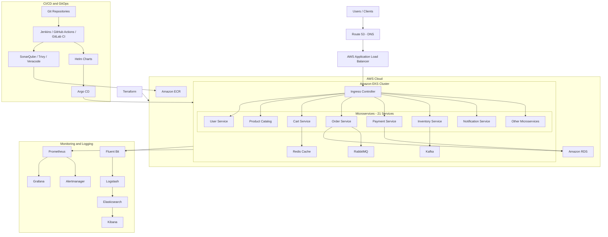

# High-Level Production DevOps Architecture

## 1. Overview

This document describes the high-level architecture of a production-style microservices platform running on AWS EKS.

The platform uses:
- AWS infrastructure provisioned through Terraform
- Docker for containerization
- Amazon ECR for container image storage
- Amazon EKS for Kubernetes orchestration
- Jenkins, GitHub Actions and GitLab CI/CD for pipeline automation
- Helm and Argo CD for application deployment and GitOps
- RDS for relational databases
- Redis for caching
- RabbitMQ and Kafka for asynchronous messaging
- Prometheus and Grafana for monitoring
- ELK Stack for centralized logging
- SonarQube, Trivy and Veracode for security scanning

This is the target/reference architecture. Actual deployment choices and integrations will be documented as they are implemented.

## 2. High-Level Architecture Diagram

## 3. Architecture Components

### 3.1 Traffic Flow
1. Users access the application using a domain name.
2. Route 53 resolves the domain.
3. The Application Load Balancer receives incoming HTTP/HTTPS traffic.
4. Traffic reaches the Kubernetes ingress layer.
5. Kubernetes Services route requests to the appropriate microservice Pods.

### 3.2 Microservices Layer

The EKS cluster hosts 21 microservices.

Examples:
- User Service
- Product Catalog Service
- Cart Service
- Order Service
- Payment Service
- Inventory Service
- Notification Service

Each microservice is containerized and deployed independently.

### 3.3 Database and Messaging Layer

- Amazon RDS stores relational application data.
- Redis provides caching.
- RabbitMQ supports asynchronous message processing.
- Kafka supports event streaming and event-driven communication.

The actual database and messaging topology will be documented in their respective implementation chapters.

### 3.4 CI/CD and GitOps Flow

1. Developers push code to Git repositories.
2. Jenkins, GitHub Actions or GitLab CI/CD runs the pipeline.
3. The pipeline builds and tests the application.
4. SonarQube, Trivy and Veracode perform applicable security checks.
5. Docker images are pushed to Amazon ECR.
6. Deployment configuration and Helm charts are updated.
7. Argo CD synchronizes the desired application state with EKS.
8. Kubernetes performs the deployment.

### 3.5 Monitoring and Logging

**Monitoring**
- Prometheus collects metrics.
- Grafana displays dashboards.
- Alertmanager handles alert notifications.

**Logging**
- Fluent Bit collects container logs.
- Logstash processes and forwards logs.
- Elasticsearch stores and indexes logs.
- Kibana provides log search and visualization.

### 3.6 Infrastructure Provisioning

Terraform provisions and manages the required AWS infrastructure, including networking, EKS, IAM, load balancing and supporting resources.

## 4. Important Production Considerations

- Use multiple replicas for critical microservices.
- Configure readiness and liveness probes.
- Use Kubernetes resource requests and limits.
- Apply rolling deployments and health checks.
- Configure Horizontal Pod Autoscaler where appropriate.
- Use Kubernetes Secrets or an approved external secrets solution.
- Restrict access through IAM and Kubernetes RBAC.
- Implement backup and disaster recovery procedures.
- Monitor application health, infrastructure metrics and logs.

## 5. Related Architecture Documents

- `02-aws-infrastructure-architecture.md`
- `03-microservices-architecture.md`
- `04-cicd-architecture.md`
- `05-gitops-deployment-architecture.md`
- `06-monitoring-observability-architecture.md`
- `07-security-architecture.md`
- `08-disaster-recovery-architecture.md`