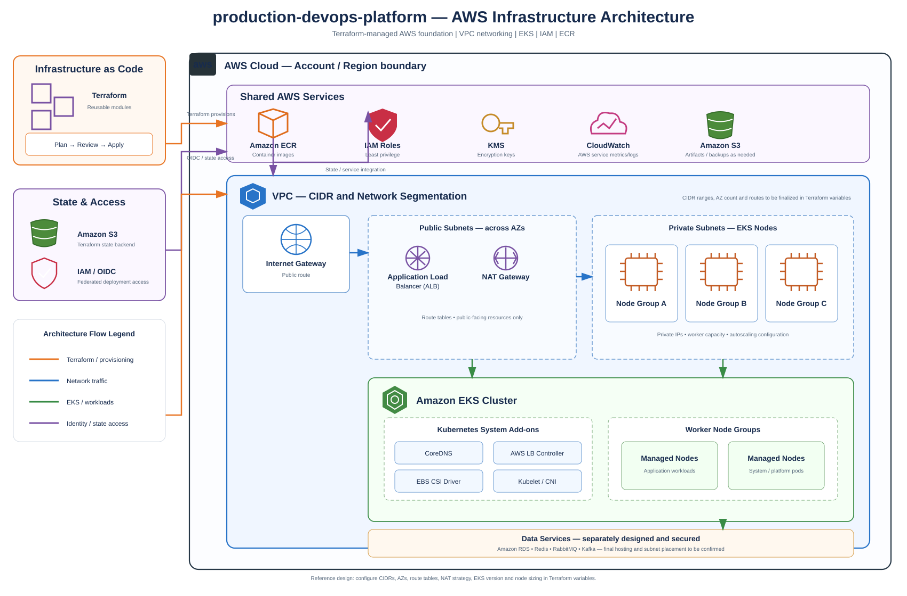

# AWS Infrastructure Architecture

## 1. Overview

This document describes the AWS infrastructure architecture for `production-devops-platform`.

The infrastructure is provisioned and managed using Terraform. Amazon EKS provides the Kubernetes platform for running the 21 microservices.

The infrastructure design focuses on:
- AWS account and regional organization
- VPC and subnet architecture
- Public and private networking
- Internet Gateway and NAT Gateway
- Application Load Balancer
- Amazon EKS and worker node groups
- IAM roles and OIDC authentication
- Amazon ECR
- Terraform remote state management
- Infrastructure security and availability

## 2. AWS Infrastructure Architecture Diagram

## 3. AWS Account and Region

All infrastructure resources are deployed within the selected AWS account and AWS Region.

The region, availability zones, CIDR ranges and resource naming conventions are configured through Terraform variables.

## 4. Terraform Infrastructure Management

Terraform is used to provision and manage infrastructure.

### Terraform components

- Reusable Terraform modules
- Environment-specific configurations
- Variables and output definitions
- Remote state stored in Amazon S3
- State locking configured through the supported backend mechanism
- IAM roles for deployment permissions

### Infrastructure provisioning flow

1. Terraform code is maintained in Git.
2. A pipeline validates and formats the code.
3. Terraform plan generates the proposed changes.
4. Changes are reviewed before applying.
5. Terraform apply provisions or updates AWS resources.
6. Outputs are used by dependent infrastructure configurations.

## 5. VPC Architecture

The VPC provides network isolation for the platform.

It contains:
- Public subnets
- Private subnets
- Route tables
- Internet Gateway
- NAT Gateway
- Security Groups
- Network ACLs where required

CIDR ranges and subnet allocation are defined through Terraform variables.

## 6. Public Subnets

Public subnets host resources that require approved inbound or internet-facing connectivity.

Components:
- Application Load Balancer
- NAT Gateway
- Internet-facing network routes

The Application Load Balancer receives application traffic and forwards it to the Kubernetes ingress layer.

## 7. Private Subnets

Private subnets host EKS worker nodes and internal application workloads.

Important considerations:
- Worker nodes do not need public IP addresses.
- Outbound internet access can use NAT Gateway where required.
- Security Groups restrict communication between infrastructure components.
- Workloads communicate through Kubernetes Services and approved network paths.

## 8. Amazon EKS Architecture

Amazon EKS provides the managed Kubernetes control plane.

The infrastructure includes:
- EKS cluster
- Managed node groups
- Worker node networking
- Cluster IAM roles
- Node IAM roles
- Kubernetes add-ons
- CoreDNS
- AWS Load Balancer Controller
- EBS CSI Driver
- Container Network Interface

The application microservices run as Kubernetes workloads on the worker nodes.

## 9. IAM and Authentication

IAM controls access to AWS resources.

The architecture uses:
- IAM roles for Terraform provisioning
- GitHub Actions OIDC federation where configured
- EKS cluster and node IAM roles
- IAM Roles for Service Accounts (IRSA) for pod-level AWS access
- Least-privilege permissions

Long-lived AWS access keys should be avoided in CI/CD wherever OIDC federation is supported.

## 10. Amazon ECR

Amazon Elastic Container Registry stores application container images.

The CI pipeline:
1. Builds Docker images.
2. Tags images with version identifiers.
3. Performs container security checks.
4. Pushes approved images to ECR.
5. Makes the images available to EKS workloads.

## 11. Infrastructure Security

Security controls include:
- Private worker nodes
- Restricted Security Group rules
- IAM least privilege
- OIDC-based pipeline authentication
- Encryption at rest and in transit where supported
- Kubernetes RBAC
- Container image scanning
- Secret management
- Network segmentation

## 12. Availability and Resilience

The infrastructure design supports:
- Multiple Availability Zones
- EKS worker node distribution across configured AZs
- Multiple replicas for critical workloads
- Load balancing
- Health checks
- Infrastructure backup and recovery planning

The actual number of AZs and node groups is determined by the environment configuration.

## 13. Related Documents

- `01-high-level-architecture.md`
- `03-microservices-architecture.md`
- `04-cicd-architecture.md`
- `05-gitops-deployment-architecture.md`
- `07-security-architecture.md`
- `08-disaster-recovery-architecture.md`