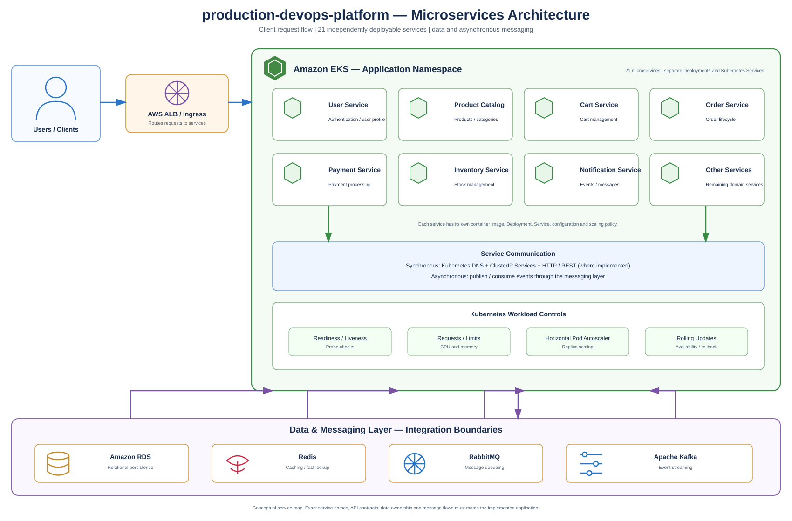

# Microservices Architecture

## 1. Overview

The `production-devops-platform` project uses a microservices architecture deployed on Amazon EKS.

The application consists of 21 independently deployable microservices. Each service is packaged as a Docker container and deployed through Kubernetes.

This architecture covers:
- Microservice organization
- Application request flow
- Kubernetes Service discovery
- Synchronous and asynchronous communication
- Database and cache integration
- Messaging integration
- Service scaling and health checks
- Independent deployments

## 2. Architecture Diagram

## 3. Microservices Overview

The application includes the following core services:

| Microservice | Responsibility |
|---|---|
| User Service | User information and account operations |
| Product Catalog | Product information and categories |
| Cart Service | Shopping cart operations |
| Order Service | Order creation and lifecycle |
| Payment Service | Payment processing |
| Inventory Service | Stock management |
| Notification Service | Notifications and event handling |
| Other Services | Remaining application domain services |

The remaining service names and responsibilities will be documented from the actual application source code.

## 4. Kubernetes Deployment Model

Each microservice is deployed independently using Kubernetes resources.

Typical resources include:
- Deployment
- Kubernetes Service
- ConfigMap
- Secret reference
- ServiceAccount
- HorizontalPodAutoscaler
- Ingress routing where required
- NetworkPolicy where required

Each service has its own container image and deployment configuration.

## 5. Application Request Flow

The typical external request flow is:

1. A user sends a request to the application.
2. The AWS Application Load Balancer receives the request.
3. The ingress layer routes the request to the appropriate Kubernetes Service.
4. The Kubernetes Service forwards traffic to healthy application Pods.
5. The microservice processes the request.
6. The service communicates with its required dependencies.
7. The response is returned to the client.

## 6. Service-to-Service Communication

### Synchronous Communication

Services can communicate using HTTP/REST APIs.

Kubernetes internal DNS allows services to locate one another using Kubernetes Service names.

Example:

`http://user-service:8080`

The actual service name, port and API endpoint must match the deployed Kubernetes Service.

### Asynchronous Communication

Asynchronous communication is used when services should exchange messages without requiring both services to process a request at the same time.

The project architecture includes RabbitMQ and Kafka as messaging technologies. Their actual responsibilities and event flows will be documented in the messaging implementation.

## 7. Database and Cache Integration

The platform architecture includes:
- Amazon RDS for relational persistence
- Redis for caching

Database ownership, schemas, credentials, connection pooling and backup procedures are documented separately.

Applications should retrieve credentials through approved secret-management mechanisms rather than hardcoding them in source code or container images.

## 8. Messaging Integration

The platform includes two messaging technologies:

**RabbitMQ**
- Message queues
- Producer and consumer workflows
- Asynchronous processing

**Apache Kafka**
- Event streaming
- Topic-based communication
- Event producer and consumer workflows

Actual topic names, queue names, retention settings and consumer groups will be documented in the messaging implementation.

## 9. Microservice Health and Scaling

Each service should be configured with appropriate Kubernetes health and resource settings.

### Health Checks
- Readiness probes determine whether a Pod can receive traffic.
- Liveness probes detect containers that need restarting.
- Startup probes can protect applications with longer startup times.

### Resource Management
- CPU requests and limits
- Memory requests and limits
- Horizontal Pod Autoscaler where appropriate
- Replica configuration

## 10. Deployment Strategy

Microservices are deployed independently using Helm and Argo CD.

The deployment workflow supports:
- Versioned container images
- Environment-specific Helm values
- Rolling updates
- Readiness-based traffic handling
- Rollback to a previous application version

Deployment strategies and rollback procedures are covered in the GitOps and deployment architecture documents.

## 11. Security Considerations

- Use Kubernetes RBAC.
- Apply least-privilege service accounts.
- Restrict service communication where required.
- Store secrets securely.
- Scan container images before release.
- Use TLS for appropriate communication paths.
- Avoid embedding credentials in container images.

## 12. Observability

Microservices should expose useful health and application metrics.

The platform's observability design uses:
- Prometheus for metrics collection
- Grafana for dashboards
- Alertmanager for alert notifications
- Fluent Bit for log collection
- Logstash for log processing
- Elasticsearch for log storage and indexing
- Kibana for log search and visualization

## 13. Related Documents

- `01-high-level-architecture.md`
- `02-aws-infrastructure-architecture.md`
- `04-cicd-architecture.md`
- `05-gitops-deployment-architecture.md`
- `06-monitoring-observability-architecture.md`
- `13-database-production-implementation.md`
- `14-messaging-production-implementation.md`