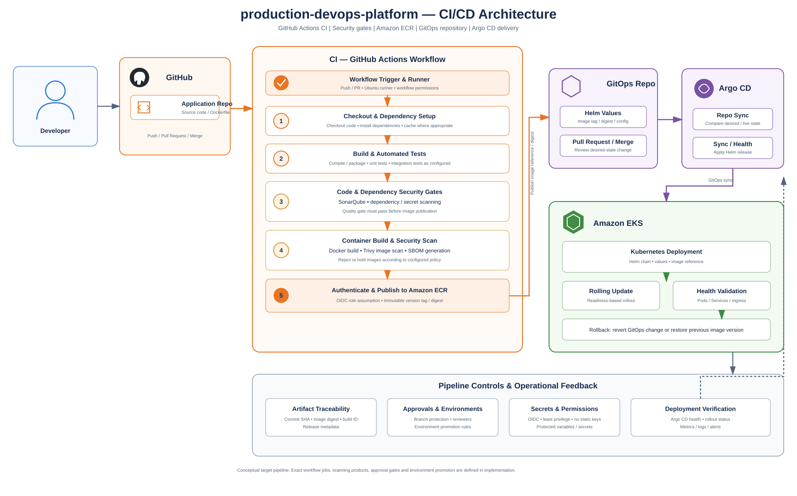

# CI/CD Architecture

## 1. Overview

The `production-devops-platform` project uses GitHub Actions as its primary Continuous Integration platform.

The pipeline automates application validation, testing, security scanning, Docker image creation and publishing to Amazon ECR.

Argo CD handles Continuous Delivery through GitOps by monitoring the GitOps repository and synchronizing the desired application state with Amazon EKS.

## 2. CI/CD Architecture Diagram

## 3. CI/CD Workflow

The pipeline follows this sequence:

1. Developer pushes application changes to GitHub.
2. GitHub Actions starts the CI workflow.
3. The workflow checks out the source code.
4. Dependencies are installed.
5. Application build and automated tests run.
6. SonarQube performs code quality analysis.
7. Dependency and secret scanning checks are performed.
8. Docker builds the application image.
9. Trivy scans the container image.
10. An SBOM can be generated for image traceability.
11. GitHub Actions authenticates to AWS using OIDC.
12. The approved image is pushed to Amazon ECR.
13. The GitOps repository is updated with the new image reference.
14. Argo CD detects the Git change.
15. Argo CD synchronizes the desired state with EKS.
16. Kubernetes performs the deployment and health checks.

## 4. Continuous Integration

### Source Code Management

GitHub repositories manage:
- Application source code
- Dockerfiles
- CI workflow definitions
- Application tests
- Build configuration

### Build and Test

The pipeline performs:
- Source checkout
- Dependency installation
- Compilation and packaging
- Unit testing
- Integration testing where configured
- Build artifact generation

### Code Quality

SonarQube checks:
- Code quality
- Maintainability
- Code duplication
- Reliability issues
- Configured quality gate conditions

### Security Scanning

The pipeline integrates applicable security checks:

- SonarQube: source code quality and configured security analysis
- Trivy: container image and dependency vulnerability scanning
- Veracode: application security testing where configured
- Secret scanning: detection of accidentally committed credentials

Image publishing should be blocked when configured release policies fail.

## 5. Docker Image Management

Each microservice has its own container build.

Image tagging should use traceable identifiers such as:
- Git commit SHA
- Release version
- Build number

Avoid relying only on the `latest` tag.

Amazon ECR stores the published container images.

## 6. AWS Authentication

GitHub Actions uses OpenID Connect (OIDC) to assume an authorized AWS IAM role.

This avoids storing long-lived AWS access keys in GitHub repository secrets.

The IAM role should have only the permissions required for the pipeline.

## 7. Continuous Delivery — GitOps

Argo CD is responsible for synchronizing the desired application state.

The GitOps repository stores:
- Helm charts
- Environment-specific values
- Application deployment configuration
- Image references

The pipeline updates the image reference through a controlled Git change.

Argo CD detects that change and synchronizes the application with EKS.

## 8. Deployment Validation

After deployment, validate:
- Argo CD application health
- Kubernetes rollout status
- Pod readiness
- Application endpoint health
- Application logs
- Relevant monitoring alerts

A deployment should not be considered successful merely because the pipeline completed.

## 9. Rollback Strategy

Rollback can be performed by:
- Reverting the GitOps repository to the previous approved configuration
- Restoring the previous image digest or version
- Allowing Argo CD to synchronize the reverted state
- Verifying the Kubernetes rollout and application health

## 10. Environment Promotion

The pipeline can support separate environments such as:
- Development
- QA
- Staging
- Production

Promotion should use controlled environment-specific configuration, approval rules and traceable image versions.

## 11. Additional CI/CD Tools

Jenkins and GitLab CI/CD are retained as additional tools for learning, comparison and pipeline implementation exercises.

They are not shown as competing primary pipelines in this project's architecture.

## 12. Related Documents

- `01-high-level-architecture.md`
- `02-aws-infrastructure-architecture.md`
- `03-microservices-architecture.md`
- `05-gitops-deployment-architecture.md`
- `07-security-architecture.md`
- `10-cicd-gitops-automation.md`