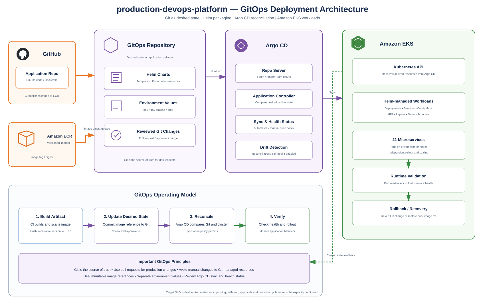

# GitOps Deployment Architecture

## 1. Overview

The `production-devops-platform` uses GitOps principles to manage application deployments on Amazon EKS.

Git is the source of truth for the desired Kubernetes application state. Helm manages reusable deployment templates, and Argo CD continuously compares the desired configuration with the live cluster state.

## 2. Architecture Diagram



## 3. GitOps Components

### GitHub Application Repository
Contains:
- Application source code
- Dockerfiles
- CI workflow definitions
- Application build configuration

### GitOps Repository
Contains:
- Helm charts
- Environment-specific values
- Kubernetes deployment configuration
- Application image references
- Argo CD application definitions

### Amazon ECR
Stores versioned Docker images built and scanned by the CI pipeline.

### Helm
Helm packages Kubernetes resources into reusable charts.

A chart can define:
- Deployment
- Service
- ConfigMap
- Ingress
- ServiceAccount
- HorizontalPodAutoscaler
- Other application resources

### Argo CD
Argo CD monitors the GitOps repository and synchronizes the desired state with Amazon EKS.

## 4. GitOps Deployment Workflow

1. Developer pushes application changes.
2. GitHub Actions runs the CI pipeline.
3. Application tests and security checks are executed.
4. Docker image is built and pushed to Amazon ECR.
5. The GitOps repository receives the approved image reference.
6. The GitOps change is reviewed and merged.
7. Argo CD detects the repository change.
8. Argo CD renders the Helm chart and compares desired and live state.
9. Argo CD synchronizes the required Kubernetes resources according to the configured sync policy.
10. Kubernetes performs the rollout.
11. Application health and rollout status are verified.

## 5. Helm Chart Structure

A typical microservice chart can use this structure:

```text
helm/
└── charts/
    └── order-service/
        ├── Chart.yaml
        ├── values.yaml
        └── templates/
            ├── deployment.yaml
            ├── service.yaml
            ├── configmap.yaml
            ├── ingress.yaml
            ├── serviceaccount.yaml
            └── hpa.yaml
```

Environment-specific values can be maintained separately:

```text
helm/
└── values/
    ├── dev/
    ├── qa/
    ├── staging/
    └── prod/
```

The actual chart layout should match the repository implementation.

## 6. Argo CD Application Management

Argo CD Applications define:
- Git repository URL
- Repository path
- Target revision
- Destination cluster
- Destination namespace
- Helm values
- Sync policy

Applications can be managed individually or through ApplicationSets when multiple services follow a common deployment pattern.

## 7. Sync and Reconciliation

Argo CD continuously compares the desired state in Git with the live Kubernetes resources.

Important concepts:

- **OutOfSync:** The live cluster differs from the desired Git configuration.
- **Synced:** The desired and live states match.
- **Healthy:** The application resources satisfy their health checks.
- **Degraded:** One or more resources have an unhealthy status.

Automated sync, pruning and self-healing should be enabled only according to the environment's operational policy.

## 8. Configuration Management

Application configuration is managed through Helm values and Kubernetes configuration resources.

Sensitive credentials must not be stored as plain text in Git.

Use approved secret-management mechanisms and restrict access through Kubernetes RBAC and IAM permissions.

## 9. Deployment Rollback

A GitOps rollback can be performed by:

1. Identifying the last known good deployment configuration.
2. Reverting the GitOps commit or restoring the previous image reference.
3. Merging the approved change.
4. Allowing Argo CD to reconcile the cluster.
5. Checking the rollout and application health.
6. Confirming that the service is operating correctly.

## 10. Environment Promotion

The same approved image should be promoted through environments using controlled configuration changes.

Typical environments:
- Development
- QA
- Staging
- Production

Production promotion should use protected branches, pull-request reviews and approval controls.

## 11. Operational Best Practices

- Keep Git as the source of truth.
- Use immutable image tags or digests.
- Avoid manual changes to Git-managed Kubernetes resources.
- Separate environment-specific configuration.
- Use least-privilege repository and cluster permissions.
- Monitor Argo CD application health.
- Keep deployment history and rollback procedures documented.
- Test Helm templates before production deployment.

## 12. Related Documents

- `01-high-level-architecture.md`
- `02-aws-infrastructure-architecture.md`
- `03-microservices-architecture.md`
- `04-cicd-architecture.md`
- `06-monitoring-observability-architecture.md`
- `10-cicd-gitops-automation.md`