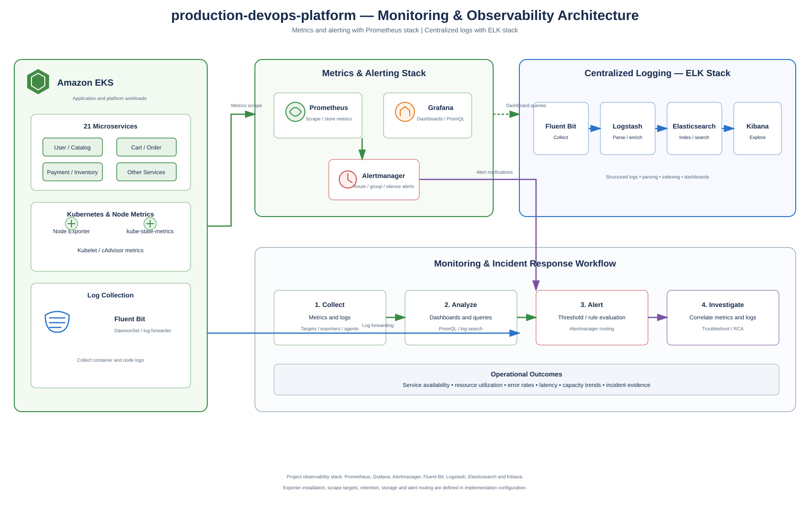

# Monitoring and Observability Architecture

## 1. Overview

The `production-devops-platform` uses Prometheus and Grafana for metrics monitoring, Alertmanager for alert management, and the ELK stack for centralized logging.

The monitoring architecture provides visibility into:
- Kubernetes cluster health
- Worker node resource utilization
- Microservice health
- Application performance
- Container logs
- Infrastructure capacity
- Production incidents

## 2. Architecture Diagram

## 3. Metrics Monitoring Stack

### Prometheus

Prometheus collects and stores time-series metrics from Kubernetes infrastructure and application workloads.

Responsibilities:
- Scrape configured metric endpoints
- Discover Kubernetes monitoring targets
- Store time-series metrics
- Evaluate alerting rules
- Support PromQL queries

### Grafana

Grafana provides dashboards for visualizing metrics.

Dashboards can display:
- CPU and memory utilization
- Node health
- Pod restarts
- Pod availability
- Request rates
- Application error rates
- Response latency
- Cluster resource utilization

### Alertmanager

Alertmanager manages alerts generated by Prometheus.

Responsibilities:
- Group related alerts
- Route alerts to configured receivers
- Silence alerts during maintenance
- Manage alert inhibition
- Reduce duplicate notifications

Actual notification channels and receiver configuration are defined during implementation.

## 4. Kubernetes Metrics Collection

The architecture uses the following metric sources:

### Node Exporter

Collects Linux worker-node metrics, including:
- CPU utilization
- Memory utilization
- Disk usage
- Filesystem metrics
- Network statistics

### kube-state-metrics

Exposes Kubernetes object state metrics, including:
- Deployment replicas
- Pod status
- Node status
- Container restart information
- Kubernetes resource state

### Kubelet and cAdvisor

Provide container and node-level metrics used for monitoring Kubernetes workloads.

### Application Metrics

Applications can expose metrics through configured endpoints.

Prometheus scrapes those endpoints using Kubernetes service discovery or explicitly configured scrape targets.

## 5. Centralized Logging Architecture

The logging pipeline uses Fluent Bit, Logstash, Elasticsearch and Kibana.

### Fluent Bit

Fluent Bit collects container and node logs from Kubernetes worker nodes.

It forwards logs to the configured processing destination.

### Logstash

Logstash processes incoming log events.

Responsibilities:
- Parse log messages
- Normalize fields
- Enrich events where required
- Apply filtering rules
- Forward processed events

### Elasticsearch

Elasticsearch stores and indexes processed log events.

It supports:
- Log search
- Filtering
- Index management
- Retention configuration

### Kibana

Kibana provides an interface for searching and visualizing logs.

It supports:
- Application log investigation
- Error analysis
- Time-based filtering
- Log dashboards
- Incident troubleshooting

## 6. Monitoring Workflow

1. Prometheus discovers configured monitoring targets.
2. Prometheus scrapes metrics from exporters and application endpoints.
3. Metrics are stored as time-series data.
4. Grafana queries Prometheus and displays dashboards.
5. Prometheus evaluates configured alert rules.
6. Alertmanager processes and routes firing alerts.

## 7. Logging Workflow

1. Applications generate container logs.
2. Fluent Bit collects logs from Kubernetes nodes.
3. Fluent Bit forwards events to Logstash.
4. Logstash parses and processes the events.
5. Elasticsearch indexes and stores the processed logs.
6. Kibana provides log search and dashboards.

## 8. Production Monitoring Areas

### Infrastructure Monitoring
- Node CPU and memory
- Disk and filesystem utilization
- Network usage
- Node availability

### Kubernetes Monitoring
- Pod status
- Pod restarts
- Deployment availability
- Replica health
- Node readiness
- Resource requests and limits

### Application Monitoring
- HTTP request rate
- Error rate
- Response latency
- Application health
- Dependency failures

### Logging and Troubleshooting
- Application exceptions
- Container startup failures
- Kubernetes events
- Service errors
- Deployment failures

## 9. Alerting Strategy

Alerts should be based on actionable conditions.

Examples:
- Node becomes unavailable.
- CPU or memory utilization remains above an agreed threshold.
- Pod restart count increases unexpectedly.
- Deployment has unavailable replicas.
- Application health endpoint fails.
- HTTP error rate increases.
- Persistent storage capacity approaches its limit.

Thresholds, evaluation periods, severity levels and notification routes must be defined and tested before production use.

## 10. Storage and Retention

Monitoring and logging storage must be configured according to operational requirements.

Important considerations:
- Prometheus retention period
- Persistent storage for metrics
- Elasticsearch index retention
- Storage capacity monitoring
- Backup and recovery
- Resource requests and limits for monitoring components

## 11. Security Considerations

- Restrict access to Grafana and Kibana.
- Protect monitoring endpoints.
- Avoid logging credentials and sensitive data.
- Apply RBAC to monitoring namespaces.
- Secure communication between logging components.
- Protect Elasticsearch access.
- Review retention and access policies.

## 12. Incident Investigation Workflow

When an alert is received:

1. Identify the affected service or infrastructure component.
2. Check the relevant Grafana dashboard.
3. Review Prometheus metrics.
4. Identify unhealthy Pods or nodes.
5. Search application logs in Kibana.
6. Check recent deployments and configuration changes.
7. Identify the root cause.
8. Apply remediation.
9. Verify recovery.
10. Document the incident and preventive actions.

## 13. Related Documents

- `01-high-level-architecture.md`
- `02-aws-infrastructure-architecture.md`
- `03-microservices-architecture.md`
- `04-cicd-architecture.md`
- `05-gitops-deployment-architecture.md`
- `07-security-architecture.md`
- `15-observability-implementation.md`
- `18-production-incident-simulations.md`