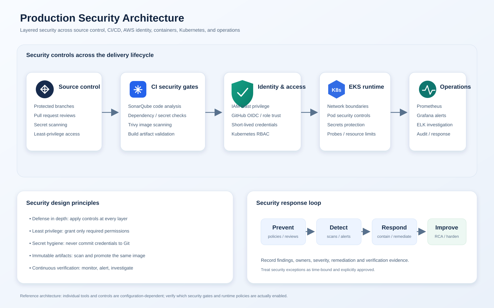

# 07 — Production Security Architecture



## 1. Overview

Production security protects the complete application delivery lifecycle, from source code and CI/CD pipelines to AWS infrastructure, Kubernetes workloads and production operations.

Our platform uses a layered security approach covering:
- Source code security
- CI/CD pipeline security
- Container image scanning
- AWS IAM and access control
- Kubernetes RBAC and workload security
- Secrets management
- Monitoring and incident response

## 2. Objectives

- Understand defense-in-depth security.
- Secure GitHub repositories and CI/CD pipelines.
- Integrate SonarQube and Trivy into delivery workflows.
- Apply least-privilege IAM permissions.
- Secure EKS workloads.
- Protect application secrets.
- Detect and respond to production security issues.

## 3. Source Code Security

Recommended controls:

- Protect important Git branches.
- Require pull request reviews.
- Restrict repository permissions.
- Avoid committing credentials and tokens.
- Scan source code and dependencies.
- Review security findings before merging.

Example GitHub Actions workflow permission:

```yaml
permissions:
  contents: read
```

Grant additional permissions only when the workflow requires them.

## 4. CI/CD Security

Security checks should be integrated into the CI/CD pipeline.

| Stage | Security control | Purpose |
|---|---|---|
| Source | Repository protection | Prevent unauthorized changes |
| Code | SonarQube | Identify code quality and security issues |
| Dependencies | Dependency scanning | Identify vulnerable packages |
| Image build | Trivy | Scan container image vulnerabilities |
| AWS authentication | OIDC and IAM | Avoid long-lived AWS credentials |
| Deployment | Approval and validation | Control production changes |

Example Trivy scan:

```bash
trivy image <ECR_IMAGE_URI>:<IMAGE_TAG>
```

A production pipeline should define which findings block deployment, based on severity and approved exceptions.

## 5. AWS IAM Security

IAM controls access to AWS resources.

Recommended practices:

- Use least-privilege IAM policies.
- Prefer temporary credentials.
- Use GitHub OIDC for CI/CD authentication where configured.
- Restrict access to ECR, S3 and EKS resources.
- Separate human and workload permissions.
- Review and rotate credentials where applicable.

Example IAM policy structure:

```json
{
  "Version": "2012-10-17",
  "Statement": [
    {
      "Effect": "Allow",
      "Action": [
        "ecr:GetAuthorizationToken"
      ],
      "Resource": "*"
    }
  ]
}
```

This is only an illustrative policy fragment. Additional ECR permissions may be required for image upload and download.

## 6. Kubernetes Security

Important Kubernetes security controls:

- Kubernetes RBAC
- Namespace isolation
- NetworkPolicies, where supported and configured
- Pod security controls
- Resource requests and limits
- Readiness and liveness probes
- Restricted container privileges
- Secure access to Kubernetes Secrets

Useful commands:

```bash
# Check namespaces
kubectl get namespaces

# Review RBAC
kubectl get roles,rolebindings -A

# Check service accounts
kubectl get serviceaccounts -A

# Inspect pod security configuration
kubectl describe pod <POD_NAME> -n production

# Check network policies
kubectl get networkpolicies -A
```

## 7. Secrets Management

Never store production credentials directly in Git repositories.

Use an approved secret-management approach, such as:
- AWS Secrets Manager
- Kubernetes Secrets with appropriate encryption and RBAC controls
- An approved external secrets platform

Recommended practices:
- Restrict secret access.
- Rotate credentials.
- Avoid printing secrets in CI logs.
- Avoid exposing credentials in container images.
- Audit access where supported.

## 8. Container Security

Container security should cover both image build and runtime.

Example:

```bash
# Build image
docker build -t user-service:1.0.0 .

# Scan image
trivy image user-service:1.0.0

# Inspect image
docker image inspect user-service:1.0.0
```

Recommended practices:
- Use trusted base images.
- Keep images small.
- Avoid running containers as root where possible.
- Scan images before publishing.
- Pin image versions.
- Promote the same tested image between environments.

## 9. Monitoring and Security Response

Use the observability stack to support production investigation:

- Prometheus for metrics.
- Grafana for dashboards and alert visibility.
- Alertmanager for alert routing.
- Fluent Bit and Logstash for log processing.
- Elasticsearch and Kibana for log search and investigation.

Security response workflow:

1. Detect a suspicious event or security finding.
2. Identify affected workloads and resources.
3. Assess severity and potential impact.
4. Contain the issue.
5. Remediate the root cause.
6. Validate recovery.
7. Document findings and preventive actions.

## 10. Production Security Best Practices

- Apply defense in depth.
- Enforce least privilege.
- Protect secrets and credentials.
- Scan source code, dependencies and images.
- Restrict production deployment permissions.
- Review security findings regularly.
- Keep base images and dependencies updated.
- Monitor security-related events.
- Document exceptions and remediation ownership.
- Test incident response procedures.

## 11. Expected Outcome

After completing this chapter, we should be able to explain how security controls are applied across GitHub, CI/CD, AWS, EKS, containers and production operations, and how security findings are investigated and remediated.

## 12. Completion Checklist

- [ ] Understand defense in depth.
- [ ] Configure repository protection.
- [ ] Integrate SonarQube into CI.
- [ ] Integrate Trivy image scanning.
- [ ] Understand IAM least privilege.
- [ ] Understand OIDC-based CI authentication.
- [ ] Review Kubernetes RBAC.
- [ ] Understand workload security controls.
- [ ] Protect application secrets.
- [ ] Investigate security findings.
- [ ] Document remediation and verification.

*Note: This is a security reference architecture. Do not claim every control is deployed until you have verified the corresponding configuration in your AWS account, GitHub workflows and EKS cluster.*