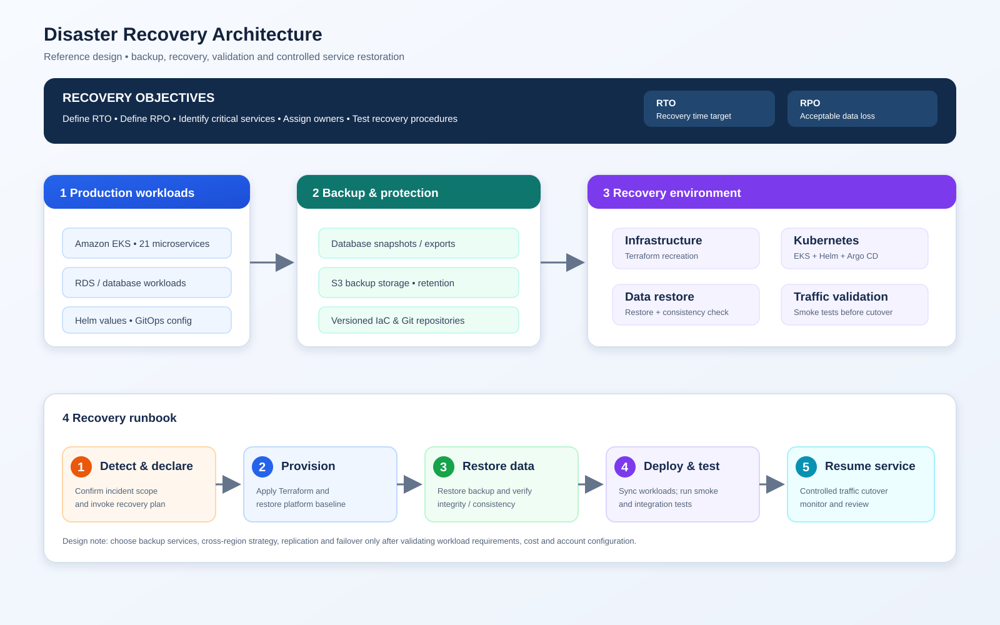

# 08 — Disaster Recovery Architecture

## 1. Overview

This document explains the disaster recovery (DR) architecture for the production DevOps platform running 21 microservices on Amazon EKS.

The objective is to recover application workloads, infrastructure configuration and data after major failures while minimizing service downtime and data loss.

The recovery approach uses:

- Terraform for infrastructure recreation.
- Amazon S3 for backup storage, where configured.
- Database snapshots and backup exports.
- Amazon EKS for Kubernetes workloads.
- Helm for application deployment configuration.
- Argo CD for GitOps-based application recovery.
- Prometheus, Grafana and ELK for operational validation and monitoring.

> This is a reference architecture. The actual backup services, retention policies, replication strategy and recovery targets must be confirmed against the implemented AWS environment.

## 2. Architecture Diagram

## 3. Disaster Recovery Objectives

Every production workload should have defined recovery objectives.

### Recovery Time Objective (RTO)

RTO is the maximum acceptable time required to restore a service after a failure.

Example: If the RTO is 2 hours, the recovery process should restore the service within that target.

### Recovery Point Objective (RPO)

RPO is the maximum acceptable amount of data loss measured in time.

Example: If the RPO is 15 minutes, the recovery strategy must limit potential data loss to approximately 15 minutes.

RTO and RPO values must be agreed with application and business owners. Do not assume the same targets for every microservice.

## 4. Backup Strategy

### Database backups

- Configure database backup policies based on the database engine and business requirements.
- Use automated snapshots where supported.
- Maintain backup retention policies.
- Perform periodic restore tests.
- Validate database consistency after restoration.

### Amazon S3 backups

Where S3 is used for backup storage:

- Enable versioning when appropriate.
- Apply lifecycle policies.
- Restrict access through IAM policies.
- Consider cross-region replication where required.
- Protect backup deletion and modification permissions.

### Infrastructure and configuration backups

Maintain version-controlled copies of:

- Terraform configurations and modules.
- Kubernetes manifests.
- Helm charts and environment values.
- Argo CD application definitions.
- CI/CD pipeline definitions.
- Operational scripts and recovery runbooks.

Terraform state stored remotely must also be protected and recoverable.

## 5. Infrastructure Recovery

If the production infrastructure becomes unavailable:

1. Identify the failure and affected AWS resources.
2. Confirm the target recovery environment and region.
3. Verify Terraform configuration and remote state.
4. Provision the required networking and infrastructure.
5. Create or recover the EKS cluster.
6. Configure required IAM roles and Kubernetes access.
7. Restore supporting services and dependencies.
8. Validate infrastructure health before deploying applications.

Do not blindly run Terraform destroy or recreate commands during an incident. First inspect the state and determine which resources can safely be recovered.

## 6. Kubernetes and Application Recovery

Use the following recovery sequence:

1. Verify EKS cluster availability.
2. Restore namespaces, RBAC and required cluster configuration.
3. Verify networking, ingress and storage dependencies.
4. Restore Helm configuration and environment values.
5. Configure Argo CD access to the GitOps repository.
6. Synchronize the required applications.
7. Verify pod readiness and service endpoints.
8. Run application health checks and smoke tests.

For critical services, recover dependencies before starting dependent workloads.

## 7. Database Recovery

Database recovery must follow an engine-specific runbook.

Typical workflow:

1. Identify the latest valid backup or snapshot.
2. Confirm the recovery point required by the incident.
3. Restore the database into the approved recovery environment.
4. Verify connectivity and credentials.
5. Validate schema, records and data consistency.
6. Update application connection configuration if necessary.
7. Run application-level validation.

Never treat a successful snapshot restore as proof that the application data is correct. Perform actual validation.

## 8. Microservices Recovery Order

For the 21-microservice platform, define service dependencies before deciding the recovery order.

A typical recovery sequence is:

1. Infrastructure and networking.
2. Kubernetes platform components.
3. Database and cache dependencies.
4. Messaging dependencies.
5. Core application services.
6. Dependent business services.
7. Notification and background-processing services.
8. Ingress and external traffic.

The exact order must follow the application's real dependency graph.

## 9. GitOps-Based Recovery

Argo CD can help restore the declared Kubernetes application state from the GitOps repository.

Recovery workflow:

1. Confirm the GitOps repository is accessible.
2. Verify the required branch and environment configuration.
3. Confirm container images are available in Amazon ECR.
4. Connect Argo CD to the recovery EKS cluster.
5. Review the desired application state.
6. Synchronize applications.
7. Check rollout and health status.

GitOps can restore Kubernetes configuration, but it does not automatically restore database contents or external infrastructure state.

## 10. Recovery Validation

Before restoring production traffic, validate:

- EKS nodes and system pods are healthy.
- Application deployments are available.
- Kubernetes services resolve correctly.
- Ingress and load-balancer routing work.
- Database connections succeed.
- Messaging and cache dependencies are healthy.
- Application health endpoints return expected responses.
- Critical business transactions complete successfully.
- Monitoring and logging are operational.

Use Prometheus and Grafana for metrics validation and ELK for log investigation.

## 11. Failover and Traffic Restoration

Traffic restoration must be controlled.

A typical process is:

1. Confirm the recovery environment is healthy.
2. Run smoke and integration tests.
3. Validate database consistency.
4. Confirm application owners approve recovery.
5. Shift traffic using the configured routing mechanism.
6. Monitor error rates, latency and service health.
7. Keep the original environment isolated until it is safe to decommission or reconnect.

DNS-based failover, cross-region routing and automated failover should only be documented as implemented after they are actually configured and tested.

## 12. Disaster Recovery Testing

Conduct scheduled recovery exercises.

Suggested scenarios:

- EKS worker-node failure.
- Kubernetes application deployment failure.
- Accidental configuration change.
- Database restore from snapshot.
- Application image unavailable.
- GitOps repository or synchronization issue.
- AWS infrastructure recreation.
- Regional outage simulation, if a secondary region is configured.

Record the actual recovery duration, data recovery point, errors and improvement actions.

## 13. Security Considerations

- Restrict backup access using least-privilege IAM policies.
- Protect Terraform state and database backups.
- Encrypt backups where supported and configured.
- Avoid storing credentials in Git repositories.
- Audit restore and deletion permissions.
- Test recovery access without relying on credentials that may be unavailable during an incident.

## 14. Related Architecture Documents

- [High-Level Architecture](01-high-level-architecture.md)
- [AWS Infrastructure Architecture](02-aws-infrastructure-architecture.md)
- [Microservices Architecture](03-microservices-architecture.md)
- [CI/CD Architecture](04-cicd-architecture.md)
- [GitOps Deployment Architecture](05-gitops-deployment-architecture.md)
- [Monitoring and Observability Architecture](06-monitoring-observability-architecture.md)
- [Security Architecture](06-security-architecture.md)

## 15. Expected Outcome

The platform should have a documented and testable recovery process for infrastructure, Kubernetes workloads, application configuration and persistent data.

The recovery procedure should be validated through practical exercises, with measured RTO and RPO results rather than assumed recovery guarantees.