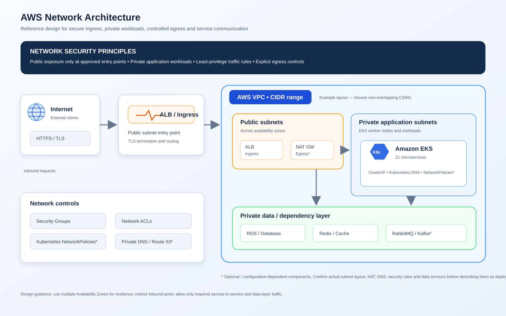

# 09 — Network Architecture

## 1. Overview

This document explains the network architecture for the production DevOps platform running 21 microservices on Amazon EKS.

The network design separates public-facing entry points from private application workloads and data services.

Key components:

- Amazon VPC
- Public and private subnets
- Availability Zones
- Internet Gateway
- Application Load Balancer (ALB)
- NAT Gateway, where required
- Amazon EKS
- Kubernetes Services and DNS
- Security Groups
- Network ACLs
- Kubernetes NetworkPolicies
- Amazon RDS and other application dependencies

> This is a reference design. Confirm the actual CIDR ranges, subnet layout, routing, network controls and deployed services before treating them as implemented infrastructure.

## 2. Architecture Diagram



## 3. Amazon VPC Design

Amazon VPC provides an isolated network environment for AWS resources.

The VPC design should define:

- VPC CIDR range.
- Public subnet CIDR ranges.
- Private application subnet CIDR ranges.
- Private data subnet CIDR ranges, if separated.
- Availability Zone distribution.
- Route tables.
- Internet and outbound connectivity.

Use non-overlapping CIDR ranges and leave sufficient IP capacity for EKS nodes, pods and future scaling.

## 4. Public Subnets

Public subnets contain resources that require a direct route to the Internet Gateway.

Typical components include:

- Application Load Balancer nodes.
- NAT Gateway, where configured.

The ALB receives approved external application traffic and forwards requests to the configured Kubernetes ingress or service targets.

Avoid placing application worker nodes and databases in public subnets unless there is a specific, justified requirement.

## 5. Private Application Subnets

Private application subnets host EKS worker nodes and application workloads.

The 21 microservices run inside Kubernetes and communicate through Kubernetes Services.

Benefits:

- Application nodes are not directly exposed to the internet.
- Inbound traffic is controlled through approved entry points.
- Internal service communication can be restricted.
- Network access can be managed through AWS and Kubernetes controls.

## 6. Internet Gateway and NAT Gateway

### Internet Gateway

An Internet Gateway provides internet connectivity for resources in public subnets when the appropriate routes and security rules are configured.

### NAT Gateway

A NAT Gateway can provide outbound internet connectivity for resources in private subnets.

For example, private workloads may need outbound access to approved external endpoints.

NAT Gateway deployment, routing and high availability should be designed according to the environment's requirements and cost constraints.

## 7. Application Load Balancer and Ingress

The application traffic flow is:

1. Client sends an HTTPS request.
2. Request reaches the configured ALB.
3. ALB forwards traffic to the Kubernetes ingress or configured targets.
4. Kubernetes routes the request to the appropriate service.
5. The service forwards the request to its application pods.

TLS certificates, listener rules, health checks and ingress configuration must be maintained and tested.

## 8. Kubernetes Internal Networking

Kubernetes provides internal communication between microservices.

Important components:

### ClusterIP

ClusterIP exposes a service internally within the Kubernetes cluster.

### Kubernetes DNS

Kubernetes DNS allows applications to discover services using Kubernetes service names.

### Pod networking

Pods communicate using their cluster network addresses, subject to the configured CNI and network policies.

### NetworkPolicies

NetworkPolicies can restrict pod-to-pod communication when supported by the cluster networking implementation.

For production, define which services need to communicate instead of allowing unrestricted traffic between all workloads.

## 9. Security Groups

Security Groups act as virtual firewalls for supported AWS network interfaces and resources.

Recommended practices:

- Allow only required inbound ports.
- Restrict source CIDR ranges.
- Avoid unrestricted administrative access.
- Separate rules for load balancers, worker nodes and databases where appropriate.
- Review rules periodically.

## 10. Network ACLs

Network ACLs operate at the subnet level.

They support inbound and outbound traffic rules.

Use them as an additional network security layer, while keeping Security Groups as the primary resource-level traffic control mechanism.

Remember that Network ACLs are stateless, so return traffic must also be allowed.

## 11. Database Network Security

Databases should not be directly accessible from the public internet.

Recommended controls:

- Place database resources in private subnets.
- Allow connections only from approved application security groups or network sources.
- Restrict database ports.
- Use encrypted connections where supported.
- Store credentials securely.
- Monitor connection and access failures.

The exact rules depend on the database engine and deployment model.

## 12. Microservices Communication

For the 21-microservice platform:

- Use Kubernetes Services for stable internal endpoints.
- Use Kubernetes DNS for service discovery.
- Use HTTP or other approved protocols for synchronous communication.
- Use RabbitMQ or Kafka for asynchronous communication where configured.
- Restrict unnecessary service-to-service traffic.
- Document dependencies and required ports.

## 13. Network Troubleshooting

Common issues and investigation steps:

### Service DNS failure

```bash
kubectl get svc -A
kubectl get pods -n kube-system
kubectl logs -n kube-system <coredns-pod>
```

### Pod connectivity issue

```bash
kubectl get pods -o wide -n <namespace>
kubectl describe pod <pod-name> -n <namespace>
kubectl get networkpolicies -A
```

### Load balancer issue

```bash
kubectl get ingress -A
kubectl describe ingress <ingress-name> -n <namespace>
kubectl get svc -A
```

### Security Group or routing issue

Review:

- Security Group inbound and outbound rules.
- Subnet route tables.
- Internet Gateway attachment.
- NAT Gateway status and routes.
- Network ACL rules.
- Load balancer target health.

Use AWS-side inspection and Kubernetes-side inspection together to isolate the failure.

## 14. Network Design Best Practices

- Distribute workloads across multiple Availability Zones.
- Keep application and database workloads private.
- Expose only approved application entry points.
- Use least-privilege network rules.
- Avoid unnecessary open ports.
- Plan VPC and subnet CIDR capacity.
- Monitor network and load balancer health.
- Test connectivity after infrastructure changes.
- Document required ports and service dependencies.

## 15. Expected Outcome

The platform should have a documented network design that explains external traffic flow, private workload connectivity, internal service discovery, database access and network security controls.

The design should support secure communication and provide a clear troubleshooting path for network-related production incidents.