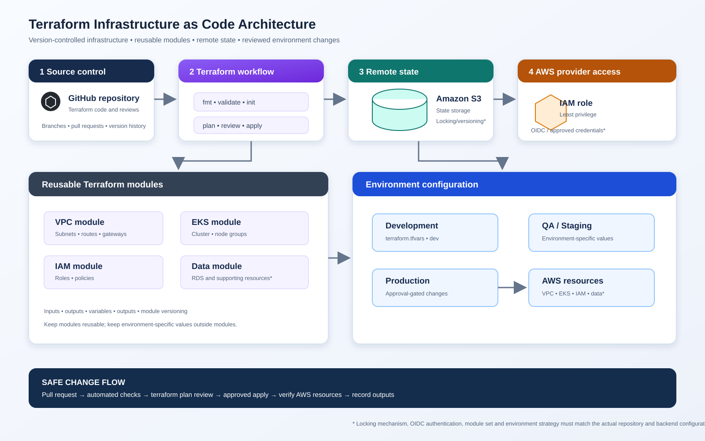

# 10 — Infrastructure as Code (Terraform) Architecture

## 1. Overview

This document describes the Terraform architecture used to provision and manage AWS infrastructure for the production DevOps platform.

Terraform allows infrastructure to be defined as code, reviewed through Git, reused through modules and deployed consistently across environments.

The architecture covers:

- Terraform project structure.
- Reusable Terraform modules.
- AWS provider configuration.
- S3 remote state.
- Environment-specific configuration.
- Infrastructure provisioning.
- CI/CD integration.
- Security and state management.

## 2. Architecture Diagram



## 3. Terraform Repository Structure

A recommended repository structure is:

```text
terraform/
├── modules/
│   ├── vpc/
│   ├── eks/
│   ├── iam/
│   └── rds/
│
├── environments/
│   ├── dev/
│   ├── qa/
│   ├── staging/
│   └── prod/
│
└── backend/
    └── backend-config/
```

The exact modules and environment directories should match the infrastructure actually implemented.

## 4. Terraform Modules

Modules help organize reusable infrastructure resources.

### VPC module

Responsible for resources such as:

- VPC.
- Public and private subnets.
- Route tables.
- Internet Gateway.
- NAT Gateway, where required.
- Security Groups.

### EKS module

Responsible for resources such as:

- EKS cluster.
- Managed node groups.
- Cluster IAM roles.
- Node IAM roles.
- Required cluster configuration.

### IAM module

Manages:

- IAM roles.
- IAM policies.
- Service-related permissions.
- Least-privilege access.

### RDS module

Manages database infrastructure where RDS is part of the selected deployment architecture.

## 5. AWS Provider Configuration

Terraform uses the AWS provider to communicate with AWS APIs.

Example:

```hcl
terraform {
  required_version = ">= 1.5.0"

  required_providers {
    aws = {
      source  = "hashicorp/aws"
      version = "~> 5.0"
    }
  }
}

provider "aws" {
  region = var.aws_region
}
```

Provider versions should be reviewed and controlled using the Terraform dependency lock file.

## 6. Remote State Management

Terraform state tracks the infrastructure managed by Terraform.

For team-based environments, use remote state rather than relying on local state files.

Example S3 backend configuration:

```hcl
terraform {
  backend "s3" {
    bucket       = "your-terraform-state-bucket"
    key          = "production/platform/terraform.tfstate"
    region       = "ap-south-1"
    encrypt      = true
    use_lockfile = true
  }
}
```

The bucket must already exist before Terraform initializes this backend.

Protect the state bucket with appropriate access policies, encryption and versioning.

State locking must match the Terraform version and backend configuration. With S3 lockfile support, `use_lockfile = true` can be used instead of configuring a separate DynamoDB locking table.

Never commit Terraform state files or state backups to Git.

## 7. Environment Management

Keep environment-specific values separate.

Example:

```text
environments/
├── dev/
│   ├── main.tf
│   ├── variables.tf
│   └── terraform.tfvars
│
├── staging/
│   ├── main.tf
│   ├── variables.tf
│   └── terraform.tfvars
│
└── prod/
    ├── main.tf
    ├── variables.tf
    └── terraform.tfvars
```

Each environment should use the appropriate module inputs, state key and AWS account or role.

Avoid sharing production credentials or sensitive values in environment files.

## 8. Terraform Execution Workflow

Typical Terraform workflow:

```bash
terraform fmt -recursive
terraform init
terraform validate
terraform plan
terraform apply
```

### Command explanation

- `terraform fmt`: Formats Terraform configuration.
- `terraform init`: Initializes the working directory and backend.
- `terraform validate`: Checks configuration syntax and internal consistency.
- `terraform plan`: Shows proposed infrastructure changes.
- `terraform apply`: Applies approved infrastructure changes.

Review the plan before applying changes, especially in production.

## 9. Terraform CI/CD Integration

Terraform can be integrated into GitHub Actions.

Recommended workflow:

1. Developer creates a feature branch.
2. Terraform files are updated.
3. Pull request is opened.
4. Formatting and validation checks run.
5. Terraform plan is generated.
6. Team reviews the plan.
7. Authorized approval is obtained.
8. Terraform apply runs through the approved workflow.
9. Infrastructure is verified.

Production applies should use controlled permissions and approval gates.

## 10. Authentication and Security

Use IAM roles with least-privilege permissions.

Where supported, GitHub Actions can authenticate to AWS using OIDC and assume an IAM role rather than storing long-lived AWS access keys.

Security practices:

- Never hardcode AWS access keys.
- Restrict access to the Terraform state bucket.
- Protect production apply permissions.
- Review IAM policies.
- Avoid committing secrets.
- Keep provider versions controlled.
- Review Terraform plans before applying.

## 11. Terraform Outputs

Use outputs to expose useful infrastructure information.

Example:

```hcl
output "vpc_id" {
  description = "ID of the VPC"
  value       = module.vpc.vpc_id
}

output "eks_cluster_name" {
  description = "EKS cluster name"
  value       = module.eks.cluster_name
}
```

Avoid exposing sensitive values through outputs or CI logs.

## 12. Terraform Troubleshooting

### Backend initialization issue

```bash
terraform init -reconfigure
```

Use this only when you intentionally need to reinitialize the backend configuration.

### State inspection

```bash
terraform state list
terraform state show <resource-address>
```

### Plan review

```bash
terraform plan -out=tfplan
terraform show tfplan
```

Treat state manipulation commands carefully. Never remove or modify state resources without understanding the impact on real infrastructure.

## 13. Best Practices

- Use reusable modules.
- Keep environment configuration separate.
- Store remote state securely.
- Enable state versioning.
- Use a supported state-locking mechanism.
- Pin provider versions.
- Review Terraform plans.
- Protect production apply permissions.
- Use OIDC where supported.
- Keep secrets outside source control.
- Document infrastructure dependencies.
- Test module changes before production use.

## 14. Expected Outcome

The platform should have a reusable and version-controlled Terraform architecture that supports consistent AWS infrastructure provisioning, secure remote state management and controlled changes across environments.

The repository should make infrastructure changes reviewable, repeatable and traceable.