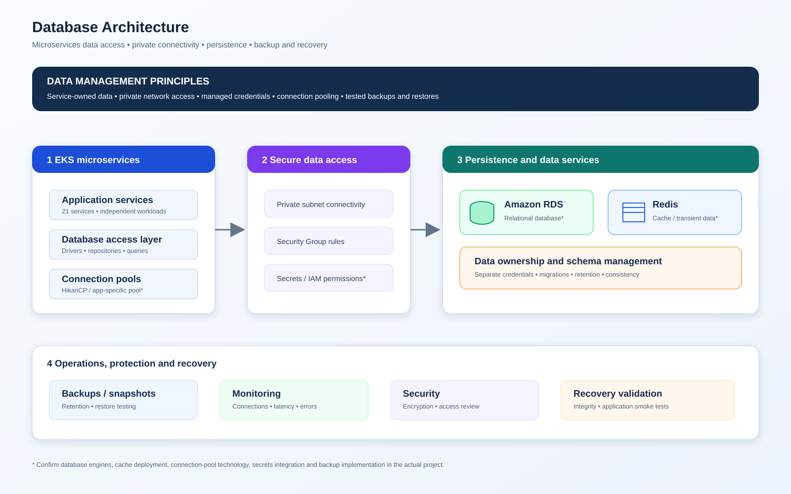

# 10 — Database Architecture

## 1. Overview

This document explains the database architecture for the production DevOps platform running 21 microservices on Amazon EKS.

The objective is to provide reliable data persistence, secure application connectivity, controlled database access and recoverable data.

The architecture covers:

- Application-to-database connectivity.
- Amazon RDS.
- Database security.
- Connection pooling.
- Database schema and migrations.
- Redis caching, where configured.
- Monitoring and troubleshooting.
- Backup and recovery.

> This is a reference design. Confirm the actual database engines, database ownership model, cache deployment and backup configuration before documenting them as deployed components.

## 2. Architecture Diagram



## 3. Database Architecture Design

The application services run inside Amazon EKS and connect to their required databases through private network connectivity.

Recommended design principles:

- Keep databases private.
- Allow only approved application workloads to connect.
- Use separate database credentials for appropriate services.
- Avoid unnecessary direct database access between microservices.
- Use connection pooling.
- Maintain database backups and test restoration.
- Monitor database performance and availability.

## 4. Amazon RDS

Amazon RDS provides managed relational database capabilities.

Depending on the application requirements, supported engines can include:

- MySQL
- PostgreSQL
- Microsoft SQL Server

The selected engine must match the application requirements and actual project configuration.

Typical RDS responsibilities:

- Database provisioning.
- Database availability.
- Storage configuration.
- Backup configuration.
- Maintenance planning.
- Database monitoring.
- Access control.

## 5. Microservices Database Connectivity

Each microservice should access only the database resources it requires.

Example:

```text
User Service       → User Database
Product Service    → Product Database
Order Service      → Order Database
Payment Service    → Payment Database
Inventory Service  → Inventory Database
```

This is an example of service-owned data. The actual ownership and database mapping must follow your application's implementation.

Avoid tightly coupling every microservice to one shared database schema.

## 6. Database Connection Configuration

Applications need database connection details such as:

- Database hostname.
- Port.
- Database name.
- Username.
- Password.
- Connection timeout.
- Maximum pool size.

Do not hardcode database credentials inside Dockerfiles, source code or Git repositories.

Inject the required configuration through an approved secret-management mechanism.

## 7. Connection Pooling

Connection pooling reuses established database connections instead of creating a new connection for every application request.

For Java Spring Boot applications, HikariCP is a commonly used connection pool.

Example:

```yaml
spring:
  datasource:
    url: ${DB_URL}
    username: ${DB_USERNAME}
    password: ${DB_PASSWORD}
    hikari:
      maximum-pool-size: 10
      minimum-idle: 2
      connection-timeout: 30000
      idle-timeout: 600000
```

These are example values, not universal production settings.

Calculate the total possible database connections across all application replicas before selecting pool sizes.

For example:

```text
10 application replicas
× 10 maximum connections per replica
= 100 possible database connections
```

The database connection limit must accommodate the combined workload, including administrative and background connections.

## 8. Database Deployment and Configuration

Database deployment depends on the selected architecture.

For managed AWS databases:

- Provision RDS through the approved infrastructure process.
- Configure private connectivity.
- Apply database security rules.
- Configure backups and retention.
- Create databases and application users.
- Apply schema migrations.

For databases running inside Kubernetes:

- Use persistent storage.
- Configure appropriate StatefulSets or an approved database operator.
- Plan storage expansion and recovery.
- Avoid treating ordinary application pods as durable database storage.

Do not deploy production databases inside EKS without a clear operational and recovery strategy.

## 9. Database Schema and Migrations

Database schema changes should be version-controlled.

A safe migration process:

1. Developer creates a schema migration.
2. Changes are reviewed.
3. Migration is tested in a lower environment.
4. Backup and rollback considerations are reviewed.
5. Migration is applied through a controlled deployment process.
6. Application compatibility is validated.

Avoid destructive schema changes that break currently running application versions during rolling deployments.

## 10. Redis Caching

Redis can be used for caching or other supported transient-data use cases.

Potential benefits:

- Reduce repeated database queries.
- Improve response times.
- Reduce database load.

Caching requires clear decisions about:

- Cache expiration (TTL).
- Cache invalidation.
- Key naming.
- Memory limits.
- Availability.
- Data consistency.

Redis should not be treated as the primary durable database unless the application architecture explicitly supports that design.

## 11. Database Security

Recommended security controls:

- Private database networking.
- Least-privilege database users.
- Restricted Security Group rules.
- Encrypted connections where supported.
- Encryption at rest where configured.
- Secure credential storage.
- Regular access reviews.
- Avoid logging passwords and sensitive data.

Applications should use only the permissions required for their operations.

## 12. Backup and Recovery

A database backup strategy should define:

- Backup frequency.
- Retention period.
- Recovery Point Objective (RPO).
- Recovery Time Objective (RTO).
- Snapshot or export strategy.
- Cross-region requirements, if applicable.
- Restore testing frequency.

A backup is useful only if it can be restored successfully.

Regularly restore backups into a test environment and validate database consistency and application functionality.

## 13. Database Monitoring

Monitor important database indicators:

- CPU utilization.
- Memory utilization.
- Storage utilization.
- Database connections.
- Connection errors.
- Query latency.
- Slow queries.
- Replication health, where applicable.
- Backup and restore status.

Use the project's monitoring stack where appropriate:

- Prometheus for metrics collection.
- Grafana for dashboards.
- Alertmanager for alert notifications.
- ELK for log investigation.

The exact metrics and exporters depend on the database engine and deployment model.

## 14. Database Troubleshooting

### Connection failure

Check application configuration, DNS, network connectivity, credentials and database availability.

```bash
kubectl get pods -n <namespace>
kubectl describe pod <pod-name> -n <namespace>
kubectl logs <pod-name> -n <namespace>
```

### Connection pool exhaustion

Investigate:

- Active connections.
- Idle connections.
- Maximum pool size.
- Long-running queries.
- Connection leaks.
- Database connection limits.

### High database latency

Investigate:

- Slow queries.
- Missing indexes.
- Resource saturation.
- Excessive concurrent connections.
- Network latency.
- Application query patterns.

### Storage issue

Check database storage utilization, growth rate, retention policies and available expansion options.

## 15. Best Practices

- Keep database services private.
- Use service-specific access permissions.
- Manage credentials securely.
- Configure connection pools carefully.
- Monitor connection counts.
- Test schema migrations.
- Maintain automated backups where supported.
- Test restoration regularly.
- Monitor slow queries and database latency.
- Document database dependencies and recovery procedures.

## 16. Expected Outcome

The platform should have a documented database architecture covering application connectivity, persistence, security, connection management, monitoring, backup and recovery.

The implementation should be validated through real database connectivity tests, load testing and restore exercises.