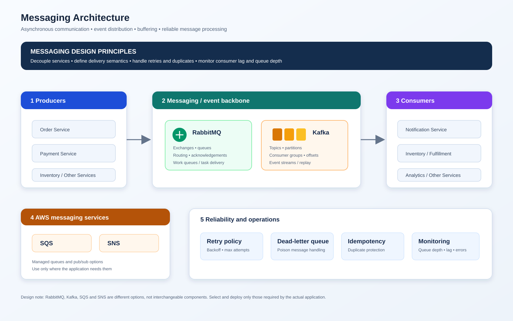

# 12 — Messaging Architecture

## 1. Overview

This document explains how asynchronous communication can be implemented across the production DevOps platform running 21 microservices on Amazon EKS.

Messaging systems allow services to exchange events and process tasks without requiring every service to communicate synchronously.

The architecture covers:

- RabbitMQ.
- Apache Kafka.
- AWS SQS.
- AWS SNS.
- Message producers and consumers.
- Retry and failure handling.
- Dead-letter queues.
- Message delivery and ordering.
- Monitoring and troubleshooting.

> RabbitMQ, Kafka, SQS and SNS are different messaging technologies. This document describes their roles and possible integration patterns. It does not claim that all four are deployed in the project.

## 2. Architecture Diagram



## 3. Why Messaging Is Required

In a microservices architecture, services often need to communicate with each other.

For example, when a customer places an order:

1. Order Service receives the request.
2. Order Service records the order.
3. An order-created event is published.
4. Inventory Service processes the inventory update.
5. Payment Service processes payment.
6. Notification Service sends an order notification.

Without asynchronous messaging, services can become tightly coupled and depend on one another being immediately available.

Messaging helps separate producers from consumers.

## 4. RabbitMQ Architecture

RabbitMQ is a message broker commonly used for asynchronous task processing and message routing.

Important components:

### Producer

An application that publishes messages.

### Exchange

Receives messages from producers and routes them according to exchange type and bindings.

### Queue

Stores messages until consumers process them.

### Binding

Connects an exchange to a queue using routing rules.

### Consumer

Receives and processes messages.

### Acknowledgement

Allows a consumer to acknowledge successful processing so that the broker can manage message delivery.

### Dead-letter exchange and queue

A dead-letter configuration can route messages that cannot be processed successfully to a separate destination for investigation.

## 5. Apache Kafka Architecture

Kafka is a distributed event-streaming platform.

Important components:

### Producer

Publishes records to Kafka topics.

### Topic

A logical category used to organize events.

### Partition

A topic is divided into partitions for parallelism and scalability.

### Consumer

Reads and processes records from topics.

### Consumer group

Allows multiple consumers to share processing of topic partitions.

### Offset

Tracks the position of a consumer within a partition.

Kafka is useful when applications need durable event streams, replay capability and high-throughput event processing.

## 6. RabbitMQ vs Kafka

| Feature | RabbitMQ | Kafka |
|---|---|---|
| Main use | Message queuing and routing | Event streaming |
| Data model | Exchanges and queues | Topics and partitions |
| Consumer tracking | Acknowledgements | Offsets |
| Routing | Exchange and binding rules | Topic and partition model |
| Replay | Depends on queue and message configuration | Supports replay using retained records |
| Common use | Background jobs and task processing | Event streams and event-driven systems |

Choose based on application requirements rather than using both without a clear reason.

## 7. AWS SQS

Amazon Simple Queue Service is a managed message queuing service.

Important concepts:

- Standard queues.
- FIFO queues.
- Visibility timeout.
- Message retention.
- Long polling.
- Dead-letter queues.

SQS can help applications communicate asynchronously without operating their own message broker infrastructure.

## 8. AWS SNS

Amazon Simple Notification Service is a managed publish/subscribe messaging service.

A publisher sends a message to an SNS topic, and configured subscribers receive the message through supported delivery protocols.

Example:

```text
Order Service
      |
      v
   SNS Topic
      |
      +----> SQS Queue
      |
      +----> Another Subscriber
      |
      +----> Notification Consumer
```

SNS and SQS can be combined for fan-out messaging patterns.

## 9. Example Microservices Messaging Flow

Example: Order processing.

```text
Customer
   |
   v
Order Service
   |
   v
Publish OrderCreated Event
   |
   v
Messaging System
   |
   +------> Inventory Service
   |
   +------> Payment Service
   |
   +------> Notification Service
```

The exact event structure, broker and processing order must be defined by the application.

## 10. Message Reliability

Messaging systems require failure-handling strategies.

### Retry

Retry transient failures using a controlled retry policy.

### Exponential backoff

Increase the delay between retry attempts to avoid overwhelming an unavailable dependency.

### Dead-letter queue

Move messages that cannot be processed after the configured attempts to a separate destination.

### Idempotency

Ensure that processing the same message more than once does not cause duplicate business operations.

### Acknowledgements

Acknowledge messages only after the required processing has completed successfully.

### Duplicate handling

Consumers should be designed to handle duplicate delivery safely.

## 11. Message Ordering and Delivery

Do not assume that every messaging system provides identical ordering or delivery guarantees.

Consider:

- At-most-once delivery.
- At-least-once delivery.
- Exactly-once processing requirements.
- Message ordering.
- Duplicate events.
- Consumer restart behavior.
- Partition or queue concurrency.

For business-critical workflows, define the required delivery behavior and validate it with failure testing.

## 12. Security

Recommended practices:

- Restrict broker access.
- Use application-specific credentials.
- Encrypt connections where supported.
- Protect sensitive message contents.
- Apply least-privilege permissions.
- Avoid logging passwords and sensitive payloads.
- Monitor unauthorized access attempts.

## 13. Monitoring and Troubleshooting

Monitor messaging system health.

For RabbitMQ, investigate:

- Queue depth.
- Ready messages.
- Unacknowledged messages.
- Consumer count.
- Redelivery count.
- Connection status.

For Kafka, investigate:

- Broker health.
- Under-replicated partitions.
- Consumer lag.
- Partition distribution.
- Failed consumer processing.
- Disk utilization.

For SQS, investigate:

- Approximate number of messages visible.
- Messages in flight.
- Oldest message age.
- Messages sent to dead-letter queues.

Use the project's Prometheus, Grafana and ELK stack where suitable integrations are configured.

## 14. Kubernetes Deployment Considerations

If RabbitMQ or Kafka is deployed inside EKS, plan for:

- Persistent storage.
- Stateful workload management.
- Resource requests and limits.
- Broker availability.
- Network access.
- Authentication and authorization.
- Backup and recovery.
- Capacity planning.
- Upgrade procedures.

For managed messaging services, document the AWS service configuration and application connectivity instead of assuming the broker runs inside EKS.

## 15. Best Practices

- Select messaging technology based on workload requirements.
- Define event schemas and message contracts.
- Use retries with bounded backoff.
- Implement dead-letter handling.
- Make consumers idempotent.
- Monitor queue depth and consumer lag.
- Protect broker credentials.
- Test broker and consumer failure scenarios.
- Document event ownership and dependencies.

## 16. Expected Outcome

The platform should have a clear messaging design explaining how services publish and consume events, how failed messages are handled, and how message processing is monitored.

The selected messaging technology must be validated through practical producer-consumer tests and failure simulations.