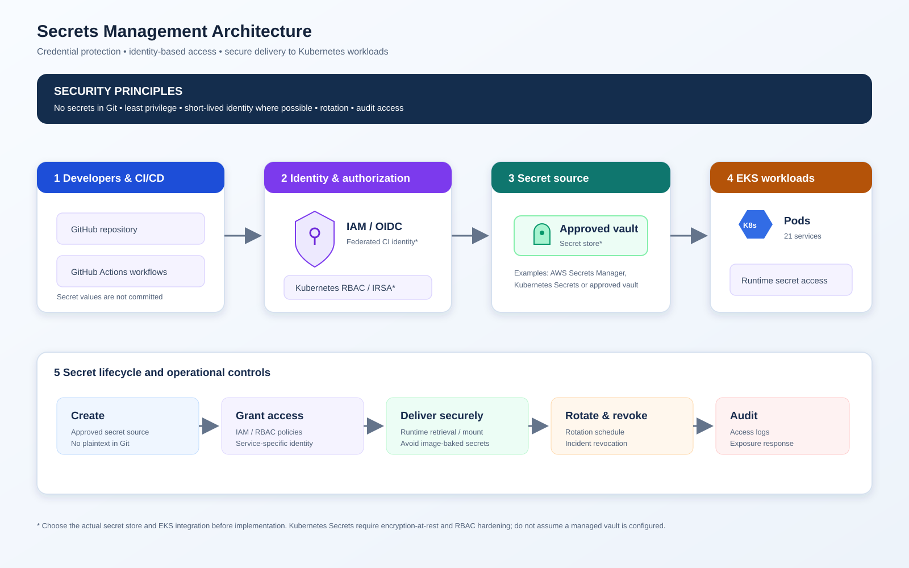

# 13 — Secrets Management Architecture

## 1. Overview

This document explains how secrets are managed securely across the production DevOps platform running 21 microservices on Amazon EKS.

Secrets include:

- Database usernames and passwords.
- AWS credentials.
- API tokens.
- Application credentials.
- Messaging broker credentials.
- TLS certificates and private keys.

The objective is to prevent sensitive information from being exposed in source code, Docker images, CI/CD logs or Kubernetes configuration repositories.

## 2. Architecture Diagram



## 3. Secrets Management Principles

Follow these principles:

- Never commit secrets to Git.
- Never hardcode credentials in application code.
- Never include credentials in Docker images.
- Use least-privilege access.
- Prefer short-lived credentials where supported.
- Rotate credentials regularly.
- Restrict access to production secrets.
- Audit secret access.
- Revoke compromised credentials immediately.

## 4. Secrets in GitHub

GitHub Actions supports encrypted repository, environment and organization secrets.

Example workflow reference:

```yaml
name: Application Deployment

on:
  push:
    branches:
      - main

jobs:
  deploy:
    runs-on: ubuntu-latest

    steps:
      - name: Checkout
        uses: actions/checkout@v4

      - name: Configure application
        env:
          DB_USERNAME: ${{ secrets.DB_USERNAME }}
          DB_PASSWORD: ${{ secrets.DB_PASSWORD }}
        run: |
          echo "Application configuration prepared"
```

Do not print secret values in workflow logs.

For production, consider retrieving secrets from an approved external secret store rather than maintaining long-lived credentials in CI/CD.

## 5. AWS IAM and OIDC

GitHub Actions can use OpenID Connect (OIDC) to assume an AWS IAM role without storing long-lived AWS access keys in GitHub secrets.

Typical flow:

1. GitHub Actions starts a workflow.
2. GitHub provides an OIDC identity token.
3. AWS validates the configured identity and trust policy.
4. AWS STS issues temporary credentials.
5. The workflow accesses only the resources allowed by the IAM role.

The IAM trust policy should restrict the allowed repository, branch or environment.

## 6. Kubernetes Secrets

Kubernetes Secrets store sensitive configuration data used by workloads.

Example:

```yaml
apiVersion: v1
kind: Secret
metadata:
  name: application-secret
  namespace: production
type: Opaque
stringData:
  DB_USERNAME: application_user
  DB_PASSWORD: replace-with-secure-value
```

This is a demonstration manifest only. Do not commit real secret values to Git.

Kubernetes Secrets are not automatically a complete secrets-management solution. Apply encryption at rest, RBAC restrictions and appropriate access controls.

## 7. External Secret Management

An external secret manager can provide centralized secret storage and controlled application access.

Possible options include:

- AWS Secrets Manager.
- An approved external vault.
- Kubernetes Secrets populated through an approved integration.

For AWS Secrets Manager integration, a typical design is:

1. Store the database credential in Secrets Manager.
2. Create an IAM role with permission to retrieve the required secret.
3. Associate the role with the appropriate Kubernetes workload identity.
4. Retrieve the secret through an approved integration.
5. Make the credential available to the application.
6. Rotate the secret according to policy.

The exact integration must be selected and configured before describing it as deployed.

## 8. IRSA and Workload Identity

IAM Roles for Service Accounts (IRSA) allows supported EKS workloads to obtain AWS permissions through Kubernetes service accounts.

Benefits:

- Avoid static AWS access keys inside pods.
- Give workloads separate IAM permissions.
- Apply least-privilege access.
- Reduce credential exposure.

Use IRSA or the appropriate EKS workload identity mechanism for the cluster configuration.

## 9. Secret Rotation

Secrets should be rotated according to their risk and operational requirements.

Typical process:

1. Generate or update the credential.
2. Update the approved secret store.
3. Ensure the application can retrieve the new value.
4. Restart or refresh workloads if required.
5. Verify database or service connectivity.
6. Revoke the old credential after successful validation.

Plan rotation carefully to avoid application downtime.

## 10. Secrets in CI/CD Pipelines

Recommended practices:

- Use GitHub Actions secrets or an approved external secret store.
- Use OIDC for AWS authentication where supported.
- Never print credentials.
- Restrict production deployment permissions.
- Protect environment approvals.
- Scan repositories for accidental secret exposure.
- Rotate credentials after suspected exposure.

## 11. Secrets in Docker Images

Never include sensitive values in:

- Dockerfiles.
- Image build arguments.
- Container image layers.
- Source code.
- Committed environment files.

Use runtime secret injection or an approved retrieval mechanism.

Remember that Docker build arguments and environment variables can be exposed through build metadata, image configuration or logs depending on how they are used.

## 12. Security and Auditing

Monitor:

- Secret access attempts.
- Unauthorized access.
- IAM policy changes.
- Secret rotation failures.
- Credential exposure incidents.
- Kubernetes Secret access.
- CI/CD permission changes.

Restrict who can read production secrets and review access regularly.

## 13. Troubleshooting

### Application cannot access a secret

Check:

- IAM role permissions.
- Kubernetes service account configuration.
- Secret name and namespace.
- External secret integration status.
- Network connectivity.
- Application configuration.

### Database authentication failure

Check:

- Credential correctness.
- Credential rotation status.
- Database user permissions.
- Application environment variables.
- Connection configuration.

### AWS OIDC authentication failure

Check:

- GitHub OIDC permissions.
- IAM trust policy.
- Repository and branch conditions.
- Role ARN.
- Workflow permissions.

## 14. Best Practices

- Never store plaintext credentials in Git.
- Prefer workload identity and temporary credentials.
- Apply least-privilege IAM and RBAC policies.
- Restrict production secret access.
- Encrypt stored secrets.
- Rotate credentials.
- Audit secret access.
- Avoid exposing secrets in application logs.
- Test credential rotation before production rollout.
- Document the recovery process for compromised credentials.

## 15. Expected Outcome

The platform should have a secure, documented process for creating, storing, accessing, rotating and auditing secrets across CI/CD pipelines and Kubernetes workloads.

The chosen secret-management integration must be tested with actual application workloads before being considered production-ready.