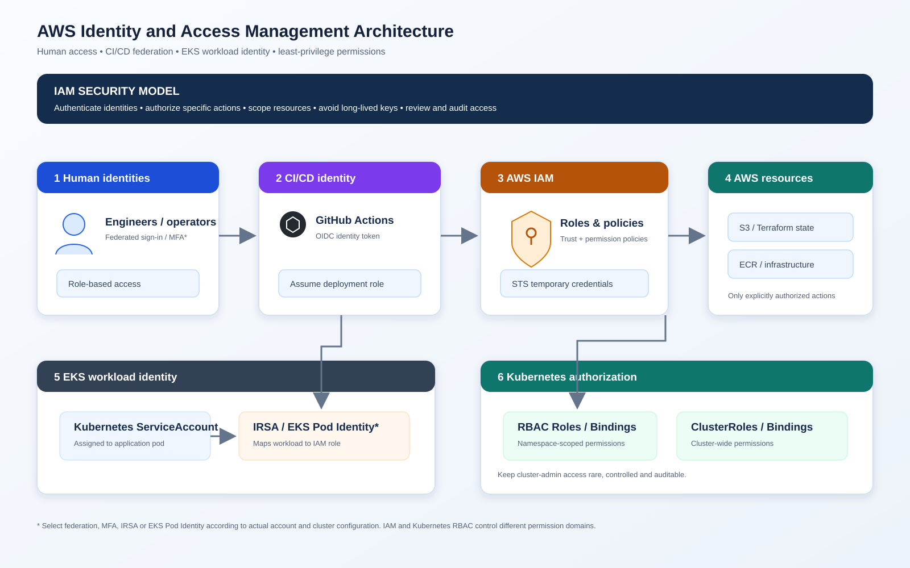

# 14 — Identity and Access Management (IAM) Architecture

## 1. Overview

This document describes identity and access management for the production DevOps platform running 21 microservices on Amazon EKS.

IAM controls who or what can access AWS resources and which operations they are permitted to perform.

The architecture covers:

- AWS IAM users, roles and policies.
- IAM trust policies.
- GitHub Actions OIDC authentication.
- AWS STS temporary credentials.
- EKS workload identity.
- Kubernetes ServiceAccounts.
- Kubernetes RBAC.
- Least-privilege access.
- Access auditing.

## 2. Architecture Diagram



## 3. IAM Core Components

### IAM Users

IAM users represent individual identities with long-term credentials.

For human access, prefer centralized identity federation and temporary credentials where available instead of creating long-lived IAM users for every engineer.

### IAM Groups

IAM groups organize IAM users and allow permissions to be managed collectively.

### IAM Roles

IAM roles provide temporary permissions to trusted identities or services.

Common examples:

- Terraform deployment role.
- GitHub Actions deployment role.
- EKS cluster role.
- EKS worker-node role.
- Application workload role.

### IAM Policies

IAM policies define which actions are allowed or denied on specific AWS resources.

Follow least privilege and avoid broad permissions such as `Action: "*"` and `Resource: "*"` unless there is a documented requirement.

## 4. GitHub Actions OIDC Authentication

GitHub Actions can authenticate to AWS using OpenID Connect.

Typical workflow:

1. Developer pushes code to GitHub.
2. GitHub Actions starts a workflow.
3. Workflow requests an OIDC token.
4. AWS validates the token against the IAM role trust policy.
5. AWS STS issues temporary credentials.
6. The workflow accesses approved AWS resources.

Example workflow permissions:

```yaml
permissions:
  id-token: write
  contents: read
```

Example AWS authentication step:

```yaml
- name: Configure AWS credentials
  uses: aws-actions/configure-aws-credentials@v4
  with:
    role-to-assume: ${{ secrets.AWS_ROLE_ARN }}
    aws-region: ap-south-1
```

Restrict the IAM trust policy to the intended repository, branch or GitHub environment.

## 5. AWS STS Temporary Credentials

AWS Security Token Service (STS) provides temporary security credentials.

Benefits:

- Credentials expire automatically.
- Reduced dependency on long-lived access keys.
- Better control over role assumption.
- Suitable for CI/CD and workload identity integrations.

## 6. EKS IAM Architecture

Amazon EKS uses IAM for AWS identity and access integration.

Common roles include:

### EKS Cluster IAM Role

Provides the permissions required by the EKS control plane for supported AWS operations.

### Worker Node IAM Role

Provides the permissions required by EKS worker nodes.

### Application Workload Role

Provides AWS permissions to an application running inside Kubernetes.

Avoid giving every application the same broad IAM permissions.

## 7. Kubernetes ServiceAccounts

A Kubernetes ServiceAccount provides an identity to a pod.

Example:

```yaml
apiVersion: v1
kind: ServiceAccount
metadata:
  name: application-service-account
  namespace: production
```

A pod can reference the ServiceAccount in its deployment specification.

```yaml
spec:
  serviceAccountName: application-service-account
```

## 8. IRSA and EKS Pod Identity

EKS supports workload identity mechanisms that allow Kubernetes workloads to access AWS services without embedding long-lived AWS access keys in containers.

### IRSA

IAM Roles for Service Accounts associates a Kubernetes ServiceAccount with an IAM role using the configured OIDC provider.

### EKS Pod Identity

EKS Pod Identity provides another mechanism for associating IAM roles with Kubernetes workloads.

Choose the mechanism supported by the cluster and document the one actually configured.

## 9. Kubernetes RBAC

Kubernetes RBAC controls access to Kubernetes API resources.

Important components:

- Role.
- ClusterRole.
- RoleBinding.
- ClusterRoleBinding.

### Role

Defines permissions within a namespace.

### ClusterRole

Defines permissions that can apply across the cluster or to cluster-scoped resources.

### RoleBinding

Associates a user, group or ServiceAccount with a Role or ClusterRole in a namespace.

### ClusterRoleBinding

Associates a subject with a ClusterRole across the cluster.

Example:

```yaml
apiVersion: rbac.authorization.k8s.io/v1
kind: Role
metadata:
  namespace: production
  name: pod-reader
rules:
  - apiGroups: [""]
    resources: ["pods"]
    verbs: ["get", "list", "watch"]
```

Grant only the permissions required for the task.

## 10. IAM vs Kubernetes RBAC

| IAM | Kubernetes RBAC |
|---|---|
| Controls AWS resource permissions | Controls Kubernetes API permissions |
| Uses IAM users, roles and policies | Uses Roles and RoleBindings |
| Authorizes AWS API operations | Authorizes Kubernetes resource operations |
| Used for S3, ECR and other AWS services | Used for pods, deployments, services and other Kubernetes resources |

Both authorization layers may be required for a workload that interacts with AWS and Kubernetes.

## 11. Least-Privilege Access

Recommended access design:

- Developers receive only the access required for development.
- CI/CD workflows receive deployment-specific permissions.
- Terraform receives only the permissions needed to manage infrastructure.
- Applications receive service-specific AWS permissions.
- Kubernetes operators receive only the permissions required for their responsibilities.
- Production administrator access is restricted and audited.

## 12. IAM Security Best Practices

- Prefer roles and temporary credentials.
- Use OIDC for GitHub Actions AWS authentication.
- Apply least-privilege policies.
- Restrict role trust relationships.
- Avoid hardcoded credentials.
- Review IAM policies regularly.
- Protect privileged accounts with MFA.
- Separate development and production access.
- Audit role assumptions and permission changes.

## 13. Troubleshooting

### AccessDenied error

Check:

- IAM role permissions.
- Trust policy.
- Resource policy.
- Explicit deny statements.
- AWS account and region.
- Requested API action.

### GitHub Actions OIDC failure

Check:

- Workflow `id-token` permission.
- IAM OIDC provider configuration.
- Role trust policy conditions.
- Repository and branch identity.
- Role ARN and AWS account.

### Kubernetes Forbidden error

Check:

```bash
kubectl auth can-i get pods -n production
kubectl auth can-i create deployments -n production
kubectl get rolebindings -n production
kubectl get clusterrolebindings
```

### Workload AWS permission failure

Check:

- Kubernetes ServiceAccount.
- IRSA or EKS Pod Identity configuration.
- Associated IAM role.
- IAM permissions.
- AWS SDK credential provider configuration.

## 14. Expected Outcome

The platform should have a documented identity and access model covering human users, CI/CD workflows, AWS infrastructure and Kubernetes workloads.

All access should follow least-privilege principles and be validated through actual authentication and authorization tests.