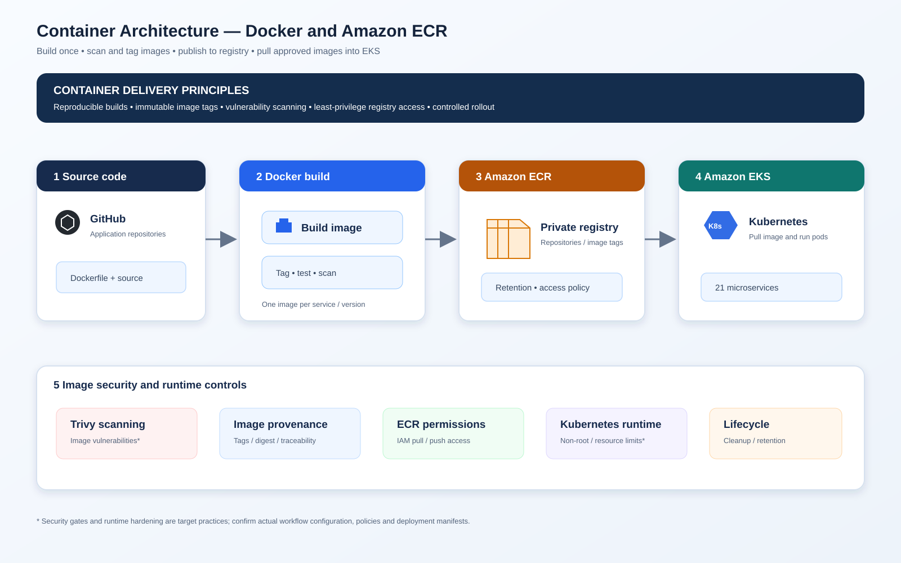

# 15 — Container Architecture (Docker and Amazon ECR)

## 1. Overview

This document explains how Docker containers are built, scanned, stored and deployed for the production DevOps platform running 21 microservices on Amazon EKS.

Docker packages applications and their dependencies into portable container images.

Amazon Elastic Container Registry (ECR) stores container images so that Amazon EKS workloads can pull and run approved versions.

The architecture covers:

- Dockerfiles.
- Docker image builds.
- Image tagging.
- Image scanning.
- Amazon ECR repositories.
- Image push and pull.
- Kubernetes deployments.
- Container security.
- Image lifecycle management.

## 2. Architecture Diagram



## 3. Docker Architecture

Docker packages an application and its dependencies into an image.

Important components:

### Dockerfile

Defines how the container image is built.

### Docker Image

A packaged application artifact containing the application and required runtime dependencies.

### Container

A running instance of an image.

### Docker Registry

Stores and distributes container images.

## 4. Example Dockerfile

Example for a Java application:

```dockerfile
FROM eclipse-temurin:17-jre

WORKDIR /app

COPY target/application.jar app.jar

EXPOSE 8080

ENTRYPOINT ["java", "-jar", "app.jar"]
```

Use a runtime image compatible with the application's Java version.

For production, use trusted base images, pin versions or digests where appropriate, and avoid running the application as root.

## 5. Docker Image Build

Build an image:

```bash
docker build -t order-service:v1.0.0 .
```

List images:

```bash
docker images
```

Run a container:

```bash
docker run -d \
  --name order-service \
  -p 8080:8080 \
  order-service:v1.0.0
```

Check running containers:

```bash
docker ps
```

View logs:

```bash
docker logs order-service
```

## 6. Image Tagging Strategy

Use meaningful image tags.

Examples:

```text
order-service:1.0.0
order-service:1.0.1
order-service:release-2026-01
```

Avoid relying only on the `latest` tag in production.

A commit-based tag helps trace an image back to its source code revision.

Example:

```bash
docker build -t order-service:${GITHUB_SHA} .
```

Use immutable image references or digests for stronger deployment traceability.

## 7. Amazon ECR

Amazon Elastic Container Registry is a managed container image registry.

It provides:

- Private image repositories.
- IAM-based access control.
- Image storage and retrieval.
- Image scanning capabilities, depending on configuration.
- Lifecycle policies.

Create one repository per service or follow the repository organization selected for the project.

## 8. Authenticate Docker with ECR

Example:

```bash
aws ecr get-login-password --region ap-south-1 \
  | docker login \
    --username AWS \
    --password-stdin <ACCOUNT_ID>.dkr.ecr.ap-south-1.amazonaws.com
```

Replace the account ID and region with the actual AWS values.

## 9. Build and Push an Image to ECR

Set the registry address:

```bash
AWS_ACCOUNT_ID=<ACCOUNT_ID>
AWS_REGION=ap-south-1
ECR_REPO=order-service
IMAGE_TAG=v1.0.0
```

Build and tag:

```bash
docker build -t ${ECR_REPO}:${IMAGE_TAG} .

docker tag ${ECR_REPO}:${IMAGE_TAG} \
  ${AWS_ACCOUNT_ID}.dkr.ecr.${AWS_REGION}.amazonaws.com/${ECR_REPO}:${IMAGE_TAG}
```

Push:

```bash
docker push \
  ${AWS_ACCOUNT_ID}.dkr.ecr.${AWS_REGION}.amazonaws.com/${ECR_REPO}:${IMAGE_TAG}
```

Verify the image:

```bash
aws ecr describe-images \
  --repository-name ${ECR_REPO} \
  --region ${AWS_REGION}
```

## 10. Image Scanning with Trivy

Trivy can scan container images for known vulnerabilities.

Example:

```bash
trivy image order-service:v1.0.0
```

A CI/CD pipeline can use scan results to decide whether an image should be published or promoted.

Define severity thresholds and exceptions according to the organization's security policy.

## 11. Kubernetes Image Deployment

Example deployment:

```yaml
apiVersion: apps/v1
kind: Deployment
metadata:
  name: order-service
  namespace: production
spec:
  replicas: 3
  selector:
    matchLabels:
      app: order-service
  template:
    metadata:
      labels:
        app: order-service
    spec:
      containers:
        - name: order-service
          image: ACCOUNT_ID.dkr.ecr.ap-south-1.amazonaws.com/order-service:v1.0.0
          ports:
            - containerPort: 8080
```

For production, use the correct registry, image version and Kubernetes configuration.

## 12. EKS Image Pull Permissions

EKS worker nodes need permission to pull images from ECR.

Configure the appropriate node IAM permissions or supported image-pull identity mechanism.

Troubleshoot image-pull errors using:

```bash
kubectl describe pod <pod-name> -n <namespace>
```

Common causes include:

- Incorrect image name.
- Incorrect tag.
- Missing ECR repository.
- IAM permission problems.
- Registry connectivity problems.

## 13. Container Security Best Practices

- Use trusted base images.
- Keep images minimal.
- Avoid root execution where possible.
- Scan images for vulnerabilities.
- Do not store secrets in images.
- Use immutable image tags or digests.
- Restrict ECR push and pull permissions.
- Rebuild images when critical base-image vulnerabilities are identified.
- Remove unused images according to retention policies.

## 14. Image Lifecycle Management

Define a retention policy for old images.

Consider:

- Production releases.
- Rollback versions.
- Development builds.
- Unused tags.
- Compliance requirements.
- Storage costs.

Do not delete an image that is still required by a running workload or a supported rollback procedure.

## 15. Troubleshooting

### Docker build failure

```bash
docker build --no-cache -t order-service:test .
```

### Container exits unexpectedly

```bash
docker ps -a
docker logs <container-name>
docker inspect <container-name>
```

### Kubernetes ImagePullBackOff

```bash
kubectl describe pod <pod-name> -n <namespace>
kubectl get events -n <namespace> --sort-by=.lastTimestamp
```

### ECR authentication failure

Check:

- AWS identity.
- IAM permissions.
- AWS region.
- Registry address.
- ECR repository access.

## 16. Expected Outcome

The platform should have a repeatable container build and delivery process in which application images are versioned, scanned, published to ECR and deployed into EKS using controlled image references.