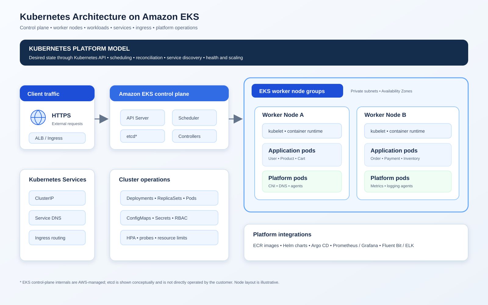

# 16 — Kubernetes Architecture on Amazon EKS

## 1. Overview

This document explains the Kubernetes architecture used to deploy and manage the 21-microservice production platform on Amazon EKS.

Kubernetes is a container orchestration platform that automates application deployment, scaling, scheduling and recovery.

Amazon EKS provides a managed Kubernetes control plane, while worker nodes run the application and platform workloads.

The architecture covers:

- Amazon EKS control plane.
- Worker nodes and node groups.
- Kubernetes pods.
- Deployments and ReplicaSets.
- Services and service discovery.
- Ingress and external traffic.
- ConfigMaps and Secrets.
- Kubernetes RBAC.
- Health probes and resource management.
- Autoscaling and platform integrations.

## 2. Architecture Diagram



## 3. Amazon EKS Control Plane

The EKS control plane manages Kubernetes cluster operations.

Important Kubernetes control-plane components include:

### API Server

The API Server is the primary interface for Kubernetes operations.

Users and automation tools interact with the cluster through the Kubernetes API.

### Scheduler

The Scheduler selects suitable worker nodes for newly created pods based on resource availability and scheduling constraints.

### Controller Manager

Controllers continuously compare the actual cluster state with the desired state and take action to reconcile differences.

### etcd

etcd is the Kubernetes backing data store for cluster state. In Amazon EKS, the control-plane implementation and etcd operations are AWS-managed.

## 4. Worker Nodes

Worker nodes execute application workloads.

They provide:

- CPU and memory resources.
- Container runtime.
- kubelet.
- Pod networking.
- Application containers.

In EKS, worker capacity can be provided through managed node groups or other supported compute options.

For production, distribute workloads across multiple Availability Zones where appropriate.

## 5. Kubernetes Pods

A pod is the smallest deployable unit in Kubernetes.

A pod can contain one or more containers that share networking and configured storage.

Example:

```yaml
apiVersion: v1
kind: Pod
metadata:
  name: order-service
  namespace: production
spec:
  containers:
    - name: order-service
      image: nginx:1.27
      ports:
        - containerPort: 80
```

This is a basic demonstration manifest, not the production application image.

## 6. Deployments and ReplicaSets

Deployments manage stateless application workloads.

They provide:

- Replica management.
- Rolling updates.
- Rollback support.
- Desired-state management.

Example:

```yaml
apiVersion: apps/v1
kind: Deployment
metadata:
  name: order-service
  namespace: production
spec:
  replicas: 3
  selector:
    matchLabels:
      app: order-service
  template:
    metadata:
      labels:
        app: order-service
    spec:
      containers:
        - name: order-service
          image: order-service:v1.0.0
          ports:
            - containerPort: 8080
```

A ReplicaSet maintains the required number of matching pods.

## 7. Kubernetes Services

Services provide stable network access to pods.

Important types:

### ClusterIP

Provides internal cluster communication.

### NodePort

Exposes a service on a port across cluster nodes.

### LoadBalancer

Integrates a service with an external load-balancing implementation where supported.

Use the service type appropriate to the application traffic requirements.

## 8. Kubernetes DNS

Kubernetes DNS provides service discovery within the cluster.

For example:

```text
order-service.production.svc.cluster.local
```

Applications can use service DNS names instead of relying on changing pod IP addresses.

CoreDNS provides DNS service discovery in a standard Kubernetes cluster.

## 9. Ingress and External Traffic

Ingress manages HTTP and HTTPS routing into the cluster when an ingress controller is installed.

In an AWS EKS environment, the AWS Load Balancer Controller can provision and manage ALBs from supported Kubernetes resources.

Typical traffic flow:

```text
Client
  |
  v
Application Load Balancer
  |
  v
Ingress / Kubernetes routing
  |
  v
Kubernetes Service
  |
  v
Application Pods
```

The actual routing depends on the configured ingress controller and service integration.

## 10. ConfigMaps and Secrets

### ConfigMaps

ConfigMaps store non-sensitive application configuration.

Examples:

- Application environment.
- Feature flags.
- Service configuration.
- Non-sensitive endpoint values.

### Secrets

Secrets store sensitive configuration such as credentials and tokens.

Restrict access through RBAC and configure appropriate encryption and secret-management controls.

Never commit real secret values to Git.

## 11. Kubernetes RBAC

Role-Based Access Control manages permissions to Kubernetes resources.

Main objects:

- Role.
- ClusterRole.
- RoleBinding.
- ClusterRoleBinding.

Use namespace-scoped permissions wherever possible and restrict cluster-wide administrator privileges.

## 12. Health Probes

Kubernetes supports three important types of probes.

### Liveness Probe

Checks whether the container should be restarted.

### Readiness Probe

Checks whether the application is ready to receive traffic.

### Startup Probe

Allows slow-starting applications sufficient time to initialize before liveness and readiness checks begin.

Configure probes according to actual application behavior.

## 13. Resource Requests and Limits

Resource requests define the resources Kubernetes uses for scheduling.

Resource limits define the maximum CPU and memory resources a container can consume.

Example:

```yaml
resources:
  requests:
    cpu: "250m"
    memory: "256Mi"
  limits:
    cpu: "500m"
    memory: "512Mi"
```

Set values using workload measurements rather than copying example values blindly.

## 14. Horizontal Pod Autoscaler

The Horizontal Pod Autoscaler adjusts the number of pod replicas based on configured metrics.

Example:

```yaml
apiVersion: autoscaling/v2
kind: HorizontalPodAutoscaler
metadata:
  name: order-service
  namespace: production
spec:
  scaleTargetRef:
    apiVersion: apps/v1
    kind: Deployment
    name: order-service
  minReplicas: 2
  maxReplicas: 10
  metrics:
    - type: Resource
      resource:
        name: cpu
        target:
          type: Utilization
          averageUtilization: 70
```

HPA requires the appropriate metrics source and workload resource configuration.

## 15. Kubernetes Troubleshooting

### Check nodes

```bash
kubectl get nodes -o wide
```

### Check pods

```bash
kubectl get pods -A
```

### Describe a pod

```bash
kubectl describe pod <pod-name> -n <namespace>
```

### Check logs

```bash
kubectl logs <pod-name> -n <namespace>
```

### Check deployments

```bash
kubectl get deployments -A
```

### Check events

```bash
kubectl get events -A --sort-by=.lastTimestamp
```

### Check services

```bash
kubectl get svc -A
```

## 16. Platform Integrations

The Kubernetes platform integrates with the following tools in the project architecture:

- Amazon ECR for container images.
- Helm for Kubernetes packaging.
- Argo CD for GitOps deployments.
- Prometheus for metrics.
- Grafana for dashboards.
- Fluent Bit and ELK for logging.

The actual integration and configuration should be validated in the cluster.

## 17. Best Practices

- Run workloads across multiple Availability Zones where appropriate.
- Use readiness, liveness and startup probes.
- Define CPU and memory requests and limits.
- Use least-privilege RBAC.
- Keep application workloads private.
- Use controlled rolling deployments.
- Monitor pod and node health.
- Keep application images versioned.
- Use autoscaling based on measured demand.
- Test recovery and rollback procedures.

## 18. Expected Outcome

The platform should have a documented Kubernetes architecture explaining how workloads are scheduled, exposed, configured, monitored and recovered on Amazon EKS.

The architecture should support reliable operation and troubleshooting of all 21 microservices.