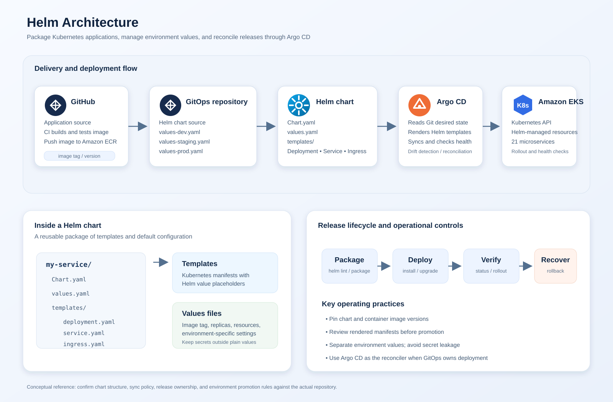

# 17 — Helm Architecture



## 1. Overview

Helm is the package manager for Kubernetes. It helps us deploy and manage Kubernetes applications using reusable charts and environment-specific configuration.

In our production DevOps platform, Helm manages the Kubernetes resources required by the 21 microservices running on Amazon EKS.

Helm works alongside Argo CD:
- Helm packages and templates Kubernetes resources.
- Git stores the desired configuration.
- Argo CD monitors Git and reconciles the cluster with the desired state.

## 2. Objectives

- Understand Helm architecture and components.
- Create reusable Helm charts for microservices.
- Manage environment-specific values.
- Deploy and upgrade Kubernetes applications.
- Integrate Helm with GitOps and Argo CD.
- Perform release validation and rollback.

## 3. Helm Chart Structure

Example chart structure:

```text
helm/
└── charts/
    └── user-service/
        ├── Chart.yaml
        ├── values.yaml
        └── templates/
            ├── deployment.yaml
            ├── service.yaml
            ├── ingress.yaml
            ├── configmap.yaml
            └── hpa.yaml
```

### Important files

| File | Purpose |
|---|---|
| Chart.yaml | Chart name, version and metadata |
| values.yaml | Default configuration |
| templates/ | Kubernetes resource templates |
| deployment.yaml | Application deployment |
| service.yaml | Internal service access |
| ingress.yaml | External routing, when required |
| hpa.yaml | Autoscaling configuration, when required |

## 4. Environment-Specific Configuration

Different environments may require different replicas, resource limits, image tags and configuration.

Example:

```text
helm/
├── charts/
│   └── user-service/
│       ├── Chart.yaml
│       ├── values.yaml
│       └── templates/
└── values/
    ├── dev/
    │   └── user-service.yaml
    ├── staging/
    │   └── user-service.yaml
    └── prod/
        └── user-service.yaml
```

Example production values:

```yaml
replicaCount: 3

image:
  repository: <ECR_REPOSITORY_URI>
  tag: "1.0.0"
  pullPolicy: IfNotPresent

resources:
  requests:
    cpu: "250m"
    memory: "256Mi"
  limits:
    cpu: "500m"
    memory: "512Mi"
```

Keep sensitive values in an approved secret-management system rather than committing plaintext secrets to Git.

## 5. Helm Deployment Commands

```bash
# Check Helm version
helm version

# Validate chart
helm lint ./helm/charts/user-service

# Render Kubernetes manifests locally
helm template user-service ./helm/charts/user-service \
  -f ./helm/values/prod/user-service.yaml

# Install a release
helm install user-service ./helm/charts/user-service \
  -f ./helm/values/prod/user-service.yaml \
  -n production --create-namespace

# Upgrade a release
helm upgrade user-service ./helm/charts/user-service \
  -f ./helm/values/prod/user-service.yaml \
  -n production

# Check releases
helm list -n production

# View release history
helm history user-service -n production

# Roll back to a previous revision
helm rollback user-service 1 -n production
```

## 6. Helm and Argo CD Integration

The intended GitOps workflow is:

1. Developers push application changes to GitHub.
2. CI builds and tests the application.
3. The container image is pushed to Amazon ECR.
4. The GitOps repository is updated with the approved image tag and Helm values.
5. Argo CD reads the repository.
6. Argo CD renders the Helm chart and applies the desired resources to EKS.
7. Deployment health is checked.
8. Failed deployments are investigated and recovered using the configured rollback process.

When Argo CD owns deployment reconciliation, avoid independently changing the same resources with manual Helm commands. Manual changes can be overwritten during reconciliation.

## 7. Production Best Practices

- Reuse charts across microservices where their requirements are similar.
- Keep application configuration separate from chart templates.
- Pin image tags instead of relying on `latest`.
- Validate charts with `helm lint`.
- Review rendered manifests before production promotion.
- Define resource requests and limits.
- Configure readiness and liveness probes.
- Keep secrets out of Git.
- Review release history and maintain a recovery procedure.
- Use controlled environment promotion.

## 8. Troubleshooting

```bash
# Check release status
helm status user-service -n production

# Inspect release history
helm history user-service -n production

# Inspect rendered manifests
helm get manifest user-service -n production

# Inspect configured values
helm get values user-service -n production

# Check Kubernetes resources
kubectl get pods,deployments,services -n production

# Inspect pod events
kubectl describe pod <POD_NAME> -n production

# Check application logs
kubectl logs <POD_NAME> -n production
```

## 9. Expected Outcome

After completing this chapter, we should be able to create reusable Helm charts, configure multiple environments, deploy Kubernetes applications, integrate Helm with Argo CD, and troubleshoot Helm-managed workloads on Amazon EKS.

## 10. Completion Checklist

- [ ] Understand Helm chart structure.
- [ ] Create a reusable microservice chart.
- [ ] Configure environment-specific values.
- [ ] Validate charts using `helm lint`.
- [ ] Render Kubernetes manifests.
- [ ] Deploy and upgrade a Helm release.
- [ ] Understand Helm release history and rollback.
- [ ] Integrate Helm charts with Argo CD.
- [ ] Troubleshoot Helm-managed workloads.

*Note: This is the target architecture and implementation guide. Confirm the actual chart layout, environment names, Argo CD sync policy and release ownership against the repository before describing them as deployed.*