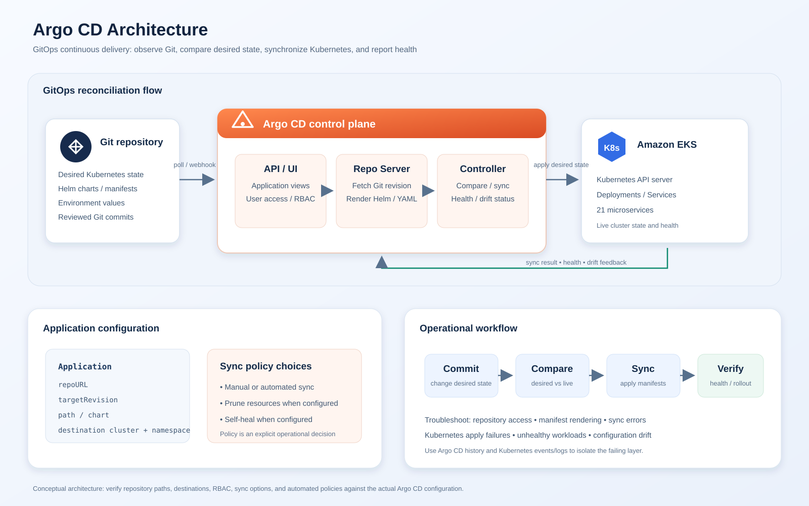

# 18 — Argo CD Architecture



## 1. Overview

Argo CD is a declarative GitOps continuous delivery tool for Kubernetes.

It continuously compares the desired application configuration stored in Git with the actual state running inside the Kubernetes cluster.

In our production DevOps platform, Argo CD manages application deployments to Amazon EKS using Helm charts and Git-based configuration.

## 2. Objectives

- Understand Argo CD architecture and components.
- Configure Git repositories as the source of desired state.
- Connect Argo CD with Amazon EKS.
- Deploy Helm-based applications using Argo CD.
- Understand synchronization and health status.
- Detect configuration drift.
- Troubleshoot failed synchronization and deployments.

## 3. Argo CD Architecture Components

### API Server

The API server provides access to Argo CD through its UI, CLI and API.

Responsibilities:
- Manage application operations.
- Provide application status.
- Handle authentication and authorization.
- Support synchronization requests.

### Repository Server

The repository server retrieves application configuration from Git.

Responsibilities:
- Clone or fetch repository content.
- Read Kubernetes manifests.
- Render Helm charts.
- Prepare manifests for synchronization.

### Application Controller

The application controller continuously compares desired state with live cluster state.

Responsibilities:
- Detect configuration differences.
- Synchronize Kubernetes resources.
- Monitor application health.
- Report synchronization and health status.

## 4. GitOps Repository Structure

Example repository:

```text
gitops-repo/
├── applications/
│   ├── dev/
│   ├── staging/
│   └── prod/
├── charts/
│   ├── user-service/
│   ├── cart-service/
│   └── order-service/
└── values/
    ├── dev/
    ├── staging/
    └── prod/
```

The actual repository layout should follow the project's chosen GitOps structure.

## 5. Argo CD Application Configuration

An Argo CD Application defines:
- Git repository URL.
- Target Git revision.
- Chart or manifest path.
- Destination Kubernetes cluster.
- Destination namespace.
- Synchronization policy.

Illustrative Application manifest:

```yaml
apiVersion: argoproj.io/v1alpha1
kind: Application
metadata:
  name: user-service
  namespace: argocd
spec:
  project: default

  source:
    repoURL: https://github.com/ORG/gitops-repo.git
    targetRevision: main
    path: charts/user-service
    helm:
      valueFiles:
        - values/prod/user-service.yaml

  destination:
    server: https://kubernetes.default.svc
    namespace: production

  syncPolicy:
    syncOptions:
      - CreateNamespace=true
```

Replace the example repository URL, branch and paths with the actual project values.

## 6. Deployment Workflow

1. Developer pushes application code to GitHub.
2. CI builds and tests the application.
3. The container image is pushed to Amazon ECR.
4. The GitOps repository is updated with the new image tag.
5. Argo CD detects the Git change.
6. Repository Server retrieves and renders the configuration.
7. Application Controller compares desired and live state.
8. Argo CD synchronizes resources to EKS.
9. Kubernetes starts or updates application pods.
10. Argo CD reports application synchronization and health status.

## 7. Sync Policies

| Policy | Purpose |
|---|---|
| Manual sync | Operator initiates deployment |
| Automated sync | Argo CD applies eligible Git changes automatically |
| Prune | Removes resources no longer defined in Git, when enabled |
| Self-heal | Reconciles certain live changes back to Git state, when enabled |

These policies must be configured deliberately. Automated sync, pruning and self-healing should not be assumed to be enabled.

## 8. Argo CD Commands

```bash
# Check Argo CD namespace
kubectl get pods -n argocd

# List applications
argocd app list

# Get application details
argocd app get user-service

# Check application synchronization
argocd app get user-service

# Preview differences
argocd app diff user-service

# Synchronize application
argocd app sync user-service

# Wait for application health
argocd app wait user-service --health

# View application history
argocd app history user-service
```

These commands require the Argo CD CLI to be installed and authenticated.

## 9. Troubleshooting

### Application OutOfSync

Possible causes:
- Git configuration changed.
- Manual changes were made to Kubernetes resources.
- Desired and live configurations differ.

Investigation:

```bash
argocd app diff user-service
argocd app get user-service
kubectl get deployment user-service -n production
```

### Application Sync Failed

Possible causes:
- Invalid YAML.
- Helm template rendering errors.
- Missing Kubernetes permissions.
- Invalid resource configuration.
- Admission policy rejection.

Investigation:

```bash
argocd app get user-service
kubectl get events -n production --sort-by=.lastTimestamp
kubectl describe deployment user-service -n production
```

### Pods Not Healthy After Sync

```bash
kubectl get pods -n production
kubectl describe pod <POD_NAME> -n production
kubectl logs <POD_NAME> -n production
```

Remember: a successful synchronization does not automatically mean that the application is healthy. Verify rollout and application health separately.

## 10. Production Best Practices

- Use Git as the source of truth for desired configuration.
- Protect production branches with review and approval controls.
- Apply least-privilege RBAC.
- Separate environments and application ownership clearly.
- Pin application image versions.
- Review changes before production synchronization.
- Monitor OutOfSync and Degraded applications.
- Understand pruning before enabling it.
- Define recovery and rollback procedures.
- Avoid unmanaged manual changes to GitOps-controlled resources.

## 11. Expected Outcome

After completing this chapter, we should be able to explain Argo CD architecture, connect Git repositories to EKS, deploy Helm-based applications, understand synchronization and health states, and troubleshoot GitOps deployment failures.

## 12. Completion Checklist

- [ ] Understand Argo CD components.
- [ ] Understand GitOps reconciliation.
- [ ] Configure a Git repository connection.
- [ ] Create an Argo CD Application.
- [ ] Deploy a Helm chart through Argo CD.
- [ ] Understand OutOfSync and Synced states.
- [ ] Understand Healthy and Degraded states.
- [ ] Practice manual synchronization.
- [ ] Investigate a failed synchronization.
- [ ] Understand production RBAC and sync policies.

*Note: This is the target architecture. Confirm actual repository paths, cluster destinations, RBAC and synchronization policies before documenting them as deployed.*