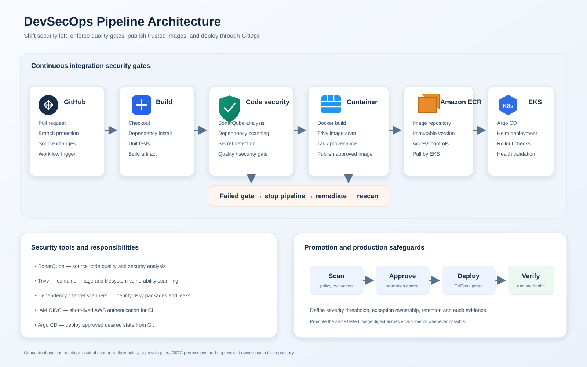

# 19 — DevSecOps Pipeline Architecture



## 1. Overview

DevSecOps integrates security practices into the complete software development and delivery lifecycle.

Instead of performing security checks only before production deployment, we introduce automated security validation throughout the CI/CD pipeline.

Our platform uses GitHub Actions as the primary CI pipeline, with SonarQube and Trivy as key security tools.

The pipeline builds container images, validates security findings, publishes approved images to Amazon ECR, and deploys through GitOps using Argo CD.

## 2. Objectives

- Integrate security into CI/CD.
- Perform source code security analysis.
- Scan application dependencies.
- Detect exposed secrets.
- Scan Docker images.
- Enforce security quality gates.
- Secure AWS authentication.
- Deploy approved images through GitOps.

## 3. DevSecOps Pipeline Flow

```text
Developer
    |
    v
GitHub Repository
    |
    v
GitHub Actions
    |
    +--> Checkout Source
    |
    +--> Dependency Installation
    |
    +--> Unit Tests
    |
    +--> SonarQube Analysis
    |
    +--> Dependency / Secret Scanning
    |
    +--> Docker Build
    |
    +--> Trivy Image Scan
    |
    +--> Security Gate
    |
    +--> AWS Authentication (OIDC)
    |
    +--> Push Image to Amazon ECR
    |
    v
GitOps Repository
    |
    v
Argo CD
    |
    v
Amazon EKS
    |
    v
Deployment Validation
```

## 4. SonarQube Integration

SonarQube analyzes application source code and identifies code quality and security issues.

Example:

```bash
mvn clean verify sonar:sonar \
  -Dsonar.projectKey=user-service \
  -Dsonar.host.url="$SONAR_HOST_URL" \
  -Dsonar.token="$SONAR_TOKEN"
```

Important checks:
- Bugs
- Code smells
- Security hotspots
- Vulnerability findings
- Quality gate status

Store the SonarQube token securely in the CI/CD secret store.

## 5. Trivy Integration

Trivy scans container images for known vulnerabilities.

Example:

```bash
# Build image
docker build -t user-service:1.0.0 .

# Scan image
trivy image user-service:1.0.0

# Scan filesystem
trivy fs .
```

A production pipeline should define its vulnerability policy. For example, it may block images with unapproved critical vulnerabilities.

## 6. GitHub Actions Pipeline Example

Illustrative workflow:

```yaml
name: DevSecOps Pipeline

on:
  pull_request:
    branches:
      - main
  push:
    branches:
      - main

permissions:
  contents: read

jobs:
  security-pipeline:
    runs-on: ubuntu-latest

    steps:
      - name: Checkout
        uses: actions/checkout@v4

      - name: Set up Java
        uses: actions/setup-java@v4
        with:
          distribution: temurin
          java-version: "17"

      - name: Build and test
        run: mvn clean verify

      - name: SonarQube analysis
        env:
          SONAR_TOKEN: ${{ secrets.SONAR_TOKEN }}
          SONAR_HOST_URL: ${{ secrets.SONAR_HOST_URL }}
        run: |
          mvn sonar:sonar \
            -Dsonar.host.url="$SONAR_HOST_URL" \
            -Dsonar.token="$SONAR_TOKEN"

      - name: Build Docker image
        run: |
          docker build -t user-service:${{ github.sha }} .

      - name: Install Trivy
        uses: aquasecurity/setup-trivy@v0.2.4

      - name: Scan Docker image
        run: |
          trivy image \
            --exit-code 1 \
            --severity CRITICAL \
            user-service:${{ github.sha }}
```

This example demonstrates the security stages. It does not yet publish to ECR or deploy to EKS. Those stages require registry authentication, OIDC role configuration, and a GitOps update workflow.

Pin third-party GitHub Actions to reviewed commit SHAs in production.

## 7. Security Gate Implementation

A security gate determines whether the pipeline can proceed.

Example policy:

| Finding | Example action |
|---|---|
| Critical vulnerability | Block release |
| High vulnerability | Block or require approved exception |
| Medium vulnerability | Track and remediate |
| Low vulnerability | Record and monitor |
| Exposed credentials | Block and rotate affected credential |

These are example policies. Final thresholds should be agreed with the security team and application owners.

## 8. AWS Authentication

GitHub Actions can authenticate to AWS using OpenID Connect (OIDC).

Benefits:
- Avoid long-lived AWS access keys.
- Use temporary credentials.
- Restrict role assumption to trusted repositories and branches.
- Apply least-privilege IAM permissions.

The IAM trust policy must validate the expected GitHub OIDC identity.

## 9. ECR Image Publishing

After all required checks pass:

1. Authenticate to Amazon ECR.
2. Tag the image with a unique version.
3. Push the image to ECR.
4. Record the image digest.
5. Update the GitOps repository with the approved image reference.

Example:

```bash
docker tag user-service:${IMAGE_TAG} \
  "${ECR_REPOSITORY_URI}:${IMAGE_TAG}"

docker push "${ECR_REPOSITORY_URI}:${IMAGE_TAG}"
```

Promote the same tested image digest between environments rather than rebuilding different artifacts for production.

## 10. Production Deployment

The GitOps deployment flow:

1. CI publishes the approved image.
2. CI or an authorized promotion workflow updates the GitOps configuration.
3. Argo CD detects the Git change.
4. Argo CD reconciles the desired state.
5. Kubernetes performs the rollout.
6. Deployment health is validated.
7. Failed deployments are investigated and recovered using the configured procedure.

## 11. Troubleshooting

### SonarQube Quality Gate Failure

```bash
# Check pipeline logs
# Review SonarQube project analysis
# Inspect failed quality gate conditions
```

### Trivy Vulnerability Failure

```bash
trivy image --severity HIGH,CRITICAL <IMAGE>
```

Check the vulnerable package, installed version, available fix and severity policy.

### Docker Build Failure

```bash
docker build --no-cache -t user-service:test .
```

Inspect the Dockerfile, dependencies and build logs.

### ECR Push Failure

Check:
- AWS role assumption.
- ECR repository permissions.
- Registry authentication.
- Repository URI and image tag.

### Deployment Failure

```bash
kubectl get pods -n production
kubectl get events -n production --sort-by=.lastTimestamp
kubectl rollout status deployment/user-service -n production
```

## 12. Production Best Practices

- Run security checks early in the pipeline.
- Use protected Git branches.
- Store tokens in secure CI/CD secrets.
- Use OIDC instead of long-lived AWS keys.
- Scan dependencies and container images.
- Define clear vulnerability thresholds.
- Maintain an exception approval process.
- Promote immutable image digests.
- Keep deployment permissions restricted.
- Retain scan results and pipeline evidence.
- Review security findings regularly.

## 13. Expected Outcome

After completing this chapter, we should be able to explain a complete DevSecOps pipeline, integrate SonarQube and Trivy, implement security gates, authenticate to AWS securely, publish images to ECR and deploy through Argo CD.

## 14. Completion Checklist

- [ ] Understand DevSecOps pipeline stages.
- [ ] Integrate SonarQube.
- [ ] Perform dependency scanning.
- [ ] Perform secret scanning.
- [ ] Build Docker images.
- [ ] Integrate Trivy.
- [ ] Implement vulnerability gates.
- [ ] Configure AWS OIDC authentication.
- [ ] Publish approved images to ECR.
- [ ] Update GitOps configuration.
- [ ] Deploy through Argo CD.
- [ ] Validate production rollout.

*Note: This is a reference implementation. Confirm the actual scanner configuration, security thresholds, workflow permissions and deployment stages before describing them as operational.*