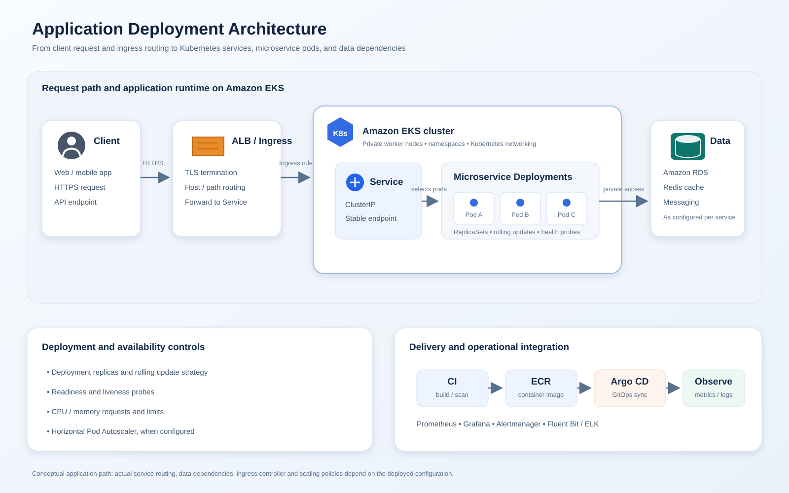

# 20 — Application Deployment Architecture



## 1. Overview

This architecture explains how application requests travel from clients through the AWS load balancer and Kubernetes networking layer to microservices running inside Amazon EKS.

Our platform contains 21 microservices. Each service runs as a containerized application and communicates with other services and required data components.

The deployment architecture covers:
- Client request handling
- AWS Application Load Balancer and Ingress
- Kubernetes Services
- Deployments, ReplicaSets and Pods
- Application-to-application communication
- Database and messaging connectivity
- Health checks and scaling
- Monitoring and logging

## 2. Objectives

- Understand the complete application request flow.
- Deploy microservices on Amazon EKS.
- Configure Kubernetes Deployments and Services.
- Understand Ingress and load balancing.
- Configure application health checks.
- Manage application-to-database communication.
- Implement rolling deployments.
- Troubleshoot application failures.

## 3. Application Request Flow

```text
User / Client
     |
     | HTTPS
     v
AWS Application Load Balancer
     |
     v
Kubernetes Ingress
     |
     v
Kubernetes Service
     |
     v
Application Pods
     |
     +----> Other Microservices
     |
     +----> Amazon RDS
     |
     +----> Redis
     |
     +----> RabbitMQ / Kafka
```

The actual routing and dependencies depend on the application configuration.

## 4. Kubernetes Deployment

A Deployment manages application replicas and rollout behavior.

Example:

```yaml
apiVersion: apps/v1
kind: Deployment
metadata:
  name: user-service
  namespace: production
spec:
  replicas: 3

  selector:
    matchLabels:
      app: user-service

  strategy:
    type: RollingUpdate
    rollingUpdate:
      maxSurge: 1
      maxUnavailable: 0

  template:
    metadata:
      labels:
        app: user-service

    spec:
      containers:
        - name: user-service
          image: <ECR_IMAGE_URI>:1.0.0

          ports:
            - containerPort: 8080

          resources:
            requests:
              cpu: "250m"
              memory: "256Mi"
            limits:
              cpu: "500m"
              memory: "512Mi"

          readinessProbe:
            httpGet:
              path: /health
              port: 8080
            initialDelaySeconds: 10
            periodSeconds: 5

          livenessProbe:
            httpGet:
              path: /health
              port: 8080
            initialDelaySeconds: 30
            periodSeconds: 10
```

The health endpoint must exist in the application. In production, readiness and liveness checks should ideally use endpoints appropriate to their different purposes.

## 5. Kubernetes Service

A Service provides a stable endpoint for accessing application Pods.

Example:

```yaml
apiVersion: v1
kind: Service
metadata:
  name: user-service
  namespace: production

spec:
  type: ClusterIP

  selector:
    app: user-service

  ports:
    - port: 80
      targetPort: 8080
      protocol: TCP
```

Other services can access it using Kubernetes DNS:

```text
user-service.production.svc.cluster.local
```

## 6. Microservices Communication

Microservices can communicate through synchronous and asynchronous patterns.

**Synchronous communication**
- HTTP/REST APIs
- Internal Kubernetes Services
- Request-response communication

**Asynchronous communication**
- RabbitMQ queues
- Kafka topics
- Event-driven processing

Use asynchronous messaging when services should process events independently rather than waiting for a direct response.

## 7. Database Connectivity

Applications access their required databases through controlled network paths and credentials.

Example Spring Boot connection settings:

```yaml
spring:
  datasource:
    url: ${DB_URL}
    username: ${DB_USERNAME}
    password: ${DB_PASSWORD}

    hikari:
      maximum-pool-size: 20
      minimum-idle: 5
      connection-timeout: 30000
```

Store credentials in an approved secret-management system. Pool sizes must be sized according to database connection limits and total application replicas.

## 8. Rolling Deployment

Kubernetes rolling updates replace application Pods gradually.

Example:

```bash
# Apply deployment
kubectl apply -f deployment.yaml

# Monitor rollout
kubectl rollout status deployment/user-service -n production

# Check Pods
kubectl get pods -n production

# Inspect deployment
kubectl describe deployment user-service -n production

# Roll back to the previous revision
kubectl rollout undo deployment/user-service -n production
```

When Argo CD manages the application, make the desired rollback change through the GitOps workflow so that Git and the cluster remain consistent.

## 9. Scaling

Horizontal Pod Autoscaler can increase or decrease replicas based on configured metrics.

Example:

```yaml
apiVersion: autoscaling/v2
kind: HorizontalPodAutoscaler
metadata:
  name: user-service
  namespace: production

spec:
  scaleTargetRef:
    apiVersion: apps/v1
    kind: Deployment
    name: user-service

  minReplicas: 3
  maxReplicas: 10

  metrics:
    - type: Resource
      resource:
        name: cpu
        target:
          type: Utilization
          averageUtilization: 70
```

HPA requires suitable metrics availability and resource requests. Node capacity must also support additional Pods.

## 10. Monitoring and Logging

Our observability architecture uses:

- Prometheus for metrics collection.
- Grafana for dashboards.
- Alertmanager for alert routing.
- Fluent Bit and Logstash for log processing.
- Elasticsearch and Kibana for log investigation.

Monitor:
- Pod restarts
- CPU and memory utilization
- Request latency
- HTTP error rates
- Deployment availability
- Database connection pool usage
- Messaging queue or consumer health

## 11. Troubleshooting

### Application Pod Not Starting

```bash
kubectl get pods -n production

kubectl describe pod <POD_NAME> -n production

kubectl logs <POD_NAME> -n production
```

### Service Not Routing Traffic

```bash
kubectl get svc -n production

kubectl get endpoints user-service -n production

kubectl describe svc user-service -n production
```

Check the Service selector, Pod labels, target port and readiness status.

### Application Cannot Connect to Database

Investigate:
- DNS resolution
- Network access and security groups
- Database endpoint and port
- Credentials and secret configuration
- Connection pool exhaustion
- Database availability

### Deployment Rollout Failure

```bash
kubectl rollout status deployment/user-service -n production

kubectl rollout history deployment/user-service -n production

kubectl get events -n production --sort-by=.lastTimestamp
```

## 12. Production Best Practices

- Run multiple replicas for critical services.
- Use readiness and liveness probes correctly.
- Define CPU and memory requests and limits.
- Use rolling updates with availability safeguards.
- Apply least-privilege service accounts.
- Restrict network access to data services.
- Store credentials securely.
- Monitor application latency and errors.
- Test rollback and recovery procedures.
- Use GitOps to maintain deployment consistency.

## 13. Expected Outcome

After completing this chapter, we should be able to explain the complete request flow, deploy microservices on EKS, configure Services and Deployments, understand database and messaging connectivity, perform rolling deployments, and troubleshoot production application issues.

## 14. Completion Checklist

- [ ] Understand the complete request flow.
- [ ] Deploy a microservice to EKS.
- [ ] Configure Kubernetes Service.
- [ ] Understand Ingress and ALB routing.
- [ ] Configure readiness and liveness probes.
- [ ] Configure resource requests and limits.
- [ ] Understand microservice communication.
- [ ] Configure database connectivity.
- [ ] Configure HPA.
- [ ] Perform rolling deployment.
- [ ] Practice rollback.
- [ ] Troubleshoot application connectivity.
- [ ] Monitor application health.

*Note: This is a reference deployment architecture. Validate the actual ingress controller, service mappings, data dependencies and scaling configuration against the deployed application.*