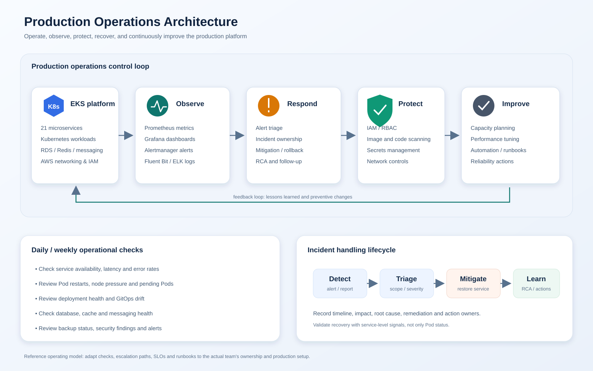

# 21 — Production Operations Architecture



## 1. Overview

Production operations cover the activities required to keep applications, infrastructure and services reliable, secure and available.

In our production DevOps platform, 21 microservices run on Amazon EKS. Production operations include monitoring, alerting, troubleshooting, incident management, security, backup validation and continuous improvement.

## 2. Objectives

- Understand day-to-day production operations.
- Monitor application and infrastructure health.
- Investigate alerts and incidents.
- Troubleshoot Kubernetes workloads.
- Maintain deployment reliability.
- Validate database and messaging health.
- Manage production security.
- Improve operational efficiency through automation.

## 3. Production Operations Architecture

The operating model has five main areas:

| Area | Responsibility |
|---|---|
| Platform | EKS, AWS infrastructure and application workloads |
| Observability | Prometheus, Grafana, Alertmanager and ELK |
| Incident response | Detection, triage, mitigation and RCA |
| Security | IAM, RBAC, secrets and vulnerability management |
| Improvement | Performance tuning, automation and reliability |

## 4. Daily Production Health Checks

### Kubernetes health

```bash
# Check cluster nodes
kubectl get nodes

# Check all namespaces
kubectl get namespaces

# Check application Pods
kubectl get pods -n production

# Check deployments
kubectl get deployments -n production

# Check Services
kubectl get services -n production

# Check recent events
kubectl get events -n production \
  --sort-by=.lastTimestamp
```

### Application health

Check:
- Application availability.
- HTTP 4xx and 5xx error rates.
- Request latency.
- Pod restart counts.
- Failed and pending Pods.
- Database connectivity.
- Messaging queue health.

### Infrastructure health

Check:
- EKS node utilization.
- CPU and memory pressure.
- Storage utilization.
- Load balancer target health.
- Database availability.
- Backup job status.

## 5. Monitoring and Alerting

Our observability stack:

- Prometheus — metrics collection.
- Grafana — dashboards and visualization.
- Alertmanager — alert routing.
- Node Exporter — host-level metrics.
- kube-state-metrics — Kubernetes object state.
- Fluent Bit and Logstash — log processing.
- Elasticsearch and Kibana — log storage and investigation.

Example Prometheus alert:

```yaml
groups:
  - name: kubernetes-alerts
    rules:
      - alert: KubernetesPodRestarting
        expr: |
          increase(kube_pod_container_status_restarts_total[10m]) > 3
        for: 5m
        labels:
          severity: warning
        annotations:
          summary: "Container restarting frequently"
          description: "A container has restarted more than three times in ten minutes."
```

Tune alert thresholds to the workload. A restart counter alone does not always indicate a customer-impacting incident.

## 6. Incident Management Workflow

### Step 1 — Detection

An alert is triggered or a user reports an issue.

### Step 2 — Triage

Identify:
- Affected service.
- Business impact.
- Number of affected users.
- Incident severity.
- Recent deployments or infrastructure changes.

### Step 3 — Investigation

Check:
- Application logs.
- Kubernetes events.
- Prometheus metrics.
- Database connections.
- Network connectivity.
- Messaging queues.

### Step 4 — Mitigation

Possible actions:
- Roll back a deployment.
- Scale application replicas.
- Restart a failed workload when appropriate.
- Restore a dependency.
- Apply a temporary configuration correction.

### Step 5 — Recovery Validation

Verify application availability, error rates, latency and critical business transactions.

### Step 6 — Root Cause Analysis

Document the timeline, root cause, customer impact, remediation and preventive actions.

## 7. Production Troubleshooting Commands

### CrashLoopBackOff

```bash
kubectl describe pod <POD_NAME> -n production

kubectl logs <POD_NAME> -n production

kubectl logs <POD_NAME> -n production --previous
```

### High CPU usage

```bash
kubectl top nodes

kubectl top pods -n production
```

### Service connectivity

```bash
kubectl get svc -n production

kubectl get endpoints -n production

kubectl describe svc <SERVICE_NAME> -n production
```

### Deployment failure

```bash
kubectl rollout status deployment/<DEPLOYMENT_NAME> \
  -n production

kubectl rollout history deployment/<DEPLOYMENT_NAME> \
  -n production
```

## 8. Backup and Recovery Operations

Production operations should include regular validation of:
- Database backups.
- Backup retention.
- Recovery procedures.
- Infrastructure configuration.
- Application deployment artifacts.
- Disaster recovery documentation.

A backup is not proven useful until a restore has been tested.

Track recovery objectives such as:
- RPO — maximum acceptable data loss.
- RTO — maximum acceptable recovery time.

## 9. Security Operations

Regularly review:
- IAM permissions.
- Kubernetes RBAC.
- Secret access.
- Container image vulnerabilities.
- CI/CD security findings.
- Network access controls.
- Production deployment permissions.

Security findings should have severity, ownership, remediation deadlines and verification evidence.

## 10. Production Operations Best Practices

- Establish clear service ownership.
- Maintain operational runbooks.
- Monitor service-level indicators.
- Configure actionable alerts.
- Avoid alert fatigue.
- Document production changes.
- Test rollback and recovery.
- Automate repetitive operational tasks.
- Review incidents and recurring failures.
- Track remediation actions to completion.

## 11. Expected Outcome

After completing this chapter, we should be able to explain how production infrastructure and applications are operated, monitored, secured and recovered. We should also be able to investigate common Kubernetes incidents and describe a complete incident response process.

## 12. Completion Checklist

- [ ] Perform daily Kubernetes health checks.
- [ ] Review Prometheus and Grafana dashboards.
- [ ] Understand Alertmanager notifications.
- [ ] Investigate application logs.
- [ ] Troubleshoot Pod failures.
- [ ] Troubleshoot Service connectivity.
- [ ] Investigate CPU and memory issues.
- [ ] Validate database and messaging health.
- [ ] Review security findings.
- [ ] Validate backup and restore procedures.
- [ ] Practice incident response.
- [ ] Write a production RCA.
- [ ] Identify operational improvements.

*Note: This is a production operations reference model. Adapt the checks, escalation paths, service objectives and runbooks to the actual platform and team's responsibilities.*