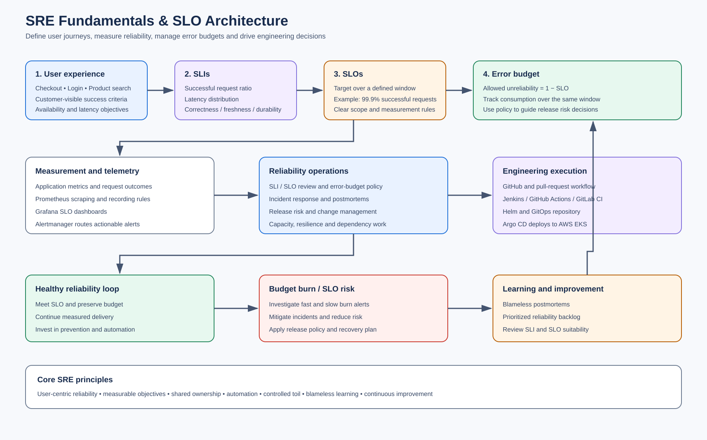

# Chapter 22 — SRE Fundamentals & SLO Architecture

## Architecture Diagram

The following diagram illustrates the complete SRE architecture, including user experience, SLIs, SLOs, error budgets, Prometheus monitoring, Grafana dashboards, Alertmanager, incident response, and continuous improvement.



## 1. Introduction to Site Reliability Engineering

Site Reliability Engineering (SRE) applies software engineering principles to infrastructure and operations problems.

The objective is to build and operate reliable, scalable, automated production systems.

Traditional operations often focus on keeping infrastructure running and responding to alerts.

SRE takes a broader approach:

- Define reliability from the user's perspective.
- Measure service reliability using SLIs.
- Set reliability targets using SLOs.
- Manage acceptable unreliability through error budgets.
- Automate repetitive operational work.
- Reduce production incidents.
- Improve deployment safety.
- Build systems that recover from failures.
- Use production incidents as opportunities to improve architecture.

For this project, SRE practices apply to the 21-microservice application running on AWS EKS.

### 1.1 Traditional operations versus SRE

| Traditional operations | SRE approach |
|---|---|
| Monitor server CPU | Monitor user-facing service performance |
| Respond to every alert | Prioritize actionable alerts |
| Focus on uptime | Define measurable reliability objectives |
| Perform manual deployments | Automate deployment workflows |
| Fix incidents individually | Identify recurring problems |
| Depend on manual recovery | Automate safe recovery |
| Measure infrastructure health | Measure service-level reliability |
| Avoid all production changes | Balance reliability and feature delivery |

### 1.2 Main SRE responsibilities

An SRE team typically works on:

1. Service reliability.
2. Monitoring and observability.
3. SLI and SLO definitions.
4. Error-budget management.
5. Incident response.
6. Capacity planning.
7. High availability.
8. Disaster recovery.
9. Deployment reliability.
10. Automation and toil reduction.
11. Performance engineering.
12. Production architecture improvements.

SRE is not simply another name for a monitoring team. It involves engineering, operations, architecture, and organizational processes.

---

## 2. SRE architecture for the 21-microservice platform

The platform consists of multiple services that collectively deliver an application experience.

Example services include:

- User Service.
- Product Catalog Service.
- Cart Service.
- Orders Service.
- Payment Service.
- Inventory Service.
- Notification Service.

The remaining services should use the actual service names in your project.

Each service has its own operational responsibilities, but some customer journeys depend on several services working together.

For example, checkout may depend on:

```text
Customer
   |
   v
API / Ingress
   |
   v
Cart Service
   |
   v
Orders Service
   |
   v
Payment Service
   |
   v
Inventory Service
   |
   v
Notification Service
```

If Payment Service fails, the customer may not be able to complete checkout even when every other service is healthy.

This is why SRE measures both individual service health and end-to-end user journeys.

### 2.1 Platform responsibilities

| Layer | Technology | SRE responsibility |
|---|---|---|
| Cloud | AWS | Infrastructure availability |
| Network | VPC, subnets, security groups | Connectivity and isolation |
| Container platform | EKS | Cluster and workload reliability |
| Application | Microservices | API availability and performance |
| Packaging | Helm | Consistent application configuration |
| Deployment | Argo CD | Desired-state reconciliation |
| CI/CD | Jenkins, GitHub Actions, GitLab | Reliable delivery pipelines |
| Metrics | Prometheus | Service-level measurements |
| Visualization | Grafana | Reliability dashboards |
| Alerting | Alertmanager | Actionable notifications |
| Logging | ELK | Failure investigation |
| Incident management | Jira Service Management | Response coordination |

---

## 3. Service Level Indicator (SLI)

An SLI is a quantitative measurement of a service's behavior.

It answers:

**How reliable is this service from the user's perspective?**

Examples:

- Successful request percentage.
- API response latency.
- Request availability.
- Payment transaction success rate.
- Data freshness.
- Message processing success.
- Storage durability.

### 3.1 Availability SLI

Availability can be measured as the proportion of valid requests that succeed.

\[
Availability =
\frac{Successful\ Requests}{Total\ Valid\ Requests}
\times 100
\]

Example:

- Total valid requests: 100,000.
- Successful requests: 99,950.
- Failed requests: 50.

\[
Availability = \frac{99950}{100000}\times100
\]

\[
Availability = 99.95\%
\]

The service achieved 99.95% request availability for the measurement window.

Define which responses count as success. For example, a successful HTTP response may not always mean a payment transaction was processed correctly.

### 3.2 Latency SLI

Latency measures how long a request takes to complete.

Example:

| Request | Response time |
|---|---:|
| Request 1 | 80 ms |
| Request 2 | 120 ms |
| Request 3 | 200 ms |
| Request 4 | 350 ms |
| Request 5 | 900 ms |

Average latency:

\[
\frac{80+120+200+350+900}{5}=330\ ms
\]

However, averages can hide slow requests.

Production latency should also be measured using percentiles:

- P50 — median latency.
- P90 — 90% of requests complete within this duration.
- P95 — 95% of requests complete within this duration.
- P99 — 99% of requests complete within this duration.

Example:

| Metric | Value |
|---|---:|
| P50 | 120 ms |
| P90 | 250 ms |
| P95 | 400 ms |
| P99 | 900 ms |

The P99 value helps identify slow requests affecting a smaller proportion of users.

### 3.3 Error rate SLI

Error rate measures the proportion of requests that fail according to the agreed service definition.

\[
Error\ Rate =
\frac{Failed\ Requests}{Total\ Requests}\times100
\]

Example:

- Total requests: 50,000.
- Failed requests: 250.

\[
Error\ Rate = \frac{250}{50000}\times100=0.5\%
\]

### 3.4 Other useful SLIs

| SLI | Measurement |
|---|---|
| Availability | Successful requests / valid requests |
| Latency | Request duration distribution |
| Correctness | Correct responses / valid operations |
| Freshness | Age of the latest available data |
| Durability | Successfully retained data |
| Processing success | Successfully processed messages / eligible messages |
| Queue delay | Time a message waits before processing |
| Transaction success | Completed business transactions / eligible transactions |

Do not select every possible SLI. Choose measurements that represent the actual service promise.

---

## 4. Service Level Objective (SLO)

An SLO is a target for an SLI over a defined measurement window.

Example:

The Payment Service should successfully process at least 99.9% of eligible requests over a rolling 30-day window.

This means:

- SLI: Successful eligible payment requests.
- SLO target: 99.9%.
- Measurement window: Rolling 30 days.

### 4.1 Example SLO definitions

| Service | SLI | Example SLO |
|---|---|---|
| User | Successful authentication requests | 99.9% |
| Product Catalog | Successful catalog requests | 99.9% |
| Cart | Successful cart operations | 99.9% |
| Orders | Successful order API requests | 99.95% |
| Payment | Successful eligible payment operations | 99.95% |
| Inventory | Successful inventory operations | 99.9% |
| Notification | Successful message processing within target | 99.5% |

These are example targets for learning and architecture planning, not measured production commitments.

Actual objectives should be agreed with service owners and business stakeholders based on user expectations, architecture, cost, and operational capability.

### 4.2 Availability targets

| SLO | Approximate allowed downtime per 30-day month |
|---|---:|
| 99% | 7 hours 12 minutes |
| 99.5% | 3 hours 36 minutes |
| 99.9% | 43 minutes 12 seconds |
| 99.95% | 21 minutes 36 seconds |
| 99.99% | 4 minutes 19 seconds |

These values assume a 30-day month and a time-based availability model.

Request-based SLOs use the proportion of eligible requests that succeed, so their error budgets are based on request counts rather than downtime minutes.

### 4.3 Example: Payment Service SLO

Assume:

```text
Service: Payment Service

SLI:
Successful eligible payment requests / total eligible requests

SLO:
99.95%

Measurement Window:
Rolling 30 days
```

For 1,000,000 eligible requests:

Allowed failures:

\[
1000000 \times (1-0.9995)=500
\]

The error budget is 500 unsuccessful eligible requests.

If 300 requests fail:

\[
Error\ Budget\ Consumption =
\frac{300}{500}\times100=60\%
\]

The service has consumed 60% of its error budget.

---

## 5. Service Level Agreement (SLA)

An SLA is a formal agreement between a service provider and a customer.

It can contain:

- Availability commitments.
- Support response targets.
- Service credits.
- Exclusions.
- Measurement methods.
- Reporting obligations.
- Escalation procedures.

### SLI vs SLO vs SLA

| Term | Meaning | Example |
|---|---|---|
| SLI | Actual measurement | 99.92% availability |
| SLO | Internal reliability target | 99.9% availability |
| SLA | Formal customer commitment | Contractual availability commitment |

The distinction is important.

An internal SLO does not automatically become a contractual SLA.

An organization may choose a more ambitious internal SLO than its external SLA to provide a reliability buffer.

---

## 6. Error budgets

An error budget is the amount of unreliability allowed by the SLO.

\[
Error\ Budget = 1-SLO
\]

For a 99.9% SLO:

\[
1-0.999=0.001
\]

The error budget is 0.1%.

### 6.1 Example calculation

Assume:

- SLO: 99.9%.
- Total eligible requests: 1,000,000.
- Allowed failed requests: 1,000.
- Actual failed requests: 400.

Error budget consumption:

\[
\frac{400}{1000}\times100=40\%
\]

Remaining budget:

\[
100-40=60\%
\]

### 6.2 Error-budget policy

A team should agree on how remaining error budget influences engineering and release decisions.

Example policy:

| Budget state | Example response |
|---|---|
| Healthy | Continue planned delivery with standard safeguards |
| Warning | Investigate reliability trends and review risky changes |
| Low | Prioritize reliability work and increase release scrutiny |
| Exhausted | Apply the agreed release policy and focus on restoration |

An exhausted budget does not automatically mean every deployment must stop. The organization should define its policy, exceptions, approval authority, and criteria for resuming normal delivery.

### 6.3 Error-budget review

Review:

1. Current SLO attainment.
2. Error-budget consumption.
3. Recent incidents.
4. Release-related failures.
5. Service dependencies.
6. Corrective actions.
7. Planned high-risk changes.

Use Jira to track reliability improvements and incident actions.

---

## 7. Measuring SLOs with Prometheus

Prometheus collects metrics from applications and infrastructure.

For this project, application instrumentation and Kubernetes monitoring provide the measurements required for SLIs.

### 7.1 Example application metrics

An application may expose metrics such as:

```text
http_requests_total
http_request_duration_seconds_bucket
http_request_duration_seconds_sum
http_request_duration_seconds_count
```

These are example metric names. Your application must expose and label metrics consistently for the queries to work.

### 7.2 Availability query

If the application exposes `http_requests_total` with `status` and `service` labels:

```promql
sum(
  rate(http_requests_total{
    service="payment",
    status!~"5.."
  }[5m])
)
/
sum(
  rate(http_requests_total{
    service="payment"
  }[5m])
)
```

This is a simplified example.

Before using it, define:

- Which status codes count as failures.
- Whether client errors should be excluded.
- Whether health checks should be excluded.
- How retries are counted.
- Which routes are in scope.
- How missing telemetry is treated.

Do not assume that all non-5xx responses represent successful business operations.

### 7.3 Error rate query

```promql
sum(
  rate(http_requests_total{
    service="payment",
    status=~"5.."
  }[5m])
)
/
sum(
  rate(http_requests_total{
    service="payment"
  }[5m])
)
```

This estimates the fraction of requests returning HTTP 5xx responses over five minutes.

It is not necessarily equivalent to a complete business transaction failure rate.

### 7.4 Latency query

If the application exposes a Prometheus histogram:

```promql
histogram_quantile(
  0.95,
  sum by (le) (
    rate(http_request_duration_seconds_bucket{
      service="payment"
    }[5m])
  )
)
```

This estimates P95 request latency.

For P99:

```promql
histogram_quantile(
  0.99,
  sum by (le) (
    rate(http_request_duration_seconds_bucket{
      service="payment"
    }[5m])
  )
)
```

Ensure histogram buckets are appropriate for the service's latency distribution.

---

## 8. SLO recording rules

For production reporting, avoid repeating complex queries in every dashboard panel.

Use Prometheus recording rules.

Example:

```yaml
groups:
  - name: payment-slo-recording-rules
    interval: 30s
    rules:
      - record: service:payment_requests:rate5m
        expr: |
          sum(rate(http_requests_total{service="payment"}[5m]))

      - record: service:payment_errors:rate5m
        expr: |
          sum(rate(http_requests_total{
            service="payment",
            status=~"5.."
          }[5m]))

      - record: service:payment_error_ratio:rate5m
        expr: |
          service:payment_errors:rate5m
          /
          service:payment_requests:rate5m
```

The expressions assume the metric labels and series exist.

### Configuration considerations

- Store rule files in version control.
- Validate PromQL before deployment.
- Avoid unbounded labels.
- Monitor rule evaluation failures.
- Test behavior when traffic is zero.
- Keep SLI definitions documented.
- Use consistent service labels.

A division-by-zero or missing-series case must be handled explicitly in the complete production rule design.

---

## 9. SLO-based alerting

Traditional alerts often trigger when an infrastructure threshold is crossed.

SRE alerting should also consider how quickly the service is consuming its error budget.

### 9.1 Fast burn alerts

A fast burn alert detects rapid reliability degradation.

Example situations:

- Payment API starts returning many 5xx responses.
- Checkout latency increases sharply.
- A major dependency becomes unavailable.

The objective is to identify a reliability event before the entire budget is consumed.

### 9.2 Slow burn alerts

A slow burn alert detects sustained degradation.

Example situations:

- A small error rate continues for several days.
- Message processing gradually falls behind.
- A service repeatedly misses its latency target.

### 9.3 Multi-window burn-rate concept

For an SLO of 99.9%, the allowed error ratio is:

\[
1-0.999=0.001
\]

If the observed error ratio is 0.01:

\[
Burn\ Rate = \frac{0.01}{0.001}=10
\]

The service is consuming its error budget at ten times the sustainable rate.

A multi-window alert combines a shorter and a longer measurement window to reduce noisy alerts and detect meaningful sustained consumption.

Example conceptual PromQL:

```promql
(
  service:payment_error_ratio:rate5m
  > 14.4 * 0.001
)
and
(
  service:payment_error_ratio:rate1h
  > 14.4 * 0.001
)
```

This is an illustrative fast-burn condition, not a complete universal alert rule. Production alert thresholds should be designed around the chosen SLO window, traffic volume, alert duration, and operational response requirements.

### 9.4 Alert routing

```text
Prometheus
    |
    v
SLO Alert Rules
    |
    v
Alertmanager
    |
    +----> On-call notification
    |
    +----> Operations channel
    |
    +----> Jira incident integration
```

The Jira integration requires an actual configured and tested API or webhook workflow.

---

## 10. Grafana SLO dashboards

Create dashboards that answer operational questions.

### Dashboard 1 — Service reliability

Panels:

- Availability SLI.
- Error rate.
- P50 latency.
- P95 latency.
- P99 latency.
- Request throughput.
- SLO attainment.

### Dashboard 2 — Error budget

Panels:

- SLO target.
- Current measured SLI.
- Remaining error budget.
- Error-budget consumption.
- Burn rate.
- Historical consumption trend.

### Dashboard 3 — Microservice reliability

Panels:

- Service-level availability.
- Service-level latency.
- Service-level error rate.
- Request volume.
- Dependency failures.
- Service health.

### Dashboard 4 — Platform reliability

Panels:

- EKS node readiness.
- Pod availability.
- Container restarts.
- Resource utilization.
- Application deployment health.
- Cluster capacity.

Use consistent dashboard variables for environment, namespace, and service.

---

## 11. SRE and Kubernetes operations

SRE must understand how Kubernetes affects application reliability.

### 11.1 Pod availability

A service may have multiple replicas.

Example:

```yaml
apiVersion: apps/v1
kind: Deployment
metadata:
  name: payment-service
  namespace: production
spec:
  replicas: 3
  selector:
    matchLabels:
      app: payment-service
  template:
    metadata:
      labels:
        app: payment-service
    spec:
      containers:
        - name: payment-service
          image: ACCOUNT_ID.dkr.ecr.REGION.amazonaws.com/payment-service:IMAGE_TAG
          ports:
            - containerPort: 8080
          readinessProbe:
            httpGet:
              path: /health/ready
              port: 8080
            initialDelaySeconds: 10
            periodSeconds: 5
          livenessProbe:
            httpGet:
              path: /health/live
              port: 8080
            initialDelaySeconds: 20
            periodSeconds: 10
          resources:
            requests:
              cpu: "250m"
              memory: "256Mi"
            limits:
              cpu: "1000m"
              memory: "1Gi"
```

Replace the example image reference, region, account ID, and tag before use.

### 11.2 Readiness and liveness

Readiness determines whether a pod should receive traffic.

Liveness determines whether Kubernetes should restart a container that is considered unhealthy.

Do not use identical probe logic blindly.

A dependency outage should not necessarily cause every application pod to fail liveness checks and restart repeatedly.

### 11.3 Pod disruption budget

A PodDisruptionBudget helps limit voluntary disruptions.

Example:

```yaml
apiVersion: policy/v1
kind: PodDisruptionBudget
metadata:
  name: payment-service-pdb
  namespace: production
spec:
  minAvailable: 2
  selector:
    matchLabels:
      app: payment-service
```

This assumes the deployment normally has enough healthy replicas to satisfy the policy.

A PDB does not protect against every failure, such as simultaneous node failures or application bugs.

### 11.4 Kubernetes operational checks

```bash
kubectl get nodes
kubectl get pods -n production
kubectl get deployments -n production
kubectl get services -n production
kubectl get events -n production --sort-by=.lastTimestamp
```

Check a specific deployment:

```bash
kubectl describe deployment payment-service -n production
```

Check rollout status:

```bash
kubectl rollout status deployment/payment-service -n production
```

Check pod logs:

```bash
kubectl logs <pod-name> -n production
```

These commands provide diagnostic evidence but do not replace service-level SLI measurement.

---

## 12. SRE and GitOps deployment reliability

Deployment reliability is an important part of SRE.

The project uses GitHub, CI/CD pipelines, ECR, Helm, Argo CD, and EKS.

### Deployment workflow

```text
Developer
    |
    v
GitHub Pull Request
    |
    v
CI Pipeline
    |
    +--> Unit Tests
    |
    +--> SonarQube
    |
    +--> Trivy
    |
    +--> Veracode (where configured)
    |
    v
Docker Image
    |
    v
Amazon ECR
    |
    v
GitOps Repository
    |
    v
Argo CD
    |
    v
AWS EKS
    |
    v
SLI / SLO Validation
```

### SRE deployment responsibilities

Before deployment:

- Review recent SLO performance.
- Review remaining error budget.
- Identify affected services.
- Check dependencies.
- Validate test results.
- Review rollback procedures.
- Confirm monitoring coverage.

After deployment:

- Check Argo CD synchronization.
- Check deployment health.
- Verify pod readiness.
- Review error rate.
- Review latency.
- Verify key user journeys.
- Watch for error-budget burn.

### Deployment policy

If a service is consuming its error budget rapidly, the team should investigate the cause and follow its agreed release policy.

This may include:

- Pausing risky releases.
- Increasing validation.
- Prioritizing reliability fixes.
- Rolling back a harmful change.
- Requiring additional review.

Do not use error-budget status as the only deployment safety control.

---

## 13. SRE and incident management

SRE teams participate in production incident response.

Example:

Payment Service availability drops below its SLO.

The response process:

1. Alert is received.
2. Incident is created in Jira Service Management.
3. Incident owner is assigned.
4. Impact is assessed.
5. Prometheus and Grafana are reviewed.
6. ELK logs are investigated.
7. Kubernetes health is checked.
8. Recent deployments are reviewed.
9. Mitigation is performed.
10. Service health is validated.
11. Incident is resolved.
12. Post-incident review is completed.

### Example incident record

```text
Incident:
Payment Service availability degradation

Environment:
Production

Affected Service:
Payment Service

Priority:
P1

Detection:
SLO burn-rate alert

Impact:
Checkout requests failing

Investigation:
Application logs, EKS workload status,
Prometheus metrics and recent deployment history

Recovery:
Document the confirmed mitigation

Follow-up:
Blameless postmortem and corrective actions
```

Record actual times, affected users, and recovery evidence. Do not assume that an alert firing means a customer-facing outage has been confirmed.

---

## 14. SRE error-budget review with Jira

Jira provides a place to track reliability improvements.

Create an SRE improvement epic:

```text
EPIC:
Improve Production Reliability
```

Example stories:

- Define Payment Service SLO.
- Add request success metrics.
- Create SLO Grafana dashboard.
- Configure burn-rate alerts.
- Improve Kubernetes readiness checks.
- Add payment failure integration tests.
- Improve production rollback runbook.
- Reduce recurring incident causes.

Each item should have:

- Service component.
- Owner.
- Priority.
- Acceptance criteria.
- Target date.
- Validation evidence.

Use Jira to coordinate and track work, while Prometheus and Grafana calculate and display live reliability measurements.

---

## 15. SRE service dependency management

Microservices depend on other services and infrastructure.

Example checkout dependencies:

```text
Checkout Journey
       |
       v
   Cart Service
       |
       v
  Orders Service
       |
       +------> Payment Service
       |
       +------> Inventory Service
       |
       +------> Notification Service
```

A failure in one dependency can affect the overall customer journey.

### Dependency reliability questions

For each service, document:

1. Which services does it call?
2. Which databases does it use?
3. Which queues or topics does it consume?
4. What happens if a dependency is slow?
5. What happens if a dependency is unavailable?
6. Are retries bounded?
7. Are operations idempotent?
8. Is there a timeout?
9. Is there a fallback?
10. How is the failure monitored?

### Dependency protection patterns

Depending on application requirements, consider:

- Timeouts.
- Bounded retries.
- Exponential backoff.
- Jitter.
- Circuit breakers.
- Bulkheads.
- Idempotency keys.
- Dead-letter queues.
- Graceful degradation.

These are application architecture patterns. Kubernetes alone does not automatically implement them.

---

## 16. SRE capacity and performance responsibilities

SRE must ensure that services have enough capacity for normal and peak traffic.

Review:

- CPU usage.
- Memory usage.
- Network throughput.
- Request rate.
- Queue depth.
- Database connections.
- Pod scheduling.
- Node capacity.
- Autoscaling behavior.

Example commands:

```bash
kubectl top nodes
kubectl top pods -n production
```

These require the relevant metrics infrastructure to be available.

### Capacity planning process

1. Collect historical traffic.
2. Identify peak usage periods.
3. Measure resource consumption.
4. Identify service bottlenecks.
5. Estimate future demand.
6. Test scaling behavior.
7. Review database and dependency limits.
8. Define capacity alerts.
9. Validate recovery during load spikes.

Do not assume that increasing replicas will solve every performance issue. Database limits, connection pools, external APIs, and network bottlenecks may remain unchanged.

---

## 17. SRE toil reduction

Toil is repetitive operational work that can be automated.

Examples:

| Manual work | Automation opportunity |
|---|---|
| Repeated pod health checks | Automated health dashboards and alerts |
| Manual deployment validation | CI/CD validation gates |
| Repeated log searches | Saved ELK queries |
| Manual incident notifications | Alert routing and Jira integration |
| Manual release status updates | Deployment status integration |
| Repeated configuration changes | Terraform and GitOps |
| Manual operational reports | Automated reporting |

The objective is not to automate every task regardless of risk.

Automate repeatable, well-understood processes while preserving human approval for sensitive or high-impact operations.

---

## 18. SRE operational review cadence

| Cadence | Activity |
|---|---|
| Daily | Review critical alerts and active incidents |
| Weekly | Review SLO attainment and error-budget consumption |
| Weekly | Review recurring operational problems |
| Sprint review | Review reliability engineering backlog |
| Monthly | Review incident trends and service performance |
| Monthly | Review capacity and dependency risks |
| Quarterly | Review SLO suitability and reliability investment |

Service owners should participate in SLO reviews so that objectives remain connected to actual business requirements.

---

## 19. SRE implementation checklist

### SLI and SLO design

- [ ] Identify critical user journeys.
- [ ] Identify service owners.
- [ ] Define service-level indicators.
- [ ] Define SLO targets.
- [ ] Define measurement windows.
- [ ] Define exclusions and counting rules.
- [ ] Document SLO ownership.
- [ ] Review targets with stakeholders.

### Prometheus and Grafana

- [ ] Verify application metrics.
- [ ] Validate metric labels.
- [ ] Create SLI PromQL queries.
- [ ] Create recording rules.
- [ ] Validate SLO calculations.
- [ ] Build reliability dashboards.
- [ ] Monitor missing telemetry.

### Alerting

- [ ] Configure SLO alerts.
- [ ] Design fast-burn alerts.
- [ ] Design slow-burn alerts.
- [ ] Route actionable notifications.
- [ ] Test alert delivery.
- [ ] Avoid duplicate or noisy alerts.
- [ ] Document response procedures.

### Kubernetes and deployment

- [ ] Review readiness probes.
- [ ] Review liveness probes.
- [ ] Review resource requests and limits.
- [ ] Review PodDisruptionBudgets.
- [ ] Review deployment strategy.
- [ ] Validate Argo CD health.
- [ ] Test recovery procedures.

### Operational process

- [ ] Define error-budget policy.
- [ ] Assign incident ownership.
- [ ] Create reliability backlog.
- [ ] Review recurring incidents.
- [ ] Conduct postmortems.
- [ ] Track corrective actions.
- [ ] Review reliability trends.

---

## 20. Common SRE mistakes

### Mistake 1 — Measuring only infrastructure uptime

A healthy EC2 instance does not guarantee that checkout is working.

Measure the customer-facing service behavior.

### Mistake 2 — Defining SLOs without user requirements

Do not select 99.99% simply because it looks impressive.

Consider business impact, architecture, cost, and achievable reliability.

### Mistake 3 — Alerting on every metric

Not every metric threshold requires an incident.

Prioritize alerts that require investigation or action.

### Mistake 4 — Ignoring error budgets

A team can meet deployment targets while continuously degrading production reliability.

Review error-budget consumption alongside delivery performance.

### Mistake 5 — Treating all services identically

Payment, product search, notifications, and background workers have different reliability requirements.

Define suitable service-level objectives for each service.

### Mistake 6 — Using averages alone

Average latency can hide severe slow-request behavior.

Use percentile measurements and appropriate request-volume context.

### Mistake 7 — Assuming Kubernetes creates application reliability

Kubernetes can restart containers and schedule workloads, but it cannot automatically correct application logic errors, database consistency problems, or faulty business workflows.

---

## 21. Final SRE architecture flow

```text
Customer Requests
       |
       v
Microservices on AWS EKS
       |
       v
Application Metrics
       |
       v
Prometheus
       |
       +----> SLI Calculations
       |
       +----> SLO Recording Rules
       |
       +----> Error-Budget Calculations
       |
       v
Grafana SLO Dashboards
       |
       v
Alertmanager
       |
       +----> On-call Response
       |
       +----> Incident Integration
       |
       v
Jira Service Management
       |
       v
Incident Investigation
       |
       v
Recovery and Validation
       |
       v
Postmortem and Corrective Actions
       |
       v
Reliability Engineering Backlog
       |
       v
Safer CI/CD and GitOps Releases
       |
       v
Improved Production Reliability
```

## 22. Expected outcome

After implementing this chapter, the platform should have a defined SRE foundation covering:

- SRE responsibilities and principles.
- User-focused service reliability.
- SLI, SLO, and SLA definitions.
- Error-budget calculations.
- Prometheus-based reliability measurements.
- SLO recording rules.
- Burn-rate alerting concepts.
- Grafana reliability dashboards.
- Kubernetes workload reliability.
- GitOps deployment reliability.
- Incident response integration.
- Jira reliability work tracking.
- Service dependency management.
- Capacity planning.
- Toil reduction.
- Reliability review processes.

### Final principle

SRE is about balancing service reliability with engineering delivery.

The objective is not to eliminate every possible failure. It is to measure reliability, understand risk, respond effectively, and continuously improve the production platform.

**Chapter 22 complete — SRE Fundamentals & SLO Architecture.**