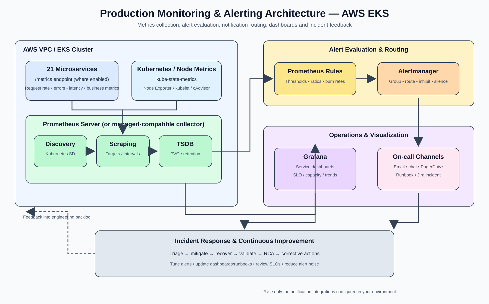

# Chapter 23 — Monitoring and Alerting Architecture

## Monitoring and Alerting Architecture Diagram

The following diagram represents the complete production monitoring architecture for our 21-microservice application running on AWS EKS.

It shows how application metrics, Kubernetes metrics and infrastructure metrics are collected by Prometheus, evaluated through alerting rules, routed by Alertmanager, visualized in Grafana and used during incident investigation.



**Diagram components:**
- Application microservices and metrics endpoints
- Node Exporter and kube-state-metrics
- Prometheus discovery, scraping and time-series storage
- Prometheus alerting rules
- Alertmanager grouping and notification routing
- Grafana dashboards
- On-call notifications and incident response
- Continuous improvement and engineering feedback

## 1. Introduction

Monitoring is a critical part of production DevOps.

Deploying an application successfully does not mean the application will remain healthy. After deployment, we must continuously monitor:

- Application availability
- HTTP request rate
- Application response time
- HTTP 4xx and 5xx errors
- CPU and memory utilization
- Kubernetes pod health
- Node health
- Container restarts
- Database connectivity
- Network and dependency failures
- Queue and message processing
- Application logs

For our production-style project, we use an AWS EKS cluster running 21 microservices.

The monitoring architecture uses:

| Tool | Responsibility |
|---|---|
| Prometheus | Metrics collection and storage |
| Grafana | Metrics visualization and dashboards |
| Alertmanager | Alert grouping, routing and notification management |
| Node Exporter | Linux node-level metrics |
| kube-state-metrics | Kubernetes object-state metrics |
| Kubernetes kubelet/cAdvisor | Container resource metrics |
| ELK Stack | Centralized log collection, search and analysis |
| Jira | Incident tracking and corrective actions |

The objective is to detect problems early, understand their impact and restore services before failures affect more users.

## 2. Monitoring Architecture Diagram

The following diagram illustrates the monitoring flow from application and Kubernetes metrics through Prometheus, alert evaluation, Alertmanager, Grafana and incident response.


**Diagram file location:**

`architecture/diagrams/monitoring-and-alerting-architecture.svg`

## 3. High-Level Monitoring Flow

The complete monitoring flow is:

1. Microservices expose application metrics.
2. Node Exporter exposes Linux system metrics.
3. kube-state-metrics exposes Kubernetes resource-state metrics.
4. Prometheus discovers monitoring targets.
5. Prometheus scrapes metrics at configured intervals.
6. Prometheus stores time-series data.
7. Prometheus evaluates alerting and recording rules.
8. Alertmanager receives firing alerts.
9. Alertmanager groups and routes notifications.
10. Grafana displays dashboards and trends.
11. Engineers investigate alerts using metrics, logs and runbooks.
12. Incidents and corrective actions are tracked through Jira.

This provides visibility across application, container, Kubernetes and infrastructure layers.

## 4. Monitoring Architecture Layers

### Layer 1 — Application Monitoring

Application monitoring focuses on the health and performance of individual microservices.

For example, the application contains services such as:

- User Service
- Product Catalog Service
- Cart Service
- Orders Service
- Payment Service
- Inventory Service
- Notification Service
- Other application services

Each service should expose useful application metrics.

Example metrics:

```text
http_requests_total
http_request_duration_seconds
http_requests_in_progress
application_errors_total
database_connection_pool_active
database_connection_pool_idle
```

The exact metric names depend on the application instrumentation.

Important application measurements:

| Metric | Purpose |
|---|---|
| Request rate | Number of requests received |
| Error rate | Percentage or count of failed requests |
| Latency | Time taken to process requests |
| Throughput | Number of successfully processed operations |
| Active connections | Current application connections |
| Queue depth | Pending messages or jobs |
| Database pool usage | Active and idle connections |

For HTTP services, monitor request rate, error rate and latency together.

A service can be running but still be unhealthy from the user's perspective. For example, a service may return HTTP 200 responses while taking several seconds to respond.

### Layer 2 — Kubernetes Monitoring

Kubernetes monitoring provides visibility into cluster resources and workload state.

Monitor:

- Pod status
- Deployment availability
- Replica count
- Container restarts
- Pending pods
- CrashLoopBackOff
- Image pull failures
- CPU and memory requests
- CPU and memory limits
- Node readiness
- Persistent volume status

Important components:

**kube-state-metrics**

Exposes Kubernetes object-state information.

Examples include:

- Desired deployment replicas
- Available deployment replicas
- Pod phase
- Container waiting reasons
- Node readiness
- Persistent volume claim status

**kubelet and cAdvisor metrics**

Provide container and node-related resource measurements, including CPU and memory usage.

**Node Exporter**

Exposes operating-system and host-level metrics such as:

- CPU utilization
- Memory utilization
- Filesystem utilization
- Disk I/O
- Network traffic
- System load

Do not confuse Node Exporter with kube-state-metrics. Node Exporter monitors host-level metrics; kube-state-metrics reports Kubernetes object state.

### Layer 3 — Infrastructure Monitoring

Infrastructure monitoring covers the AWS and Kubernetes infrastructure supporting the application.

Monitor:

- EKS worker nodes
- EC2 instance health
- CPU and memory
- EBS volume capacity and performance
- Network connectivity
- Load balancer health
- RDS database health
- Storage capacity
- Cluster capacity

For AWS-managed services, use the appropriate AWS monitoring integrations and service metrics where required. Prometheus does not automatically collect every AWS service metric without an exporter, integration or other collection mechanism.

### Layer 4 — Log Monitoring

Metrics tell us that a problem exists. Logs often help explain why it happened.

Our log monitoring architecture uses the ELK Stack:

- Elasticsearch — stores and indexes logs.
- Logstash — processes and transforms logs where required.
- Kibana — searches and visualizes logs.
- Fluent Bit — collects and forwards container logs.

Example flow:

```text
Application Containers
        |
        v
Container Log Files
        |
        v
Fluent Bit
        |
        v
Logstash (if used for processing)
        |
        v
Elasticsearch
        |
        v
Kibana
```

Use structured JSON logs where possible.

Example:

```json
{
  "timestamp": "2026-11-18T10:30:00Z",
  "level": "ERROR",
  "service": "payment-service",
  "environment": "production",
  "trace_id": "example-request-id",
  "message": "Database connection timeout"
}
```

The `trace_id` field here is an example correlation identifier. It does not imply that distributed tracing infrastructure is deployed.

Avoid logging passwords, access tokens, payment-card details or other sensitive information.

## 5. Prometheus Architecture

Prometheus is the primary metrics collection and alert evaluation component.

Its main responsibilities are:

1. Discover monitoring targets.
2. Scrape metrics endpoints.
3. Store metrics as time-series data.
4. Execute PromQL queries.
5. Evaluate recording rules.
6. Evaluate alerting rules.
7. Send firing alerts to Alertmanager.

### Prometheus components

| Component | Responsibility |
|---|---|
| Prometheus server | Scraping, querying and rule evaluation |
| Service discovery | Finds monitoring targets |
| TSDB | Stores time-series metrics |
| PromQL | Queries metrics |
| Recording rules | Precompute frequently used queries |
| Alerting rules | Identify conditions requiring attention |
| Alertmanager | Manages alert notifications |

### Prometheus deployment options

For an EKS cluster, Prometheus can be deployed using:

- Helm
- Prometheus Operator
- kube-prometheus-stack

A Helm-based deployment is a practical way to manage Prometheus and related monitoring components.

The Prometheus Operator manages Prometheus-related custom resources such as:

- ServiceMonitor
- PodMonitor
- PrometheusRule
- Alertmanager configuration resources

The Operator approach is useful when Kubernetes-native monitoring configuration is preferred.

## 6. Deploying Prometheus on AWS EKS

First, configure kubectl to connect to the EKS cluster.

```bash
aws eks update-kubeconfig \
  --region ap-south-1 \
  --name production-eks
```

Verify the cluster connection:

```bash
kubectl get nodes
```

Create a monitoring namespace:

```bash
kubectl create namespace monitoring
```

Add the Prometheus community Helm repository:

```bash
helm repo add prometheus-community \
  https://prometheus-community.github.io/helm-charts

helm repo update
```

Install kube-prometheus-stack:

```bash
helm install monitoring prometheus-community/kube-prometheus-stack \
  --namespace monitoring
```

Check the deployed resources:

```bash
kubectl get pods -n monitoring
```

Check the services:

```bash
kubectl get svc -n monitoring
```

Check the Helm release:

```bash
helm list -n monitoring
```

For a production deployment, do not rely on default chart values without reviewing them.

Create a version-controlled `values.yaml` file and configure:

- Persistent storage
- Resource requests and limits
- Retention duration
- Storage capacity
- Authentication and network access
- Alertmanager routing
- Grafana access
- Node placement and tolerations
- High availability requirements
- Chart version pinning

Example repository structure:

```text
monitoring/
├── prometheus/
│   ├── values.yaml
│   ├── prometheus-rules.yaml
│   └── service-monitors/
├── alertmanager/
│   └── alertmanager-values.yaml
├── grafana/
│   ├── dashboards/
│   └── dashboards-provisioning/
├── exporters/
│   ├── node-exporter/
│   └── kube-state-metrics/
└── README.md
```

Store actual credentials in an approved secrets-management system. Do not commit credentials to Git.

## 7. How Prometheus Discovers Kubernetes Targets

Prometheus needs to identify which endpoints should be scraped.

Kubernetes service discovery helps Prometheus find targets dynamically.

For example, suppose the application has 21 microservices.

If a new pod is created, its IP address can change. Manually maintaining every pod IP in a Prometheus configuration is not a reliable approach.

Kubernetes service discovery allows Prometheus to discover targets using Kubernetes API information.

Common discovery roles include:

- `pod`
- `service`
- `endpoints`
- `endpointslice`
- `node`

The exact discovery configuration depends on the Prometheus deployment and Operator configuration.

### ServiceMonitor example

A ServiceMonitor tells Prometheus Operator how to discover and scrape a Kubernetes Service.

Example:

```yaml
apiVersion: monitoring.coreos.com/v1
kind: ServiceMonitor
metadata:
  name: payment-service-monitor
  namespace: monitoring
  labels:
    release: monitoring
spec:
  namespaceSelector:
    matchNames:
      - production
  selector:
    matchLabels:
      app: payment-service
  endpoints:
    - port: metrics
      path: /metrics
      interval: 30s
```

The Kubernetes Service must have a matching label and a named port called `metrics`.

Example Service:

```yaml
apiVersion: v1
kind: Service
metadata:
  name: payment-service
  namespace: production
  labels:
    app: payment-service
spec:
  selector:
    app: payment-service
  ports:
    - name: metrics
      port: 9090
      targetPort: 9090
```

Apply the resources:

```bash
kubectl apply -f payment-service.yaml
kubectl apply -f payment-service-monitor.yaml
```

Verify:

```bash
kubectl get servicemonitor -n monitoring
kubectl get svc -n production
```

Important: The ServiceMonitor must match the labels and namespace selectors configured on the Prometheus resource. A correctly created ServiceMonitor can still be ignored if its labels do not match Prometheus' selection rules.

## 8. Application Metrics Exposure

Prometheus generally scrapes an HTTP metrics endpoint exposed by an application or exporter.

For example:

```text
http://payment-service.production.svc.cluster.local:9090/metrics
```

The application must expose the endpoint and provide metrics in Prometheus exposition format.

For a Spring Boot application, Micrometer with a Prometheus registry is a common implementation.

Illustrative Maven dependency:

```xml
<dependency>
    <groupId>io.micrometer</groupId>
    <artifactId>micrometer-registry-prometheus</artifactId>
</dependency>
```

The application must also configure the relevant Actuator endpoints and security rules.

Example Spring Boot configuration:

```yaml
management:
  endpoints:
    web:
      exposure:
        include: health,prometheus
  endpoint:
    health:
      probes:
        enabled: true
```

The exact endpoint path depends on the application's configuration. Confirm that the metrics endpoint is accessible from the Prometheus collector without exposing it publicly.

Application metrics should include:

- Request count
- Request duration
- Error count
- JVM memory and garbage collection for Java services
- Database pool utilization
- Business transaction outcomes
- Queue processing metrics

Avoid high-cardinality labels such as user IDs, order IDs, session IDs or raw URLs containing unique values. Excessive cardinality increases Prometheus storage and memory requirements.

## 9. Node Exporter Deployment

Node Exporter exposes host-level metrics for Linux nodes.

When deployed in Kubernetes, it is commonly configured as a DaemonSet so that an exporter runs on each eligible node.

The kube-prometheus-stack chart commonly includes Node Exporter and its scrape configuration, depending on the selected chart values.

Verify the deployment:

```bash
kubectl get pods -n monitoring -o wide
```

Check Node Exporter services:

```bash
kubectl get svc -n monitoring | grep node-exporter
```

Example PromQL:

CPU usage percentage:

```promql
100 * (1 - avg by (instance) (
  rate(node_cpu_seconds_total{mode="idle"}[5m])
))
```

Memory usage percentage:

```promql
100 * (
  1 -
  node_memory_MemAvailable_bytes /
  node_memory_MemTotal_bytes
)
```

Filesystem usage percentage:

```promql
100 * (
  1 -
  node_filesystem_avail_bytes{
    mountpoint="/",
    fstype!=""
  } /
  node_filesystem_size_bytes{
    mountpoint="/",
    fstype!=""
  }
)
```

Check filesystem labels before using a production alert. Different nodes can have multiple mount points and filesystem types.

## 10. kube-state-metrics

kube-state-metrics exposes metrics about the state of Kubernetes objects.

It helps identify problems such as:

- Desired replicas not available
- Pods in unexpected states
- Containers waiting to start
- Nodes not ready
- Persistent volume claims not bound

Example PromQL to identify unavailable deployment replicas:

```promql
kube_deployment_spec_replicas
-
kube_deployment_status_replicas_available
```

Example query for non-ready nodes:

```promql
kube_node_status_condition{
  condition="Ready",
  status="true"
} == 0
```

Confirm the exact metric labels and availability in your installed version before creating alert rules.

## 11. Prometheus Scrape Configuration

A scrape configuration defines how Prometheus collects metrics.

A simplified standalone Prometheus configuration example:

```yaml
global:
  scrape_interval: 30s
  evaluation_interval: 30s

scrape_configs:
  - job_name: prometheus
    static_configs:
      - targets:
          - localhost:9090

  - job_name: node-exporter
    static_configs:
      - targets:
          - node-exporter.monitoring.svc.cluster.local:9100
```

This example demonstrates static targets. In an EKS production deployment using the Prometheus Operator, Kubernetes service discovery and ServiceMonitor or PodMonitor resources are commonly used instead.

Important configuration fields:

| Field | Purpose |
|---|---|
| `scrape_interval` | How often metrics are collected |
| `scrape_timeout` | Maximum time allowed for a scrape |
| `job_name` | Identifies a scrape job |
| `targets` | Endpoints to scrape |
| `metrics_path` | Metrics endpoint path |
| `relabel_configs` | Modify or filter discovered targets |
| `metric_relabel_configs` | Modify or filter samples before ingestion |

Do not set scrape intervals unnecessarily low. More frequent scraping increases collection and storage load.

## 12. Prometheus Storage and Retention

Prometheus stores metrics in its time-series database.

For a Kubernetes deployment, configure persistent storage so that metrics are not lost when a Prometheus pod is rescheduled.

Important production considerations:

- Use a PersistentVolumeClaim.
- Select an appropriate storage class.
- Estimate storage requirements from ingestion rate and retention.
- Monitor disk usage.
- Configure retention based on operational needs.
- Plan backups or snapshots according to recovery requirements.
- Test storage expansion and recovery procedures.

Illustrative Helm values:

```yaml
prometheus:
  prometheusSpec:
    retention: 15d
    storageSpec:
      volumeClaimTemplate:
        spec:
          storageClassName: gp3
          accessModes:
            - ReadWriteOnce
          resources:
            requests:
              storage: 50Gi
```

The values above are examples, not universal production sizing recommendations. Validate chart structure and storage-class availability for your EKS environment.

Prometheus local storage is not automatically a long-term, highly available metrics archive. If longer retention or cross-cluster metrics is required, design an appropriate remote-storage architecture.

## 13. PromQL — Practical Production Queries

PromQL is the query language used by Prometheus.

### CPU usage

```promql
100 * (1 - avg by (instance) (
  rate(node_cpu_seconds_total{mode="idle"}[5m])
))
```

### Memory usage

```promql
100 * (
  1 -
  node_memory_MemAvailable_bytes /
  node_memory_MemTotal_bytes
)
```

### Pod restart count over the last hour

```promql
increase(kube_pod_container_status_restarts_total[1h])
```

### Running pods by namespace

```promql
count by (namespace) (
  kube_pod_status_phase{phase="Running"}
)
```

### HTTP request rate

```promql
sum by (service) (
  rate(http_requests_total[5m])
)
```

This query assumes the application exports `http_requests_total` and includes a `service` label.

### HTTP 5xx request rate

```promql
sum by (service) (
  rate(http_requests_total{status=~"5.."}[5m])
)
```

### HTTP error ratio

```promql
sum by (service) (
  rate(http_requests_total{status=~"5.."}[5m])
)
/
sum by (service) (
  rate(http_requests_total[5m])
)
```

Use a suitable guard or minimum traffic condition when turning ratios into alerts. A ratio is not meaningful when the request count is zero or extremely low.

### Request latency — 95th percentile

For histogram metrics:

```promql
histogram_quantile(
  0.95,
  sum by (le, service) (
    rate(http_request_duration_seconds_bucket[5m])
  )
)
```

This requires correctly configured histogram buckets and the expected labels.

## 14. Recording Rules

Recording rules precompute frequently used PromQL expressions.

They are useful for:

- Complex queries
- Frequently used dashboard panels
- SLO calculations
- High-volume metric aggregation

Example:

```yaml
groups:
  - name: application-recording-rules
    interval: 30s
    rules:
      - record: service:http_requests:rate5m
        expr: |
          sum by (service) (
            rate(http_requests_total[5m])
          )

      - record: service:http_5xx:rate5m
        expr: |
          sum by (service) (
            rate(http_requests_total{status=~"5.."}[5m])
          )
```

Recording rules should use consistent naming conventions and be reviewed like application code.

## 15. Alerting Architecture

Prometheus evaluates alerting rules at configured intervals.

When an alert expression remains true for the configured duration, Prometheus sends the alert to Alertmanager.

The alert lifecycle is:

```text
Metrics
   |
   v
Prometheus Query
   |
   v
Alert Rule Evaluation
   |
   v
Pending
   |
   v
Firing
   |
   v
Alertmanager
   |
   v
Notification
```

An alert rule usually contains:

- Alert name
- Expression
- Duration
- Severity
- Description
- Runbook reference
- Ownership or routing labels

### Example CPU alert

```yaml
groups:
  - name: infrastructure-alerts
    rules:
      - alert: HighNodeCPUUsage
        expr: |
          100 * (
            1 - avg by (instance) (
              rate(node_cpu_seconds_total{mode="idle"}[5m])
            )
          ) > 85
        for: 10m
        labels:
          severity: warning
        annotations:
          summary: "High CPU usage on node"
          description: "Node CPU usage has exceeded 85% for 10 minutes."
          runbook_url: "https://runbooks.example.com/high-node-cpu"
```

### Example memory alert

```yaml
groups:
  - name: infrastructure-alerts
    rules:
      - alert: HighNodeMemoryUsage
        expr: |
          100 * (
            1 - node_memory_MemAvailable_bytes /
            node_memory_MemTotal_bytes
          ) > 90
        for: 10m
        labels:
          severity: critical
        annotations:
          summary: "High memory usage detected"
          description: "Available node memory has fallen below the configured threshold."
```

### Example pod restart alert

```yaml
groups:
  - name: kubernetes-alerts
    rules:
      - alert: ContainerRestartingFrequently
        expr: |
          increase(kube_pod_container_status_restarts_total[15m]) > 3
        for: 5m
        labels:
          severity: warning
        annotations:
          summary: "Container restarting frequently"
          description: "A container has restarted more than three times in 15 minutes."
```

Thresholds and durations should be tuned using workload behavior and historical data. A threshold alone does not prove that a user-facing incident is occurring.

## 16. Alert Severity Design

Use consistent severity levels.

| Severity | Meaning | Example response |
|---|---|---|
| Critical | Major user-facing impact or imminent outage | Immediate on-call response |
| Warning | Degradation or risk that needs investigation | Investigate during the agreed response window |
| Info | Useful operational event | Dashboard or ticket visibility |

Examples:

**Critical**

- Production service unavailable
- High sustained 5xx rate
- Database connection failure affecting transactions
- All replicas unavailable

**Warning**

- CPU usage consistently elevated
- Memory utilization approaching a limit
- Increasing pod restarts
- Queue backlog growing

**Info**

- Deployment completed
- Scaling event occurred
- Non-impacting configuration change

Avoid creating alerts for every metric. Alerts should represent actionable conditions.

## 17. Alertmanager Architecture

Alertmanager receives alerts from Prometheus and manages notification delivery.

Its responsibilities include:

- Grouping related alerts
- Routing alerts to the correct team
- Inhibiting duplicate or lower-priority notifications
- Silencing alerts during approved maintenance
- Managing notification retries and delivery

Example routing configuration:

```yaml
route:
  receiver: default-team
  group_by:
    - alertname
    - namespace
    - service
  group_wait: 30s
  group_interval: 5m
  repeat_interval: 4h

  routes:
    - matchers:
        - severity="critical"
      receiver: critical-team

    - matchers:
        - severity="warning"
      receiver: warning-team

receivers:
  - name: default-team

  - name: critical-team
    # Configure the approved critical notification integration.

  - name: warning-team
    # Configure the approved warning notification integration.
```

The receiver examples are placeholders. Configure the actual email, chat or on-call integration supported by your environment.

Do not commit webhook URLs, passwords or tokens into Git.

### Alert grouping

Suppose five pods belonging to the same service fail simultaneously.

Without grouping, the on-call engineer may receive five separate notifications.

Alertmanager can group related alerts so that the engineer receives one notification containing the relevant instances.

### Alert inhibition

Suppose an entire Kubernetes node is unavailable.

Many pods on that node may also become unavailable.

An inhibition rule can suppress lower-level pod alerts when the higher-level node alert is already firing, provided the matching labels and inhibition conditions are correctly designed.

### Alert silencing

Silencing temporarily suppresses notifications for matching alerts.

Use it for approved maintenance windows or known operational work.

A silence does not fix the underlying issue and should always have an owner and expiration time.

## 18. Grafana Dashboard Architecture

Grafana provides dashboards for engineers and operations teams.

Useful dashboard categories:

1. Kubernetes cluster overview
2. Node resource utilization
3. Namespace and workload health
4. Microservice health
5. Application request rate and latency
6. Error rate
7. Database connection pool
8. Queue processing
9. SLO and error budget
10. Prometheus health

### Kubernetes cluster dashboard

Important panels:

- Total nodes
- Ready nodes
- CPU usage
- Memory usage
- Pod count
- Pending pods
- Restarting containers
- Available deployment replicas

### Microservice dashboard

For each service, include:

- Request rate
- 4xx responses
- 5xx responses
- p50 latency
- p95 latency
- p99 latency
- Active requests
- Database connection pool usage
- Dependency failures

### Infrastructure dashboard

Include:

- EC2 node CPU
- Memory usage
- Disk usage
- Network throughput
- EBS capacity and performance indicators
- RDS health and connection metrics
- Load balancer target health

### Dashboard design practices

- Use consistent service labels.
- Keep dashboard variables for namespace and service.
- Show the time range clearly.
- Use meaningful units.
- Link panels to relevant runbooks.
- Avoid excessive panels on one dashboard.
- Provide both overview and service-specific views.
- Restrict dashboard access according to organizational policy.

## 19. Monitoring Microservices in Production

For the 21-microservice application, establish a common monitoring standard.

Each service should expose a consistent set of metrics where applicable.

Example:

| Service | Important metrics |
|---|---|
| User Service | Request rate, authentication errors, latency |
| Product Catalog | Request rate, catalog lookup latency, errors |
| Cart Service | Cart operation latency, failed updates |
| Orders Service | Order creation rate, failed order operations |
| Payment Service | Payment success rate, payment failures, latency |
| Inventory Service | Stock update failures, operation latency |
| Notification Service | Message delivery failures, queue backlog |
| Other services | Standard request, error, latency and dependency metrics |

The remaining service names should follow the actual application inventory rather than being invented in monitoring configuration.

Use common labels where appropriate:

```text
environment
namespace
service
cluster
```

Avoid putting unique business identifiers into metric labels.

## 20. Alerting on Application-Level Problems

Infrastructure metrics alone cannot tell us whether the application is functioning correctly.

For example:

- CPU can be normal while the payment service is failing.
- Pods can be running while requests are timing out.
- The database can be reachable while its connection pool is exhausted.
- The queue can be available while consumers are falling behind.

Therefore, application-level alerts are essential.

Example: high 5xx error ratio.

```yaml
groups:
  - name: application-alerts
    rules:
      - alert: HighHTTP5xxErrorRatio
        expr: |
          (
            sum by (service) (
              rate(http_requests_total{status=~"5.."}[5m])
            )
            /
            sum by (service) (
              rate(http_requests_total[5m])
            )
          ) > 0.05
        for: 5m
        labels:
          severity: critical
        annotations:
          summary: "High HTTP 5xx error ratio"
          description: "The service 5xx error ratio is above 5% for five minutes."
```

This example assumes the application exports the required counter and labels. In a real deployment, also consider minimum traffic, service-specific SLOs and whether the errors are user-impacting.

## 21. SLO-Based Alerting

A strong monitoring design connects alerts to service reliability objectives.

For example:

- Availability SLO: 99.9%
- Latency SLO: 95% of requests complete within an agreed threshold
- Error-rate SLO: within an agreed error budget

These are illustrative objectives, not measured performance claims for the application.

An error budget represents the permitted unreliability over the SLO measurement window.

For a 99.9% availability SLO, the permitted unavailability is 0.1% over that window.

A burn-rate alert identifies when the service is consuming its error budget too quickly.

A simplified burn-rate calculation:

```promql
(
  sum(rate(http_requests_total{status=~"5.."}[5m]))
  /
  sum(rate(http_requests_total[5m]))
) / (1 - 0.999)
```

This expression illustrates the ratio of the observed error rate to the permitted error rate. Production SLO alerting should use carefully designed windows, service-specific traffic, and appropriate handling for low-volume services.

Use multi-window, multi-burn-rate alerts for important user-facing services rather than relying only on one static threshold.

## 22. Monitoring and Alerting Integration with CI/CD

Monitoring should be considered part of the application delivery lifecycle.

A practical pipeline:

```text
Developer Commit
       |
       v
GitHub / GitLab
       |
       v
CI Pipeline
       |
       v
Build and Unit Tests
       |
       v
SonarQube
       |
       v
Trivy Scan
       |
       v
Docker Image Build
       |
       v
Container Registry
       |
       v
Helm / GitOps Deployment
       |
       v
Argo CD
       |
       v
AWS EKS
       |
       v
Prometheus Monitoring
       |
       v
Grafana + Alertmanager
       |
       v
Deployment Validation
```

After deployment:

1. Verify that the expected replicas are available.
2. Check readiness and liveness probe results.
3. Verify Prometheus targets are up.
4. Check application request rate and error rate.
5. Review latency and resource utilization.
6. Confirm that no new critical alerts are firing.
7. Continue monitoring during the release observation window.

Monitoring signals can inform rollback decisions, but rollback should be based on explicit release-health criteria and a tested rollback procedure.

## 23. Monitoring GitOps Deployments

Argo CD provides deployment synchronization and application health information.

Prometheus provides runtime metrics.

Grafana provides visualization.

Together, these tools provide a broader view of deployment health.

Example deployment validation:

```bash
kubectl get deployments -n production
kubectl get pods -n production
kubectl get events -n production --sort-by=.lastTimestamp
```

Check Argo CD application state:

```bash
argocd app list
argocd app get <application-name>
```

Check Prometheus target health through the Prometheus UI or API.

A deployment can be synchronized in Argo CD while the application still has runtime failures. Always validate both deployment state and application behavior.

## 24. Production Troubleshooting Scenarios

### Scenario 1 — Prometheus target is DOWN

Problem:

Prometheus cannot scrape the application metrics endpoint.

Investigation:

```bash
kubectl get servicemonitor -n monitoring
kubectl get svc -n production
kubectl get endpoints -n production
kubectl get pods -n production
```

Check:

1. Is the application pod running?
2. Is the metrics endpoint enabled?
3. Does the Kubernetes Service select the correct pods?
4. Does the Service expose a named metrics port?
5. Does the ServiceMonitor select the Service?
6. Does the Prometheus resource select the ServiceMonitor?
7. Is network access allowed?
8. Is the endpoint returning valid Prometheus metrics?

Test from a temporary pod in an approved environment:

```bash
kubectl run metrics-test \
  -n monitoring \
  --rm -it \
  --image=curlimages/curl \
  -- sh
```

Then test the service DNS name and metrics path from inside the cluster.

### Scenario 2 — Grafana dashboard shows no data

Possible causes:

- Prometheus data source is incorrect.
- Prometheus is not scraping targets.
- The PromQL query uses the wrong metric name.
- The dashboard uses labels that do not exist.
- The selected time range contains no samples.
- Metrics have not yet been collected.

Troubleshooting:

1. Open Grafana data source settings.
2. Test the Prometheus connection.
3. Open Prometheus and check target status.
4. Execute a simple query such as `up`.
5. Check the metric name and labels.
6. Validate the dashboard query.
7. Review the dashboard time range.

### Scenario 3 — Too many alerts are firing

Possible causes:

- Alert thresholds are too sensitive.
- The same condition is monitored by multiple rules.
- Alert grouping is missing.
- Inhibition rules are not configured.
- Transient failures trigger immediate alerts.
- Alerts do not distinguish user impact from internal symptoms.

Resolution:

1. Review the firing alert history.
2. Identify duplicate alert rules.
3. Review the `for` duration.
4. Group related alerts.
5. Add appropriate inhibition.
6. Adjust thresholds using historical behavior.
7. Add runbook instructions.
8. Review the result with the service owner.

Do not silence important alerts permanently simply to reduce noise.

### Scenario 4 — Node memory usage is high

Investigation:

```bash
kubectl top nodes
kubectl top pods -A
kubectl describe node <node-name>
```

Check:

- Which pods consume the most memory?
- Are containers approaching memory limits?
- Are pods being OOMKilled?
- Are requests and limits appropriate?
- Is the workload experiencing a memory leak?
- Does the node have enough allocatable memory?

Prometheus and Grafana help identify trends. Kubernetes events and application logs help investigate the cause.

### Scenario 5 — Application is slow but pods are healthy

Possible causes:

- Slow database queries
- Connection pool exhaustion
- External dependency latency
- Thread pool saturation
- CPU throttling
- Queue backlog
- Network latency

Investigation:

1. Check service p95 and p99 latency.
2. Compare latency between application services.
3. Review database connection pool metrics.
4. Check database health and query performance.
5. Review application error logs in Kibana.
6. Check queue depth and consumer throughput.
7. Compare the timing with recent deployments.

Do not assume that healthy Kubernetes pods mean healthy application transactions.

## 25. Alert-to-Incident Management

An alert should lead to an operational action.

Example:

```text
Prometheus Alert
       |
       v
Alertmanager
       |
       v
On-Call Notification
       |
       v
Engineer Acknowledges
       |
       v
Initial Investigation
       |
       v
Mitigation
       |
       v
Service Recovery
       |
       v
Validation
       |
       v
RCA and Jira Follow-up
```

An incident record should contain:

- Incident ID
- Affected service
- Environment
- Start and end time
- Customer impact
- Detection source
- Severity
- Timeline
- Root cause
- Mitigation
- Recovery validation
- Corrective actions

Use Jira to track follow-up engineering tasks and prevent recurring failures.

## 26. Security and Access Control

Monitoring systems can expose infrastructure details and application behavior.

Secure the monitoring environment:

- Restrict Prometheus access.
- Protect Grafana with authentication.
- Use role-based access control.
- Restrict Alertmanager access.
- Avoid exposing internal metrics endpoints publicly.
- Store notification credentials securely.
- Use network policies where appropriate.
- Review dashboard access.
- Avoid sensitive information in labels and logs.
- Keep monitoring components patched.

Metrics endpoints should generally be reachable only by approved monitoring components and internal operators.

## 27. High Availability and Scalability Considerations

A production monitoring system must be designed to remain useful during infrastructure failures.

Consider:

- Prometheus replicas where required.
- Appropriate pod anti-affinity or topology spread.
- Persistent storage.
- Alertmanager clustering for high availability.
- Grafana availability and configuration persistence.
- Resource requests and limits.
- Scrape target volume.
- Metric cardinality.
- Retention and storage growth.
- Backup and recovery procedures.

Prometheus replicas scraping the same targets can generate duplicate series or duplicate notifications if the architecture is not designed correctly. Plan deduplication and alerting behavior when operating multiple replicas.

Do not assume that deploying two pods automatically creates a complete highly available monitoring architecture.

## 28. Monitoring Capacity Planning

Monitoring itself consumes resources.

Estimate:

- Number of scrape targets
- Number of active time series
- Scrape interval
- Metric sample rate
- Retention duration
- Dashboard query volume
- Alert evaluation workload
- Log ingestion volume
- Elasticsearch storage requirements

Review growth over time.

High-cardinality metrics can cause unexpected memory and storage growth. Remove unnecessary labels and avoid unique identifiers in metric dimensions.

## 29. Operational Runbooks

Every important alert should link to a practical runbook.

Example runbook structure:

```text
runbooks/
├── high-cpu-usage.md
├── high-memory-usage.md
├── pod-crashloopbackoff.md
├── pod-restart-alert.md
├── application-high-latency.md
├── application-5xx-errors.md
├── prometheus-target-down.md
├── grafana-no-data.md
├── database-connection-failure.md
└── queue-backlog.md
```

Each runbook should contain:

1. Alert description
2. Impact
3. Initial checks
4. Commands
5. Relevant dashboards
6. Relevant log searches
7. Mitigation steps
8. Escalation process
9. Recovery validation
10. Post-incident actions

Runbooks must be tested and kept current.

## 30. Monitoring Repository Structure

A practical repository structure:

```text
production-devops-platform/
├── architecture/
│   ├── 22-SRE-Fundamentals-and-SLO-Architecture.md
│   ├── 23-Monitoring-and-Alerting-Architecture.md
│   └── diagrams/
│       ├── sre-fundamentals-slo-architecture.svg
│       └── monitoring-and-alerting-architecture.svg
│
├── monitoring/
│   ├── prometheus/
│   │   ├── values.yaml
│   │   ├── rules/
│   │   │   ├── application-alerts.yaml
│   │   │   ├── infrastructure-alerts.yaml
│   │   │   └── kubernetes-alerts.yaml
│   │   └── service-monitors/
│   ├── alertmanager/
│   │   └── values.yaml
│   ├── grafana/
│   │   ├── dashboards/
│   │   └── provisioning/
│   ├── exporters/
│   └── README.md
│
├── logging/
│   ├── fluent-bit/
│   ├── logstash/
│   ├── elasticsearch/
│   └── kibana/
│
└── runbooks/
    ├── high-cpu-usage.md
    ├── high-memory-usage.md
    ├── pod-crashloopbackoff.md
    └── application-high-latency.md
```

Keep environment-specific values separate. Use reviewed configuration changes and pin Helm chart versions.

## 31. Production Monitoring Checklist

### Prometheus

- [ ] Prometheus deployed successfully
- [ ] Persistent storage configured
- [ ] Retention configured
- [ ] Kubernetes service discovery working
- [ ] Application targets discovered
- [ ] Node Exporter targets healthy
- [ ] kube-state-metrics targets healthy
- [ ] Scrape errors reviewed
- [ ] Recording rules validated
- [ ] Alerting rules validated

### Grafana

- [ ] Prometheus data source configured
- [ ] Cluster dashboard created
- [ ] Node dashboard created
- [ ] Microservice dashboards created
- [ ] Application latency panels configured
- [ ] Error-rate panels configured
- [ ] SLO dashboards configured
- [ ] Access controls configured

### Alertmanager

- [ ] Alert routing configured
- [ ] Critical alerts routed correctly
- [ ] Warning alerts routed correctly
- [ ] Grouping configured
- [ ] Inhibition rules reviewed
- [ ] Maintenance silences controlled
- [ ] Notification delivery tested

### Logging

- [ ] Fluent Bit collection verified
- [ ] Log forwarding verified
- [ ] Elasticsearch indexing verified
- [ ] Kibana searches validated
- [ ] Sensitive information excluded
- [ ] Log retention reviewed

### Operations

- [ ] Runbooks available
- [ ] On-call ownership defined
- [ ] Incident workflow documented
- [ ] Alert noise reviewed
- [ ] Monitoring capacity reviewed
- [ ] Recovery procedures tested

## 32. Interview Questions and Answers

### Q1. How do you deploy Prometheus in AWS EKS?

I normally use Helm with the Prometheus community chart or kube-prometheus-stack.

I create a monitoring namespace, configure persistent storage and retention, and deploy Prometheus along with the required monitoring components.

Then I verify the pods, services, scrape targets and Prometheus queries.

### Q2. How does Prometheus discover Kubernetes targets?

Prometheus uses Kubernetes service discovery to discover pods, services, nodes and other supported resources.

With Prometheus Operator, I can use ServiceMonitor and PodMonitor resources to define which endpoints should be scraped.

### Q3. What is the difference between Node Exporter and kube-state-metrics?

Node Exporter exposes operating-system metrics such as CPU, memory, disk and network utilization.

kube-state-metrics exposes Kubernetes object-state information such as pod phases, deployment replicas and node conditions.

### Q4. How do you monitor 21 microservices?

I establish common application metrics for all services, including request rate, error rate and latency.

Each service exposes a metrics endpoint. Prometheus discovers the endpoints and collects the metrics.

I create service-level Grafana dashboards and alerts, then route important alerts through Alertmanager.

### Q5. What happens when a Prometheus target is down?

I check the Prometheus target status first.

Then I verify whether the application pod is running, the metrics endpoint is accessible, the Kubernetes Service selects the correct pods, and the ServiceMonitor selectors match the Prometheus configuration.

I also check network policies and scrape errors.

### Q6. How do you reduce alert noise?

I create alerts for actionable symptoms, tune thresholds using historical data, configure suitable pending durations, group related alerts and use inhibition for dependent failures.

I also review alerts regularly with service owners.

### Q7. How do you monitor application latency?

I collect request-duration histogram metrics from the application and query them using PromQL.

I use histogram quantiles to display p95 and p99 latency in Grafana and compare them against agreed service objectives.

### Q8. How do you monitor Kubernetes pod restarts?

I use kube-state-metrics and query the container restart counter.

For example:

```promql
increase(kube_pod_container_status_restarts_total[15m])
```

I investigate the pod description, events and application logs to identify the cause.

### Q9. What is Alertmanager?

Alertmanager handles alerts sent by Prometheus.

It groups alerts, routes them to receivers, supports inhibition and manages silences. This helps deliver notifications to the correct operational team without creating unnecessary duplicate notifications.

### Q10. How do you troubleshoot missing Grafana data?

I check the Grafana data source, Prometheus target health, metric names, labels, query syntax and selected time range.

I start with a simple query such as `up` to verify that Prometheus is returning data.

## 33. Final Architecture Summary

The production monitoring architecture provides visibility across application, Kubernetes, infrastructure and log layers.

Prometheus collects and stores metrics. Node Exporter and kube-state-metrics provide infrastructure and Kubernetes information. Grafana visualizes operational health. Alertmanager routes actionable alerts. ELK provides centralized log investigation.

The monitoring process does not end when an alert is delivered. Engineers must investigate, mitigate, validate recovery and record corrective actions.

The key objective is to move from reactive troubleshooting to proactive reliability engineering.

**Monitoring principle:**

Detect early → Understand impact → Alert the right team → Investigate → Recover → Prevent recurrence.