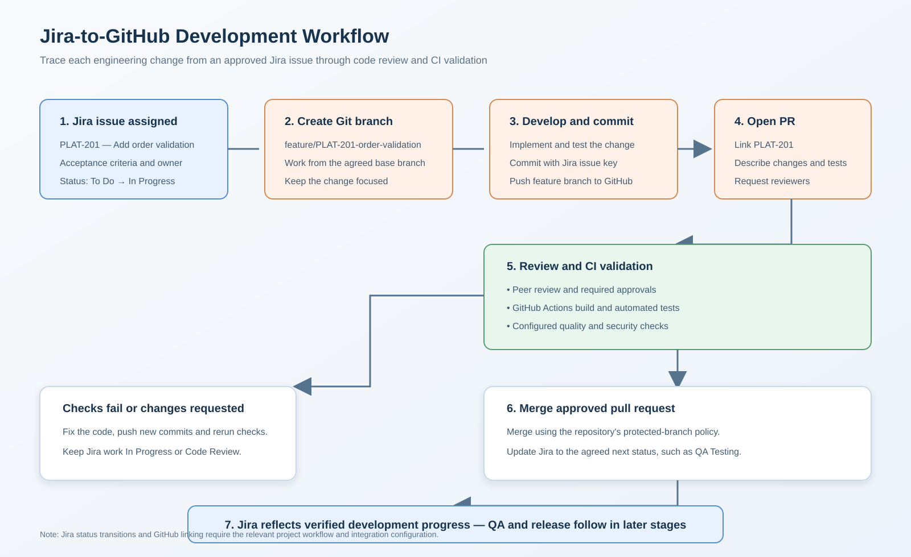

# 05 — Jira Development Workflow

## Development Workflow Architecture



## 1. Objective

This chapter explains how developers work on Jira issues and connect their development activities with GitHub.

We will use the Production DevOps Platform project and its Order Management microservice as our practical example.

The objective is to understand how work moves from Jira assignment to code implementation, Git commits, pull requests, code reviews and CI validation.

By the end of this chapter, you will understand:

- Jira issue assignment and ownership.
- Development workflow and status transitions.
- Git branching strategy.
- Jira issue key integration with GitHub.
- Commit message conventions.
- Pull request creation.
- Code review and approval.
- GitHub Actions validation.
- Updating Jira development progress.

## 2. Development Workflow Overview

The development lifecycle follows this process:

1. Product Owner creates a Story in Jira.
2. Story is assigned to a developer.
3. Developer reviews requirements and acceptance criteria.
4. Developer creates a Git feature branch.
5. Developer implements the requested changes.
6. Developer commits code using the Jira issue key.
7. Developer pushes the branch to GitHub.
8. Developer creates a Pull Request.
9. Reviewers inspect the code.
10. GitHub Actions executes automated checks.
11. Required approvals are collected.
12. Pull Request is merged.
13. Jira issue is updated to reflect the actual progress.

## 3. Example Development Environment

| Component | Technology |
|---|---|
| Project Management | Jira Software |
| Source Code Management | GitHub |
| Version Control | Git |
| Development Branches | Feature Branches |
| Pull Requests | GitHub Pull Requests |
| CI/CD | GitHub Actions |
| Code Quality | SonarQube |
| Image Security | Trivy |
| Container Registry | Amazon ECR |
| Deployment Platform | Amazon EKS |
| GitOps | Argo CD |

GitHub Actions is the primary CI/CD tool in this example.

Jenkins and GitLab CI/CD can be documented separately as alternative pipeline implementations.

## 4. Example Jira Story

Assume the Product Owner creates the following Story.

### Jira Issue Details

| Field | Value |
|---|---|
| Project | Production DevOps Platform |
| Issue Key | PLAT-201 |
| Issue Type | Story |
| Summary | Add Order API Request Validation |
| Epic | Order Management |
| Priority | High |
| Assignee | Backend Developer |
| Status | To Do |
| Story Points | 5 |

The issue key and details are illustrative.

### Story Description

Implement request validation in the Order Service API.

The application must validate:

- Customer ID.
- Product ID.
- Product quantity.
- Required request fields.
- Invalid or missing input values.

### Acceptance Criteria

1. Valid requests are accepted.
2. Missing customer IDs are rejected.
3. Invalid product IDs are rejected.
4. Product quantity must be greater than zero.
5. Invalid requests return appropriate HTTP responses.
6. Unit tests cover validation scenarios.
7. Existing order creation functionality must continue working.

The developer should understand these requirements before starting implementation.

## 5. Jira Issue Assignment

The Product Owner or responsible team member assigns the Story to the appropriate developer.

### Assignment Steps

1. Open the Jira project.
2. Navigate to Backlog or the relevant issue list.
3. Open PLAT-201.
4. Select the Assignee field.
5. Select the responsible developer.
6. Confirm the priority and description.
7. Save the changes.

The developer should review the issue before starting work.

### Example Responsibilities

| Role | Responsibility |
|---|---|
| Product Owner | Defines requirements and priorities |
| Project Manager | Tracks project delivery |
| Scrum Master | Supports sprint execution |
| Developer | Implements application changes |
| Technical Lead | Reviews technical approach |
| DevOps Engineer | Maintains build and deployment automation |
| QA Engineer | Validates application behavior |

## 6. Jira Development Status Workflow

A practical development workflow can use the following statuses:

`TO DO → IN PROGRESS → CODE REVIEW → QA TESTING → DONE`

### Status Explanation

| Status | Meaning |
|---|---|
| To Do | Work is ready to start |
| In Progress | Developer is implementing the Story |
| Code Review | Pull Request is awaiting review |
| QA Testing | Implementation is ready for testing |
| Done | Acceptance criteria are satisfied |

Additional statuses such as Blocked or Reopened can be introduced when required.

The workflow must be configured in Jira. These status names are not automatically created by linking GitHub.

## 7. Git Branching Strategy

The team uses a feature branch strategy.

The main branch contains approved and stable application code.

Developers create separate branches for individual Jira issues.

### Example Branch Naming Convention

```text
feature/PLAT-201-order-validation
bugfix/PLAT-202-payment-timeout
hotfix/PLAT-203-critical-order-failure
```

Recommended naming pattern:

`<branch-type>/<jira-issue-key>-<short-description>`

### Why Include Jira Issue Keys?

Including Jira issue keys helps connect:

- Jira Stories.
- Git branches.
- Git commits.
- Pull Requests.
- Code review activities.

It also improves traceability during troubleshooting and audits.

## 8. Create a Git Feature Branch

First, clone the application repository if it is not already available locally.

```bash
git clone https://github.com/your-org/order-service.git

cd order-service
```

Update the local base branch.

```bash
git checkout main
git pull origin main
```

Create a feature branch.

```bash
git checkout -b feature/PLAT-201-order-validation
```

Verify the current branch.

```bash
git branch
```

Expected output:

```text
* feature/PLAT-201-order-validation
  main
```

The repository URL and organization name above are examples. Replace them with your actual GitHub repository details.

## 9. Implement the Development Changes

The developer implements the requested changes.

Example application structure:

```text
order-service/
│
├── src/
│   ├── main/
│   │   ├── java/
│   │   │   └── com/example/order/
│   │   │       ├── controller/
│   │   │       ├── service/
│   │   │       ├── repository/
│   │   │       └── validation/
│   │   └── resources/
│   │
│   └── test/
│       └── java/
│
├── Dockerfile
├── pom.xml
└── README.md
```

Example validation logic:

```java
public void validateOrder(OrderRequest request) {

    if (request.getCustomerId() == null) {
        throw new IllegalArgumentException(
            "Customer ID is required"
        );
    }

    if (request.getProductId() == null) {
        throw new IllegalArgumentException(
            "Product ID is required"
        );
    }

    if (request.getQuantity() <= 0) {
        throw new IllegalArgumentException(
            "Quantity must be greater than zero"
        );
    }
}
```

This is a simplified example. Production applications should use the project's agreed validation framework and return consistent API error responses.

## 10. Run Tests Locally

Before committing, the developer runs the application tests.

For a Maven-based Java application:

```bash
mvn clean test
```

To package the application:

```bash
mvn clean package
```

Check the Git working tree:

```bash
git status
```

Review the changes:

```bash
git diff
```

The developer should confirm that the implementation meets the acceptance criteria.

## 11. Commit Changes Using Jira Issue Keys

Use meaningful commit messages.

Example:

```bash
git add .

git commit -m "PLAT-201 add order request validation"
```

The Jira issue key connects the commit to the corresponding development task when the relevant integration is configured.

### Recommended Commit Message Format

`<JIRA-KEY> <short description>`

Examples:

```text
PLAT-201 add order request validation

PLAT-202 fix payment timeout handling

PLAT-203 improve inventory API error handling
```

Avoid unclear messages such as:

```text
changes
final update
fixed issue
test commit
```

## 12. Push the Feature Branch to GitHub

Push the branch:

```bash
git push -u origin feature/PLAT-201-order-validation
```

Verify the remote branch:

```bash
git branch -r
```

The branch should now be available in GitHub.

## 13. Create a Pull Request

A Pull Request allows other engineers to review the changes before they are merged into the target branch.

### Pull Request Details

| Field | Example |
|---|---|
| Source Branch | feature/PLAT-201-order-validation |
| Target Branch | main |
| Title | PLAT-201: Add Order API Request Validation |
| Author | Backend Developer |
| Reviewer | Technical Lead |
| Linked Jira Issue | PLAT-201 |

### Pull Request Description

Example:

```markdown
## Jira Issue
PLAT-201

## Summary
Implemented request validation in the Order Service API.

## Changes
- Added customer ID validation.
- Added product ID validation.
- Added quantity validation.
- Added unit tests.

## Testing
- Maven unit tests passed.
- Invalid request scenarios tested.
- Valid order creation verified.

## Checklist
- [x] Code implemented
- [x] Unit tests added
- [x] Local tests passed
- [ ] Code review completed
- [ ] CI checks passed
```

### Pull Request Creation Steps

1. Open the GitHub repository.
2. Navigate to Pull Requests.
3. Select New Pull Request.
4. Select the feature branch as the source.
5. Select the target branch.
6. Enter the Pull Request title.
7. Add the description.
8. Link Jira issue PLAT-201.
9. Assign reviewers.
10. Create the Pull Request.

## 14. Code Review Process

The reviewer examines the implementation before approval.

### Code Review Checklist

- [ ] Code follows project standards.
- [ ] Business logic is correct.
- [ ] Input validation is implemented.
- [ ] Error handling is appropriate.
- [ ] No secrets are committed.
- [ ] No unnecessary configuration changes.
- [ ] Unit tests are included.
- [ ] Existing functionality is not broken.
- [ ] Code is maintainable.
- [ ] Acceptance criteria are satisfied.

### If Changes Are Requested

1. Reviewer adds comments.
2. Developer reviews the feedback.
3. Developer modifies the code.
4. Developer commits the changes.
5. Developer pushes the updated branch.
6. GitHub updates the existing Pull Request.
7. Reviewer checks the changes again.

Example:

```bash
git add .

git commit -m "PLAT-201 address code review comments"

git push origin feature/PLAT-201-order-validation
```

## 15. GitHub Actions CI Validation

When a Pull Request is created or updated, GitHub Actions can automatically execute the configured validation workflow.

Example CI stages:

1. Checkout source code.
2. Configure Java.
3. Build application.
4. Execute unit tests.
5. Run SonarQube analysis.
6. Perform configured dependency and secret scans.
7. Build the Docker image.
8. Run Trivy image scanning if the workflow builds an image.
9. Report the validation results.

Example GitHub Actions workflow:

```yaml
name: Order Service CI

on:
  pull_request:
    branches:
      - main

permissions:
  contents: read

jobs:
  build-test:
    runs-on: ubuntu-latest

    steps:
      - name: Checkout code
        uses: actions/checkout@v4

      - name: Set up Java
        uses: actions/setup-java@v4
        with:
          distribution: temurin
          java-version: '17'
          cache: maven

      - name: Build application
        run: mvn clean compile

      - name: Run unit tests
        run: mvn test

      - name: Package application
        run: mvn package
```

This is a basic CI example. It does not yet implement SonarQube, Trivy, ECR publishing or deployment. Those require additional configured jobs, credentials and permissions.

For production, pin third-party GitHub Actions to verified commit SHAs and configure least-privilege permissions.

## 16. Pull Request Approval and Merge

After the review and required CI checks succeed:

1. Reviewer approves the Pull Request.
2. Required branch protection checks are satisfied.
3. Developer or authorized maintainer merges the Pull Request.
4. GitHub records the merge.
5. The target branch receives the approved changes.

Example merge strategy:

- Squash and merge.
- Merge commit.
- Rebase and merge.

Choose a consistent strategy based on your repository standards.

### Branch Protection

For the main branch, consider configuring:

- Required Pull Request reviews.
- Required CI status checks.
- No direct pushes for ordinary contributors.
- Restrictions on force pushes.
- Restrictions on branch deletion.
- Required approvals from code owners when applicable.

The exact protections depend on your GitHub plan and repository configuration.

## 17. Update Jira Development Progress

After the Pull Request is opened, update the Jira issue to reflect its actual state.

Example:

| Development Activity | Jira Status |
|---|---|
| Work assigned | To Do |
| Development started | In Progress |
| Pull Request opened | Code Review |
| Pull Request approved and merged | QA Testing |
| QA testing passed | Done |

These are example workflow transitions. Your team must configure the relevant Jira statuses and transition rules.

Jira does not automatically update every status simply because a Git branch or Pull Request exists.

Automatic updates require a configured Jira-GitHub integration, automation rule or other workflow integration.

## 18. Jira and GitHub Integration

To display GitHub development information in Jira, configure an appropriate integration.

Typical setup involves:

1. Confirming the Jira and GitHub products and accounts.
2. Installing or authorizing the supported integration.
3. Selecting the GitHub organization and repositories.
4. Granting the required permissions.
5. Verifying branch, commit and Pull Request visibility.
6. Testing with a sample Jira issue key.

After successful integration, the Jira issue may display associated development activity.

For example, PLAT-201 can show:

- Feature branch.
- Commits.
- Pull Request.
- Review status.
- Merge information.

The available features depend on the integration and its permissions.

## 19. Complete End-to-End Example

Example: PLAT-201 — Add Order API Request Validation.

| Step | Activity | Tool |
|---|---|---|
| 1 | Create Story | Jira |
| 2 | Assign developer | Jira |
| 3 | Start development | Jira |
| 4 | Create feature branch | Git |
| 5 | Implement validation | Java |
| 6 | Run unit tests | Maven |
| 7 | Commit changes | Git |
| 8 | Push feature branch | GitHub |
| 9 | Open Pull Request | GitHub |
| 10 | Review code | GitHub |
| 11 | Run CI checks | GitHub Actions |
| 12 | Approve and merge | GitHub |
| 13 | Move to QA | Jira |
| 14 | Validate acceptance criteria | QA |
| 15 | Close the Story when complete | Jira |

This completes the development workflow for one Story. Release planning and production deployment are covered in later chapters.

## 20. Development Workflow Best Practices

- Always link development work to a Jira issue.
- Use consistent branch naming conventions.
- Include Jira issue keys in commit messages.
- Keep Pull Requests focused and reasonably small.
- Add meaningful Pull Request descriptions.
- Require code reviews for protected branches.
- Run automated tests before merging.
- Protect the main branch.
- Do not commit credentials or secrets.
- Keep Jira statuses accurate.
- Do not mark work Done before its acceptance criteria are satisfied.
- Keep development and deployment responsibilities clear.

## 21. Troubleshooting

### Problem 1: Jira issue does not display GitHub branches

Possible causes:

- GitHub integration is not configured.
- Repository is not connected.
- Jira issue key is missing from the branch name.
- Integration permissions are insufficient.

Resolution:

1. Verify the integration.
2. Check repository access.
3. Confirm the issue key.
4. Check the integration's permissions.

### Problem 2: GitHub Actions CI fails

Possible causes:

- Compilation error.
- Unit test failure.
- Incorrect Java version.
- Missing dependency.
- Invalid workflow configuration.

Resolution:

1. Open the failed GitHub Actions run.
2. Identify the failed job and step.
3. Review the logs.
4. Reproduce the issue locally.
5. Fix the problem.
6. Push the correction.
7. Verify that CI passes.

### Problem 3: Pull Request cannot be merged

Possible causes:

- Required review is missing.
- CI checks failed.
- Branch protection rules are not satisfied.
- Merge conflicts exist.

Resolution:

1. Review the GitHub Pull Request checks.
2. Obtain the required approvals.
3. Resolve merge conflicts.
4. Rerun failed checks.
5. Merge after all repository requirements are satisfied.

### Problem 4: Jira issue status is not updated

Possible causes:

- Status transition is unavailable.
- User lacks Jira permissions.
- GitHub integration automation is not configured.
- Automation rule failed.

Resolution:

1. Review the Jira workflow.
2. Check the user's permissions.
3. Review configured automation rules.
4. Update the status manually if appropriate.

## 22. Validation Checklist

- [ ] Created a Jira Story.
- [ ] Assigned the Story to a developer.
- [ ] Reviewed acceptance criteria.
- [ ] Created a Git feature branch.
- [ ] Included the Jira issue key in the branch name.
- [ ] Implemented the requested changes.
- [ ] Ran local tests.
- [ ] Created meaningful Git commits.
- [ ] Pushed the branch to GitHub.
- [ ] Created a Pull Request.
- [ ] Linked the Jira issue.
- [ ] Completed code review.
- [ ] Verified GitHub Actions checks.
- [ ] Obtained required approvals.
- [ ] Merged the Pull Request.
- [ ] Updated Jira development status.

## 23. Expected Outcome

At the end of this chapter, the team should have a traceable development workflow connecting Jira and GitHub.

The team can identify:

- Which Jira requirement is being implemented.
- Which developer owns the work.
- Which branch contains the changes.
- Which commits implement the requirement.
- Which Pull Request contains the implementation.
- Whether code review and CI checks passed.
- Whether development work is ready for QA.

This creates a clear connection between project management and software development.

## 24. Next Chapter

**Chapter 06 — GitHub Integration**

Topics:

1. Jira and GitHub integration architecture.
2. Connecting Jira with a GitHub organization.
3. Repository authorization and permissions.
4. Branch and commit linking.
5. Pull Request visibility in Jira.
6. Jira automation possibilities.
7. Integration validation and troubleshooting.