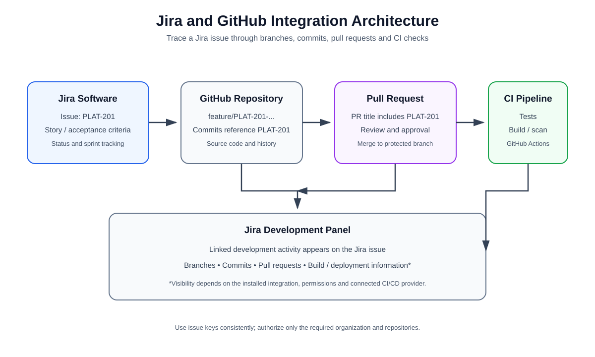

# Chapter 06 — Jira and GitHub Integration

## 1. Objective

Integrate Jira Software with GitHub so that development activity can be tracked against Jira issues.

The integration helps the development and DevOps teams connect:

- Jira stories and tasks
- GitHub repositories
- Feature branches
- Commits
- Pull requests
- Code reviews
- CI pipeline activity

**Project example:** Production DevOps Platform

**Jira project key:** `PLAT`

**Example Jira issue:** `PLAT-201`

## 2. Jira and GitHub Integration Architecture



## 3. Integration Overview

Jira manages the work, while GitHub manages the source code and collaboration.

| Platform | Responsibility |
|---|---|
| Jira Software | Stories, tasks, bugs, sprint tracking |
| GitHub | Source code, branches, commits, pull requests |
| GitHub Actions | Build, test and security validation |
| Jira-GitHub integration | Connect development activity to Jira issues |

When the integration is configured and the issue key is used consistently, Jira can display related branches, commits and pull requests on the issue's development panel.

## 4. Prerequisites

Before starting, ensure that you have:

- Access to a Jira Software project.
- Access to a GitHub organization or repository.
- Permission to install or authorize the Jira-GitHub integration.
- A Jira issue assigned to a developer.
- A GitHub repository containing the application source code.

Example repository:

```text
production-devops-platform/
└── microservices/
    └── order-service/
        ├── src/
        ├── pom.xml
        └── Dockerfile
```

## 5. Connect Jira with GitHub

For Jira Cloud, use the supported GitHub integration app, commonly listed as **GitHub for Jira**, or the currently supported Atlassian integration method for your Jira environment.

### Step 1: Open Jira

1. Log in to your Jira Cloud account.
2. Open the Production DevOps Platform project.
3. Navigate to the Jira administration or Apps area.
4. Open the Atlassian Marketplace.
5. Search for the GitHub integration app.

### Step 2: Install the integration

1. Select the supported GitHub integration.
2. Review the app details and required permissions.
3. Install the app if you have the required Jira administrator permission.
4. Follow the authorization flow.

### Step 3: Authorize GitHub

1. Sign in to the appropriate GitHub account.
2. Select the GitHub organization or account.
3. Review the permissions requested by the integration.
4. Authorize access only to the repositories needed for the project, where the integration supports repository-level selection.
5. Complete the connection.

Do not grant broad organization access without reviewing the requested permissions and your company's access policy.

### Step 4: Verify the connection

1. Return to Jira.
2. Open the connected development or integration settings.
3. Confirm that the GitHub organization or repository is listed.
4. Open a Jira issue and check its Development section or panel.

The exact menu names can vary with Jira Cloud, app version and administrator permissions.

## 6. Connect Jira Issues with GitHub Branches

Developers should include the Jira issue key in the branch name.

Example Jira issue:

```text
PLAT-201
```

Example branch:

```bash
git checkout -b feature/PLAT-201-order-validation
```

Recommended branch naming:

```text
feature/PLAT-201-order-validation
bugfix/PLAT-202-payment-timeout
hotfix/PLAT-203-order-api-failure
```

The Jira issue key helps the integration associate the branch with the correct issue.

## 7. Create a Commit with the Jira Issue Key

After making code changes, commit them with the issue key in the commit message.

```bash
git add .
git commit -m "PLAT-201 Add order validation"
```

Push the branch:

```bash
git push -u origin feature/PLAT-201-order-validation
```

The connected Jira issue can display the commit when the integration recognizes the repository and issue key.

## 8. Create a Pull Request

After pushing the feature branch:

1. Open the GitHub repository.
2. Select the newly pushed branch.
3. Create a pull request.
4. Use a title containing the Jira issue key.

Example:

```text
PLAT-201 Implement order validation
```

Pull request description:

```markdown
## Jira Issue
PLAT-201

## Changes
- Added order request validation.
- Added invalid request handling.
- Added unit tests.

## Validation
- Maven tests completed.
- Code review requested.
```

Select the correct target branch, such as `develop` or `main`, according to your team's branching strategy.

## 9. Configure Pull Request Reviews

Use GitHub branch protection rules or repository rulesets to enforce the team's review policy.

Recommended controls:

- Require pull request reviews before merging.
- Require approval from the appropriate reviewers.
- Require status checks to pass.
- Prevent unauthorized direct pushes to protected branches.
- Require conversations to be resolved before merging, if appropriate.

Example workflow:

```text
Developer creates feature branch
          |
          v
Developer pushes code
          |
          v
Pull request created
          |
          v
CI checks execute
          |
          v
Code review
          |
          v
Approval
          |
          v
Pull request merged
```

The number of required approvals and checks should follow your team's repository policy.

## 10. Jira and GitHub Actions Integration

GitHub Actions executes the CI pipeline when code is pushed or a pull request is opened.

Example workflow file:

**File:** `.github/workflows/order-service-ci.yml`

```yaml
name: Order Service CI

on:
  push:
    branches:
      - main
      - develop
  pull_request:
    branches:
      - main
      - develop

jobs:
  build-and-test:
    runs-on: ubuntu-latest

    steps:
      - name: Checkout source
        uses: actions/checkout@v4

      - name: Set up Java
        uses: actions/setup-java@v4
        with:
          distribution: temurin
          java-version: '17'
          cache: maven

      - name: Build application
        run: mvn clean package

      - name: Run tests
        run: mvn test
```

This is a basic Maven build-and-test example. Add SonarQube, Trivy, image publishing and deployment jobs separately according to the project's security and release requirements.

Jira's visibility into CI activity depends on the configured integration and supported CI provider. Do not assume that every GitHub Actions job or deployment automatically appears in Jira.

## 11. Jira Issue Status Workflow

A team can use a workflow such as:

```text
To Do
  |
  v
In Progress
  |
  v
In Review
  |
  v
Testing
  |
  v
Done
```

Example mapping:

| Development activity | Jira status |
|---|---|
| Story assigned to developer | To Do |
| Feature branch created and work started | In Progress |
| Pull request opened | In Review |
| Changes undergoing validation | Testing |
| Work completed and accepted | Done |

The Jira issue status does not necessarily change automatically when a branch or pull request is created. Automatic transitions require a configured Jira workflow, automation rule or supported integration capability. Otherwise, the developer or project workflow owner updates the issue manually.

## 12. Complete End-to-End Example

Consider the Order Service feature.

**Step 1 — Jira issue created**

```text
Issue: PLAT-201
Summary: Implement order validation
Type: Story
Assignee: Developer
Status: To Do
```

**Step 2 — Developer starts work**

```bash
git checkout develop
git pull origin develop

git checkout -b feature/PLAT-201-order-validation
```

**Step 3 — Developer commits changes**

```bash
git add .
git commit -m "PLAT-201 Implement order validation"

git push -u origin feature/PLAT-201-order-validation
```

**Step 4 — Pull request created**

```text
PLAT-201 Implement order validation
```

**Step 5 — CI pipeline executes**

```text
Checkout
   |
   v
Java setup
   |
   v
Maven build
   |
   v
Unit tests
   |
   v
CI result
```

**Step 6 — Code review**

The reviewer checks the implementation, test coverage and code quality.

**Step 7 — Merge**

After required approvals and successful checks, the pull request is merged into the target branch.

**Step 8 — Jira verification**

Open `PLAT-201` and verify that the connected development panel shows the recognized branch, commits and pull request.

Update the Jira issue status according to the team's workflow and acceptance criteria.

## 13. Security and Access Management

Follow these practices when connecting Jira and GitHub:

- Use an approved organization-level integration.
- Grant only the permissions required by the integration.
- Limit repository access where supported.
- Review app permissions before installation.
- Remove access for users who leave the project.
- Protect important branches.
- Store CI credentials in GitHub Actions secrets or an approved secret manager.
- Never commit passwords, tokens or private keys.
- Review integration access periodically.

## 14. Troubleshooting

| Problem | Possible cause | What to check |
|---|---|---|
| Jira does not show a branch | Issue key missing or integration not connected | Branch naming and connection |
| Commit is not displayed | Commit message does not contain the issue key | Commit message and repository |
| Pull request is not displayed | PR title or branch is not associated with the issue | Issue key and integration permissions |
| GitHub repository is missing | Repository not authorized or selected | GitHub app configuration |
| CI checks are not running | Workflow trigger or branch filter is incorrect | Workflow YAML and Actions settings |
| Jira status does not change | No automation or transition configured | Jira workflow and automation rules |
| Authorization fails | Insufficient administrator permission or organization policy | App permissions and organization settings |

## 15. Validation Checklist

- [ ] Jira project is available.
- [ ] GitHub integration is installed and authorized.
- [ ] Correct GitHub organization or repository is connected.
- [ ] Jira issue key is included in the branch name.
- [ ] Commit message contains the Jira issue key.
- [ ] Pull request title contains the Jira issue key.
- [ ] Jira displays recognized development activity.
- [ ] GitHub Actions CI workflow executes successfully.
- [ ] Branch protection and review requirements are configured.
- [ ] Jira issue status reflects the team's actual workflow.

## 16. Expected Outcome

After completing this chapter, the team should be able to:

- Connect Jira Software with GitHub.
- Link Jira issues with development branches.
- Track commits and pull requests from Jira.
- Run CI workflows using GitHub Actions.
- Enforce code review and branch protection.
- Maintain traceability between requirements and source-code changes.

## 17. Next Chapter

**Chapter 07 — CI/CD Integration**

The next chapter covers how Jira connects with CI/CD workflows, how pipeline execution relates to Jira issues, and how build, test, security scanning and deployment activities fit into release management.