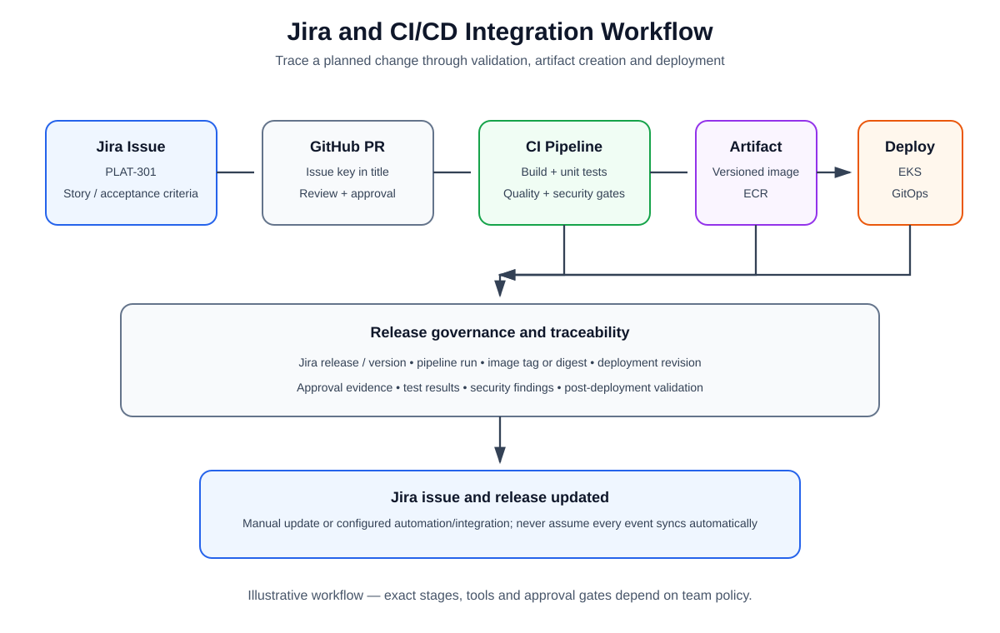

# Chapter 07 — Jira and CI/CD Integration

## 1. Objective

Integrate Jira Project and Release Management with CI/CD workflows to maintain traceability between development tasks, pipeline execution and production releases.

The goal is to understand how a Jira issue moves through:

- Source code changes
- Continuous Integration (CI)
- Build and unit testing
- Code quality and security scanning
- Container image creation
- Artifact publishing
- Kubernetes deployment
- Release validation

**Project:** Production DevOps Platform  
**Jira project key:** `PLAT`  
**Example issue:** `PLAT-301`

## 2. Jira and CI/CD Integration Architecture



## 3. CI/CD Integration Overview

Jira manages project work and release tracking. CI/CD tools automate application validation and delivery.

| Tool | Responsibility |
|---|---|
| Jira Software | Issues, sprints, releases and approvals |
| GitHub | Source code and pull requests |
| GitHub Actions | CI pipeline execution |
| Jenkins | Alternative CI/CD pipeline execution |
| GitLab CI/CD | Alternative CI/CD pipeline execution |
| SonarQube | Static code quality analysis |
| Trivy | Container and dependency vulnerability scanning |
| Amazon ECR | Container image registry |
| Amazon EKS | Kubernetes deployment platform |
| Argo CD | GitOps-based deployment |
| Prometheus and Grafana | Deployment and application monitoring |

The examples in this chapter use GitHub Actions as the primary CI pipeline. Jenkins and GitLab CI/CD are covered as alternative integrations.

## 4. Understand the End-to-End Workflow

Consider a new feature for the Order Service.

Jira issue:

```text
Issue: PLAT-301
Summary: Implement order validation
Type: Story
Status: In Progress
```

The developer creates a feature branch and opens a pull request.

The CI/CD workflow then validates the code, builds the application, scans it and publishes an image when the required checks pass.

The deployment process promotes the validated artifact into the target environment.

```text
Jira Story
    |
    v
GitHub Branch
    |
    v
Pull Request
    |
    v
CI Pipeline
    |
    v
Build and Unit Tests
    |
    v
SonarQube and Trivy
    |
    v
Docker Image
    |
    v
Amazon ECR
    |
    v
Deployment through Argo CD
    |
    v
Amazon EKS
    |
    v
Release Validation
```

Not every pipeline needs to publish an image or deploy on every pull request. Separate pull-request validation from release and deployment workflows.

## 5. Define Jira Release Versions

Before connecting pipeline activity to a release, create a release version in Jira.

Example:

```text
Project: Production DevOps Platform
Version: v1.0.0
Description: Initial production release
Release date: Planned release date
Status: Unreleased
```

In Jira, open the project's Releases or Versions area and create the version.

Assign completed issues to the relevant release version.

Example:

| Jira issue | Summary | Fix version |
|---|---|---|
| PLAT-301 | Implement order validation | v1.0.0 |
| PLAT-302 | Add payment timeout handling | v1.0.0 |
| PLAT-303 | Add inventory API validation | v1.0.0 |

A Fix Version represents the planned release containing the work. It does not prove that the feature has been deployed to production.

## 6. Connect Jira with CI/CD Tools

There are different integration approaches.

### Option A — Jira and GitHub Actions

Use the supported Jira-GitHub integration to connect repository development activity.

For pipeline and deployment visibility, check whether the installed integration supports the required CI/CD information. Some teams use an additional supported integration or Jira automation.

### Option B — Jira and Jenkins

For Jenkins-based environments:

1. Configure the approved Jira integration or Jenkins plugin.
2. Configure the Jira site connection.
3. Set up authentication using approved credentials.
4. Configure the relevant Jenkins jobs.
5. Include Jira issue keys in branch names and commit messages.
6. Verify that the expected build information appears in Jira.

Do not expose Jira API tokens in Jenkinsfiles or console output.

### Option C — Jira and GitLab CI/CD

For GitLab environments:

1. Configure the supported Jira-GitLab integration.
2. Authorize the appropriate GitLab project or group.
3. Include Jira issue keys in branch names, commits and merge requests.
4. Configure pipeline visibility according to the integration's supported capabilities.
5. Verify the linked development activity from the Jira issue.

The exact configuration differs by Jira deployment type, integration version and organizational permissions.

## 7. Create a GitHub Actions CI Pipeline

Example application repository:

```text
order-service/
├── src/
├── pom.xml
├── Dockerfile
└── .github/
    └── workflows/
        └── order-service-ci.yml
```

Create the workflow:

**File:** `.github/workflows/order-service-ci.yml`

```yaml
name: Order Service CI

on:
  pull_request:
    branches:
      - develop
      - main

  push:
    branches:
      - develop
      - main

permissions:
  contents: read

jobs:
  build-and-test:
    runs-on: ubuntu-latest

    steps:
      - name: Checkout source
        uses: actions/checkout@v4

      - name: Set up Java
        uses: actions/setup-java@v4
        with:
          distribution: temurin
          java-version: '17'
          cache: maven

      - name: Build application
        run: mvn clean package

      - name: Run unit tests
        run: mvn test
```

This is a basic CI example. It does not yet publish an image or deploy to EKS.

For production, pin third-party actions to reviewed commit SHAs, apply least-privilege permissions and protect deployment environments.

## 8. Add SonarQube Quality Checks

SonarQube can be integrated into the CI pipeline to analyze code quality.

Typical process:

```text
Developer pushes code
       |
       v
GitHub Actions starts
       |
       v
Maven build and tests
       |
       v
SonarQube analysis
       |
       v
Quality Gate evaluation
       |
       v
Pipeline continues or fails
```

Example Maven command:

```bash
mvn clean verify sonar:sonar \
  -Dsonar.projectKey=order-service \
  -Dsonar.host.url="$SONAR_HOST_URL" \
  -Dsonar.token="$SONAR_TOKEN"
```

Store the SonarQube URL and token in approved GitHub Actions secrets or variables.

Configure the pipeline to fail when the required quality gate fails. The exact enforcement mechanism depends on the SonarQube edition and CI integration.

## 9. Add Trivy Security Scanning

Trivy can scan application dependencies, container images and configuration files.

Example filesystem scan:

```bash
trivy fs \
  --severity HIGH,CRITICAL \
  --exit-code 1 \
  .
```

Example container image scan:

```bash
trivy image \
  --severity HIGH,CRITICAL \
  --exit-code 1 \
  order-service:1.0.0
```

A production pipeline should define:

- Which vulnerability severities block a build.
- How exceptions are approved.
- How scan reports are retained.
- How newly discovered vulnerabilities are handled.
- Which image digest is approved for release.

Do not treat a successful scan as proof that an image is completely secure.

## 10. Build and Push Docker Images

After successful validation, build the container image.

Example:

```bash
docker build -t order-service:1.0.0 .
```

Tag the image for Amazon ECR:

```bash
docker tag order-service:1.0.0 \
  ACCOUNT_ID.dkr.ecr.REGION.amazonaws.com/order-service:1.0.0
```

Authenticate to ECR using an approved AWS identity:

```bash
aws ecr get-login-password --region REGION |
docker login \
  --username AWS \
  --password-stdin ACCOUNT_ID.dkr.ecr.REGION.amazonaws.com
```

Push the image:

```bash
docker push \
  ACCOUNT_ID.dkr.ecr.REGION.amazonaws.com/order-service:1.0.0
```

Use the actual account ID, AWS region and repository name for your environment.

For production releases, record the immutable image digest as well as the human-readable tag.

## 11. Connect the Deployment Process with Jira

In a GitOps environment, the CI pipeline can publish the image and update the deployment configuration repository.

Example:

```text
GitHub Actions
      |
      v
Build and scan image
      |
      v
Push image to ECR
      |
      v
Update Helm values in GitOps repository
      |
      v
Argo CD detects Git change
      |
      v
Deploy to Amazon EKS
```

Example Helm values:

```yaml
image:
  repository: ACCOUNT_ID.dkr.ecr.REGION.amazonaws.com/order-service
  tag: "1.0.0"
```

Argo CD synchronizes the desired configuration with the Kubernetes cluster according to its configured sync policy.

The deployment workflow should retain traceability to:

- Jira issue key.
- Source commit.
- Pull request.
- Pipeline run.
- Image tag and digest.
- GitOps configuration commit.
- Argo CD application and deployed revision.

## 12. Jira Release Tracking

Jira should represent the business and delivery status of the release.

Example release:

```text
Release: v1.0.0

Included issues:
- PLAT-301
- PLAT-302
- PLAT-303

Release owner: DevOps Team
Environment: Production
Release status: Planned
```

Use a release checklist to capture the required evidence.

| Check | Evidence |
|---|---|
| Code merged | Pull request URL |
| CI successful | Pipeline run URL |
| Quality gate passed | SonarQube result |
| Security scan completed | Trivy report |
| Image published | ECR image tag and digest |
| Deployment completed | Argo CD revision |
| Production validation passed | Test or validation record |

Jira can store links and release information through issue fields, comments, release notes or approved integrations. Choose one consistent approach for the team.

## 13. Configure Jira Automation Carefully

Jira Automation can help update issues based on configured events.

Possible automation examples:

| Trigger | Possible action |
|---|---|
| Pull request created | Transition issue to In Review |
| Pull request merged | Transition issue to Testing |
| Deployment succeeds | Add deployment information |
| Release validation completed | Transition issue to Done |

These are proposed automation rules, not automatic default behavior.

Before enabling them:

1. Confirm that the integration exposes the required trigger.
2. Confirm the Jira issue key can be identified.
3. Check that the target status transition is valid.
4. Prevent duplicate or repeated transitions.
5. Record failed automation executions.
6. Test the rules in a non-production project first.

Do not automatically mark a Jira issue Done merely because a pull request is merged. The acceptance criteria and required validation must also be satisfied.

## 14. Jenkins Pipeline Integration Example

If a team uses Jenkins instead of GitHub Actions, the pipeline can follow a similar delivery sequence.

Illustrative Jenkinsfile:

```groovy
pipeline {
    agent any

    stages {
        stage('Checkout') {
            steps {
                checkout scm
            }
        }

        stage('Build') {
            steps {
                sh 'mvn clean package'
            }
        }

        stage('Unit Tests') {
            steps {
                sh 'mvn test'
            }
        }

        stage('SonarQube Analysis') {
            steps {
                echo 'Run configured SonarQube analysis'
            }
        }

        stage('Security Scan') {
            steps {
                sh 'trivy fs --severity HIGH,CRITICAL .'
            }
        }
    }

    post {
        success {
            echo 'CI pipeline completed successfully'
        }

        failure {
            echo 'CI pipeline failed - investigate the failed stage'
        }
    }
}
```

The example shows the pipeline structure. Configure the actual SonarQube integration, credentials, scanner execution, report publishing and Jenkins-to-Jira integration for your environment.

## 15. GitLab CI/CD Integration Example

A GitLab pipeline can use the same stages.

Example `.gitlab-ci.yml`:

```yaml
stages:
  - build
  - test
  - security

build:
  stage: build
  image: maven:3.9-eclipse-temurin-17
  script:
    - mvn clean package

unit-tests:
  stage: test
  image: maven:3.9-eclipse-temurin-17
  script:
    - mvn test

security-scan:
  stage: security
  image:
    name: aquasec/trivy:latest
    entrypoint: [""]
  script:
    - trivy fs --severity HIGH,CRITICAL --exit-code 1 .
```

For production, pin container images to approved versions or digests, manage runner permissions and credentials securely, and configure the appropriate security-report retention.

## 16. Production Failure Scenarios

### Scenario 1 — Build failure

**Problem:** Maven build fails.

Actions:

1. Open the failed pipeline run.
2. Identify the failed build step.
3. Review compiler errors and dependency resolution.
4. Fix the code or dependency issue.
5. Push the correction.
6. Re-run the pipeline.
7. Keep the Jira issue In Progress until validation succeeds.

### Scenario 2 — SonarQube quality gate failure

**Problem:** The quality gate rejects the code.

Actions:

1. Open the SonarQube analysis.
2. Review new bugs, vulnerabilities and code smells.
3. Fix blocking findings.
4. Run the analysis again.
5. Confirm the quality gate passes.
6. Continue the release process only after required checks pass.

### Scenario 3 — Trivy reports a critical vulnerability

**Problem:** The container image contains a critical vulnerability.

Actions:

1. Identify the vulnerable package.
2. Check whether an updated base image or dependency is available.
3. Rebuild the image.
4. Scan the new image.
5. Record any approved exception with an owner and expiry date.
6. Do not promote a blocked image without the required security approval.

### Scenario 4 — Deployment fails

**Problem:** Argo CD reports a failed synchronization or unhealthy application.

Actions:

1. Check the Argo CD application status.
2. Inspect Kubernetes events and pod status.
3. Review deployment and application logs.
4. Identify whether the issue is configuration, image, resource or application related.
5. Restore the last known-good GitOps configuration if rollback is required.
6. Validate application health.
7. Record the incident and release outcome in Jira.

## 17. End-to-End Validation Checklist

- [ ] Jira issue exists and has acceptance criteria.
- [ ] Jira issue is assigned to the correct release version.
- [ ] GitHub branch contains the Jira issue key.
- [ ] Pull request contains the Jira issue key.
- [ ] Required code reviews are completed.
- [ ] CI pipeline executes successfully.
- [ ] Unit tests pass.
- [ ] SonarQube quality gate passes.
- [ ] Trivy security scan is completed.
- [ ] Container image is published to ECR.
- [ ] Image digest is recorded.
- [ ] GitOps configuration is updated.
- [ ] Argo CD deployment is successful.
- [ ] Production validation is completed.
- [ ] Jira release information is updated.

## 18. Expected Outcome

After completing this chapter, the team should understand how to:

- Connect Jira with CI/CD tools.
- Track pipeline activity against Jira work.
- Integrate build, test and security validation.
- Publish versioned container images.
- Connect CI with GitOps deployment workflows.
- Maintain release evidence and traceability.
- Handle pipeline and deployment failures.
- Update Jira based on actual delivery results.

## 19. Next Chapter

**Chapter 08 — QA/UAT Management**

The next chapter covers test planning, test execution, defect tracking, QA sign-off, UAT coordination and release readiness.