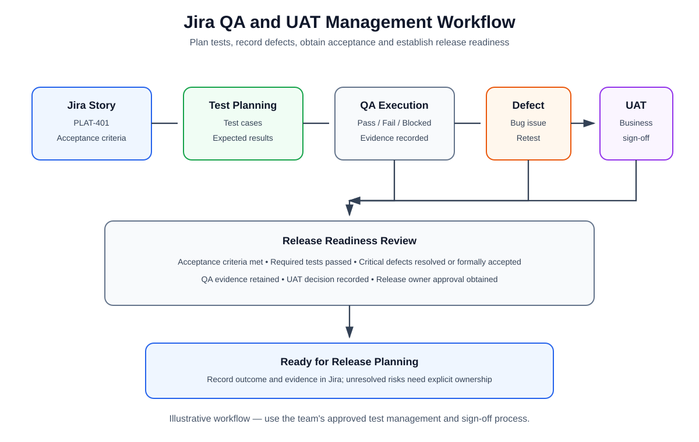

# Chapter 08 — QA/UAT Management

## 1. Objective

Establish a structured QA and UAT process to verify that application changes meet technical requirements and business expectations before release.

The process covers:

- Test planning and test cases
- Functional and integration testing
- Test execution and evidence
- Defect creation and tracking
- Bug fixing and retesting
- Regression testing
- User Acceptance Testing
- QA and business sign-off
- Release readiness

**Project:** Production DevOps Platform  
**Jira project key:** `PLAT`  
**Example issue:** `PLAT-401`

## 2. Jira QA/UAT Management Architecture



## 3. QA and UAT Overview

QA and UAT serve different purposes.

| Area | QA | UAT |
|---|---|---|
| Full form | Quality Assurance | User Acceptance Testing |
| Main responsibility | Verify technical and functional quality | Verify business requirements |
| Performed by | QA engineers and testers | Business users or product owners |
| Focus | Defects, functionality, integration and regression | Business workflows and acceptance |
| Output | Test results and defect reports | Acceptance or rejection decision |

A successful QA result does not automatically mean that the business has accepted the release.

## 4. Define the Testing Workflow in Jira

A sample testing workflow:

```text
Development Completed
        |
        v
Ready for QA
        |
        v
QA In Progress
        |
        v
QA Passed?
   /          \
 No            Yes
 |              |
 v              v
Bug Created   Ready for UAT
 |              |
 v              v
Developer     UAT Execution
Fixes Bug        |
 |               v
 v            UAT Passed?
Retesting      /       \
 |            No        Yes
 v             |         |
QA Passed?     v         v
              Rework   Accepted
```

Configure the actual statuses and transitions in the Jira workflow. The names above are an example, not mandatory default Jira statuses.

## 5. Create a Test Plan

A test plan describes what needs to be tested, how it will be tested and what constitutes success.

Example:

```text
Test Plan: Order Service Release v1.0.0

Application: Order Service
Environment: QA
Release: v1.0.0

Testing Scope:
- Order creation
- Order validation
- Payment integration
- Inventory integration
- Error handling
- API response validation

Test Types:
- Functional testing
- API testing
- Integration testing
- Regression testing
- Performance testing where required

Entry Criteria:
- Development completed
- Build available in QA
- Required dependencies available

Exit Criteria:
- Required test cases executed
- Critical defects resolved
- Regression tests passed
- Test evidence recorded
- QA sign-off completed
```

The test plan should identify the test owner, environment, version and execution period.

## 6. Create Test Cases

Create test cases for the application features.

Example: Order Service.

| Test ID | Test scenario | Expected result |
|---|---|---|
| TC-001 | Create order with valid data | Order created successfully |
| TC-002 | Submit order without customer ID | Validation error returned |
| TC-003 | Submit order with invalid product ID | Request rejected |
| TC-004 | Submit order with unavailable inventory | Appropriate business error returned |
| TC-005 | Verify payment integration | Payment result handled correctly |
| TC-006 | Retrieve order status | Correct order status returned |

A test case should contain:

- Test case ID
- Related Jira story
- Preconditions
- Test steps
- Test data
- Expected result
- Actual result
- Execution status
- Evidence or attachment

Jira's built-in issue types do not always provide a dedicated test-case management feature. Depending on your Jira setup, use a supported test management app, custom issue types or an agreed documentation approach.

## 7. Link Test Cases to Jira Stories

Example story:

```text
Issue: PLAT-401
Summary: Implement order validation
Type: Story
Status: Ready for QA
```

Associate the test cases with this story using the available issue links or your test management integration.

Example relationship:

```text
PLAT-401 — Implement order validation
    |
    |-- TC-001 — Valid order creation
    |-- TC-002 — Missing customer ID
    |-- TC-003 — Invalid product ID
    |-- TC-004 — Inventory unavailable
```

This provides traceability between the requirement and its validation.

## 8. Execute QA Testing

The QA engineer executes each test case in the QA environment.

Example execution record:

| Test case | Actual result | Status |
|---|---|---|
| TC-001 | Order created successfully | Pass |
| TC-002 | Correct validation error returned | Pass |
| TC-003 | API returned incorrect response | Fail |
| TC-004 | Inventory error handled correctly | Pass |

Record the actual result and attach relevant evidence.

Evidence may include:

- API request and response
- Application logs
- Screenshots
- Test execution reports
- Relevant pipeline run
- Environment and application version

Do not mark a test as passed without executing it and recording the result.

## 9. Create a Bug in Jira

Suppose test case `TC-003` fails because the Order API accepts an invalid product ID.

Create a Jira Bug.

Example:

```text
Issue Type: Bug

Summary:
Order API accepts invalid product ID

Description:
The Order API accepts an invalid product ID
instead of returning the expected validation error.

Environment:
QA

Steps to Reproduce:
1. Open the Order API.
2. Submit an order with an invalid product ID.
3. Check the API response.

Expected Result:
API should reject the request with an appropriate
validation response.

Actual Result:
API accepts the invalid product ID.

Priority:
High

Related Story:
PLAT-401
```

Link the bug to the original story and test case.

## 10. Bug Lifecycle

A sample bug lifecycle:

```text
Open
  |
  v
Assigned
  |
  v
In Progress
  |
  v
Fixed
  |
  v
Ready for Retest
  |
  v
Retesting
  |
  +------ Failed ------> Reopened
  |
  v
Verified
  |
  v
Closed
```

The workflow should distinguish between a developer claiming that a bug is fixed and QA verifying the fix.

Example:

| Status | Responsible team |
|---|---|
| Open | QA |
| Assigned | QA lead / project team |
| In Progress | Developer |
| Fixed | Developer |
| Ready for Retest | Development team |
| Retesting | QA |
| Reopened | QA |
| Verified | QA |
| Closed | QA lead or workflow owner |

## 11. Retesting and Regression Testing

After a bug is fixed:

1. Developer commits the fix.
2. CI pipeline runs the required checks.
3. Updated build is deployed to QA.
4. QA executes the failed test again.
5. QA verifies the expected result.
6. QA performs regression testing on related functionality.
7. Bug is closed if verification succeeds.

Example:

```text
PLAT-401 — Original Story
       |
       +-- PLAT-402 — Bug: Invalid product accepted
                  |
                  v
             Developer Fix
                  |
                  v
              CI Pipeline
                  |
                  v
             QA Deployment
                  |
                  v
               Retesting
                  |
             +----+----+
             |         |
           Pass       Fail
             |         |
             v         v
           Close    Reopen
```

Regression testing is important because a change in one service can affect other services.

For example, changes in Order Service may affect Payment Service and Inventory Service.

## 12. Integration Testing for Microservices

The platform contains multiple services that communicate with one another.

Example order flow:

```text
User Service
     |
     v
Order Service
     |
     v
Inventory Service
     |
     v
Payment Service
     |
     v
Notification Service
```

QA should verify:

- Service-to-service communication.
- API request and response contracts.
- Authentication and authorization.
- Database transactions and consistency.
- Messaging behavior where applicable.
- Timeout and retry behavior.
- Error handling when a dependent service is unavailable.

Do not validate only the individual service. Test important end-to-end business flows as well.

## 13. UAT Planning

UAT verifies that the application supports the business requirements.

Example:

```text
UAT Plan: Order Service Release v1.0.0

Business Owner: Product Owner
Environment: UAT
Application: Order Service

UAT Scenarios:
- Customer creates an order.
- Customer views order details.
- Inventory availability is validated.
- Payment is processed correctly.
- Order status is updated.
- Customer receives the expected notification.

Acceptance Criteria:
- Required business scenarios work.
- No unresolved release-blocking defects.
- Business owner accepts the results.
```

The business owner should agree on the acceptance criteria before UAT starts.

## 14. Execute UAT

Example UAT execution:

| Scenario | Expected result | Result |
|---|---|---|
| Customer places order | Order created | Pass |
| Customer checks order | Correct details displayed | Pass |
| Payment is processed | Payment status updated | Pass |
| Inventory unavailable | Order handled according to business rules | Pass |
| Customer receives notification | Notification delivered | Fail |

If a scenario fails, create a defect, link it to the relevant story and record its business impact.

UAT should be repeated for affected scenarios after the fix is deployed to the UAT environment.

## 15. Record UAT Sign-Off

Example UAT decision:

```text
Release: v1.0.0
Application: Order Service
Environment: UAT

Total Scenarios: 5
Passed: 5
Failed: 0
Blocked: 0

Decision: Accepted

Business Owner: Product Owner
Sign-off Date: Actual approval date
Evidence: UAT execution records
```

If UAT is rejected, record:

- Failed scenarios
- Defect references
- Business impact
- Required corrective actions
- Person responsible
- Expected retest date

Never record a UAT approval that has not actually been given by the authorized business owner.

## 16. QA/UAT Release Readiness Criteria

Before moving to release planning, check the following:

| Area | Readiness requirement |
|---|---|
| Functional testing | Required test cases passed |
| Integration testing | Critical integrations validated |
| Regression testing | Required regression suite passed |
| Defects | No unresolved release-blocking defects |
| Security | Required security checks completed |
| Performance | Required performance criteria met |
| UAT | Business acceptance recorded |
| Evidence | Test results and approvals retained |

A defect that remains open must have an explicit owner, impact assessment and approved disposition before release.

## 17. Jira Dashboard and Reporting

Create a QA dashboard to monitor testing progress.

Useful reports include:

- Open bugs by priority.
- Open bugs by status.
- Test execution summary.
- Defects by application or microservice.
- Defects created versus resolved.
- Blocked test cases.
- UAT acceptance status.
- Release readiness.

Example tracking table:

| Metric | Example value |
|---|---:|
| Total test cases | 50 |
| Passed | 44 |
| Failed | 3 |
| Blocked | 3 |
| Open critical defects | 0 |
| UAT status | Accepted |

These are illustrative numbers. Use actual Jira and test management data when reporting project status.

## 18. Troubleshooting

| Problem | Possible cause | Action |
|---|---|---|
| Test case cannot be executed | QA environment unavailable | Check deployment and dependencies |
| API test fails | Application or integration issue | Review response, logs and service health |
| Bug is not linked to story | Missing issue relationship | Link the relevant Jira issues |
| Fix is not visible in QA | New build not deployed | Verify image version and deployment |
| Regression test fails | Change affected another component | Analyze service dependencies |
| UAT is blocked | Business scenario or dependency unavailable | Record blocker and assign an owner |
| QA and UAT results differ | Different data or environment configuration | Compare environment settings and test data |

## 19. Validation Checklist

- [ ] Test plan is documented.
- [ ] Test cases are created.
- [ ] Test cases are linked to Jira stories.
- [ ] QA environment is available.
- [ ] Test execution results are recorded.
- [ ] Failed tests have linked bugs.
- [ ] Developers have fixed assigned defects.
- [ ] QA has completed retesting.
- [ ] Required regression testing has passed.
- [ ] UAT scenarios are executed.
- [ ] Business acceptance is recorded.
- [ ] Release readiness evidence is available.

## 20. Expected Outcome

After completing this chapter, the team should be able to:

- Manage QA and UAT activities through Jira.
- Create and track test cases.
- Link defects to development stories.
- Manage bug fixes and retesting.
- Validate microservice integration flows.
- Coordinate business acceptance.
- Maintain test evidence.
- Determine whether a release is ready for planning.

## 21. Next Chapter

**Chapter 09 — Release Planning**

The next chapter covers release scope, release versions, release schedules, dependencies, deployment windows, release owners and release planning for multiple microservices.