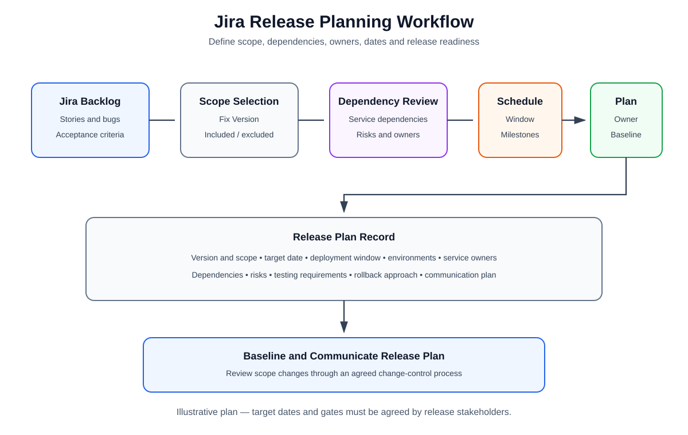

# Chapter 09 — Release Planning

## 1. Objective

Create a structured release plan before deploying application changes into production.

Release planning ensures that development, QA, DevOps, security and business teams understand:

- What changes are included in the release.
- Which microservices are affected.
- Which Jira issues belong to the release.
- What dependencies must be completed.
- Who is responsible for each activity.
- When the release will be deployed.
- Which environments require validation.
- What risks and rollback plans exist.

**Project:** Production DevOps Platform  
**Jira project key:** `PLAT`  
**Example release:** `v1.0.0`

## 2. Jira Release Planning Architecture



## 3. Understand Release Planning

A release is a collection of application changes delivered together as a controlled deployment.

For example, the Production DevOps Platform contains multiple microservices:

- User Service
- Product Catalog Service
- Cart Service
- Order Service
- Payment Service
- Inventory Service
- Notification Service

A release may include changes to several services.

The release manager must understand the scope, dependencies, testing requirements and deployment sequence before confirming the release plan.

## 4. Create a Release Version in Jira

Open the Jira project and navigate to its Releases or Versions section.

Create a release version:

```text
Project: Production DevOps Platform

Version: v1.0.0

Description:
Initial production release of the platform.

Start Date: Planned start date
Release Date: Planned release date

Status: Unreleased
```

The version provides a common reference for issues included in the release.

A Jira release version is a planning and tracking record. It does not itself deploy application changes.

## 5. Define Release Scope

Release scope identifies which stories, bugs and technical tasks are included.

Example:

**Release:** `v1.0.0`

| Jira issue | Description | Service | Priority |
|---|---|---|---|
| PLAT-501 | Implement user registration API | User | High |
| PLAT-502 | Add product catalog API | Product Catalog | High |
| PLAT-503 | Implement cart operations | Cart | High |
| PLAT-504 | Add order validation | Order | High |
| PLAT-505 | Integrate payment processing | Payment | High |
| PLAT-506 | Add inventory validation | Inventory | High |
| PLAT-507 | Configure order notifications | Notification | Medium |

Assign the `v1.0.0` Fix Version to each included issue.

### Scope categories

| Category | Meaning |
|---|---|
| Included | Approved for this release |
| Excluded | Not part of this release |
| Deferred | Moved to a future release |
| At risk | Planned but has an unresolved dependency or blocker |

Avoid including incomplete work merely to meet a release date.

## 6. Identify Microservice Dependencies

Microservices often depend on one another.

For example, an order workflow may involve:

```text
User Service
     |
     v
Order Service
     |
     +------> Inventory Service
     |
     +------> Payment Service
     |
     v
Notification Service
```

Before finalizing the release plan, identify:

- Which services call other services.
- Which API contracts are changing.
- Whether database schema changes are required.
- Whether messaging topics or queues are changing.
- Whether configuration or secrets need updating.
- Whether services must be deployed in a particular order.
- Whether backward compatibility is maintained.

Example dependency table:

| Service | Dependency | Planning consideration |
|---|---|---|
| Order | User | Authentication and user data |
| Order | Inventory | Inventory availability API |
| Order | Payment | Payment request and response |
| Notification | Order | Order event or message |
| Cart | Product Catalog | Product details and pricing |

Document actual dependencies from the application architecture and service contracts. Do not assume every service has a direct dependency on every other service.

## 7. Create a Release Dependency Matrix

A dependency matrix helps teams identify work that must be completed before another component can be released.

| Component | Depends on | Required before |
|---|---|---|
| Order Service | User Service API | Order integration testing |
| Order Service | Inventory API | End-to-end order validation |
| Payment Service | Payment configuration | Payment integration testing |
| Notification Service | Order event contract | Notification validation |
| Platform deployment | EKS and ECR readiness | Application deployment |

For each dependency, record:

- Owner
- Current status
- Target completion date
- Blocking issue
- Mitigation plan

Use Jira issue links such as blocks, is blocked by or relates to, where appropriate.

## 8. Define Release Milestones

A release should have clear milestones.

Example:

| Milestone | Activity |
|---|---|
| M1 | Development completion |
| M2 | Code freeze |
| M3 | QA testing completion |
| M4 | UAT acceptance |
| M5 | Release approval |
| M6 | Production deployment |
| M7 | Post-deployment validation |
| M8 | Release closure |

The actual schedule should be agreed by the project and release stakeholders.

## 9. Define Release Owners

Every major release activity should have an owner.

Example responsibility matrix:

| Activity | Responsible team |
|---|---|
| Release scope | Product Owner / Project Manager |
| Development completion | Development Team |
| Code quality | Development / DevSecOps |
| Security validation | Security / DevSecOps |
| QA testing | QA Team |
| UAT acceptance | Business Owner |
| CI/CD pipeline | DevOps Team |
| Kubernetes deployment | DevOps / Platform Team |
| Production validation | QA / Operations |
| Release communication | Release Manager |

For larger releases, use a RACI matrix to identify who is Responsible, Accountable, Consulted and Informed.

## 10. Define the Release Schedule

The release schedule should identify the planned deployment date and operational window.

Example:

```text
Release: v1.0.0

Development Completion: Planned
Code Freeze: Planned
QA Completion: Planned
UAT Completion: Planned
Approval: Planned
Production Deployment: Planned

Deployment Window:
Approved production maintenance window

Release Owner:
Release Manager

Technical Owner:
DevOps Team
```

Do not use placeholder dates as confirmed commitments. Record the approved date and time, including the relevant timezone.

## 11. Plan Environment Promotion

A typical release promotion flow:

```text
Development
     |
     v
QA
     |
     v
UAT
     |
     v
Staging
     |
     v
Production
```

Each environment should have its own validation requirements.

| Environment | Purpose |
|---|---|
| Development | Developer integration and early validation |
| QA | Functional and integration testing |
| UAT | Business acceptance |
| Staging | Production-like release validation |
| Production | Live application delivery |

Not every organization uses all five environments. Follow the actual environment strategy.

Promote the same validated artifact between environments wherever possible. Avoid rebuilding a different image for production after testing a separate image in staging.

## 12. Plan CI/CD and GitOps Activities

For the platform, the release workflow may look like this:

```text
Jira Release Scope
        |
        v
GitHub Pull Requests
        |
        v
GitHub Actions CI
        |
        v
Build and Unit Tests
        |
        v
SonarQube Quality Gate
        |
        v
Trivy Security Scan
        |
        v
Docker Image Build
        |
        v
Amazon ECR
        |
        v
GitOps Repository Update
        |
        v
Argo CD Synchronization
        |
        v
Amazon EKS
```

Plan the following before the deployment window:

- Required pipeline workflows.
- Required approvals and branch protections.
- ECR repository availability.
- Image tag and digest.
- Helm chart or values changes.
- Argo CD application configuration.
- Kubernetes resource requirements.
- Database migration procedure.
- Configuration and secret updates.
- Rollback strategy.

The pipeline should enforce the release's required quality and security gates.

## 13. Define Database and Messaging Changes

Application releases can include changes outside the application container.

Check for:

**Database changes**
- Schema migrations.
- Index changes.
- Data migrations.
- Backward compatibility.
- Backup and recovery requirements.

**Messaging changes**
- Kafka topic changes.
- RabbitMQ exchange or queue changes.
- SQS queue configuration.
- SNS subscription changes.
- Message schema compatibility.
- Consumer compatibility.

Coordinate these changes with dependent services.

For production systems, prefer backward-compatible database and messaging changes that allow old and new application versions to coexist during deployment and rollback.

## 14. Identify Release Risks

Create a release risk register.

Example:

| Risk | Impact | Mitigation |
|---|---|---|
| Payment API unavailable | Orders may fail | Validate payment integration and timeout handling |
| Database migration failure | Application errors | Backup and test migration procedure |
| Image vulnerability | Security exposure | Scan and approve image before promotion |
| Kubernetes deployment failure | Service disruption | Health checks and rollback procedure |
| Messaging incompatibility | Event processing failure | Validate producer and consumer compatibility |
| Insufficient capacity | Performance degradation | Validate resource requests and scaling capacity |

Every significant risk should have:

- An owner.
- An impact assessment.
- A mitigation.
- A contingency or rollback plan.
- A status.

## 15. Create a Release Plan Record

Maintain a release plan in Jira or an approved project document.

Example:

```markdown
# Release Plan — v1.0.0

## Release Information
Project: Production DevOps Platform
Release Version: v1.0.0
Environment: Production
Release Owner: Release Manager
Technical Owner: DevOps Team

## Release Scope
- PLAT-501 User Service
- PLAT-502 Product Catalog Service
- PLAT-503 Cart Service
- PLAT-504 Order Service
- PLAT-505 Payment Service
- PLAT-506 Inventory Service
- PLAT-507 Notification Service

## Prerequisites
- Development completed
- Code review completed
- CI pipeline successful
- Quality gate passed
- Security scan completed
- QA sign-off completed
- UAT acceptance recorded
- Release approval obtained

## Deployment Plan
- Confirm production readiness
- Verify image versions and digests
- Confirm Helm values and GitOps changes
- Verify Argo CD application health
- Deploy during the approved window
- Validate application and business flows

## Rollback Plan
- Identify last known-good application revision
- Restore approved GitOps configuration
- Verify application health
- Confirm data compatibility
- Communicate rollback outcome

## Post-Deployment
- Verify critical APIs
- Verify service-to-service communication
- Check application logs and metrics
- Confirm business workflows
- Update Jira release information
```

## 16. Manage Scope Changes

Release scope can change after planning.

Examples:

- A critical production bug must be included.
- A feature is not ready.
- A dependency is delayed.
- A security issue blocks the release.
- A business requirement changes.

Use a controlled process:

1. Record the requested change in Jira.
2. Identify affected services and issues.
3. Assess technical and business impact.
4. Review dependencies and testing effort.
5. Obtain the required approval.
6. Update the Fix Version and release plan.
7. Communicate the change to affected teams.

Do not silently add or remove production changes after the release scope has been agreed.

## 17. Release Planning Checklist

### Scope
- [ ] Release version created.
- [ ] Included Jira issues identified.
- [ ] Fix Version assigned to included issues.
- [ ] Excluded and deferred work documented.
- [ ] Acceptance criteria reviewed.

### Dependencies
- [ ] Microservice dependencies identified.
- [ ] API compatibility reviewed.
- [ ] Database changes identified.
- [ ] Messaging changes identified.
- [ ] Dependency owners assigned.

### Schedule and ownership
- [ ] Release milestones defined.
- [ ] Deployment window agreed.
- [ ] Release owner assigned.
- [ ] Technical owners assigned.
- [ ] Stakeholders informed.

### Technical readiness
- [ ] CI/CD workflows reviewed.
- [ ] Security and quality gates defined.
- [ ] Container images identified.
- [ ] GitOps changes reviewed.
- [ ] Database and configuration changes planned.
- [ ] Rollback procedure documented.

### Governance
- [ ] QA requirements defined.
- [ ] UAT requirements defined.
- [ ] Release risks documented.
- [ ] Scope change process agreed.

## 18. Expected Outcome

After completing this chapter, the team should be able to:

- Create Jira release versions.
- Define release scope.
- Group multiple microservice changes into a release.
- Identify service dependencies.
- Define release milestones and owners.
- Plan environment promotion.
- Coordinate CI/CD and GitOps activities.
- Identify database and messaging risks.
- Maintain a controlled release plan.

## 19. Next Chapter

**Chapter 10 — Release Approval**

The next chapter covers release approval workflows, change review, production readiness checks, approval responsibilities, change records and authorization before production deployment.