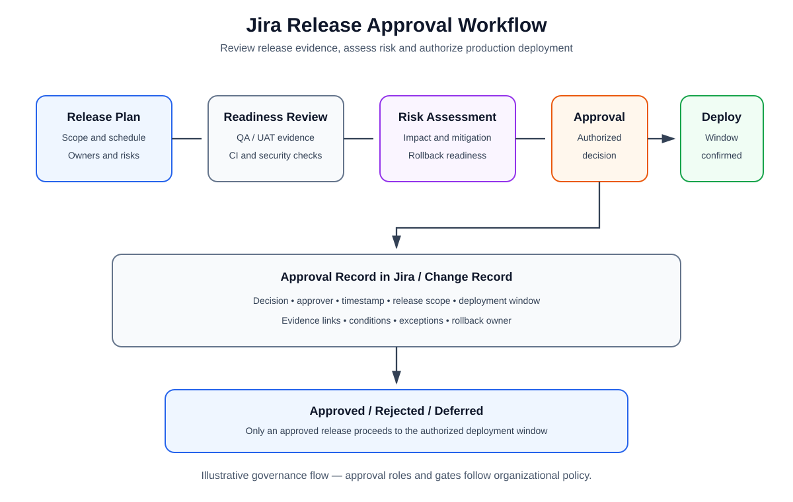

# Chapter 10 — Release Approval

## 1. Objective

Establish a controlled release approval process before deploying application changes into production.

Release approval ensures that:

- The release scope is reviewed.
- Required development activities are completed.
- QA and UAT sign-offs are available.
- Security and quality checks are completed.
- Production risks are understood.
- Rollback procedures are documented.
- Authorized stakeholders approve the release.
- Deployment timing is agreed.

**Project:** Production DevOps Platform  
**Jira project key:** `PLAT`  
**Example release:** `v1.0.0`

## 2. Jira Release Approval Architecture



## 3. Understand Release Approval

Release approval is a formal decision to authorize a planned release.

It is different from development completion or QA completion.

For example:

- Development confirms that the implementation is complete.
- QA confirms that required testing has passed.
- Security confirms that required security checks are completed.
- The business owner confirms UAT acceptance.
- The release authority reviews the evidence and approves production deployment.

The exact approval roles depend on organizational policy.

## 4. Define Release Approval Roles

Example responsibility structure:

| Role | Responsibility |
|---|---|
| Release Manager | Coordinates the release approval process |
| Product Owner | Confirms business scope and acceptance |
| Development Lead | Confirms development readiness |
| QA Lead | Confirms testing completion |
| Security Team | Reviews security findings and exceptions |
| DevOps Lead | Confirms deployment and rollback readiness |
| Change Manager / CAB | Reviews and authorizes changes where required |
| Business Owner | Confirms business acceptance |

Not every organization uses a Change Advisory Board (CAB). Follow the organization's approved change-management policy.

## 5. Define Release Approval Criteria

Before requesting approval, verify the release readiness criteria.

### Development readiness

- All included stories are completed.
- Code reviews are completed.
- Required pull requests are merged.
- No unapproved changes remain in scope.
- Source commits and release artifacts are identifiable.

### QA readiness

- Required functional tests have passed.
- Integration tests have passed.
- Regression testing is completed.
- Release-blocking defects are resolved or formally dispositioned.
- Test evidence is available.

### UAT readiness

- Business scenarios have been executed.
- UAT results are documented.
- Business acceptance is recorded.
- Outstanding business risks are documented.

### Security readiness

- SonarQube quality gate is satisfied.
- Trivy scanning is completed.
- Vulnerability exceptions are documented and approved.
- Secrets and configuration are handled securely.
- Required security approvals are available.

### Deployment readiness

- Production environment is available.
- Deployment artifact and image digest are identified.
- Helm values and GitOps changes are reviewed.
- Database and messaging changes are understood.
- Monitoring and alerting are ready.
- Rollback procedure is documented.
- Deployment owner is available.

## 6. Create a Release Approval Issue in Jira

One practical approach is to create a dedicated release approval issue for each production release.

Example:

```text
Issue Type: Task

Summary:
Release Approval - Production v1.0.0

Description:
Review and approve Production DevOps Platform
release v1.0.0 before deployment.

Release Version:
v1.0.0

Environment:
Production

Release Owner:
Release Manager

Deployment Owner:
DevOps Team

Target Deployment Window:
Approved production window
```

Link the approval issue to the relevant release stories and technical tasks.

Depending on the Jira configuration, you can also use a change-management issue type or an approved change-management integration.

## 7. Create a Release Approval Checklist

Use a checklist or structured fields in the approval issue.

Example:

```markdown
## Release Approval Checklist

### Development
- [ ] All planned stories completed
- [ ] Pull requests reviewed and merged
- [ ] Source commit identified

### QA
- [ ] Functional testing passed
- [ ] Integration testing passed
- [ ] Regression testing passed
- [ ] Critical defects resolved or approved

### UAT
- [ ] UAT execution completed
- [ ] Business acceptance recorded

### Security
- [ ] SonarQube quality gate passed
- [ ] Trivy scan completed
- [ ] Vulnerability exceptions approved

### Deployment
- [ ] Container image identified
- [ ] Image digest recorded
- [ ] GitOps changes reviewed
- [ ] Database changes reviewed
- [ ] Rollback plan documented
- [ ] Monitoring and alerts verified

### Approval
- [ ] Release Manager approval
- [ ] Required technical approval
- [ ] Business approval, where required
- [ ] Production deployment window confirmed
```

A checked box should represent completed and verified work, not an assumption.

## 8. Collect Release Evidence

Approval must be supported by evidence.

Example evidence register:

| Area | Evidence |
|---|---|
| Development | GitHub pull request links |
| Build | GitHub Actions run |
| Code quality | SonarQube analysis |
| Security | Trivy scan report |
| Artifact | ECR image tag and digest |
| QA | Test execution report |
| UAT | Business acceptance record |
| Deployment | GitOps commit and Argo CD revision |
| Rollback | Documented rollback procedure |
| Monitoring | Dashboard and alert verification |

Store evidence in approved project locations and link it from the Jira release approval issue.

Avoid storing passwords, tokens or other secrets in Jira comments or attachments.

## 9. Perform Production Risk Assessment

Before approval, assess the risks associated with the release.

Example:

| Risk | Impact | Mitigation | Owner |
|---|---|---|---|
| Payment Service failure | Payment processing may stop | Validate payment integration and rollback | Development Lead |
| Database migration failure | Data or application errors | Test migration and recovery procedure | Database Owner |
| Image vulnerability | Security exposure | Scan image and resolve blocking findings | Security Team |
| Kubernetes deployment failure | Service disruption | Health checks and rollback plan | DevOps Team |
| Messaging incompatibility | Events may not process correctly | Verify producer and consumer compatibility | Development Lead |
| Increased traffic | Performance degradation | Validate capacity and autoscaling | Platform Team |

For every significant risk, document its owner, mitigation and contingency.

An accepted risk should have an explicit approval and expiry or review condition where appropriate.

## 10. Define the Release Approval Workflow

Example workflow:

```text
Draft
  |
  v
Ready for Review
  |
  v
Under Approval
  |
  +------> Rejected
  |           |
  |           v
  |       Rework Required
  |           |
  |           v
  |       Ready for Review
  |
  +------> Deferred
  |
  v
Approved
  |
  v
Ready for Deployment
```

These are example workflow statuses. Configure the actual statuses and transitions in Jira.

### Workflow transition rules

| Transition | Example condition |
|---|---|
| Draft → Ready for Review | Release plan completed |
| Ready for Review → Under Approval | Required evidence attached |
| Under Approval → Approved | Authorized approver accepts |
| Under Approval → Rejected | Approval denied |
| Under Approval → Deferred | Release postponed |
| Approved → Ready for Deployment | Deployment window confirmed |

Do not allow unauthorized users to approve production releases.

## 11. Configure Jira Permissions and Approvals

Use Jira project roles, workflow conditions, validators and permissions to control the process.

Recommended controls:

- Limit approval actions to authorized roles.
- Restrict changes to release scope after approval.
- Require mandatory approval information.
- Record the approver and approval timestamp.
- Prevent unauthorized transitions.
- Maintain an audit trail.
- Reopen approval if a material change affects the approved scope.

Some approval capabilities depend on Jira edition, workflow configuration or installed apps. Verify the features available in your environment.

## 12. Approval Decision Example

Example release decision:

```text
Release: v1.0.0
Project: Production DevOps Platform
Environment: Production

Development Status: Completed
QA Status: Passed
UAT Status: Accepted
Security Status: Approved
Deployment Plan: Reviewed
Rollback Plan: Available

Decision: Approved

Approver: Authorized Release Approver
Approval Date: Actual approval date
Deployment Window: Approved production window

Conditions:
- Deploy only the approved image digests.
- Verify Argo CD application health.
- Complete post-deployment validation.
```

Use the actual approver identity and approval timestamp from Jira or the organization's approved change-management system.

## 13. Handle Rejected or Deferred Releases

### Scenario A — Release rejected

Example: QA has reported a critical defect.

Actions:

1. Record the rejection reason.
2. Link the blocking defect.
3. Notify the development and release teams.
4. Return the release to the required remediation stage.
5. Fix the issue.
6. Execute required tests again.
7. Collect updated evidence.
8. Request approval again.

### Scenario B — Release deferred

Example: A production dependency is unavailable during the planned window.

Actions:

1. Record the deferral reason.
2. Update the release plan.
3. Notify stakeholders.
4. Assess whether the release scope is affected.
5. Select a new deployment window.
6. Reconfirm operational readiness.
7. Obtain renewed approval where required.

### Scenario C — Scope changed after approval

If a new microservice, database migration or configuration change is added after approval:

1. Identify the change.
2. Assess the technical and business impact.
3. Determine whether existing approval remains valid.
4. Update the release scope and evidence.
5. Obtain additional approval or restart the approval process according to policy.

## 14. Connect Approval with CI/CD Deployment

Approval should be enforced at the deployment boundary, not just documented in Jira.

For GitHub Actions, a protected deployment environment can require authorized reviewers before a deployment job proceeds, subject to repository and plan capabilities.

Illustrative workflow:

```yaml
name: Production Deployment Approval

on:
  workflow_dispatch:

jobs:
  deploy:
    runs-on: ubuntu-latest

    environment:
      name: production

    steps:
      - name: Confirm deployment authorization
        run: echo "Production environment approval completed"

      - name: Deploy application
        run: echo "Run approved deployment process here"
```

Configure the `production` environment in GitHub with the required protection rules and reviewers.

This example demonstrates the approval boundary only. It does not implement an actual EKS deployment.

For a GitOps deployment:

1. Approve the release.
2. Confirm the approved image digest.
3. Merge the approved GitOps configuration change.
4. Allow Argo CD to synchronize according to the configured policy.
5. Validate the deployment.

Do not assume Jira approval automatically blocks or permits GitHub Actions or Argo CD. That requires an explicit integration or deployment control.

## 15. Maintain an Approval Audit Trail

The approval record should capture:

| Field | Purpose |
|---|---|
| Release version | Identifies the release |
| Jira approval issue | Links the approval record |
| Approver | Identifies the authorized decision-maker |
| Decision | Approved, rejected or deferred |
| Timestamp | Records when the decision occurred |
| Scope | Identifies approved changes |
| Evidence | Links validation and security results |
| Conditions | Records approval restrictions |
| Rollback owner | Identifies operational responsibility |

If the release scope changes materially, retain the original approval record and document the new decision rather than silently overwriting the history.

## 16. Release Approval Validation Checklist

- [ ] Release scope reviewed.
- [ ] Jira Fix Version assigned.
- [ ] Development completion confirmed.
- [ ] Pull requests reviewed and merged.
- [ ] CI pipeline successful.
- [ ] SonarQube quality gate passed.
- [ ] Trivy security scan completed.
- [ ] QA sign-off recorded.
- [ ] UAT acceptance recorded.
- [ ] Release risks assessed.
- [ ] Database and messaging changes reviewed.
- [ ] Container image digest identified.
- [ ] GitOps configuration reviewed.
- [ ] Rollback plan documented.
- [ ] Monitoring readiness confirmed.
- [ ] Authorized release approval recorded.
- [ ] Production deployment window confirmed.

## 17. Expected Outcome

After completing this chapter, the team should be able to:

- Create release approval records in Jira.
- Define release readiness criteria.
- Collect technical and business evidence.
- Assess production risks.
- Configure approval workflows and permissions.
- Handle rejected and deferred releases.
- Enforce deployment approvals.
- Maintain an auditable release decision.

## 18. Next Chapter

**Chapter 11 — Production Deployment**

The next chapter covers the actual production deployment process, including pre-deployment checks, image verification, Helm and Argo CD deployment, Kubernetes health validation and production monitoring.