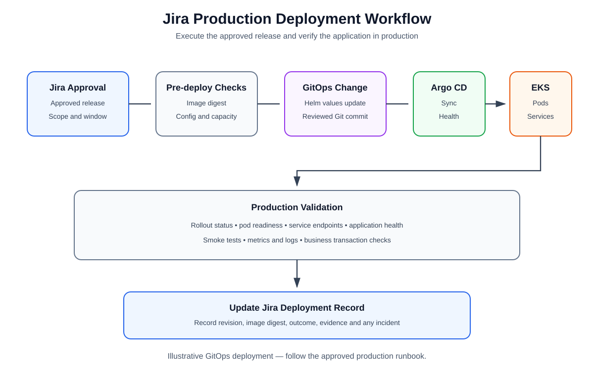

# Chapter 11 — Production Deployment

## 1. Objective

Define a controlled production deployment process for releasing application changes into Amazon EKS.

The deployment process covers:

- Production pre-deployment checks.
- Release and image verification.
- Kubernetes and Helm configuration.
- GitOps repository updates.
- Argo CD synchronization.
- Kubernetes rollout validation.
- Application health verification.
- Production monitoring.
- Jira deployment records.

**Project:** Production DevOps Platform  
**Jira project key:** `PLAT`  
**Example release:** `v1.0.0`  
**Deployment platform:** AWS EKS  
**Deployment approach:** Helm and Argo CD

## 2. Production Deployment Architecture



## 3. Understand the Production Deployment Process

Production deployment means releasing an approved and validated application version into the live environment.

In this project, CI and CD responsibilities are separated.

**CI responsibilities:**
- Checkout source code.
- Compile and build applications.
- Run unit tests.
- Perform SonarQube analysis.
- Scan dependencies and container images using Trivy.
- Build Docker images.
- Publish images to Amazon ECR.

**CD responsibilities:**
- Update the GitOps repository.
- Review and approve deployment configuration.
- Allow Argo CD to synchronize the desired state.
- Deploy applications into Amazon EKS.
- Validate deployment health.

The deployment process should use the exact artifact approved for release.

## 4. Production Deployment Prerequisites

Before starting deployment, verify the following.

### Jira readiness

- Release approval is completed.
- Release scope is finalized.
- Jira Fix Version is assigned.
- QA sign-off is recorded.
- UAT acceptance is recorded where required.
- Production deployment window is confirmed.

### AWS readiness

- EKS cluster is accessible.
- Required namespaces exist.
- ECR repositories are available.
- Worker nodes or compute capacity are healthy.
- Required IAM permissions are configured.
- Required networking and load balancing components are available.

### Kubernetes readiness

- Deployments and Services are configured.
- ConfigMaps and Secrets are available.
- Resource requests and limits are defined.
- Readiness and liveness probes are configured.
- Ingress configuration is reviewed.
- Network policies and RBAC are verified where applicable.

### GitOps readiness

- Helm chart changes are reviewed.
- Production values files are reviewed.
- Image tag or digest is verified.
- Argo CD application configuration is available.
- Rollback revision is identified.

## 5. Verify the Production Environment

Configure the AWS CLI with the approved production identity.

Check the AWS identity:

```bash
aws sts get-caller-identity
```

Configure EKS access:

```bash
aws eks update-kubeconfig \
  --region REGION \
  --name production-eks
```

Check cluster connectivity:

```bash
kubectl cluster-info
```

Check nodes:

```bash
kubectl get nodes -o wide
```

Check namespaces:

```bash
kubectl get namespaces
```

Check existing workloads:

```bash
kubectl get deployments -A
kubectl get pods -A
```

Verify that the cluster is healthy before starting the release.

Do not proceed if critical cluster components or required application dependencies are unhealthy.

## 6. Verify the Container Image in Amazon ECR

The production deployment must use an approved image.

Example:

```text
Repository:
order-service

Tag:
1.0.0

Registry:
ACCOUNT_ID.dkr.ecr.REGION.amazonaws.com
```

List image details:

```bash
aws ecr describe-images \
  --repository-name order-service \
  --region REGION
```

Retrieve a specific image digest:

```bash
aws ecr describe-images \
  --repository-name order-service \
  --image-ids imageTag=1.0.0 \
  --region REGION
```

Record the image digest in the release evidence.

Example:

```text
Image:
ACCOUNT_ID.dkr.ecr.REGION.amazonaws.com/order-service:1.0.0

Digest:
sha256:APPROVED_IMAGE_DIGEST
```

The digest above is a placeholder. Use the actual digest returned by ECR.

For stronger release integrity, use the immutable digest in the deployment configuration rather than relying only on a mutable tag.

## 7. Prepare the GitOps Repository

Example repository structure:

```text
gitops-repository/
├── applications/
│   ├── order-service.yaml
│   └── payment-service.yaml
│
├── helm/
│   └── order-service/
│       ├── Chart.yaml
│       ├── templates/
│       └── values.yaml
│
└── environments/
    └── production/
        ├── order-service-values.yaml
        └── payment-service-values.yaml
```

The application source repository and GitOps configuration repository can be maintained separately.

The CI pipeline builds and publishes the image. The GitOps repository defines which version should run in the cluster.

## 8. Update the Production Helm Values

Example production values file:

**File:** `environments/production/order-service-values.yaml`

```yaml
replicaCount: 3

image:
  repository: ACCOUNT_ID.dkr.ecr.REGION.amazonaws.com/order-service
  tag: "1.0.0"
  pullPolicy: IfNotPresent

service:
  type: ClusterIP
  port: 8080

resources:
  requests:
    cpu: 250m
    memory: 512Mi
  limits:
    cpu: "1"
    memory: 1Gi

autoscaling:
  enabled: true
  minReplicas: 3
  maxReplicas: 10
  targetCPUUtilizationPercentage: 70
```

This is an illustrative values file. The actual keys must match the Helm chart templates.

For production, validate resource requirements using workload measurements and capacity planning.

If the chart supports digest-based image references, use the approved image digest instead of only a tag.

## 9. Review the GitOps Change

Before merging the deployment configuration:

```bash
git checkout main
git pull origin main

git checkout -b release/PLAT-501-order-service-v1.0.0
```

Update the production values file.

Review the change:

```bash
git diff
```

Commit:

```bash
git add environments/production/order-service-values.yaml

git commit -m "PLAT-501 Update Order Service production image"

git push -u origin release/PLAT-501-order-service-v1.0.0
```

Create a pull request and obtain the required approval.

After approval, merge the configuration change into the branch monitored by Argo CD.

Do not commit production credentials or secret values into the GitOps repository.

## 10. Deploy Through Argo CD

Argo CD continuously compares the desired configuration in Git with the actual Kubernetes state.

Once the approved GitOps change is merged, Argo CD detects the configuration change according to its polling or webhook configuration.

Check Argo CD applications:

```bash
argocd app list
```

Check the Order Service application:

```bash
argocd app get order-service
```

If manual synchronization is part of the approved deployment procedure:

```bash
argocd app sync order-service
```

Check application health:

```bash
argocd app get order-service
```

Expected state:

```text
Sync Status: Synced
Health Status: Healthy
```

These statuses are examples of the desired result. A healthy Argo CD application does not by itself prove that every business transaction is working.

## 11. Verify Kubernetes Deployment Status

Check the deployment:

```bash
kubectl get deployment order-service -n production
```

Check rollout status:

```bash
kubectl rollout status \
  deployment/order-service \
  -n production \
  --timeout=300s
```

Check pods:

```bash
kubectl get pods -n production -o wide
```

Check ReplicaSets:

```bash
kubectl get replicasets -n production
```

Check Services:

```bash
kubectl get services -n production
```

Check endpoints:

```bash
kubectl get endpoints -n production
```

For clusters using EndpointSlices:

```bash
kubectl get endpointslices -n production
```

Verify that the expected number of replicas are available and that Service endpoints point to healthy pods.

## 12. Validate Application Health

Check the application logs:

```bash
kubectl logs \
  deployment/order-service \
  -n production \
  --tail=100
```

Check recent events:

```bash
kubectl get events \
  -n production \
  --sort-by=.metadata.creationTimestamp
```

Check the application health endpoint from an approved network location.

Example:

```bash
curl -i https://api.example.com/health
```

Expected response:

```text
HTTP/1.1 200 OK
```

The endpoint and expected response depend on the application.

Also validate:

- Application startup.
- Database connectivity.
- Service-to-service communication.
- Payment and inventory integrations.
- Message consumption where applicable.
- Authentication and authorization.
- Critical business transactions.

## 13. Validate Production Monitoring

After deployment, review the monitoring stack.

### Prometheus

Check application and infrastructure metrics.

Examples of useful metrics:

- CPU utilization.
- Memory utilization.
- Pod restarts.
- HTTP request rate.
- HTTP error rate.
- Request latency.
- JVM metrics for Java services, where configured.

Example PromQL:

```promql
rate(container_cpu_usage_seconds_total[5m])
```

Check pod restarts:

```promql
increase(kube_pod_container_status_restarts_total[15m])
```

### Grafana

Review dashboards for:

- EKS node health.
- Kubernetes workload health.
- Application performance.
- API error rates.
- Request latency.
- Resource consumption.

### ELK Stack

Review application logs for:

- Application startup errors.
- Database connection failures.
- API exceptions.
- Authentication failures.
- Dependency timeouts.

### Alertmanager

Check whether deployment-related alerts are firing.

Do not disable production alerts simply to hide deployment problems. If maintenance silencing is required, use the approved process and a defined expiry.

## 14. Execute Smoke Testing

Smoke tests verify that the most important application functions work after deployment.

Example:

| Test | Expected result |
|---|---|
| Health endpoint | Successful response |
| User authentication | Successful authentication |
| Product API | Product details returned |
| Cart API | Cart operation successful |
| Order API | Order request accepted |
| Payment integration | Expected payment result |
| Inventory integration | Availability handled correctly |

Use controlled test data and approved production testing procedures.

Do not create real customer orders or trigger real payments unless explicitly authorized.

## 15. Update Jira Deployment Information

After successful deployment, update the Jira release and related issues.

Example deployment record:

```text
Release: v1.0.0

Environment: Production

Deployment Status: Successful

Services Deployed:
- User Service
- Product Catalog Service
- Cart Service
- Order Service
- Payment Service
- Inventory Service
- Notification Service

Deployment Platform:
Amazon EKS

Deployment Tool:
Argo CD

Container Registry:
Amazon ECR

Validation:
- Kubernetes rollout successful
- Application health verified
- Smoke tests passed
- Monitoring reviewed

GitOps Revision:
ACTUAL_GIT_COMMIT

Deployment Evidence:
- Argo CD application details
- Pipeline execution
- ECR image digests
- Smoke test results
```

The example service list is illustrative. Record only services actually included in the release.

Link the deployment evidence to the release approval issue and relevant Jira stories.

## 16. Production Deployment Failure Scenarios

### Scenario 1 — Pods stuck in Pending

Check:

```bash
kubectl get pods -n production
kubectl describe pod POD_NAME -n production
kubectl get events -n production
```

Possible causes:

- Insufficient CPU or memory.
- Node capacity unavailable.
- Persistent volume binding failure.
- Node selector or affinity mismatch.
- Scheduling constraints.

Resolve the underlying issue before continuing.

### Scenario 2 — ImagePullBackOff

Check:

```bash
kubectl describe pod POD_NAME -n production
```

Possible causes:

- Incorrect image repository.
- Image tag or digest does not exist.
- ECR permissions are missing.
- Image pull authentication is failing.

Verify the image and the EKS node or workload's ECR access configuration.

### Scenario 3 — CrashLoopBackOff

Check:

```bash
kubectl logs POD_NAME -n production --previous
kubectl describe pod POD_NAME -n production
```

Possible causes:

- Application startup failure.
- Missing environment variables.
- Invalid configuration.
- Database connectivity failure.
- Incorrect container command.

Investigate the application logs and configuration before deciding whether to roll back.

### Scenario 4 — Readiness probe failure

Check:

```bash
kubectl describe pod POD_NAME -n production
```

Possible causes:

- Application is not ready.
- Incorrect health endpoint.
- Application startup takes longer than expected.
- Dependent service is unavailable.
- Probe timeout or threshold is unsuitable.

Correct the application or probe configuration based on actual health behavior.

### Scenario 5 — Application error rate increases

Investigate:

1. Prometheus metrics.
2. Grafana dashboards.
3. ELK application logs.
4. Kubernetes events.
5. Service dependency health.
6. Recent GitOps and application changes.

If the release is responsible for customer impact, initiate the incident and rollback process according to the production runbook.

## 17. Deployment Rollback Readiness

Before deployment, identify the last known-good version.

Example:

```text
Current production image:
order-service:0.9.5

New release image:
order-service:1.0.0

Rollback target:
order-service:0.9.5
```

For GitOps deployments, the preferred rollback method is usually to revert the approved GitOps configuration change to the last known-good configuration and allow Argo CD to reconcile it.

Example:

```bash
git revert COMMIT_ID
git push origin main
```

Verify the resulting GitOps revision and Kubernetes rollout.

Important considerations:

- Confirm database backward compatibility.
- Check whether messaging contracts remain compatible.
- Verify whether old and new versions can coexist.
- Confirm that the previous image is still available.
- Follow the approved rollback runbook.

Do not assume that reverting an application image reverses database changes or restores lost data.

## 18. Production Deployment Checklist

### Before deployment

- [ ] Jira release approval completed.
- [ ] Production deployment window confirmed.
- [ ] EKS cluster healthy.
- [ ] Required dependencies available.
- [ ] Approved ECR image verified.
- [ ] Image digest recorded.
- [ ] GitOps change reviewed and merged.
- [ ] Helm configuration validated.
- [ ] Rollback target identified.
- [ ] Monitoring and alerting ready.

### During deployment

- [ ] Argo CD synchronization completed.
- [ ] Kubernetes rollout successful.
- [ ] Expected replicas available.
- [ ] Services and endpoints healthy.
- [ ] No unexpected pod restarts.
- [ ] Application logs reviewed.

### After deployment

- [ ] Health checks passed.
- [ ] Smoke tests completed.
- [ ] Business flows validated.
- [ ] Prometheus metrics reviewed.
- [ ] Grafana dashboards reviewed.
- [ ] ELK logs reviewed.
- [ ] Alerts checked.
- [ ] Jira deployment record updated.
- [ ] Stakeholders notified.

## 19. Expected Outcome

After completing this chapter, the team should be able to:

- Execute approved production deployments.
- Verify AWS and EKS readiness.
- Identify approved container images.
- Update Helm and GitOps configuration.
- Deploy applications using Argo CD.
- Validate Kubernetes workloads.
- Perform production smoke testing.
- Monitor application health.
- Investigate deployment failures.
- Maintain deployment traceability in Jira.

## 20. Next Chapter

**Chapter 12 — Release Validation and Rollback**

The next chapter covers post-release validation, deployment verification, release failure handling, rollback execution, incident documentation and release recovery procedures.