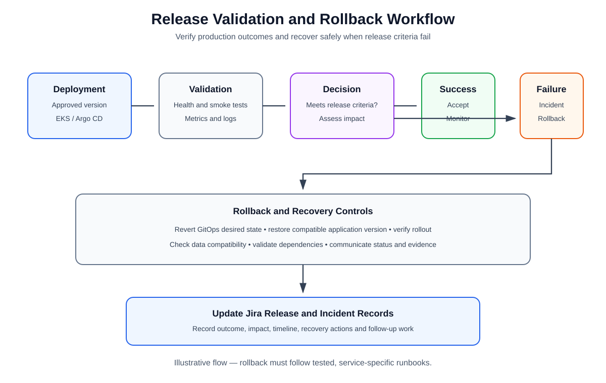

# Chapter 12 — Release Validation and Rollback

## 1. Objective

Establish a production release validation and rollback process to ensure that application deployments are working correctly and that failed releases can be recovered safely.

The process covers:

- Post-deployment validation.
- Kubernetes health checks.
- Application and API validation.
- Microservice integration checks.
- Monitoring and log analysis.
- Release acceptance criteria.
- Rollback decision-making.
- GitOps configuration recovery.
- Database and messaging compatibility.
- Jira release and incident updates.

**Project:** Production DevOps Platform  
**Jira project key:** `PLAT`  
**Example release:** `v1.0.0`  
**Deployment platform:** AWS EKS  
**Deployment approach:** Helm and Argo CD

## 2. Release Validation and Rollback Architecture



## 3. Understand Release Validation

Release validation confirms that the deployed application works as expected in production.

A successful Kubernetes deployment does not automatically mean the application is functioning correctly.

For example:

- Kubernetes pods may be Running.
- Deployment replicas may be Available.
- Argo CD may report Healthy.
- But the Order API may return HTTP 500 errors.
- Payment integration may fail.
- Database connections may be exhausted.

Therefore, validate infrastructure, application behavior and business transactions.

## 4. Define Release Validation Criteria

Before deployment, define what success means.

Example:

| Validation area | Expected result |
|---|---|
| Kubernetes deployment | Desired replicas available |
| Pod health | No unexpected restarts |
| Application health | Health endpoint responds successfully |
| API validation | Critical APIs return expected responses |
| Database | Application can connect and execute required operations |
| Messaging | Required messages are processed |
| Service integration | Dependent services communicate correctly |
| Error rate | Within agreed service thresholds |
| Latency | Within agreed performance objectives |
| Monitoring | Required dashboards and alerts operational |

Use actual service-level objectives and production thresholds rather than arbitrary values.

## 5. Verify Argo CD Deployment Status

Check the application:

```bash
argocd app get order-service
```

Check synchronization and health.

Expected example:

```text
Sync Status: Synced
Health Status: Healthy
```

Check all applications:

```bash
argocd app list
```

Verify that the deployed revision corresponds to the approved GitOps commit.

A Healthy status is useful, but it does not replace application-level validation.

## 6. Validate Kubernetes Workloads

Check deployments:

```bash
kubectl get deployments -n production
```

Check pods:

```bash
kubectl get pods -n production -o wide
```

Check rollout status:

```bash
kubectl rollout status \
  deployment/order-service \
  -n production \
  --timeout=300s
```

Check ReplicaSets:

```bash
kubectl get replicasets -n production
```

Check Services:

```bash
kubectl get services -n production
```

Check EndpointSlices:

```bash
kubectl get endpointslices -n production
```

Check recent events:

```bash
kubectl get events \
  -n production \
  --sort-by=.metadata.creationTimestamp
```

Verify that the expected number of replicas are ready and that the Service has healthy endpoints.

## 7. Validate Application Health

Check application logs:

```bash
kubectl logs \
  deployment/order-service \
  -n production \
  --tail=100
```

Check previous container logs if a container restarted:

```bash
kubectl logs POD_NAME \
  -n production \
  --previous
```

Check the application health endpoint:

```bash
curl -i https://api.example.com/health
```

Expected example:

```text
HTTP/1.1 200 OK
```

Validate important application functions:

- User authentication.
- Product catalog retrieval.
- Cart operations.
- Order creation.
- Payment processing.
- Inventory validation.
- Notification processing.

Use approved test accounts and test data. Avoid creating real customer transactions without authorization.

## 8. Validate Microservice Communication

A release may affect multiple services.

Example order processing flow:

```text
User Service
     |
     v
Order Service
     |
     +------> Inventory Service
     |
     +------> Payment Service
     |
     v
Notification Service
```

Verify:

- Service DNS resolution.
- Kubernetes Service connectivity.
- API request and response contracts.
- Authentication between services.
- Database connectivity.
- Messaging producer and consumer behavior.
- Timeout and retry handling.
- Error propagation.

Example DNS test from an approved diagnostic pod:

```bash
kubectl exec -it POD_NAME -n production -- \
  nslookup order-service.production.svc.cluster.local
```

Example connectivity test:

```bash
kubectl exec -it POD_NAME -n production -- \
  curl -i http://order-service:8080/health
```

The diagnostic container must contain the required tools, and the test should follow production access controls.

## 9. Validate Monitoring and Observability

Use the existing monitoring stack to verify the release.

### Prometheus

Check metrics such as:

- CPU usage.
- Memory usage.
- Pod restarts.
- HTTP request rate.
- HTTP error rate.
- Application latency.
- JVM metrics, where configured.

Example PromQL — request rate:

```promql
sum by (service) (
  rate(http_server_requests_seconds_count[5m])
)
```

Example — HTTP 5xx response rate:

```promql
sum(rate(http_server_requests_seconds_count{status=~"5.."}[5m]))
```

Adapt metric names and labels to the actual application instrumentation.

### Grafana

Review:

- EKS cluster health.
- Kubernetes workload dashboards.
- Application performance dashboards.
- CPU and memory usage.
- Request latency.
- API error rates.

### ELK Stack

Search application logs for:

- Exceptions.
- Database errors.
- Timeout errors.
- Authentication failures.
- Failed API requests.
- Messaging errors.

### Alertmanager

Verify whether any critical alerts are firing.

Do not silence production alerts to conceal a failed deployment.

## 10. Define Release Acceptance Criteria

Example release acceptance record:

```text
Release: v1.0.0
Environment: Production

Kubernetes Status: Passed
Application Health: Passed
API Smoke Tests: Passed
Database Connectivity: Passed
Service Integration: Passed
Monitoring: Passed
Critical Alerts: None

Release Decision: Accepted
```

The values above are illustrative. Record actual results from production validation.

If a critical validation fails, the release should remain unaccepted until the issue is resolved or an authorized recovery decision is made.

## 11. Understand When Rollback Is Required

Rollback means returning the application or configuration to a previously approved working state.

Examples of rollback conditions:

| Failure | Possible action |
|---|---|
| Critical API errors increase | Investigate and consider rollback |
| Application pods repeatedly crash | Fix forward or rollback |
| Payment processing fails | Follow incident and rollback criteria |
| Database connection failures | Investigate dependency and application changes |
| Incorrect configuration deployed | Restore previous configuration |
| Performance degradation | Assess impact and rollback if criteria are met |
| Security issue discovered | Stop promotion and follow security response procedure |

Not every error requires rollback.

The incident owner and release authority should assess:

- Customer impact.
- Error rate and duration.
- Service availability.
- Data integrity.
- Recovery time.
- Whether a safe fix-forward is possible.

## 12. Identify the Last Known-Good Version

Before deployment, record the current production version.

Example:

```text
Service: Order Service

Current Production Version:
0.9.5

New Release:
1.0.0

Rollback Target:
0.9.5
```

Record:

- Image tag.
- Image digest.
- Git commit.
- Helm chart version.
- GitOps configuration revision.
- Database migration version, if applicable.

Do not rely only on an image tag. Preserve the exact image digest and deployment revision.

## 13. Rollback Using GitOps

In an Argo CD GitOps environment, the Git repository is the source of truth for the desired application configuration.

Suppose the new deployment configuration was committed in:

```text
Commit: NEW_RELEASE_COMMIT
```

If the deployment fails, revert the specific GitOps change.

Example:

```bash
git checkout main
git pull origin main

git revert NEW_RELEASE_COMMIT

git push origin main
```

Use the actual commit ID.

Argo CD detects the reverted desired state and reconciles the cluster according to its configured sync policy.

Check the application:

```bash
argocd app get order-service
```

Check the Kubernetes rollout:

```bash
kubectl rollout status \
  deployment/order-service \
  -n production \
  --timeout=300s
```

Verify that the previous approved image and configuration are restored.

Important: do not manually change live resources and assume the GitOps repository will remain consistent. Argo CD may reconcile manual changes back to the repository's desired state.

## 14. Rollback Using Helm

For applications deployed directly through Helm, inspect release history:

```bash
helm history order-service -n production
```

Inspect the current release:

```bash
helm status order-service -n production
```

Rollback to a previous revision:

```bash
helm rollback order-service REVISION_NUMBER \
  -n production
```

Verify:

```bash
helm status order-service -n production
```

For an Argo CD-managed Helm application, perform rollback through the GitOps source of truth unless the approved runbook explicitly specifies another controlled method. A direct Helm rollback can be overwritten by Argo CD reconciliation.

## 15. Understand Kubernetes Deployment Rollback

For a Deployment managed directly with Kubernetes manifests, inspect rollout history:

```bash
kubectl rollout history \
  deployment/order-service \
  -n production
```

Rollback to a previous revision:

```bash
kubectl rollout undo \
  deployment/order-service \
  -n production
```

Verify:

```bash
kubectl rollout status \
  deployment/order-service \
  -n production
```

This command is useful for understanding Kubernetes Deployment history. In a GitOps-managed production environment, use the approved GitOps rollback procedure to preserve desired-state consistency.

## 16. Database Rollback Considerations

Application rollback does not automatically reverse database changes.

Example:

```text
Old Application Version: 0.9.5
New Application Version: 1.0.0
Database Schema: Updated
```

If the new application version changes the database schema, the old version may no longer be compatible.

Use backward-compatible database migration strategies:

1. Add new schema elements without immediately removing old ones.
2. Deploy code that supports both old and new schema structures.
3. Migrate data safely.
4. Validate the new application.
5. Remove obsolete schema elements in a later controlled release.

Before rollback, check:

- Database schema compatibility.
- Data migration status.
- Transaction consistency.
- Backup availability.
- Recovery Point Objective (RPO).
- Recovery Time Objective (RTO).

Do not run a destructive database rollback without an approved recovery plan.

## 17. Messaging Rollback Considerations

The platform may use Kafka, RabbitMQ, SQS or SNS for asynchronous communication.

Before rollback, verify:

- Message schema compatibility.
- Producer and consumer version compatibility.
- Queue or topic configuration.
- Consumer offsets or acknowledgements.
- Retry and dead-letter handling.
- Duplicate message behavior.

A rolled-back application must still be able to process messages produced by the newer version, or the messaging contract must be restored safely.

## 18. Complete Rollback Scenario

Example:

**Problem:** Order Service v1.0.0 is deployed, but the application starts returning increased HTTP 500 responses.

### Step 1 — Detect the issue

Prometheus alerts on an increased error rate.

### Step 2 — Investigate

Check:

```bash
kubectl get pods -n production

kubectl logs \
  deployment/order-service \
  -n production \
  --tail=100

kubectl get events -n production
```

Review Grafana dashboards and ELK logs.

### Step 3 — Assess impact

Determine:

- Whether customer transactions are affected.
- Whether database writes are failing.
- Whether Payment and Inventory services are affected.
- Whether the failure is limited to the new release.

### Step 4 — Make the recovery decision

If the new release is causing significant impact and the previous version is compatible, initiate the approved rollback.

### Step 5 — Revert the GitOps change

Restore the last known-good configuration and allow Argo CD to reconcile.

### Step 6 — Validate recovery

Verify:

- Previous image is running.
- Kubernetes rollout is successful.
- API health is restored.
- Error rates return to acceptable levels.
- Critical business workflows work.

### Step 7 — Update Jira

Record the failure, impact, rollback revision, recovery time and follow-up actions.

## 19. Create a Release Failure Record in Jira

Example:

```text
Issue Type: Bug / Incident

Summary:
Production deployment failure - Order Service v1.0.0

Release:
v1.0.0

Service:
Order Service

Environment:
Production

Failure:
Increased HTTP 500 responses after deployment.

Impact:
Order API requests affected.

Detection:
Prometheus alert and application monitoring.

Recovery:
Previous approved GitOps configuration restored.

Rollback Target:
Order Service v0.9.5

Validation:
- Kubernetes rollout successful
- API health restored
- Smoke tests passed
- Monitoring reviewed

Follow-up:
Root cause analysis required.
```

Use your organization's incident-management issue type or project if one exists. Link the incident to the release and affected Jira stories.

## 20. Post-Rollback Root Cause Analysis

After recovery, conduct an RCA.

Example structure:

```text
Incident:
Order Service deployment failure

Timeline:
- Deployment started
- New version became available
- Error rate increased
- Incident detected
- Rollback initiated
- Previous version restored
- Service health confirmed

Root Cause:
To be established through investigation.

Customer Impact:
Document actual impact.

Recovery Action:
GitOps configuration reverted.

Preventive Actions:
- Add missing integration test.
- Improve deployment validation.
- Review readiness and startup probes.
- Add relevant monitoring coverage.
- Improve release acceptance criteria.
```

Do not label a suspected cause as the confirmed root cause without evidence.

## 21. Release Validation and Rollback Checklist

### Validation

- [ ] Argo CD synchronization verified.
- [ ] Kubernetes deployment healthy.
- [ ] Expected pod replicas available.
- [ ] Application health endpoint passed.
- [ ] API smoke tests passed.
- [ ] Database connectivity verified.
- [ ] Microservice integration validated.
- [ ] Messaging behavior verified.
- [ ] Prometheus metrics reviewed.
- [ ] Grafana dashboards reviewed.
- [ ] ELK logs reviewed.
- [ ] Critical alerts checked.

### Rollback readiness

- [ ] Last known-good image digest recorded.
- [ ] Previous GitOps revision identified.
- [ ] Previous Helm chart and values available.
- [ ] Database compatibility assessed.
- [ ] Messaging compatibility assessed.
- [ ] Rollback owner identified.
- [ ] Recovery procedure documented.

### Closure evidence

- [ ] Release accepted or rollback recorded.
- [ ] Jira release record updated.
- [ ] Incident linked where required.
- [ ] Deployment timeline documented.
- [ ] RCA follow-up assigned if needed.
- [ ] Stakeholders informed.

## 22. Expected Outcome

After completing this chapter, the team should be able to:

- Validate production releases.
- Verify Kubernetes and application health.
- Check microservice dependencies.
- Use Prometheus, Grafana and ELK for validation.
- Identify when rollback is necessary.
- Restore a previous GitOps configuration.
- Understand Helm and Kubernetes rollback mechanisms.
- Assess database and messaging compatibility.
- Record failures and recovery actions in Jira.
- Conduct post-incident RCA.

## 23. Next Chapter

**Chapter 13 — Release Closure**

The next chapter covers final release verification, closure approvals, release notes, stakeholder communication, documentation, lessons learned and closing the Jira release cycle.