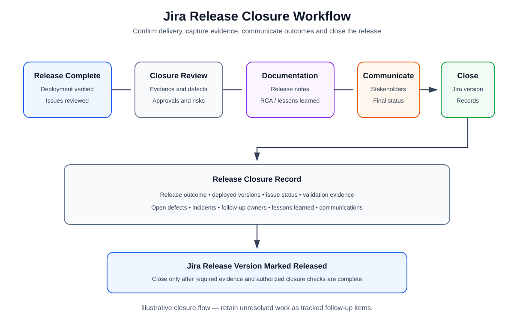

# Chapter 13 — Release Closure

## 1. Objective

Define a structured process for closing a production release after deployment and validation are completed.

Release closure ensures that:

- Production deployment is verified.
- Release scope is reviewed.
- Jira issues are updated.
- Outstanding defects are tracked.
- Release notes are prepared.
- Deployment evidence is retained.
- Stakeholders are informed.
- Incidents and follow-up actions are documented.
- Lessons learned are captured.
- The Jira release version is marked as released.

**Project:** Production DevOps Platform  
**Jira project key:** `PLAT`  
**Example release:** `v1.0.0`

## 2. Jira Release Closure Architecture



## 3. Understand Release Closure

Release closure is the final stage of the release management lifecycle.

It confirms that the planned release has been delivered and that the required evidence and records are complete.

Example release lifecycle:

```text
Release Planning
       |
       v
Release Approval
       |
       v
Production Deployment
       |
       v
Release Validation
       |
       v
Release Closure
```

A release should not be marked complete merely because a deployment pipeline succeeded.

The release owner must verify the agreed acceptance and closure criteria.

## 4. Define Release Closure Criteria

Before closing the release, verify the following.

### Deployment completion

- Production deployment completed.
- Expected application versions are running.
- Kubernetes workloads are healthy.
- Argo CD application status is verified.
- Critical application workflows are validated.

### Quality and acceptance

- Required smoke tests passed.
- QA validation is complete.
- UAT acceptance is recorded where required.
- Critical release-blocking defects are resolved or formally dispositioned.
- Outstanding issues have owners and target releases.

### Operational readiness

- Monitoring dashboards reviewed.
- Required alerts verified.
- Application logs reviewed.
- Support or operations handover completed where required.
- Rollback information retained.

### Documentation

- Release notes prepared.
- Deployment evidence linked.
- Release issues updated.
- Incident records linked.
- Stakeholder communication completed.
- Lessons learned documented.

## 5. Verify the Production Deployment

Before closure, verify the actual production state.

Check Argo CD:

```bash
argocd app list
```

Inspect the relevant application:

```bash
argocd app get order-service
```

Check Kubernetes deployments:

```bash
kubectl get deployments -n production
```

Check pods:

```bash
kubectl get pods -n production -o wide
```

Check rollout status:

```bash
kubectl rollout status \
  deployment/order-service \
  -n production \
  --timeout=300s
```

Check application logs:

```bash
kubectl logs \
  deployment/order-service \
  -n production \
  --tail=100
```

Also verify:

- Application health endpoints.
- Critical API responses.
- Database connectivity.
- Service-to-service communication.
- Messaging behavior.
- Production metrics and alerts.

Record the actual results. Do not use expected or sample results as production evidence.

## 6. Review Jira Release Issues

Open the Jira project and review all issues associated with the release version.

Example:

| Issue | Description | Final status |
|---|---|---|
| PLAT-501 | User Service registration | Done |
| PLAT-502 | Product Catalog API | Done |
| PLAT-503 | Cart operations | Done |
| PLAT-504 | Order validation | Done |
| PLAT-505 | Payment integration | Done |
| PLAT-506 | Inventory validation | Done |
| PLAT-507 | Order notifications | Done |

The issue keys and statuses are illustrative.

Check that:

- Completed issues are actually complete.
- Fix Version is correct.
- Required acceptance criteria are met.
- Linked bugs are reviewed.
- Deferred work is assigned to a future release where appropriate.
- No issue is marked Done without the required validation.

## 7. Review Outstanding Defects

Not every minor defect must necessarily block release closure, but unresolved issues must remain visible and controlled.

Example:

| Defect | Priority | Status | Closure action |
|---|---|---|---|
| PLAT-510 | Critical | Open | Must be resolved or release closure blocked |
| PLAT-511 | High | Fixed | Verify fix and close |
| PLAT-512 | Medium | Open | Assign owner and target release |
| PLAT-513 | Low | Deferred | Track in future release |

For every outstanding defect, document:

- Business impact.
- Technical impact.
- Owner.
- Workaround, if available.
- Target fix version.
- Approval or acceptance of any remaining risk.

Do not close a bug just because its parent release is complete.

## 8. Prepare Release Notes

Release notes summarize what was delivered.

Example:

```markdown
# Production DevOps Platform — Release v1.0.0

## Release Overview
Initial production release of the platform.

## Included Services
- User Service
- Product Catalog Service
- Cart Service
- Order Service
- Payment Service
- Inventory Service
- Notification Service

## Key Improvements
- User registration and authentication workflows.
- Product catalog functionality.
- Cart management.
- Order creation and validation.
- Payment integration.
- Inventory validation.
- Order notification processing.

## Deployment Information
Environment: Production
Platform: AWS EKS
Container Registry: Amazon ECR
Deployment: Helm and Argo CD

## Validation
- Production deployment verified.
- Kubernetes health checked.
- Application smoke tests completed.
- Monitoring reviewed.

## Known Issues
List any approved outstanding issues and their Jira references.

## References
Jira Project: PLAT
Release Version: v1.0.0
```

Only include features and services actually delivered in the release.

## 9. Record Deployment Evidence

Maintain a release evidence register.

| Evidence | Example reference |
|---|---|
| Jira release | PLAT v1.0.0 |
| GitHub pull requests | PR links |
| CI pipeline | GitHub Actions run |
| Code quality | SonarQube analysis |
| Security scan | Trivy report |
| Container artifact | ECR image digest |
| GitOps change | Git commit |
| Deployment | Argo CD revision |
| Kubernetes validation | Rollout and health results |
| QA | Test execution report |
| UAT | Business acceptance |
| Incident | Linked Jira incident |

Store evidence in approved project locations and link it from the release record.

Never store credentials, access tokens or other secrets in release notes or Jira attachments.

## 10. Update the Jira Release Version

After completing the required checks:

1. Open the Jira project.
2. Navigate to Releases or Versions.
3. Find `v1.0.0`.
4. Review the release issues.
5. Verify the release date.
6. Confirm that the required closure checks are complete.
7. Mark the version as Released.

The exact menu names may vary depending on the Jira project type and interface.

Example:

```text
Project: Production DevOps Platform

Version: v1.0.0

Status: Released

Release Date: Actual release date

Included Issues:
- PLAT-501
- PLAT-502
- PLAT-503
- PLAT-504
- PLAT-505
- PLAT-506
- PLAT-507
```

Marking a Jira version as Released updates project tracking. It does not perform or verify a production deployment.

## 11. Close the Release Approval Issue

Example:

```text
Issue:
Release Approval - Production v1.0.0

Final Status:
Closed

Closure Summary:
- Production deployment completed.
- Release validation completed.
- Required smoke tests passed.
- Monitoring reviewed.
- Release notes prepared.
- Evidence linked.
- Outstanding issues reviewed.
- Stakeholders notified.
```

Only close the approval issue when its required conditions are met.

If a release has been rolled back, record the actual outcome and follow the organization's release closure policy rather than reporting it as a successful release.

## 12. Stakeholder Communication

After release completion, notify the relevant stakeholders.

The communication should include:

- Release version.
- Deployment date and environment.
- Services or features delivered.
- Deployment outcome.
- Validation results.
- Known issues.
- Incident or rollback information, if applicable.
- Support contact or ownership.

Example message:

```text
Subject: Production Release v1.0.0 — Deployment Completed

Hello Team,

The Production DevOps Platform release v1.0.0
has been deployed to the production environment.

Deployment Status: Successful

Platform: AWS EKS
Deployment Method: Helm and Argo CD

Validation:
- Kubernetes deployment verified.
- Application health checks completed.
- Critical smoke tests passed.
- Monitoring dashboards reviewed.

Release notes and deployment evidence have been
updated in Jira.

Please refer to Jira project PLAT for release details.

Regards,
Release Management Team
```

Use the actual deployment outcome and validation results in the communication.

## 13. Conduct a Release Retrospective

After closure, conduct a release retrospective with development, QA, DevOps, security and business stakeholders as appropriate.

Discuss:

- What went well?
- What caused delays?
- Which defects escaped earlier testing?
- Were dependencies identified correctly?
- Did CI/CD pipelines work as expected?
- Were deployment approvals timely?
- Was monitoring sufficient?
- Was rollback readiness adequate?
- What should change before the next release?

Record actionable improvements.

Example:

| Observation | Improvement action | Owner |
|---|---|---|
| Integration testing took longer than planned | Improve test automation | QA Lead |
| Image verification was manual | Automate image digest verification | DevOps |
| Deployment alerts were delayed | Review alert thresholds | Monitoring Owner |
| Release evidence was incomplete | Standardize release checklist | Release Manager |

Assign owners and target dates to improvement actions.

## 14. Capture Lessons Learned

Example:

```markdown
# Release Retrospective — v1.0.0

## What Went Well
- CI pipeline completed successfully.
- Container images were published to ECR.
- Argo CD deployment was successful.
- Production smoke tests passed.

## Challenges
- Integration testing required additional coordination.
- Some release evidence was collected manually.

## Improvements
- Automate release evidence collection.
- Improve integration test coverage.
- Standardize deployment validation.
- Review alert thresholds before future releases.

## Action Items
- Assign owners to each improvement.
- Create Jira follow-up issues.
- Track completion in the next sprint.
```

These are example observations. Replace them with findings from the actual release.

## 15. Create Follow-up Jira Tasks

Release retrospectives often identify work that should not be forgotten.

Example:

| Jira issue | Follow-up action |
|---|---|
| PLAT-520 | Automate production smoke tests |
| PLAT-521 | Improve Order Service integration tests |
| PLAT-522 | Add image digest verification to CI/CD |
| PLAT-523 | Improve release evidence automation |
| PLAT-524 | Review production alert thresholds |

Assign each task to an owner and include it in the appropriate future backlog or sprint.

## 16. Final Release Closure Checklist

### Production verification
- [ ] Production deployment verified.
- [ ] Argo CD state checked.
- [ ] Kubernetes workloads healthy.
- [ ] Application health verified.
- [ ] Critical business workflows tested.
- [ ] Monitoring and logs reviewed.

### Jira management
- [ ] Release issues reviewed.
- [ ] Completed stories updated.
- [ ] Outstanding defects reviewed.
- [ ] Deferred issues assigned to future work.
- [ ] Release approval issue updated.
- [ ] Jira version marked Released where appropriate.

### Documentation
- [ ] Release notes prepared.
- [ ] Deployment evidence linked.
- [ ] Image digests recorded.
- [ ] GitOps revision recorded.
- [ ] QA and UAT evidence retained.
- [ ] Incident records linked.

### Communication and improvement
- [ ] Stakeholders notified.
- [ ] Support handover completed where required.
- [ ] Retrospective conducted.
- [ ] Lessons learned documented.
- [ ] Follow-up tasks created.
- [ ] Owners assigned.

## 17. Expected Outcome

After completing this chapter, the team should be able to:

- Verify final production release status.
- Review Jira release issues.
- Manage outstanding defects.
- Prepare release notes.
- Maintain deployment evidence.
- Mark Jira versions as released.
- Close release approval records.
- Communicate release outcomes.
- Conduct release retrospectives.
- Track improvement actions.

## 18. Complete Jira Project & Release Management Lifecycle

The complete workflow covered by this collection is:

```text
Jira Project Setup
       |
       v
Epics, Stories and Tasks
       |
       v
Backlog Management
       |
       v
Sprint Planning
       |
       v
Development Workflow
       |
       v
GitHub Integration
       |
       v
CI/CD Integration
       |
       v
QA / UAT Management
       |
       v
Release Planning
       |
       v
Release Approval
       |
       v
Production Deployment
       |
       v
Release Validation and Rollback
       |
       v
Release Closure
```

## 19. Collection Completion

The Jira Project & Release Management documentation now covers the complete release lifecycle, from initial project setup through production deployment and release closure.

Use these chapters as a practical reference for understanding how Jira, GitHub, CI/CD, QA, UAT, production deployment and release governance work together in a DevOps environment.