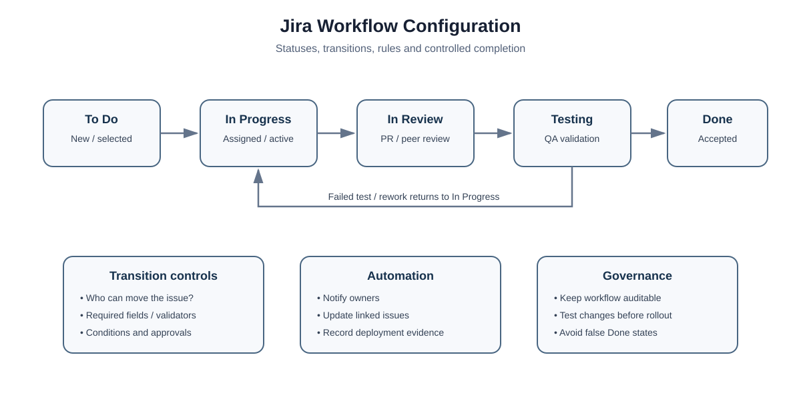

# 15 — Jira Workflow Configuration

## 1. Objective

Configure Jira workflows to control how work moves from creation to completion.

In a production DevOps project, workflows help teams:

- Track development progress.
- Control issue status transitions.
- Enforce code review and QA activities.
- Prevent incomplete work from being marked Done.
- Record approvals and release decisions.
- Maintain traceability across development and production.

**Project:** Production DevOps Platform  
**Example Project Key:** PLAT  
**Application:** 21 microservices on AWS EKS

## 2. Jira Workflow Architecture



## 3. What Is a Jira Workflow?

A Jira workflow defines the lifecycle of an issue.

It consists of:

| Component | Meaning |
|---|---|
| Status | Current state of an issue |
| Transition | Movement from one status to another |
| Condition | Determines who can execute a transition |
| Validator | Checks whether required information is provided |
| Post function | Performs an action after a transition |
| Workflow scheme | Associates workflows with issue types |

Example:

A developer creates a story, starts development, submits a pull request, receives code review, sends the work to QA and completes it after successful testing.

## 4. Design the Development Workflow

Use the following statuses as a practical starting point.

| Status | Purpose |
|---|---|
| To Do | Work is ready but not started |
| In Progress | Developer is working on it |
| In Review | Code is submitted for review |
| Testing | QA is validating the change |
| Done | Acceptance criteria are satisfied |

### Workflow transitions

| From | To | Action |
|---|---|---|
| To Do | In Progress | Start work |
| In Progress | In Review | Submit pull request |
| In Review | In Progress | Changes requested |
| In Review | Testing | Review approved |
| Testing | In Progress | Testing failed |
| Testing | Done | Testing passed |

The exact transition names and available workflow features depend on your Jira project type and configuration.

## 5. Create a Workflow in Jira

The following steps describe a typical company-managed Jira Software project. Menu labels can differ by Jira version and permissions.

1. Open Jira.
2. Navigate to **Settings → Issues** or the relevant project workflow settings.
3. Open **Workflows**.
4. Select **Add workflow**.
5. Enter the workflow name:

```text
Production DevOps Development Workflow
```

6. Add the required statuses.
7. Create the transitions between statuses.
8. Configure conditions, validators and post functions where supported.
9. Save and publish the workflow.
10. Associate it with the appropriate issue types through a workflow scheme.

**Important:** Do not modify a shared production workflow without checking which projects and issue types use it. Test the new workflow before applying it broadly.

## 6. Configure Issue Statuses

Create or reuse the following statuses:

| Status | Jira status category |
|---|---|
| To Do | To Do |
| In Progress | In Progress |
| In Review | In Progress |
| Testing | In Progress |
| Done | Done |

Status categories help Jira classify work for boards and reporting.

Avoid creating unnecessary statuses. A status should represent a meaningful state, not simply a team member or an activity.

## 7. Configure Transitions

A transition controls how an issue moves between statuses.

Example: Developer moves a story from In Progress to In Review.

**Transition name:**

```text
Submit for Code Review
```

**From:** In Progress  
**To:** In Review

### Recommended transition rules

| Transition | Recommended control |
|---|---|
| To Do → In Progress | Assignee or authorized team member |
| In Progress → In Review | Require development work to be ready |
| In Review → Testing | Require review approval |
| In Review → In Progress | Allow reviewer feedback and rework |
| Testing → Done | Require QA acceptance evidence |
| Testing → In Progress | Allow failed tests to return for correction |

These controls should be implemented using Jira workflow features or automation where available. A transition name alone does not enforce the rule.

## 8. Configure Conditions

Conditions determine whether a user is allowed to execute a transition.

Examples:

- Only members of the development team can start development.
- Only authorized reviewers can approve a review transition.
- Only QA team members can complete a testing transition.
- Only release managers can execute a controlled release approval transition.

### Example

For the transition:

```text
In Review → Testing
```

Possible condition:

```text
User belongs to the authorized reviewer group
```

The exact condition options depend on the Jira workflow editor and available extensions.

## 9. Configure Validators

Validators check whether required information exists before a transition is completed.

Examples:

| Transition | Validation requirement |
|---|---|
| In Progress → In Review | Pull request link provided |
| In Review → Testing | Review decision recorded |
| Testing → Done | Test result recorded |
| Release approval → Approved | Approval evidence provided |

### Example: Require a Pull Request Link

For the transition:

```text
In Progress → In Review
```

Configure a required field or equivalent validation rule for the pull request URL, if supported.

Example value:

```text
https://github.com/example-org/order-service/pull/25
```

This is illustrative. Use your actual repository and pull request URL.

## 10. Configure Post Functions

Post functions perform actions after a transition.

Examples:

- Update issue status.
- Record transition information.
- Add a comment.
- Update a field.
- Trigger a notification or automation rule.

Example:

When a story moves to Done, Jira can record the completion transition and trigger an automation rule to notify the Product Owner.

Use native workflow post functions where available. Use Jira Automation for actions that are not supported directly by the workflow editor.

## 11. Configure a Bug Workflow

Bugs require a slightly different lifecycle.

| Status | Meaning |
|---|---|
| Open | Bug reported |
| In Progress | Developer investigating |
| Fixed | Code correction completed |
| Ready for Retest | Fix available for testing |
| Reopened | Bug still exists |
| Closed | QA verified the fix |

### Bug transition example

```text
Open
  ↓
In Progress
  ↓
Fixed
  ↓
Ready for Retest
  ↓
Closed
```

If testing fails:

```text
Ready for Retest → Reopened → In Progress
```

A bug should not be closed merely because a developer has committed a fix. Verification must follow the team's agreed process.

## 12. Configure a Release Approval Workflow

Create a separate approval workflow or approval issue type where your Jira configuration supports it.

Example statuses:

| Status | Meaning |
|---|---|
| Draft | Approval request created |
| Under Review | Release evidence being reviewed |
| Approved | Required approvals obtained |
| Rejected | Release cannot proceed |
| Deferred | Release postponed |

### Approval flow

```text
Draft
  ↓
Under Review
  ↓
Approved
  ↓
Production Deployment
```

Rejected or deferred requests should return to the appropriate planning or remediation activity.

**Important:** Jira approval tracking and production deployment authorization are separate concerns. Connect Jira to GitHub Actions environment protection or another deployment gate if approval must technically block deployment.

## 13. Assign Workflows to Issue Types

Use a workflow scheme to associate the appropriate workflow with each issue type.

Example mapping:

| Issue Type | Workflow |
|---|---|
| Epic | Epic Workflow |
| Story | Development Workflow |
| Task | Development Workflow |
| Sub-task | Development Workflow |
| Bug | Bug Workflow |
| Release Approval | Approval Workflow, if configured |

A shared workflow can be used by multiple issue types when their lifecycle is genuinely the same.

Do not create separate workflows for every microservice unless their process requirements differ.

## 14. Example: Order Service Story

**Jira Issue:** PLAT-101  
**Summary:** Create Order API  
**Issue Type:** Story

### Workflow execution

1. Product Owner creates the story in To Do.
2. Developer starts work and moves it to In Progress.
3. Developer implements the API.
4. Developer creates a feature branch.
5. Developer submits a pull request.
6. Story moves to In Review.
7. Reviewer requests changes or approves the pull request.
8. Approved work moves to Testing.
9. QA validates the API.
10. If testing passes, the story moves to Done.
11. If testing fails, the story returns to In Progress.

### Example branch

```bash
git checkout -b feature/PLAT-101-create-order-api
```

### Example commit

```bash
git add .
git commit -m "PLAT-101: implement order creation API"
git push origin feature/PLAT-101-create-order-api
```

The Jira issue key in branch names and commit messages helps link development activity to the issue when the GitHub integration is configured.

## 15. Jira Automation Examples

Automation can reduce repetitive work.

### Rule 1: Notify the Product Owner when a story is completed

**Trigger:** Issue transitioned to Done  
**Condition:** Issue type is Story  
**Action:** Send notification to the Product Owner or relevant team.

### Rule 2: Notify QA when a story enters Testing

**Trigger:** Issue transitioned to Testing  
**Condition:** Issue type is Story  
**Action:** Notify the QA team.

### Rule 3: Notify the developer when a bug is reopened

**Trigger:** Issue transitioned to Reopened  
**Action:** Notify the assignee.

### Rule 4: Update release tracking

**Trigger:** A release-related issue reaches the configured completion state  
**Condition:** Release field or version matches the intended release  
**Action:** Update the tracking record or notify the Release Manager.

Automation rules must be configured, scoped and tested. They do not run simply because these examples are documented.

## 16. Workflow Testing Checklist

Before publishing or applying a workflow, test:

- [ ] Every required status exists.
- [ ] Every intended transition is available.
- [ ] Invalid transitions are prevented.
- [ ] Conditions restrict unauthorized actions.
- [ ] Validators enforce required information.
- [ ] Post functions execute correctly.
- [ ] Rework paths work.
- [ ] Bugs can be reopened.
- [ ] QA cannot accidentally bypass required checks.
- [ ] Approval decisions are recorded.
- [ ] Automation rules do not create loops.
- [ ] Existing issues are handled correctly after workflow changes.

## 17. Common Workflow Problems

| Problem | Possible Cause | Action |
|---|---|---|
| Transition not visible | Condition or permission restriction | Review conditions and permissions |
| Issue cannot move to Done | Validator failure | Check required fields |
| Automation not triggered | Rule disabled or incorrect scope | Review audit log |
| Wrong workflow assigned | Workflow scheme mapping | Review issue type mapping |
| Users can bypass review | Missing condition or validator | Add appropriate controls |
| Issues stuck in old status | Workflow migration issue | Review status mapping |

## 18. Production Best Practices

1. Keep workflows simple and understandable.
2. Use separate workflows only when lifecycles differ.
3. Restrict important transitions using permissions and conditions.
4. Require evidence for important completion and approval steps.
5. Test workflow changes in a controlled project before wider rollout.
6. Avoid automatically marking issues Done when a pull request is merged unless the team's acceptance policy explicitly allows it.
7. Keep Jira status aligned with actual delivery progress.
8. Review workflow and automation audit history.
9. Document changes to workflows and approval rules.
10. Never treat a Jira status as proof that a production deployment succeeded.

## 19. Expected Outcome

After completing this chapter, the team has a defined Jira workflow for development, code review, QA, bug handling and release approval.

The workflow provides visibility and governance across the software delivery lifecycle while keeping actual CI/CD and production deployment controls in their respective systems.

## 20. Next Chapter

**16 — Jira Automation Rules**

The next chapter will cover practical automation rules, triggers, conditions, actions, audit logs, notifications and end-to-end workflow automation.