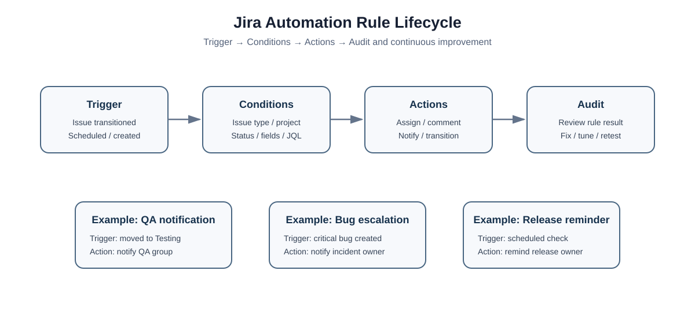

# 16 — Jira Automation Rules

## 1. Objective

Jira Automation helps teams reduce repetitive manual work by executing actions when predefined events occur.

In the Production DevOps Platform project, automation can help:

- Notify developers when work is assigned.
- Notify QA when stories enter Testing.
- Escalate critical bugs.
- Remind release managers about upcoming releases.
- Update related issues.
- Notify stakeholders when releases are completed.
- Maintain consistent issue tracking.

**Project:** Production DevOps Platform  
**Example Project Key:** PLAT  
**Application:** 21 microservices on AWS EKS

## 2. Jira Automation Architecture



A Jira automation rule normally contains three main elements:

| Element | Purpose |
|---|---|
| Trigger | Starts the automation |
| Condition | Determines whether the rule should continue |
| Action | Performs the required operation |

Additional components include branches, smart values and audit logs.

## 3. Access Jira Automation

For a typical Jira Cloud project:

1. Open your Jira project.
2. Navigate to **Project settings**.
3. Open **Automation**.
4. Select **Create rule**.
5. Select the required trigger.
6. Add conditions.
7. Add actions.
8. Give the rule a meaningful name.
9. Save and enable the rule.
10. Test it using a sample Jira issue.

The menu location and available features can differ by Jira version, project type and permissions.

## 4. Automation Rule 1 — Notify Developer When an Issue Is Assigned

### Business requirement

Whenever a Jira issue is assigned to a developer, notify that developer.

### Rule configuration

**Rule name:**

```text
Notify Developer on Issue Assignment
```

**Trigger:**

```text
Field value changed
```

**Field:**

```text
Assignee
```

**Condition:**

```text
Assignee is not empty
```

**Action:**

```text
Send email
```

**Recipient:**

```text
Assignee
```

**Subject:**

```text
Jira Issue Assigned: {{issue.key}}
```

**Message:**

```text
Hello,

A Jira issue has been assigned to you.

Issue: {{issue.key}}
Summary: {{issue.summary}}
Priority: {{issue.priority.name}}
Status: {{issue.status.name}}

Please review the issue and update its progress.

Jira URL: {{issue.url}}
```

### Expected result

When an issue is assigned or reassigned, the configured notification is sent to the current assignee.

---

## 5. Automation Rule 2 — Notify QA When a Story Enters Testing

### Business requirement

When a developer completes code review and moves a story to Testing, notify the QA team.

### Rule configuration

**Rule name:**

```text
Notify QA When Story Enters Testing
```

**Trigger:**

```text
Issue transitioned
```

**To status:**

```text
Testing
```

**Conditions:**

```text
Issue Type = Story
Project = PLAT
```

**Action:**

```text
Send email or notification to QA group
```

**Message:**

```text
A story is ready for QA testing.

Issue: {{issue.key}}
Summary: {{issue.summary}}
Assignee: {{issue.assignee.displayName}}
Priority: {{issue.priority.name}}

Please execute the linked test cases and
update the Jira issue with the test result.

Jira URL: {{issue.url}}
```

### Expected result

QA receives a notification when a story enters Testing.

**Production consideration:** Configure the recipient group or project role in Jira. Do not assume that a group named QA already exists.

---

## 6. Automation Rule 3 — Escalate Critical Bugs

### Business requirement

Critical production bugs should immediately notify the responsible engineering or incident management team.

### Rule configuration

**Rule name:**

```text
Escalate Critical Production Bugs
```

**Trigger:**

```text
Issue Created
```

**Conditions:**

```text
Issue Type = Bug
Priority = Critical
Environment = Production
```

The Environment condition assumes your Jira project uses that field and that it is populated consistently.

**Actions:**

1. Assign the issue to the configured incident owner or on-call role, if supported by your assignment configuration.
2. Send an email or notification to the incident management group.
3. Add an escalation comment.

**Example comment:**

```text
Critical production bug detected.

Please investigate immediately.

Check:
- Application logs
- Kubernetes pod health
- Recent deployments
- Database connectivity
- Service dependencies

Incident owner: Please update the investigation status.
```

### Expected result

A critical production bug is brought to the attention of the responsible team.

**Important:** Jira issue escalation is not a substitute for an operational paging system. Integrate with your on-call alerting platform if immediate incident paging is required.

---

## 7. Automation Rule 4 — Remind the Assignee About Stale Issues

### Business requirement

Issues that remain In Progress for too long should be reviewed.

### Rule configuration

**Rule name:**

```text
Daily Reminder for Stale In Progress Issues
```

**Trigger:**

```text
Scheduled
```

**Frequency:**

```text
Daily
```

**JQL condition:**

```jql
project = PLAT
AND status = "In Progress"
AND updated <= -3d
AND assignee IS NOT EMPTY
```

**Action:**

Send a reminder to the assignee.

**Message:**

```text
Reminder: This Jira issue has not been updated recently.

Issue: {{issue.key}}
Summary: {{issue.summary}}
Status: {{issue.status.name}}
Assignee: {{issue.assignee.displayName}}

Please update the issue or add a blocker comment.
```

### Expected result

The assignee receives a reminder for issues matching the JQL.

The scheduled rule's timezone, execution limits and project scope should be checked before enabling it.

---

## 8. Automation Rule 5 — Notify the Product Owner When a Story Is Completed

### Business requirement

When a story moves to Done, notify the Product Owner.

### Rule configuration

**Rule name:**

```text
Notify Product Owner on Story Completion
```

**Trigger:**

```text
Issue transitioned
```

**To status:**

```text
Done
```

**Condition:**

```text
Issue Type = Story
```

**Action:**

Send an email or notification to the configured Product Owner.

**Message:**

```text
A story has been completed.

Issue: {{issue.key}}
Summary: {{issue.summary}}
Assignee: {{issue.assignee.displayName}}
Completed By: {{initiator.displayName}}

Please review the completed work.

Jira URL: {{issue.url}}
```

### Expected result

The Product Owner is notified when a story reaches Done.

---

## 9. Automation Rule 6 — Notify Release Manager Before Release Date

### Business requirement

Release managers should receive reminders before a planned release.

### Rule configuration

**Rule name:**

```text
Upcoming Release Reminder
```

**Trigger:**

```text
Scheduled
```

**Example schedule:**

```text
Daily at 09:00
```

**JQL example:**

```jql
project = PLAT
AND fixVersion = "1.0"
AND statusCategory != Done
```

This example searches for unresolved issues associated with version 1.0. It is not, by itself, a release-date comparison.

For a date-based reminder, use a scheduled rule that queries the configured release-date field or version date supported by your Jira setup.

**Action:**

Notify the Release Manager with the matching release information.

### Expected result

The Release Manager receives a reminder to review outstanding release work.

---

## 10. Automation Rule 7 — Notify Stakeholders After Release Closure

### Business requirement

After the release tracking issue reaches its final approved closure state, notify stakeholders.

### Rule configuration

**Rule name:**

```text
Notify Stakeholders on Release Closure
```

**Trigger:**

```text
Issue transitioned
```

**To status:**

```text
Done
```

**Conditions:**

```text
Issue Type = Release
Project = PLAT
```

Use your actual release tracking issue type. If your Jira setup uses a different issue type or release version workflow, adjust the condition.

**Action:**

Send an email or notification to the stakeholder list.

**Message:**

```text
Release tracking has been closed.

Release: {{issue.summary}}
Jira Issue: {{issue.key}}
Completed By: {{initiator.displayName}}

Please refer to the release notes and deployment
evidence linked to the Jira release record.
```

**Important:** Closing a Jira release tracking issue does not prove that production deployment succeeded. Validate the deployment independently.

---

## 11. Automation Rule 8 — Link Related Issues

### Business requirement

When a bug is created for a story, link the bug to the related story so developers and QA can track the relationship.

### Rule configuration

**Rule name:**

```text
Link Bug to Related Story
```

**Trigger:**

```text
Issue Created
```

**Conditions:**

```text
Issue Type = Bug
```

**Action:**

Use the Jira issue linking action or an appropriate branch to link the bug to the related story.

Example relationship:

```text
PLAT-101 — Create Order API
        |
        | relates to
        |
PLAT-225 — Order API returns HTTP 500
```

The automation needs a reliable way to identify the related story, such as a populated custom field or an explicit issue link. Do not automatically link unrelated issues based only on similar summaries.

---

## 12. Smart Values

Smart values allow automation rules to use information from Jira issues and users.

Examples:

| Smart Value | Purpose |
|---|---|
| `{{issue.key}}` | Jira issue key |
| `{{issue.summary}}` | Issue summary |
| `{{issue.status.name}}` | Current status |
| `{{issue.priority.name}}` | Priority |
| `{{issue.assignee.displayName}}` | Assignee name |
| `{{initiator.displayName}}` | User who triggered the rule |
| `{{issue.url}}` | Issue URL |
| `{{now}}` | Current date and time |

Example comment:

```text
Issue {{issue.key}} was updated by
{{initiator.displayName}}.

Current status: {{issue.status.name}}
Updated at: {{now}}
```

Smart-value availability depends on the trigger and rule context. Test expressions before using them in production.

---

## 13. Prevent Automation Loops

Poorly designed automation can cause repeated transitions, notifications or updates.

Example of a problematic design:

```text
Rule A:
When issue moves to Done,
change a field.

Rule B:
When that field changes,
move issue to Done.
```

These rules may repeatedly trigger each other.

### Prevention

- Use conditions to restrict when rules execute.
- Avoid updating fields that trigger the same rule unnecessarily.
- Use the rule actor consistently.
- Avoid multiple rules performing the same action.
- Review audit logs for repeated execution.
- Test rules using sample issues before production rollout.

---

## 14. Automation Audit Logs

Jira automation provides audit information about rule executions.

Use audit logs to investigate:

- Successful rule execution.
- Failed actions.
- Permission problems.
- Incorrect JQL results.
- Missing fields.
- Smart-value errors.
- Rule execution limits.

### Troubleshooting examples

| Problem | Possible cause | Action |
|---|---|---|
| Email not received | Recipient or notification configuration | Verify recipient and mail settings |
| Rule did not run | Trigger did not occur | Check trigger and audit log |
| Wrong issue updated | Incorrect JQL or branch scope | Review rule scope and conditions |
| Smart value is empty | Field not available or not populated | Inspect issue data and execution context |
| Repeated notifications | Duplicate rules or loops | Review related automation rules |
| Permission error | Rule actor lacks permission | Review rule actor permissions |

---

## 15. Production Automation Governance

Before enabling automation in a production Jira project:

1. Define the business requirement.
2. Identify the correct trigger.
3. Add precise conditions.
4. Select the correct rule actor.
5. Configure actions.
6. Test with sample issues.
7. Review the audit log.
8. Document the rule owner.
9. Monitor execution failures.
10. Review rules periodically.

### Recommended naming convention

```text
PLAT-AUTO-001-Notify-Assignee
PLAT-AUTO-002-Notify-QA
PLAT-AUTO-003-Escalate-Critical-Bug
PLAT-AUTO-004-Stale-Issue-Reminder
PLAT-AUTO-005-Notify-Product-Owner
PLAT-AUTO-006-Release-Reminder
PLAT-AUTO-007-Release-Closure-Notification
PLAT-AUTO-008-Link-Related-Bug
```

---

## 16. Automation Validation Checklist

- [ ] All automation rules have meaningful names.
- [ ] Correct project scope is configured.
- [ ] Triggers execute as expected.
- [ ] Conditions filter the correct issues.
- [ ] Actions target the correct users or groups.
- [ ] Smart values display the expected information.
- [ ] JQL returns the expected issues.
- [ ] Rule actor has the required permissions.
- [ ] Audit logs show successful execution.
- [ ] Duplicate notifications are avoided.
- [ ] Automation loops are prevented.
- [ ] Rules are documented and reviewed.

## 17. Expected Outcome

After completing this chapter, the Jira project has a documented automation design for assignment notifications, QA handoffs, critical bug escalation, stale issue reminders, release tracking and stakeholder communication.

The actual rules must be configured and tested in your Jira environment before they can be considered operational.

## 18. Next Chapter

**17 — Jira 21-Microservice Project Simulation**

The next chapter will demonstrate how to organize epics, stories, tasks, bugs, dependencies and release tracking across the 21-microservice application.