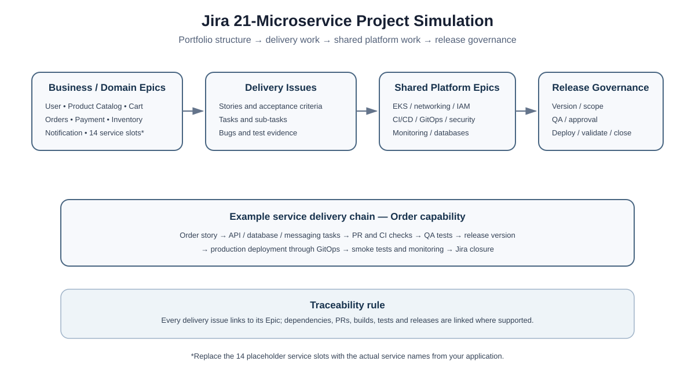

# 17 — Jira 21-Microservice Project Simulation

## 1. Objective

Build a realistic Jira project structure for managing a 21-microservice application running on AWS EKS.

The objective is to understand how a DevOps team manages development and delivery across multiple services without creating an unmanageable Jira backlog.

**Project:** Production DevOps Platform  
**Project Key:** PLAT (example)  
**Application:** 21 microservices  
**Cloud:** AWS  
**Container Platform:** Kubernetes / EKS  
**Deployment:** Helm and Argo CD  
**CI/CD:** Jenkins, GitHub Actions and GitLab CI/CD  
**Monitoring:** Prometheus, Grafana, Alertmanager and ELK

## 2. Project Structure



Organize the Jira project into four areas:

1. Microservice delivery.
2. Shared platform and infrastructure.
3. Quality and security.
4. Release and production operations.

Do not create a separate Jira project for every microservice unless there is a genuine organizational requirement. A shared project with well-structured epics, components, labels and filters is easier to manage.

## 3. Microservice Register

The following seven service names are the services identified in the project description. The remaining 14 entries are placeholders because their actual names have not been specified.

| No. | Microservice | Jira Component |
|---:|---|---|
| 01 | User Service | user-service |
| 02 | Product Catalog | product-catalog |
| 03 | Cart Service | cart-service |
| 04 | Orders Service | orders-service |
| 05 | Payment Service | payment-service |
| 06 | Inventory Service | inventory-service |
| 07 | Notification Service | notification-service |
| 08 | Service 08 — replace with actual name | service-08 |
| 09 | Service 09 — replace with actual name | service-09 |
| 10 | Service 10 — replace with actual name | service-10 |
| 11 | Service 11 — replace with actual name | service-11 |
| 12 | Service 12 — replace with actual name | service-12 |
| 13 | Service 13 — replace with actual name | service-13 |
| 14 | Service 14 — replace with actual name | service-14 |
| 15 | Service 15 — replace with actual name | service-15 |
| 16 | Service 16 — replace with actual name | service-16 |
| 17 | Service 17 — replace with actual name | service-17 |
| 18 | Service 18 — replace with actual name | service-18 |
| 19 | Service 19 — replace with actual name | service-19 |
| 20 | Service 20 — replace with actual name | service-20 |
| 21 | Service 21 — replace with actual name | service-21 |

Create Jira components for the actual services so that issues can be categorized and filtered by service.

## 4. Create Project-Level Epics

Epics represent larger business or engineering outcomes.

Recommended epics:

| Epic ID (Example) | Epic Name | Purpose |
|---|---|---|
| PLAT-100 | User Management | User Service delivery |
| PLAT-110 | Product Catalog Management | Product Catalog delivery |
| PLAT-120 | Shopping Cart Management | Cart Service delivery |
| PLAT-130 | Order Management | Orders Service delivery |
| PLAT-140 | Payment Processing | Payment Service delivery |
| PLAT-150 | Inventory Management | Inventory Service delivery |
| PLAT-160 | Notification Management | Notification Service delivery |
| PLAT-170 | Microservice Expansion | Remaining 14 services |
| PLAT-180 | AWS Infrastructure | Cloud infrastructure |
| PLAT-190 | Kubernetes Platform | EKS platform |
| PLAT-200 | CI/CD Automation | Build and deployment pipelines |
| PLAT-210 | DevSecOps Implementation | Security and quality checks |
| PLAT-220 | Observability | Metrics, logs and alerting |
| PLAT-230 | Production Release Management | Production delivery and governance |

These issue keys are illustrative. Jira generates the actual keys when you create the issues.

## 5. Create Stories Under Each Epic

Stories describe deliverable functionality or outcomes.

### Example: Order Management Epic

**Epic:** Order Management

Create the following stories:

| Story | Summary | Priority |
|---|---|---|
| PLAT-131 | Create Order API | High |
| PLAT-132 | Implement Order Validation | High |
| PLAT-133 | Integrate Order Database | High |
| PLAT-134 | Integrate Payment Service | High |
| PLAT-135 | Publish Order Events | Medium |
| PLAT-136 | Implement Order Status Tracking | Medium |
| PLAT-137 | Add Order Service Health Checks | Medium |
| PLAT-138 | Deploy Order Service to EKS | High |

### Example acceptance criteria: Create Order API

**Story:** Create Order API

Acceptance criteria:

- API accepts a valid order request.
- Invalid requests are rejected with appropriate responses.
- A unique order identifier is generated.
- Order data is persisted successfully.
- Appropriate error handling is implemented.
- Automated tests pass.
- API documentation is updated.

## 6. Create Tasks and Sub-tasks

Tasks represent engineering work required to complete a story.

Example:

**Story:** PLAT-131 — Create Order API

| Task | Description | Owner |
|---|---|---|
| PLAT-301 | Create Spring Boot project structure | Developer |
| PLAT-302 | Implement order controller | Developer |
| PLAT-303 | Implement order service layer | Developer |
| PLAT-304 | Implement repository layer | Developer |
| PLAT-305 | Write unit tests | Developer |
| PLAT-306 | Update API documentation | Developer |

Example DevOps tasks:

| Task | Description |
|---|---|
| PLAT-307 | Create Dockerfile |
| PLAT-308 | Configure CI pipeline |
| PLAT-309 | Build and scan container image |
| PLAT-310 | Push approved image to ECR |
| PLAT-311 | Configure Helm deployment |
| PLAT-312 | Add Argo CD application configuration |
| PLAT-313 | Validate EKS deployment |

Sub-tasks can be created under tasks or stories according to your Jira issue hierarchy.

## 7. Create Shared Platform Epics

Not every engineering task belongs to an individual microservice.

Shared platform work should have its own epics.

### AWS Infrastructure Epic

Example stories:

- Provision VPC and subnets.
- Configure IAM roles and policies.
- Provision EKS cluster.
- Configure ECR repositories.
- Configure ALB and ingress.
- Configure RDS connectivity.
- Configure DNS.

### Kubernetes Platform Epic

Example stories:

- Create Kubernetes namespaces.
- Configure service accounts and RBAC.
- Configure resource requests and limits.
- Configure readiness and liveness probes.
- Configure network policies.
- Configure pod disruption budgets.
- Configure autoscaling where required.

### CI/CD Epic

Example stories:

- Configure GitHub Actions workflows.
- Configure Jenkins pipelines.
- Configure GitLab CI/CD pipelines.
- Integrate SonarQube.
- Integrate Trivy.
- Publish approved images to ECR.
- Configure deployment promotion.

### Observability Epic

Example stories:

- Deploy Prometheus.
- Configure Grafana dashboards.
- Configure Alertmanager.
- Deploy Node Exporter.
- Configure kube-state-metrics.
- Configure log collection and ELK integration.
- Configure service-level alerts.

## 8. Create Dependencies

Dependencies show when one issue cannot progress until another is completed.

Example:

| Issue | Depends On | Reason |
|---|---|---|
| Deploy Order Service | EKS platform ready | Cluster must exist |
| Publish Order image | ECR repository ready | Image destination required |
| Run integration tests | Payment API available | Service dependency |
| Enable application metrics | Prometheus configured | Metrics collection required |
| Production release | QA approval completed | Release readiness |

Use Jira issue links such as:

- Blocks / is blocked by.
- Depends on / is depended on by, if available in your configuration.
- Relates to.

Do not create dependencies merely because two issues belong to the same epic.

## 9. Example End-to-End Order Service Delivery

This is the main practical simulation.

### Step 1 — Create the Epic

```text
Epic: Order Management
Description: Deliver the Order Service capability.
```

### Step 2 — Create the Story

```text
Story: Create Order API
Acceptance Criteria:
- Create order endpoint works.
- Request validation is implemented.
- Database persistence works.
- Unit tests pass.
```

### Step 3 — Create Development Tasks

```text
Task 1: Create API controller
Task 2: Implement business logic
Task 3: Configure database integration
Task 4: Write unit tests
```

### Step 4 — Create DevOps Tasks

```text
Task 1: Create Dockerfile
Task 2: Configure CI pipeline
Task 3: Integrate SonarQube
Task 4: Integrate Trivy
Task 5: Push image to ECR
Task 6: Configure Helm chart
Task 7: Configure Argo CD deployment
```

### Step 5 — Connect GitHub

Example branch:

```bash
git checkout -b feature/PLAT-131-create-order-api
```

Example commit:

```bash
git add .
git commit -m "PLAT-131: implement order API"
git push origin feature/PLAT-131-create-order-api
```

Create a pull request and include the Jira issue key in its title or description.

### Step 6 — Run CI Pipeline

Example pipeline stages:

```text
Checkout
   ↓
Build
   ↓
Unit Tests
   ↓
SonarQube Analysis
   ↓
Trivy Scan
   ↓
Docker Build
   ↓
Push Image to ECR
```

The actual pipeline should publish only approved artifacts and use appropriately scoped credentials.

### Step 7 — QA Testing

Create test cases for:

- Successful order creation.
- Invalid order request.
- Database failure.
- Duplicate order request.
- Payment service integration.
- Order status retrieval.

If a test fails, create a Bug and link it to the related story.

### Step 8 — Release Planning

Create a Jira version:

```text
Version: 1.0
Description: Initial Order Service production release
```

Add the completed stories and required release tasks to the version.

### Step 9 — Production Deployment

The deployment workflow should:

1. Confirm release approval.
2. Verify the approved image digest.
3. Update the GitOps repository.
4. Merge the reviewed deployment change.
5. Allow Argo CD to reconcile.
6. Verify Kubernetes rollout.
7. Run production smoke tests.
8. Monitor application metrics and logs.

### Step 10 — Close the Work

Update Jira with:

- Completed story and task statuses.
- Pull request and commit references.
- CI pipeline evidence.
- Test results.
- Release version.
- Deployment evidence.
- Known issues and follow-up tasks.

Do not mark an issue Done until its acceptance criteria are met.

## 10. Example Jira Board Structure

Recommended columns:

| Column | Statuses |
|---|---|
| Backlog | To Do |
| Selected | Selected for Development, if configured |
| Development | In Progress |
| Code Review | In Review |
| QA | Testing |
| Completed | Done |

Map the actual Jira statuses to board columns. The board column names do not automatically create workflow statuses.

## 11. Useful Jira Filters

### All Order Service issues

```jql
project = PLAT
AND component = "orders-service"
ORDER BY priority DESC
```

### All open bugs

```jql
project = PLAT
AND issuetype = Bug
AND statusCategory != Done
ORDER BY priority DESC
```

### All high-priority work

```jql
project = PLAT
AND priority in (High, Highest)
AND statusCategory != Done
ORDER BY created ASC
```

### All issues in a release

```jql
project = PLAT
AND fixVersion = "1.0"
ORDER BY issuetype, priority DESC
```

### All blocked issues

```jql
project = PLAT
AND statusCategory != Done
AND issueLinkType = "is blocked by"
```

The exact issue-link JQL syntax depends on Jira's supported fields and functions. If this query is unavailable in your Jira instance, use issue-link search functionality or an approved JQL extension.

## 12. Recommended Labels

Use consistent labels for cross-cutting categorization.

Examples:

```text
aws
eks
kubernetes
terraform
docker
helm
argocd
cicd
devsecops
sonarqube
trivy
monitoring
database
messaging
production
release
```

Use components to identify the owning service and labels for broader technical categories.

## 13. Project Validation Checklist

- [ ] Create the Jira project.
- [ ] Configure project roles and permissions.
- [ ] Create components for the 21 actual microservices.
- [ ] Create business and platform epics.
- [ ] Add stories under the appropriate epics.
- [ ] Create tasks and sub-tasks.
- [ ] Define acceptance criteria.
- [ ] Link dependencies.
- [ ] Configure the development board.
- [ ] Connect GitHub.
- [ ] Verify Jira issue keys appear in development activity.
- [ ] Connect CI/CD evidence where supported.
- [ ] Create QA test records and bugs.
- [ ] Create release versions.
- [ ] Record approval and deployment evidence.
- [ ] Validate the release and close completed work.

## 14. Expected Outcome

After completing this simulation, the Jira project has a structured approach for managing work across multiple microservices and shared platform engineering.

Teams can identify which service an issue belongs to, what work is required, which dependencies exist, what is blocking delivery and what is included in a release.

The 14 placeholder services must be replaced with the application's actual service names before treating this as the final project register.

## 15. Next Chapter

**18 — Jira Sprint-to-Production End-to-End Simulation**

The next chapter will follow one sprint and one release through backlog selection, development, pull requests, CI/CD, QA, approval, Argo CD deployment, production validation and Jira closure.