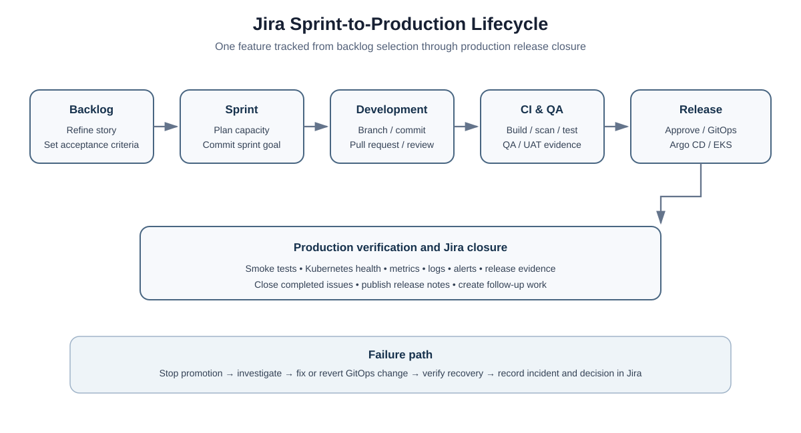

# 18 — Jira Sprint-to-Production End-to-End Simulation

## 1. Objective

Simulate a complete software delivery lifecycle using Jira for a microservices application running on AWS EKS.

By completing this simulation, you will understand how a DevOps team coordinates development, testing, CI/CD, approvals and production releases using Jira.

**Project:** Production DevOps Platform  
**Jira Project Key:** PLAT (example)  
**Application:** 21 microservices  
**Example Service:** Order Service  
**Sprint Duration:** 2 weeks  
**Release:** Version 1.0

## 2. End-to-End Architecture



## 3. Project Scenario

The development team needs to implement a new Order API feature.

The feature must:

- Accept order creation requests.
- Validate incoming requests.
- Persist order information.
- Communicate with the required downstream services.
- Pass automated tests.
- Be deployed to AWS EKS.
- Be validated before production release.

The Jira project will track the complete delivery process.

## 4. Step 1 — Create the Epic

Navigate to the Jira project and create an Epic.

**Epic name:**

```text
Order Management Enhancement
```

**Epic description:**

```text
Implement Order Service enhancements,
including order creation, validation,
database integration and production deployment.
```

**Example Jira issue:**

```text
PLAT-400
```

This is an illustrative issue key. Jira will generate the actual key.

## 5. Step 2 — Create Stories

Create the following stories under the Epic.

| Issue | Summary | Story Points |
|---|---|---:|
| PLAT-401 | Implement Create Order API | 5 |
| PLAT-402 | Implement Order Validation | 3 |
| PLAT-403 | Integrate Order Database | 5 |
| PLAT-404 | Integrate Payment Service | 5 |
| PLAT-405 | Add Order API Unit Tests | 3 |
| PLAT-406 | Deploy Order Service to EKS | 5 |
| PLAT-407 | Configure Order Service Monitoring | 3 |

Example acceptance criteria for PLAT-401:

- API accepts valid order requests.
- Invalid requests return appropriate error responses.
- A unique order identifier is generated.
- Order details are persisted.
- Unit tests pass.
- API documentation is updated.

## 6. Step 3 — Create Sprint

Create a two-week sprint.

**Sprint name:**

```text
Sprint 05 - Order Service Enhancement
```

**Sprint goal:**

```text
Complete Order Service API development,
database integration, automated testing
and deployment to the QA environment.
```

### Sprint backlog

| Jira Issue | Summary | Owner | Points |
|---|---|---|---:|
| PLAT-401 | Create Order API | Developer 1 | 5 |
| PLAT-402 | Order Validation | Developer 2 | 3 |
| PLAT-403 | Database Integration | Developer 1 | 5 |
| PLAT-405 | Unit Tests | Developer 2 | 3 |
| PLAT-406 | EKS Deployment | DevOps Engineer | 5 |
| PLAT-407 | Monitoring Configuration | DevOps Engineer | 3 |

**Total: 24 illustrative story points.**

The team should select work based on actual capacity and historical velocity, not simply the available point total.

## 7. Step 4 — Create Development Tasks

Under PLAT-401, create implementation tasks.

| Task | Description | Owner |
|---|---|---|
| Create API controller | Implement REST endpoint | Developer |
| Implement service layer | Add business logic | Developer |
| Implement repository | Add persistence logic | Developer |
| Add validation | Validate request payload | Developer |
| Write unit tests | Test API functionality | Developer |
| Update API documentation | Document endpoint | Developer |

Create the corresponding DevOps tasks under the deployment story.

| Task | Description |
|---|---|
| Dockerfile | Containerize the application |
| CI pipeline | Configure build and test |
| SonarQube | Run code quality analysis |
| Trivy | Scan container image |
| ECR | Publish approved image |
| Helm | Configure deployment chart |
| Argo CD | Configure GitOps deployment |
| Monitoring | Validate metrics and logs |

## 8. Step 5 — Start Development

The developer moves PLAT-401 from To Do to In Progress.

Create a feature branch:

```bash
git checkout -b feature/PLAT-401-create-order-api
```

Implement the API and run local tests.

Example:

```bash
mvn clean test
```

Commit the changes:

```bash
git add .
git commit -m "PLAT-401: implement create order API"
```

Push the branch:

```bash
git push origin feature/PLAT-401-create-order-api
```

The Jira issue key helps connect the development activity with the Jira story when the integration is configured.

## 9. Step 6 — Create Pull Request

Create a pull request in GitHub.

**Example PR title:**

```text
PLAT-401: Implement Create Order API
```

### Pull request checklist

- [ ] Jira issue linked.
- [ ] Code follows project standards.
- [ ] Unit tests included.
- [ ] No credentials committed.
- [ ] Error handling reviewed.
- [ ] API documentation updated.
- [ ] Required reviewers assigned.

Move the Jira story to In Review according to the configured workflow.

### Review outcomes

If the reviewer requests changes:

```text
In Review → In Progress
```

If the reviewer approves the change and required checks pass:

```text
In Review → Testing
```

## 10. Step 7 — Execute CI Pipeline

The CI pipeline runs when the pull request is created or updated.

Example pipeline:

```text
Developer Push
      |
      v
GitHub Actions
      |
      v
Checkout Source
      |
      v
Maven Build
      |
      v
Unit Tests
      |
      v
SonarQube Analysis
      |
      v
Trivy Security Scan
      |
      v
Docker Build
      |
      v
Publish Approved Image to ECR
```

Example GitHub Actions workflow:

```yaml
name: order-service-ci

on:
  pull_request:
    branches:
      - main
  push:
    branches:
      - main

jobs:
  build:
    runs-on: ubuntu-latest

    steps:
      - name: Checkout
        uses: actions/checkout@v4

      - name: Set up Java
        uses: actions/setup-java@v4
        with:
          distribution: temurin
          java-version: '17'

      - name: Build and Test
        run: mvn clean verify
```

This is a minimal build-and-test example. SonarQube, Trivy, Docker publishing and ECR authentication require additional configured steps, credentials and permissions.

### CI validation

- Build successful.
- Unit tests successful.
- Code quality checks passed where configured.
- Security findings reviewed.
- Required pull request checks passed.

Record the pipeline run or link it to the Jira issue where the integration supports it.

## 11. Step 8 — Merge Pull Request

After required approvals and CI checks:

1. Merge the pull request.
2. Verify the target branch contains the changes.
3. Confirm the expected commit.
4. Verify the CI pipeline result.
5. Update the Jira issue according to the workflow.

Example merge strategy:

```text
Pull Request
     |
     v
Code Review
     |
     v
CI Checks Passed
     |
     v
Merge to Main
```

## 12. Step 9 — QA Testing

QA begins testing after the application is available in the QA environment.

Create test cases for:

| Test Case | Scenario | Expected Result |
|---|---|---|
| TC-001 | Valid order request | Order created |
| TC-002 | Invalid request | Validation error |
| TC-003 | Database unavailable | Controlled error |
| TC-004 | Payment service unavailable | Expected failure handling |
| TC-005 | Retrieve order | Correct order returned |

### QA execution

1. Execute the test cases.
2. Record actual results.
3. Attach evidence.
4. Link test cases to the story.
5. Create bugs for failures.
6. Retest after fixes.
7. Complete regression testing.

### Example bug

```text
Issue: PLAT-450
Summary: Order API returns HTTP 500
Priority: High
Component: orders-service
Environment: QA
```

Link the bug to PLAT-401.

If testing fails, return the story to the appropriate development state.

If all acceptance criteria pass, move the story to Done according to the team's workflow.

## 13. Step 10 — Complete Release Planning

Create a Jira version:

```text
Version: 1.0
Description: Order Service production release
```

Associate the relevant completed stories and release tasks with the version.

### Release readiness

| Check | Required |
|---|---|
| Development complete | Yes |
| Pull requests reviewed | Yes |
| CI pipeline successful | Yes |
| QA passed | Yes |
| UAT sign-off | If required |
| Security findings reviewed | Yes |
| Production configuration reviewed | Yes |
| Rollback plan ready | Yes |
| Monitoring ready | Yes |

Do not consider a release ready merely because all Jira issues have been moved to Done. Verify the evidence.

## 14. Step 11 — Obtain Release Approval

Create or update the release approval record.

Example:

```text
Release: Version 1.0
Target: Production
Requested By: Release Manager
Approval Status: Under Review
```

Record the decisions from the required approvers.

Example approval roles:

- Engineering Lead
- QA Lead
- Security Reviewer
- Operations Lead
- Release Manager

A Jira approval record must be connected to an actual deployment gate if it is required to prevent an unauthorized deployment.

## 15. Step 12 — Deploy to Production

The DevOps engineer follows the GitOps deployment process.

### Deployment flow

```text
Approved Release
       |
       v
Verify Image Digest
       |
       v
Update GitOps Repository
       |
       v
Create Pull Request
       |
       v
Review and Merge
       |
       v
Argo CD Reconciliation
       |
       v
AWS EKS Deployment
```

Example Kubernetes validation:

```bash
kubectl get pods -n production
kubectl get deployments -n production
kubectl get services -n production
kubectl rollout status deployment/order-service -n production
```

Check Argo CD:

```bash
argocd app get order-service
```

The application name and namespace are examples; use your actual deployment configuration.

### Production deployment checklist

- [ ] Approved image digest verified.
- [ ] GitOps change reviewed and merged.
- [ ] Argo CD application healthy.
- [ ] Deployment rollout successful.
- [ ] Pods ready.
- [ ] Services and ingress healthy.
- [ ] Database connectivity verified.
- [ ] Application logs reviewed.

## 16. Step 13 — Production Validation

After deployment, verify the actual application behavior.

### Application validation

- Create a test order using the approved smoke-test process.
- Verify the expected response.
- Verify order persistence.
- Verify required downstream service communication.
- Verify order retrieval.
- Confirm no unexpected errors.

### Kubernetes validation

```bash
kubectl get pods -n production
kubectl get events -n production --sort-by=.lastTimestamp
kubectl describe deployment order-service -n production
```

### Monitoring validation

Check:

**Prometheus**
- Application metrics are being collected.
- Request error rates are acceptable.
- Latency is within the agreed threshold.

**Grafana**
- Service dashboards show healthy behavior.
- Resource utilization is within expected limits.

**Alertmanager**
- No unexpected critical alerts are firing.

**ELK**
- Application logs do not show unexpected exceptions.
- No repeated database or downstream connection failures are observed.

Use the service's agreed SLOs and alert thresholds rather than inventing universal production limits.

## 17. Step 14 — Handle Production Failure

Suppose the deployment causes an increased application error rate.

### Incident workflow

1. Detect the issue through alerts, dashboards or user reports.
2. Create or link an incident record in Jira.
3. Assign an incident owner.
4. Investigate recent changes and application logs.
5. Decide whether to fix forward or roll back.
6. If rollback is required, revert the GitOps change to the last known good configuration.
7. Allow Argo CD to reconcile the desired state.
8. Verify application recovery.
9. Record the timeline and decision.
10. Create follow-up corrective actions.

Example incident:

```text
Issue: INC-001
Summary: Order Service production errors increased
Affected Service: orders-service
Severity: Based on incident policy
Status: Investigating
```

**Important:** For an Argo CD-managed application, prefer changing the GitOps source of truth. A manual Kubernetes or Helm rollback can be overwritten by reconciliation. Database changes also require a separate compatibility and recovery plan.

## 18. Step 15 — Close the Release

After successful production validation:

- Update the Jira release record.
- Confirm the delivered issue scope.
- Link deployment evidence.
- Publish release notes.
- Record known issues.
- Close completed approval and deployment tasks.
- Create follow-up tasks for remaining work.
- Communicate the release outcome.

Only mark the release successful if production validation supports that conclusion.

## 19. End-to-End Jira Status Tracking

| Stage | Jira Status |
|---|---|
| Backlog | To Do |
| Sprint commitment | Selected for Development, if configured |
| Development | In Progress |
| Pull request | In Review |
| QA | Testing |
| Acceptance | Done |
| Release approval | Approved |
| Production deployment | Deployment tracking status |
| Release closure | Released / Closed as configured |

The release status and issue status are different concepts. A Jira version marked Released does not perform or validate a deployment.

## 20. Complete Delivery Evidence

For PLAT-401, maintain links to:

| Evidence | Example |
|---|---|
| Jira story | PLAT-401 |
| Git branch | feature/PLAT-401-create-order-api |
| Pull request | GitHub PR URL |
| Commit | Commit SHA |
| CI pipeline | Pipeline run URL |
| SonarQube | Analysis result |
| Trivy | Scan result |
| Container image | ECR image digest |
| Helm configuration | Git commit / PR |
| Argo CD | Application status |
| QA test evidence | Test execution |
| Production validation | Smoke-test evidence |
| Release | Version 1.0 |

Use actual evidence links and identifiers in your Jira instance.

## 21. Final End-to-End Checklist

- [ ] Epic created.
- [ ] Stories created.
- [ ] Acceptance criteria defined.
- [ ] Sprint planned.
- [ ] Tasks and sub-tasks assigned.
- [ ] Development completed.
- [ ] Pull request reviewed.
- [ ] CI checks passed.
- [ ] Approved image published.
- [ ] QA tests passed.
- [ ] Bugs resolved or accepted through the defined process.
- [ ] Release version created.
- [ ] Release approval recorded.
- [ ] GitOps deployment completed.
- [ ] EKS workload health verified.
- [ ] Production smoke tests passed.
- [ ] Prometheus, Grafana, Alertmanager and ELK checked.
- [ ] Jira release evidence updated.
- [ ] Release notes published.
- [ ] Follow-up actions created.

## 22. Expected Outcome

This simulation demonstrates how Jira connects the work of developers, DevOps engineers, QA, security reviewers, release managers and production operations.

Jira provides planning, traceability and approval records. GitHub manages source code and pull requests. CI/CD systems build and validate artifacts. Argo CD manages GitOps deployment. Kubernetes runs the application. Monitoring systems provide production visibility.

Together, these systems support an auditable delivery process from backlog to production.

## 23. Next Chapter

**19 — Jira Dashboards, Filters and Reports**

The next chapter will cover Scrum boards, JQL filters, sprint reports, burndown charts, velocity reports, release dashboards and management reporting.