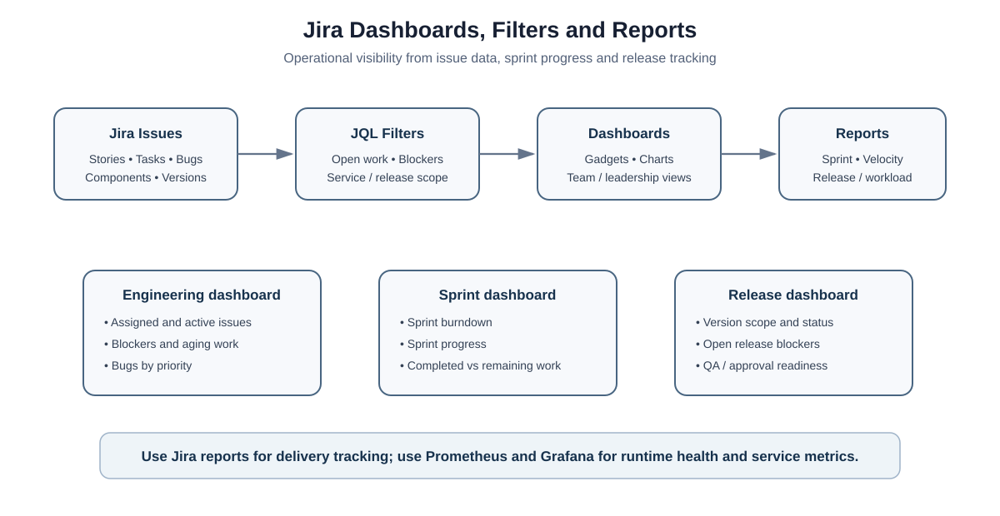

# 19 — Jira Dashboards, Filters and Reports

## 1. Objective

Jira dashboards and reports provide visibility into project delivery.

In a production DevOps project, teams need to understand:

- How many issues are open?
- Which developers are working on which tasks?
- How many bugs are pending?
- Which microservices are blocked?
- Is the sprint progressing as planned?
- Is the release ready for production?
- Which work remains incomplete?

**Project:** Production DevOps Platform  
**Project Key:** PLAT (example)  
**Application:** 21 microservices on AWS EKS

## 2. Dashboard Architecture



The reporting flow:

```text
Jira Issues
    |
    v
JQL Filters
    |
    v
Dashboard Gadgets
    |
    v
Sprint and Release Reports
    |
    v
Team and Management Decisions
```

## 3. What Is a Jira Dashboard?

A Jira dashboard is a configurable page that displays project information using gadgets.

Examples of information displayed:

- Assigned issues
- Open bugs
- Sprint progress
- Issue statistics
- Created versus resolved issues
- Release progress
- Workload distribution

Different teams can create different dashboards according to their responsibilities.

## 4. Create a Jira Dashboard

Typical Jira Cloud steps:

1. Open Jira.
2. Navigate to **Dashboards**.
3. Select **Create dashboard**.
4. Enter the dashboard name.
5. Add a description.
6. Configure sharing permissions.
7. Save the dashboard.
8. Select **Add gadget**.
9. Add the required gadgets.
10. Configure each gadget using saved filters.

### Dashboard name

```text
Production DevOps Platform Dashboard
```

### Description

```text
Dashboard for monitoring microservice development,
sprint progress, bugs, CI/CD delivery tracking
and production release readiness.
```

Menu names and gadget availability can differ depending on Jira version, permissions and installed applications.

## 5. Understand Jira Query Language (JQL)

JQL is used to search and filter Jira issues.

It helps teams retrieve specific information from large projects.

Example:

```jql
project = PLAT
AND statusCategory != Done
ORDER BY priority DESC
```

This returns incomplete issues from the PLAT project, ordered by priority.

## 6. Create Useful JQL Filters

### Filter 1 — All Open Issues

```jql
project = PLAT
AND statusCategory != Done
ORDER BY created DESC
```

Purpose:

View all incomplete issues in the project.

### Filter 2 — Open Bugs

```jql
project = PLAT
AND issuetype = Bug
AND statusCategory != Done
ORDER BY priority DESC
```

Purpose:

Track unresolved defects.

### Filter 3 — Critical Bugs

```jql
project = PLAT
AND issuetype = Bug
AND priority in (Highest, High)
AND statusCategory != Done
ORDER BY created ASC
```

Purpose:

Identify high-priority bugs requiring attention.

Adjust priority names to match the priorities configured in your Jira instance.

### Filter 4 — My Assigned Issues

```jql
project = PLAT
AND assignee = currentUser()
AND statusCategory != Done
ORDER BY priority DESC
```

Purpose:

Allow each developer to view their own pending work.

### Filter 5 — Order Service Issues

```jql
project = PLAT
AND component = "orders-service"
ORDER BY priority DESC
```

Purpose:

Track issues belonging to the Order Service.

### Filter 6 — Issues in Current Sprint

```jql
project = PLAT
AND sprint in openSprints()
ORDER BY priority DESC
```

Purpose:

View issues assigned to currently active sprints.

### Filter 7 — Blocked Issues

```jql
project = PLAT
AND statusCategory != Done
AND issueLinkType = "is blocked by"
```

Purpose:

Find issues waiting on other work.

The issue-link JQL function and link-type wording can vary. If unsupported, use Jira's issue-link search capability or a supported JQL extension.

### Filter 8 — Release Version Issues

```jql
project = PLAT
AND fixVersion = "1.0"
ORDER BY priority DESC
```

Purpose:

View issues associated with release version 1.0.

### Filter 9 — Recently Updated Issues

```jql
project = PLAT
AND updated >= -7d
ORDER BY updated DESC
```

Purpose:

Review recently modified project work.

### Filter 10 — Unassigned Issues

```jql
project = PLAT
AND assignee IS EMPTY
AND statusCategory != Done
ORDER BY priority DESC
```

Purpose:

Identify work that does not have an owner.

## 7. Save and Share Filters

After executing a JQL query:

1. Select Save as.
2. Enter a meaningful filter name.
3. Save the filter.
4. Open filter details or manage filters.
5. Configure sharing permissions.
6. Share with the required project role or group, if permitted.

Recommended names:

```text
PLAT - All Open Issues
PLAT - Open Bugs
PLAT - Critical Bugs
PLAT - My Assigned Issues
PLAT - Order Service Issues
PLAT - Current Sprint
PLAT - Blocked Issues
PLAT - Release 1.0
PLAT - Recently Updated
PLAT - Unassigned Issues
```

Sharing a filter does not automatically grant users access to every underlying issue. Jira project and issue permissions still apply.

## 8. Recommended Dashboard Gadgets

Gadgets display information from Jira filters and project data.

| Gadget | Purpose |
|---|---|
| Filter Results | Display matching issues |
| Pie Chart | Show issue distribution |
| Created vs Resolved Chart | Compare issue creation and resolution |
| Two Dimensional Filter Statistics | Compare two issue fields |
| Average Age Chart | Show how long issues remain open |
| Assigned to Me | Show current user's assigned work |
| Sprint Burndown | Track remaining sprint work |
| Sprint Health | Show sprint progress, where available |
| Activity Stream | Display recent project activity |

Gadget availability depends on your Jira edition and configuration.

## 9. Engineering Team Dashboard

**Dashboard name:**

```text
PLAT - Engineering Dashboard
```

### Recommended gadgets

1. Filter Results — All Open Issues.
2. Filter Results — My Assigned Issues.
3. Pie Chart — Issues by Status.
4. Pie Chart — Bugs by Priority.
5. Average Age Chart — Open Issues.
6. Activity Stream — Recent Project Activity.

### Example operational questions

- Which issues are currently in development?
- Which stories are waiting for code review?
- Which bugs have the highest priority?
- Which issues have not been updated recently?
- Which developers have unassigned or blocked work?

Use the dashboard to identify delivery problems, not to compare individual developers using raw issue counts alone.

## 10. Sprint Dashboard

**Dashboard name:**

```text
PLAT - Sprint Dashboard
```

### Recommended gadgets and reports

- Sprint Burndown Chart.
- Sprint Health, if available.
- Filter Results — Current Sprint.
- Pie Chart — Current Sprint by Status.
- Two Dimensional Filter Statistics — Assignee and Status.

### Sprint burndown

A burndown chart tracks remaining work over the sprint.

Example:

| Sprint Day | Remaining Story Points |
|---|---:|
| Day 1 | 24 |
| Day 3 | 21 |
| Day 5 | 18 |
| Day 7 | 12 |
| Day 9 | 6 |
| Day 10 | 0 |

<text color="secondary" size="xs">Illustrative data, not actual Jira results.</text>

A healthy burndown generally shows remaining work decreasing over time, although actual sprint work may change.

### How to interpret the chart

- Flat line: Work may not be progressing or estimates have not been updated.
- Sudden drop: Multiple issues may have been completed together.
- Rising work: Sprint scope may have increased.
- Work remaining at sprint end: Some commitments were not completed.

The burndown chart should be interpreted alongside sprint scope changes and issue history.

## 11. Velocity Report

Velocity measures the amount of work completed in previous sprints, typically using story points or another configured estimation method.

Example:

| Sprint | Committed Points | Completed Points |
|---|---:|---:|
| Sprint 01 | 24 | 20 |
| Sprint 02 | 25 | 23 |
| Sprint 03 | 26 | 22 |
| Sprint 04 | 24 | 24 |

<text color="secondary" size="xs">Illustrative data.</text>

<Chart content={{"chartType":"bar","meta":{"description":"Illustrative completed story points across four sprints."},"xKey":"sprint","series":[{"dataKey":"points","label":"Completed points"}],"data":[{"sprint":"Sprint 01","points":20},{"sprint":"Sprint 02","points":23},{"sprint":"Sprint 03","points":22},{"sprint":"Sprint 04","points":24}]}}/>

### Why velocity matters

- Helps estimate future sprint capacity.
- Helps identify delivery trends.
- Supports sprint planning.
- Helps the team understand its historical throughput.

Velocity is a planning aid, not a performance target for individual developers.

## 12. Release Dashboard

**Dashboard name:**

```text
PLAT - Release Management Dashboard
```

### Recommended gadgets

- Filter Results — Release 1.0 Issues.
- Pie Chart — Release Issues by Status.
- Filter Results — Open Release Bugs.
- Filter Results — Unassigned Release Issues.
- Activity Stream — Release Activity.

### Release JQL examples

Release scope:

```jql
project = PLAT
AND fixVersion = "1.0"
ORDER BY priority DESC
```

Incomplete release issues:

```jql
project = PLAT
AND fixVersion = "1.0"
AND statusCategory != Done
ORDER BY priority DESC
```

Release bugs:

```jql
project = PLAT
AND fixVersion = "1.0"
AND issuetype = Bug
ORDER BY priority DESC
```

### Release readiness review

The Release Manager should verify:

- All required stories are complete.
- Blocking bugs are resolved or formally accepted.
- QA evidence is available.
- Security findings are reviewed.
- Production approval is recorded.
- Deployment configuration is reviewed.
- Rollback plan is ready.
- Monitoring and smoke tests are prepared.

A dashboard indicates Jira tracking status. It does not independently prove that the production application is healthy.

## 13. Microservice-Level Reporting

Create separate filters for each actual service component.

Example:

```jql
project = PLAT
AND component = "orders-service"
AND statusCategory != Done
```

```jql
project = PLAT
AND component = "payment-service"
AND issuetype = Bug
AND statusCategory != Done
```

```jql
project = PLAT
AND component = "inventory-service"
AND sprint in openSprints()
```

Use these filters to build service-level dashboard views.

For 21 microservices, consider using a single dashboard with component-based filters instead of creating 21 separate dashboards.

## 14. Jira Reports

Jira Software provides reports that help teams analyze delivery.

Common reports include:

| Report | What It Shows |
|---|---|
| Burndown Chart | Remaining sprint work |
| Burnup Chart | Completed work against total scope |
| Velocity Chart | Completed work over multiple sprints |
| Sprint Report | Completed and incomplete sprint work |
| Cumulative Flow Diagram | Work distribution across statuses |
| Control Chart | Cycle time and delivery time |
| Version Report | Release version progress, where available |

The exact report list depends on the Jira project type and product configuration.

## 15. Cumulative Flow Diagram

A cumulative flow diagram displays how many issues are in each workflow status over time.

It helps identify bottlenecks.

Example:

- A growing In Review band may indicate insufficient reviewer capacity.
- A growing Testing band may indicate QA bottlenecks.
- A growing In Progress band may indicate excessive work in progress.

Use the diagram to investigate workflow constraints rather than assuming the cause from the chart alone.

## 16. Jira vs Prometheus and Grafana

Jira and observability tools solve different problems.

| Requirement | Tool |
|---|---|
| Sprint progress | Jira |
| Backlog tracking | Jira |
| Story and bug status | Jira |
| Release tracking | Jira |
| Kubernetes CPU and memory | Prometheus / Grafana |
| Pod restart monitoring | Prometheus / Grafana |
| Application latency | Prometheus / Grafana |
| Application error rate | Prometheus / Grafana |
| Application logs | ELK |
| Alert notifications | Alertmanager |

Jira tracks work and delivery. Prometheus, Grafana, Alertmanager and ELK track runtime behavior and operational health.

## 17. Management Dashboard

**Dashboard name:**

```text
PLAT - Management Overview
```

Recommended sections:

### Delivery

- Open versus completed issues.
- Sprint progress.
- Velocity trend.
- Work by component.

### Quality

- Open bugs by priority.
- Bugs by service.
- Average age of unresolved bugs.
- QA completion status.

### Release

- Release version scope.
- Incomplete release issues.
- Approval status.
- Known release blockers.

### Operations

Link to the relevant Grafana dashboards and incident records where appropriate.

Do not represent Jira issue counts as production availability or service reliability metrics.

## 18. Dashboard Maintenance

- Review saved filters periodically.
- Remove unused gadgets.
- Verify filter ownership and sharing.
- Ensure the correct project scope.
- Review dashboard permissions.
- Validate JQL after workflow changes.
- Avoid exposing restricted issue information.
- Keep dashboard names consistent.

## 19. Practical Implementation Checklist

- [ ] Create the Engineering Dashboard.
- [ ] Create the Sprint Dashboard.
- [ ] Create the Release Dashboard.
- [ ] Create the Management Dashboard.
- [ ] Save all required JQL filters.
- [ ] Add Filter Results gadgets.
- [ ] Add Pie Chart gadgets.
- [ ] Add Sprint Burndown gadget or report.
- [ ] Review Velocity Chart.
- [ ] Review Sprint Report.
- [ ] Review Cumulative Flow Diagram.
- [ ] Configure dashboard sharing.
- [ ] Verify access permissions.
- [ ] Validate component-based filters.
- [ ] Link operational Grafana dashboards where appropriate.

## 20. Expected Outcome

After completing this chapter, the project has a reporting structure for engineering work, sprint progress, microservice delivery and release readiness.

The dashboards help developers, Scrum Masters, QA engineers and release managers identify blockers and make delivery decisions using current Jira data.

## 21. Next Chapter

**20 — Jira Project Governance, Permissions and Audit Management**

The next chapter will cover project roles, permissions, issue security, workflow governance, audit records, change control and production project administration.