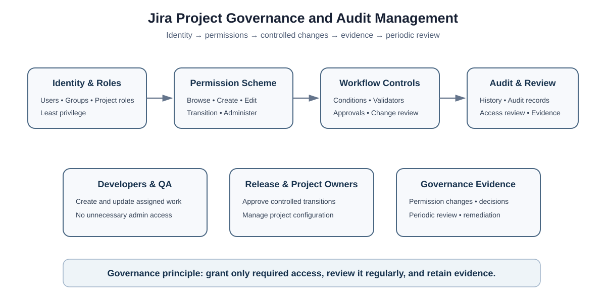

# 20 — Jira Project Governance, Permissions and Audit Management

## 1. Objective

Establish a controlled Jira administration model for the Production DevOps Platform project.

Governance ensures that:

- Users have only the permissions required for their roles.
- Developers cannot perform unauthorized administrative actions.
- Production release approvals are controlled.
- Sensitive issues are visible only to authorized users.
- Workflow changes are reviewed.
- Administrative activities are traceable.
- Access is reviewed periodically.

**Project:** Production DevOps Platform  
**Example Project Key:** PLAT  
**Application:** 21 microservices on AWS EKS

## 2. Governance Architecture



The governance lifecycle:

```text
Identity and User Groups
         |
         v
Project Roles
         |
         v
Permission Schemes
         |
         v
Workflow Restrictions
         |
         v
Audit Records
         |
         v
Periodic Access Review
```

## 3. Understand Jira Governance Components

| Component | Purpose |
|---|---|
| User | Individual Jira account |
| Group | Collection of users |
| Project Role | Project-specific responsibility |
| Permission Scheme | Controls project permissions |
| Issue Security Scheme | Restricts visibility of selected issues |
| Workflow | Controls issue lifecycle |
| Workflow Condition | Restricts who can execute a transition |
| Validator | Enforces required information |
| Audit Log | Records supported administrative or configuration activities |

These components work together. Project roles do not automatically grant permissions unless they are included in the relevant permission scheme or configuration.

## 4. Define Project Roles

Create a role structure for the Production DevOps Platform project.

Recommended roles:

| Project Role | Responsibility |
|---|---|
| Project Administrator | Project configuration and administration |
| Project Manager | Project planning and coordination |
| Product Owner | Backlog and business priorities |
| Scrum Master | Sprint coordination |
| Developer | Application development |
| DevOps Engineer | CI/CD and deployment coordination |
| QA Engineer | Testing and defect validation |
| Security Reviewer | Security review and findings |
| Release Manager | Release planning and coordination |
| Operations Engineer | Production operations and incident coordination |

### Example team mapping

| Team Member | Project Role |
|---|---|
| Team Lead | Project Administrator or designated lead |
| Product Owner | Product Owner |
| Scrum Master | Scrum Master |
| Developer 1 | Developer |
| Developer 2 | Developer |
| DevOps Engineer 1 | DevOps Engineer |
| QA Engineer 1 | QA Engineer |
| Security Engineer | Security Reviewer |
| Release Manager | Release Manager |
| Operations Engineer | Operations Engineer |

Use actual user accounts and group membership from your organization.

## 5. Configure Project Roles

For a typical Jira Cloud company-managed project:

1. Open the Jira project.
2. Navigate to Project settings.
3. Open People or the equivalent project access section.
4. Review available project roles.
5. Add authorized users or groups to the appropriate roles.
6. Verify their project access.
7. Test permissions using representative accounts.

Some project-level roles may be centrally managed by Jira administrators.

**Important:** Do not assign every user the Project Administrator role. Administrative access should be limited to people who actually manage project configuration.

## 6. Understand Permission Schemes

A permission scheme defines what users can do within a Jira project.

Common permissions include:

| Permission | Purpose |
|---|---|
| Browse Projects | View project issues |
| Create Issues | Create new issues |
| Edit Issues | Modify issue fields |
| Assign Issues | Assign work |
| Assignable User | Be selected as an assignee |
| Resolve Issues | Resolve issues |
| Close Issues | Close issues |
| Delete Issues | Delete issues |
| Move Issues | Move issues between projects |
| Link Issues | Create issue relationships |
| Manage Sprints | Manage sprint operations |
| Administer Projects | Administer project configuration |

Exact permissions vary by Jira product and project configuration.

## 7. Recommended Permission Matrix

Use the following as a starting design, not a universal Jira default.

| Permission | Developer | QA | DevOps | Release Manager | Project Admin |
|---|---|---|---|---|---|
| Browse Project | Yes | Yes | Yes | Yes | Yes |
| Create Issues | Yes | Yes | Yes | Yes | Yes |
| Edit Issues | Yes | Yes | Yes | Yes | Yes |
| Assign Issues | As configured | As configured | As configured | Yes | Yes |
| Manage Sprints | No | No | No | As configured | Yes |
| Delete Issues | No | No | No | No | Restricted admin |
| Administer Project | No | No | No | No | Yes |

The organization should decide whether each role needs additional permissions.

### Least privilege

Follow these principles:

- Give users only the access needed for their responsibilities.
- Prefer group- or role-based permission assignments.
- Avoid granting broad administrative access.
- Review access when team members change roles.
- Remove access when users leave the project.
- Test permissions before production use.

## 8. Configure Permission Schemes

Typical Jira Cloud company-managed project steps:

1. Open Jira settings.
2. Navigate to Issues or Work items settings, depending on the interface.
3. Open Permission Schemes.
4. Review the existing scheme.
5. Create a dedicated scheme if required.
6. Configure permissions using project roles and groups.
7. Associate the scheme with the intended project.
8. Test access with representative accounts.

Avoid editing a shared permission scheme without checking all projects that use it.

A permission scheme can affect multiple projects, so changes should be reviewed before applying them.

## 9. Configure Issue Security

Issue security controls who can view individual issues.

This is useful for sensitive work such as:

- Security vulnerabilities.
- Production incidents.
- Confidential customer-impact investigations.
- Access-control investigations.
- Sensitive infrastructure changes.

### Example security levels

| Security Level | Example Access |
|---|---|
| Default Project Access | Users who can browse the project |
| Engineering Restricted | Authorized engineering users |
| Security Restricted | Security team and designated owners |
| Incident Restricted | Authorized incident responders and managers |

These are example labels. Actual access must be configured through an Issue Security Scheme and appropriate user or group membership.

### Example

Create a sensitive issue:

```text
Issue: PLAT-500
Summary: Production security vulnerability investigation
Security Level: Security Restricted
```

Only authorized users should be able to view the issue.

**Important:** Hiding an issue from a dashboard or filter does not secure it. Use Jira's actual issue security controls.

## 10. Configure Workflow Restrictions

Workflow conditions and validators help enforce controlled processes.

Examples:

| Transition | Governance Control |
|---|---|
| To Do → In Progress | Authorized development team |
| In Progress → In Review | Required development information |
| In Review → Testing | Authorized reviewer decision |
| Testing → Done | Required acceptance evidence |
| Release → Approved | Required approver permissions |
| Release → Closed | Required release closure evidence |

### Production release approval

For a production release, define:

```text
Release Request
      |
      v
Under Review
      |
      v
Required Approvals
      |
      v
Approved
      |
      v
Deployment Authorization
```

Approval should be recorded by authorized approvers.

A Jira workflow transition does not automatically enforce a production deployment gate. Integrate it with the deployment system if deployment must be blocked until approval is obtained.

## 11. Manage Project Configuration Changes

Treat important Jira configuration changes as controlled changes.

Examples:

- Adding or removing project roles.
- Updating permission schemes.
- Changing workflow transitions.
- Adding workflow validators.
- Modifying issue security.
- Changing automation rules.
- Changing board filters.
- Updating release approval processes.

### Change management template

```text
Change ID: JIRA-CHANGE-001

Change Title:
Update Production DevOps Jira Permissions

Requested By:
Project Administrator

Reason:
Restrict project administration to authorized users.

Impact:
Project access and administration.

Risk:
Users may lose access if role mapping is incorrect.

Validation:
Test with developer, QA and project administrator accounts.

Approval:
Authorized Jira Administrator

Rollback:
Restore the previous permission scheme configuration.

Evidence:
Configuration screenshots or approved change record.
```

## 12. Jira Audit Logs

Audit logs help administrators investigate configuration and administrative changes.

Depending on Jira product and subscription, available records may include:

- User and group administration.
- Project configuration changes.
- Permission scheme changes.
- Workflow configuration changes.
- Automation rule changes.
- Security-related administration.
- Other supported administrative activities.

Do not assume that every issue edit, comment, deployment or user action appears in the same administrative audit log.

### Where to review audit information

For Jira Cloud, administrators can typically find audit records in Jira administration settings under the relevant audit log area.

Project-level and organization-level audit capabilities may differ.

Review the available audit log scopes and retention settings for your Jira plan.

## 13. Issue History and Change Traceability

Issue history provides a record of supported changes to an individual Jira issue.

Example:

```text
Issue: PLAT-401

Change History:
- Summary updated
- Assignee changed
- Priority changed
- Status moved from To Do to In Progress
- Comment added
- Fix Version updated
```

Use issue history to investigate:

- Who changed an issue?
- When was its status updated?
- Was the assignee changed?
- Were important fields modified?
- Was a release version updated?

For a production incident, link the incident issue to the affected release and deployment evidence.

## 14. Access Review Process

Perform periodic reviews of users and permissions.

Example quarterly review:

| Review Item | Action |
|---|---|
| Project administrators | Confirm each still needs admin access |
| Developer accounts | Verify active team membership |
| QA accounts | Verify testing responsibilities |
| DevOps accounts | Verify deployment-related access |
| External users | Confirm business need and expiry |
| Inactive users | Remove or disable access according to policy |
| Restricted issues | Verify security-level membership |
| Groups | Review group membership |

### Access review procedure

1. Export or review the current user and role assignments.
2. Compare access with the approved team roster.
3. Identify unnecessary permissions.
4. Obtain approval for access changes.
5. Remove or update access.
6. Test the revised access.
7. Record the review date and outcome.
8. Retain evidence according to organizational policy.

## 15. Production Governance Scenario

### Scenario

A developer needs to update production Helm values for the Order Service.

### Controlled process

1. Developer creates a Jira change task.
2. Developer updates the GitOps repository.
3. Developer creates a pull request.
4. Required reviewers inspect the changes.
5. CI checks execute.
6. Release Manager verifies release readiness.
7. Authorized approvers approve the production change.
8. Deployment proceeds through the configured GitOps process.
9. Argo CD reconciles the approved configuration.
10. DevOps validates Kubernetes and application health.
11. Jira is updated with deployment evidence.

### Governance controls

- Developer cannot administer the Jira project.
- Developer cannot bypass required pull request reviews.
- Production approval is limited to authorized approvers.
- Deployment credentials are managed outside Jira.
- Changes are traceable through Jira and Git history.
- Production validation is recorded.

## 16. Governance Risk Register

| Risk | Impact | Mitigation |
|---|---|---|
| Excessive administrator access | Unauthorized changes | Least-privilege access |
| Incorrect permission scheme | Users gain or lose access | Test scheme changes |
| Sensitive issue exposed | Information disclosure | Configure issue security |
| Workflow bypass | Incomplete approvals | Add transition controls |
| Shared scheme modified unexpectedly | Multiple projects affected | Review scheme usage |
| Inactive users retain access | Unauthorized access | Periodic access review |
| Missing change evidence | Poor traceability | Maintain change records |
| Audit retention insufficient | Incomplete investigation history | Review plan and retention settings |

## 17. Governance Checklist

### User and Role Management

- [ ] Project roles are defined.
- [ ] User membership is reviewed.
- [ ] Project administrators are limited.
- [ ] Group assignments are appropriate.
- [ ] External access is reviewed.

### Permissions

- [ ] Permission scheme is reviewed.
- [ ] Developers have appropriate access.
- [ ] QA permissions are appropriate.
- [ ] Release approval access is restricted.
- [ ] Delete and administrative permissions are controlled.

### Security

- [ ] Sensitive issues use issue security where required.
- [ ] Security group membership is reviewed.
- [ ] Production credentials are not stored in Jira issues.
- [ ] Restricted information is not exposed through dashboards.

### Audit and Change Control

- [ ] Workflow changes are documented.
- [ ] Permission changes are documented.
- [ ] Automation changes are reviewed.
- [ ] Audit logs are periodically reviewed.
- [ ] Issue history is used for investigation.
- [ ] Access reviews are recorded.

## 18. Expected Outcome

After completing this chapter, the Production DevOps Platform Jira project has a documented governance model for user access, project roles, permissions, issue security, workflow restrictions and audit reviews.

This provides a foundation for managing a shared Jira project across development, DevOps, QA, security and production operations teams.

## 19. Next Chapter

**21 — Jira Advanced Automation and Integrations**

The next chapter will cover advanced automation patterns, cross-project workflows, GitHub integration, CI/CD evidence, release notifications and integration governance.