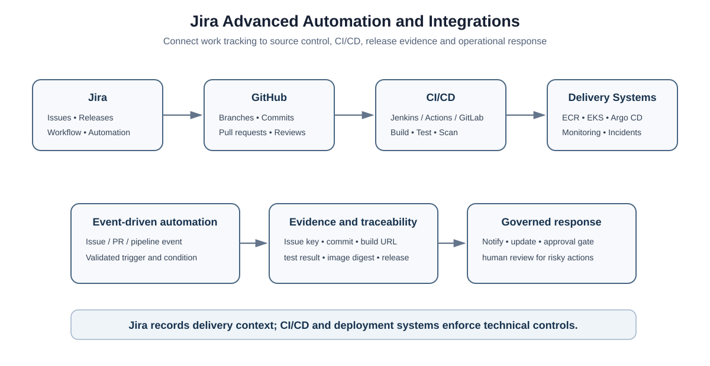

# 21 — Jira Advanced Automation and Integrations

## 1. Objective

Implement advanced Jira automation and integrations for a production DevOps environment.

The integration should help teams:

- Connect Jira issues with GitHub branches and pull requests.
- Track commits and code reviews.
- Link CI/CD pipeline execution to Jira issues.
- Notify teams about build and deployment failures.
- Track release progress.
- Maintain delivery evidence.
- Coordinate development and production operations.

**Project:** Production DevOps Platform  
**Jira Project Key:** PLAT (example)  
**Application:** 21 microservices  
**Cloud:** AWS  
**Container Platform:** EKS  
**CI/CD:** Jenkins, GitHub Actions and GitLab CI/CD  
**GitOps:** Argo CD

## 2. Integration Architecture



### Integration flow

```text
Jira
  |
  v
GitHub
  |
  v
CI/CD Pipeline
  |
  v
SonarQube + Trivy
  |
  v
Docker Build
  |
  v
Amazon ECR
  |
  v
GitOps Repository
  |
  v
Argo CD
  |
  v
AWS EKS
  |
  v
Production Validation
  |
  v
Jira Release Record
```

Jira tracks the delivery process. The CI/CD and deployment systems execute the actual technical operations.

## 3. Jira and GitHub Integration

### Objective

Connect Jira with GitHub so developers can associate source code changes with Jira issues.

### Integration setup

For Jira Cloud, one common approach is the supported GitHub for Jira integration.

Typical steps:

1. Open Jira administration.
2. Find the connected apps or integrations area.
3. Select the GitHub integration.
4. Install or authorize the supported GitHub app.
5. Select the GitHub organization.
6. Grant the required repository permissions.
7. Complete the connection.
8. Verify that development activity appears on Jira issues.

The exact setup depends on your Jira deployment, GitHub organization policies and current integration options.

### Example branch naming

```bash
git checkout -b feature/PLAT-401-create-order-api
```

### Example commit

```bash
git add .
git commit -m "PLAT-401: implement create order API"
git push origin feature/PLAT-401-create-order-api
```

### Example pull request title

```text
PLAT-401: Implement Create Order API
```

When the integration recognizes the Jira issue key, it can associate development activity with the corresponding Jira issue.

### Expected result

The Jira issue can display supported development information such as:

- Branches
- Commits
- Pull requests
- Pull request status

Do not assume every status transition is automatic. Configure Jira automation or workflow integration separately when required.

## 4. Jira and Jenkins Integration

### Objective

Connect Jenkins build activity with Jira issue tracking.

### Integration approach

Depending on the Jenkins and Jira versions, use a supported integration, plugin or API-based workflow.

Typical implementation:

1. Identify the Jenkins controller.
2. Review available Jira integration plugins.
3. Verify plugin compatibility and security.
4. Configure Jira connectivity.
5. Configure authentication securely.
6. Map Jenkins jobs to repositories and Jira projects.
7. Test with a non-production job.
8. Verify the resulting Jira development or build information.

### Example Jenkins pipeline

```groovy
pipeline {
    agent any

    stages {
        stage('Checkout') {
            steps {
                checkout scm
            }
        }

        stage('Build') {
            steps {
                sh 'mvn clean package'
            }
        }

        stage('Unit Tests') {
            steps {
                sh 'mvn test'
            }
        }
    }

    post {
        success {
            echo 'Build completed successfully'
        }

        failure {
            echo 'Build failed'
        }
    }
}
```

This is a minimal pipeline example. Jira updates require a configured integration or explicit API call.

### Expected result

The team can trace a Jira story to its related Jenkins build where the integration supports it.

## 5. Jira and GitHub Actions Integration

### Objective

Connect GitHub Actions workflow execution with Jira issue tracking.

### Example workflow

```yaml
name: order-service-ci

on:
  pull_request:
    branches:
      - main
  push:
    branches:
      - main

jobs:
  build:
    runs-on: ubuntu-latest

    steps:
      - name: Checkout
        uses: actions/checkout@v4

      - name: Set up Java
        uses: actions/setup-java@v4
        with:
          distribution: temurin
          java-version: '17'

      - name: Build
        run: mvn clean package

      - name: Test
        run: mvn test
```

### Jira integration options

- Use the GitHub for Jira integration for source-control development activity.
- Use a supported Jira integration or marketplace application for build information.
- Use Jira REST APIs for explicitly configured custom updates.
- Use webhooks or an integration service to process pipeline events.

A successful GitHub Actions run does not automatically update every Jira issue. The connection and mapping must be configured.

## 6. Jira and GitLab CI/CD Integration

### Objective

Connect GitLab development and pipeline activity with Jira.

### Example GitLab pipeline

```yaml
stages:
  - build
  - test

build:
  stage: build
  image: maven:3.9-eclipse-temurin-17
  script:
    - mvn clean package

test:
  stage: test
  image: maven:3.9-eclipse-temurin-17
  script:
    - mvn test
```

### Integration steps

1. Review the Jira and GitLab integration options.
2. Configure the GitLab project connection.
3. Configure required authentication.
4. Include Jira issue keys in branch names and commit messages.
5. Verify supported development activity.
6. Configure pipeline event updates if required.
7. Test access permissions and integration behavior.

Example branch:

```bash
git checkout -b feature/PLAT-401-order-api
```

Example commit:

```bash
git commit -m "PLAT-401: add order API validation"
```

## 7. Advanced Automation — Notify When CI Fails

### Business requirement

When a CI pipeline fails, the development team should be notified.

### Suggested event flow

```text
CI Pipeline Failure
       |
       v
Webhook / Integration
       |
       v
Identify Jira Issue
       |
       v
Validate Project and Issue
       |
       v
Notify Assignee
       |
       v
Record Build Evidence
```

### Implementation considerations

The integration needs to:

- Receive the pipeline failure event.
- Identify the associated Jira issue.
- Validate the issue key.
- Confirm that the issue belongs to the intended project.
- Record the build URL and failure information.
- Notify the appropriate team.

A custom integration service may use Jira REST APIs to add a comment or update an issue.

### Example Jira comment

```text
CI pipeline failed.

Issue: PLAT-401
Repository: order-service
Branch: feature/PLAT-401-create-order-api
Pipeline: <pipeline-url>
Result: Failed

Please review the build logs and investigate.
```

Do not automatically move a story to a new status solely because a pipeline failed unless the team has explicitly designed and tested that workflow.

## 8. Advanced Automation — Notify When Pull Request Is Merged

### Business requirement

Notify the relevant team when a pull request is merged.

### Event flow

```text
Pull Request Merged
       |
       v
GitHub Event
       |
       v
Jira Issue Key Identified
       |
       v
Integration Validates Event
       |
       v
Jira Development Activity Updated
       |
       v
Optional Team Notification
```

Use the supported GitHub for Jira integration where possible. For custom behavior, use a webhook or integration service.

Example notification:

```text
Pull request merged.

Jira Issue: PLAT-401
Repository: order-service
Pull Request: <pull-request-url>
Merged By: <user>
Commit: <commit-sha>
```

## 9. Jira and SonarQube Integration

### Objective

Make code-quality evidence accessible during development and release review.

### Pipeline flow

```text
Code Push
    |
    v
CI Pipeline
    |
    v
SonarQube Analysis
    |
    v
Quality Gate Evaluation
    |
    v
Build Decision
```

### Example Maven command

```bash
mvn clean verify sonar:sonar \
  -Dsonar.projectKey=order-service \
  -Dsonar.host.url="$SONAR_HOST_URL" \
  -Dsonar.token="$SONAR_TOKEN"
```

The token should be stored in an approved secret store or CI secret configuration, not committed to Git.

### Jira evidence

Record or link:

- SonarQube project.
- Analysis URL.
- Quality gate result.
- Scan timestamp.
- Relevant issue or release.

Jira does not automatically enforce a SonarQube quality gate unless the CI/CD pipeline or another deployment control enforces it.

## 10. Jira and Trivy Integration

### Objective

Track container image security scan evidence.

Example:

```bash
trivy image \
  --severity HIGH,CRITICAL \
  --exit-code 1 \
  "$IMAGE"
```

### Integration flow

```text
Docker Image Build
       |
       v
Trivy Scan
       |
       v
Scan Result
       |
       v
Pipeline Decision
       |
       v
Jira Evidence / Notification
```

### Evidence to record

- Repository name.
- Image tag.
- Image digest.
- Scan timestamp.
- Scan result.
- Relevant findings.
- Remediation Jira issue, if required.

Use an approved vulnerability policy. Do not treat every scanner finding as automatically exploitable or every finding as automatically acceptable.

## 11. Jira and Amazon ECR Integration

### Objective

Track the image artifact that is intended for release.

Example ECR image reference:

```text
<account-id>.dkr.ecr.<region>.amazonaws.com/order-service:<tag>
```

Prefer recording the immutable image digest as release evidence.

Example:

```text
Image:
order-service

Tag:
1.0.0

Digest:
sha256:<image-digest>
```

### Jira release evidence

Record:

- ECR repository.
- Image tag.
- Image digest.
- Build pipeline URL.
- Security scan result.
- Release version.

Do not put AWS access keys or other credentials in Jira issues.

## 12. Jira and Argo CD Integration

### Objective

Connect release tracking with GitOps deployment evidence.

### Deployment flow

```text
Jira Release Approved
        |
        v
GitOps Pull Request
        |
        v
Configuration Review
        |
        v
Merge Approved Change
        |
        v
Argo CD Reconciliation
        |
        v
EKS Deployment
        |
        v
Production Validation
```

### Example Argo CD command

```bash
argocd app get order-service
```

### Kubernetes validation

```bash
kubectl get pods -n production
kubectl rollout status deployment/order-service -n production
```

### Jira deployment evidence

Record:

- GitOps pull request.
- Git commit SHA.
- Argo CD application.
- Deployment timestamp.
- Image digest.
- Deployment result.
- Smoke-test result.

Jira approval and Argo CD synchronization are separate operations unless an explicit integration enforces the connection.

## 13. Cross-Project Automation

Some organizations use multiple Jira projects.

Example:

```text
PLAT — Platform Engineering
APP — Application Development
SEC — Security Engineering
OPS — Operations
```

A cross-project workflow may be needed when a development issue depends on infrastructure or security work.

Example:

```text
APP-401
Create Order API
       |
       | depends on
       v
PLAT-120
Create EKS Deployment Configuration
```

### Automation use cases

- Notify the platform team when an infrastructure request is created.
- Notify security when a critical vulnerability issue is raised.
- Notify application developers when a platform dependency is completed.
- Link incidents to affected release issues.

Cross-project rules require appropriate project permissions and careful scope configuration.

## 14. Integration Security

Treat integration credentials as production credentials.

Recommended controls:

1. Use supported OAuth or application-based authentication where available.
2. Use dedicated integration identities when appropriate.
3. Grant only required repository and Jira permissions.
4. Store tokens in approved secret management systems.
5. Rotate credentials according to policy.
6. Review installed applications and their permissions.
7. Avoid sharing personal access tokens between users.
8. Review webhook endpoints and authentication.
9. Validate incoming events.
10. Log integration failures without exposing secrets.

For custom API integrations, protect against unauthorized requests, duplicate events and incorrect issue updates.

## 15. Duplicate Event Handling

Webhooks may be delivered more than once.

Example:

```text
GitHub Event
     |
     v
Integration Service
     |
     v
Event Received
     |
     v
Check Event Identifier
     |
     +---- Already processed? ---- Yes → Ignore duplicate
     |
     No
     |
     v
Process Jira Update
     |
     v
Record Result
```

For reliable custom integrations:

- Use event identifiers where provided.
- Make processing idempotent.
- Retry transient failures safely.
- Avoid repeated comments.
- Record processing results.
- Handle API rate limits.
- Do not blindly retry invalid requests.

## 16. Integration Monitoring

Monitor the integration itself, not only the application.

| Area | What to Monitor |
|---|---|
| Jira API | Authentication and API errors |
| GitHub | Webhook delivery failures |
| Jenkins | Job execution failures |
| GitHub Actions | Workflow failures |
| GitLab | Pipeline failures |
| SonarQube | Analysis and quality gate |
| Trivy | Scan execution and findings |
| ECR | Artifact availability |
| Argo CD | Sync and health status |
| Integration Service | Failed events and retries |

Create Jira issues for integration failures when appropriate, but use operational alerts for time-sensitive production incidents.

## 17. Integration Validation Checklist

- [ ] Jira and GitHub connection is working.
- [ ] Branches link to the correct Jira issues.
- [ ] Commits link to the correct Jira issues.
- [ ] Pull requests are visible where supported.
- [ ] Jenkins integration is tested.
- [ ] GitHub Actions integration is tested.
- [ ] GitLab integration is tested if used.
- [ ] SonarQube evidence is available.
- [ ] Trivy evidence is available.
- [ ] ECR image references are traceable.
- [ ] Argo CD deployment evidence is recorded.
- [ ] Cross-project rules are tested.
- [ ] Integration credentials are secured.
- [ ] Duplicate events are handled.
- [ ] Failed integrations are monitored.

## 18. Expected Outcome

After completing this chapter, the Jira project has a documented integration design that connects development activity, CI/CD execution, code quality, container security and GitOps deployment evidence.

The goal is end-to-end traceability without confusing Jira's tracking responsibilities with the technical controls enforced by CI/CD and Kubernetes.

## 19. Next Chapter

**22 — Jira Service Management and Incident Management**

The next chapter will cover incident intake, service requests, incident priorities, escalation, major incident handling, communication and post-incident reviews.