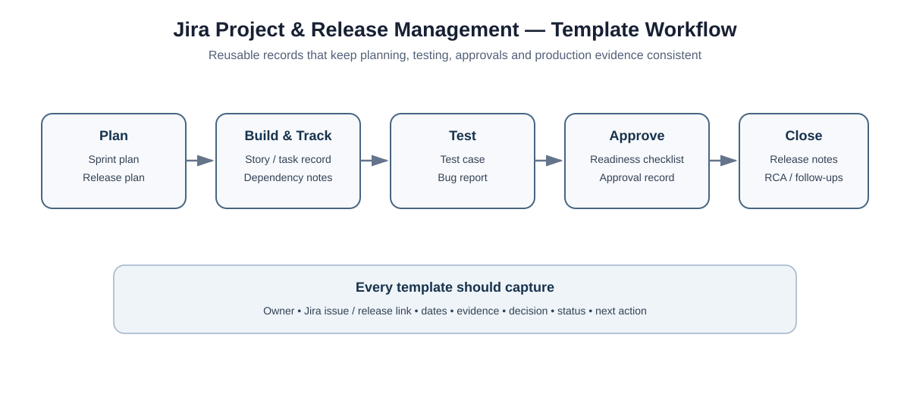

# 14 — Jira Project & Release Management Templates

## 1. Objective

This document provides reusable templates for managing the complete software delivery lifecycle through Jira.

The templates help teams maintain consistent information across:

- Sprint planning
- Backlog refinement
- Development tracking
- QA and UAT
- Release planning
- Release approvals
- Production deployment
- Release validation
- Rollback
- Incident management
- Release closure

**Project:** Production DevOps Platform  
**Example Jira Project Key:** `PLAT`  
**Application:** 21-microservice application running on AWS EKS

## 2. Template Workflow



## 3. Sprint Planning Template

**Suggested filename:** `sprint-planning-template.md`

### Sprint Information

| Field | Details |
|---|---|
| Project | Production DevOps Platform |
| Sprint Name | Sprint 01 |
| Sprint Duration | 2 weeks |
| Sprint Start Date | YYYY-MM-DD |
| Sprint End Date | YYYY-MM-DD |
| Scrum Master | Name |
| Product Owner | Name |
| Development Team | Team name |

### Sprint Goal

Describe the main outcome expected from this sprint.

**Example:** Complete the Order Service API development and deploy it to the development environment.

### Sprint Backlog

| Jira Issue | Summary | Type | Owner | Story Points | Priority |
|---|---|---|---|---:|---|
| PLAT-101 | Create Order API | Story | Developer 1 | 5 | High |
| PLAT-102 | Add Order Validation | Story | Developer 2 | 3 | High |
| PLAT-103 | Create Dockerfile | Task | DevOps 1 | 2 | Medium |
| PLAT-104 | Deploy Order Service to Dev | Task | DevOps 2 | 3 | High |

### Dependencies

| Dependency | Required From | Impact | Action |
|---|---|---|---|
| Database connectivity | Database team | API development blocked | Confirm access |
| ECR repository | DevOps team | Image publishing blocked | Create repository |
| API contract | Architecture team | Integration testing blocked | Finalize contract |

### Sprint Risks

| Risk | Impact | Mitigation | Owner |
|---|---|---|---|
| API contract changes | High | Review contract before development | Tech Lead |
| Build pipeline failure | Medium | Validate pipeline early | DevOps Engineer |

### Sprint Completion Criteria

- All committed stories meet their acceptance criteria.
- Code review is completed.
- Required automated tests pass.
- CI security and quality checks pass where configured.
- Documentation is updated.
- Incomplete work is returned to the backlog or replanned.

---

## 4. Release Planning Template

**Suggested filename:** `release-plan-template.md`

### Release Information

| Field | Details |
|---|---|
| Project | Production DevOps Platform |
| Release Name | Release 1.0 |
| Jira Version | 1.0 |
| Release Owner | Release Manager |
| Planned Release Date | YYYY-MM-DD |
| Target Environment | Production |
| Release Type | Major / Minor / Patch |
| Status | Planning |

### Release Objective

Describe what this release delivers and why it is required.

**Example:** Deploy the Order Service enhancements and associated infrastructure changes to production.

### Release Scope

| Jira Issue | Component | Description | Priority |
|---|---|---|---|
| PLAT-101 | Order Service | Create Order API | High |
| PLAT-102 | Order Service | Add order validation | High |
| PLAT-103 | Platform | Update deployment configuration | Medium |

### Deployment Plan

| Step | Activity | Owner | Expected Result |
|---|---|---|---|
| 1 | Validate release scope | Release Manager | Scope confirmed |
| 2 | Complete QA testing | QA Engineer | Tests passed |
| 3 | Complete security checks | DevSecOps Engineer | No blocking findings |
| 4 | Obtain production approval | Approver | Approval recorded |
| 5 | Deploy through GitOps | DevOps Engineer | New version deployed |
| 6 | Perform smoke tests | QA / DevOps | Application healthy |
| 7 | Monitor production | Operations Team | No critical regression |

### Release Dependencies

| Dependency | Description | Owner | Status |
|---|---|---|---|
| Database migration | Required schema changes | Database Team | Pending |
| Container image | Approved image in ECR | DevOps Team | Pending |
| Helm configuration | Production values validated | DevOps Team | Pending |

### Release Risks

| Risk | Impact | Mitigation |
|---|---|---|
| Deployment failure | Service disruption | Keep previous version available |
| Database incompatibility | Application errors | Use backward-compatible migrations |
| Image vulnerability | Security exposure | Scan and approve image before release |

### Rollback Plan

- Identify the last known good application version.
- Revert the GitOps configuration to the approved version.
- Allow Argo CD to reconcile the desired state.
- Validate Kubernetes workloads and application health.
- Check database compatibility separately.
- Record the rollback decision and evidence in Jira.

---

## 5. Test Case Template

**Suggested filename:** `test-case-template.md`

### Test Case Information

| Field | Details |
|---|---|
| Test Case ID | TC-ORDER-001 |
| Jira Story | PLAT-101 |
| Service | Order Service |
| Test Type | Functional / Integration / Regression |
| Environment | QA |
| Tester | Name |
| Execution Date | YYYY-MM-DD |

### Test Scenario

**Scenario:** Verify that a user can create an order successfully.

### Preconditions

- Order Service is running.
- Database connectivity is available.
- Required test user exists.
- API endpoint is accessible.

### Test Steps

| Step | Action | Expected Result |
|---|---|---|
| 1 | Send a valid create-order request | Request is accepted |
| 2 | Validate HTTP response | Expected success response |
| 3 | Check order identifier | Unique order ID is returned |
| 4 | Verify database record | Order is persisted |
| 5 | Retrieve the order | Correct order details are returned |

### Test Execution Result

| Field | Value |
|---|---|
| Actual Result | Enter observed result |
| Status | Pass / Fail / Blocked |
| Evidence | Attach logs, screenshots or test output |
| Defect Jira Issue | Link bug if failed |
| Comments | Additional observations |

### Exit Criteria

- All critical test cases pass.
- Blocking defects are resolved.
- Regression testing is completed.
- Test evidence is attached or linked.

---

## 6. Bug Report Template

**Suggested filename:** `bug-report-template.md`

### Bug Information

| Field | Details |
|---|---|
| Summary | Order API returns HTTP 500 |
| Jira Issue Type | Bug |
| Affected Service | Order Service |
| Environment | QA / Staging / Production |
| Priority | Critical / High / Medium / Low |
| Severity | Based on team severity definitions |
| Reporter | Name |
| Assignee | Name |
| Affected Version | Version number |

### Description

Explain what happened and why it is a problem.

### Steps to Reproduce

1. Access the Order Service API.
2. Submit a valid order request.
3. Observe the response.
4. Review the application logs.

### Expected Result

The API should create the order and return the expected successful response.

### Actual Result

The API returns HTTP 500.

### Technical Evidence

```text
Service: order-service
Environment: QA
HTTP Status: 500
Timestamp: YYYY-MM-DD HH:MM:SS
Request ID: <request-id>
Pod: <pod-name>
```

### Investigation Details

- Application logs reviewed: Yes / No
- Kubernetes pod status checked: Yes / No
- Database connectivity checked: Yes / No
- Recent deployment reviewed: Yes / No
- Root cause: Pending investigation

### Resolution

Document the code/configuration change and the validation performed.

### Retest Result

| Field | Value |
|---|---|
| Retested By | Name |
| Retest Date | YYYY-MM-DD |
| Result | Pass / Fail |
| Evidence | Link or attachment |

---

## 7. Release Readiness and Approval Template

**Suggested filename:** `release-approval-template.md`

### Approval Information

| Field | Details |
|---|---|
| Release | Release 1.0 |
| Jira Version | 1.0 |
| Approval Issue | PLAT-APPROVAL-001 |
| Requested By | Release Manager |
| Approval Date | YYYY-MM-DD |
| Target Environment | Production |

### Readiness Checklist

| Check | Status | Evidence |
|---|---|---|
| Release scope finalized | Yes / No | Jira release scope |
| Code review completed | Yes / No | Pull request |
| CI pipeline successful | Yes / No | Pipeline run |
| SonarQube quality gate passed | Yes / No / N/A | Scan result |
| Trivy image scan reviewed | Yes / No / N/A | Scan result |
| QA testing completed | Yes / No | Test execution |
| UAT sign-off received | Yes / No / N/A | Sign-off record |
| Production configuration reviewed | Yes / No | Configuration PR |
| Rollback plan documented | Yes / No | Rollback procedure |
| Monitoring checks prepared | Yes / No | Dashboard and alerts |
| Database changes reviewed | Yes / No / N/A | Migration plan |

### Risk Assessment

| Risk | Probability | Impact | Mitigation |
|---|---|---|---|
| Application startup failure | Medium | High | Validate health checks |
| Database migration failure | Low | Critical | Backup and migration validation |
| Increased error rate | Medium | High | Monitor and prepare rollback |

### Approval Decision

| Role | Name | Decision | Date | Comments |
|---|---|---|---|---|
| Engineering Lead | Name | Approved / Rejected | Date | Comments |
| QA Lead | Name | Approved / Rejected | Date | Comments |
| Security Reviewer | Name | Approved / Rejected | Date | Comments |
| Operations Lead | Name | Approved / Rejected | Date | Comments |
| Release Manager | Name | Approved / Rejected | Date | Comments |

**Important:** Record approval in Jira and configure the actual deployment gate separately. A Jira approval record does not automatically block or permit GitHub Actions or Argo CD deployments unless an integration or control enforces it.

---

## 8. Production Deployment Checklist

**Suggested filename:** `production-deployment-checklist.md`

### Before Deployment

- [ ] Confirm approved release version.
- [ ] Confirm production deployment window.
- [ ] Verify EKS cluster access.
- [ ] Verify target namespace.
- [ ] Confirm approved container image tag and digest.
- [ ] Confirm Helm values and GitOps changes.
- [ ] Confirm database migration requirements.
- [ ] Confirm secrets are available through the approved secrets mechanism.
- [ ] Confirm rollback version.
- [ ] Confirm monitoring dashboards and alerts.

### During Deployment

- [ ] Merge approved GitOps change.
- [ ] Verify Argo CD application status.
- [ ] Verify Kubernetes rollout.
- [ ] Check pod readiness and restarts.
- [ ] Check service endpoints.
- [ ] Check ingress and load balancer health.
- [ ] Review application logs.

### After Deployment

- [ ] Run smoke tests.
- [ ] Validate critical API endpoints.
- [ ] Validate service-to-service communication.
- [ ] Verify database connectivity.
- [ ] Review Prometheus metrics and Grafana dashboards.
- [ ] Review application logs in the ELK stack.
- [ ] Confirm Alertmanager has no unexpected critical alerts.
- [ ] Update Jira deployment record.
- [ ] Notify stakeholders.

---

## 9. Release Notes Template

**Suggested filename:** `release-notes-template.md`

# Release Notes — Version 1.0

**Release Date:** YYYY-MM-DD  
**Environment:** Production  
**Release Owner:** Name

## Overview

Briefly describe the purpose and scope of this release.

## New Features

- Feature 1
- Feature 2

## Improvements

- Improvement 1
- Improvement 2

## Bug Fixes

- Bug fix 1 — Jira issue reference
- Bug fix 2 — Jira issue reference

## Infrastructure Changes

- Kubernetes deployment configuration changes
- Helm chart changes
- Terraform changes, if applicable
- CI/CD pipeline changes

## Security Updates

- Dependency updates
- Container image scan results
- Security findings addressed

## Known Issues

List known limitations or unresolved defects. Do not hide unresolved production risks.

## Deployment Information

| Field | Value |
|---|---|
| Image Version | Version / digest |
| Helm Chart Version | Version |
| Git Commit | Commit SHA |
| Argo CD Application | Application name |
| Jira Version | Release version |

## Rollback Information

Document the previous known good version and the approved rollback procedure.

---

## 10. Incident RCA Template

**Suggested filename:** `incident-rca-template.md`

# Incident Root Cause Analysis

### Incident Information

| Field | Details |
|---|---|
| Incident ID | INC-001 |
| Related Jira Release | Release 1.0 |
| Affected Service | Order Service |
| Environment | Production |
| Severity | SEV-1 / SEV-2 / SEV-3 |
| Start Time | YYYY-MM-DD HH:MM |
| End Time | YYYY-MM-DD HH:MM |
| Incident Owner | Name |

### 1. Incident Summary

Describe what happened, the affected service and the customer impact.

### 2. Business Impact

- Users affected:
- Requests affected:
- Duration:
- Business impact:

### 3. Detection

Explain how the incident was detected.

Examples:

- Prometheus alert
- Grafana dashboard
- Application log
- Customer report
- Synthetic health check

### 4. Timeline

| Time | Event |
|---|---|
| 10:00 | Deployment started |
| 10:05 | Error rate increased |
| 10:07 | Alert triggered |
| 10:12 | Investigation started |
| 10:20 | Rollback initiated |
| 10:30 | Service recovered |

### 5. Root Cause

Explain the technical cause using verified evidence. Do not assume that the most recent deployment caused the incident without investigation.

### 6. Resolution

Describe the actions taken to restore service.

### 7. Corrective Actions

| Action | Owner | Priority | Due Date | Jira Issue |
|---|---|---|---|---|
| Add missing readiness validation | DevOps | High | Date | PLAT-XXX |
| Add regression test | Developer | Medium | Date | PLAT-XXX |
| Improve alert threshold | Operations | Medium | Date | PLAT-XXX |

### 8. Lessons Learned

- What worked well?
- What did not work?
- What could have detected the issue earlier?
- What should be automated?

---

## 11. Template Usage Guidelines

1. Use the sprint template during sprint planning.
2. Use the release plan template before a release enters execution.
3. Link test cases and bugs to the relevant Jira stories.
4. Use the approval template before production deployment.
5. Use the deployment checklist during the release window.
6. Publish release notes after validating the actual release contents.
7. Create an RCA when an incident requires formal investigation.
8. Link all supporting evidence to the relevant Jira issue or release.

## 12. Recommended Folder Structure

```text
jira-project-release-management/
├── templates/
│   ├── README.md
│   ├── sprint-planning-template.md
│   ├── release-plan-template.md
│   ├── test-case-template.md
│   ├── bug-report-template.md
│   ├── release-approval-template.md
│   ├── production-deployment-checklist.md
│   ├── release-notes-template.md
│   └── incident-rca-template.md
└── diagrams/
    └── jira-templates-workflow.svg
```

## 13. Expected Outcome

After adopting these templates, the team has a consistent way to plan sprints, manage defects, validate releases, record approvals, deploy to production and document incidents.

The templates are starting points. Adapt fields, approval roles, statuses and evidence requirements to the actual Jira configuration and organizational policies.